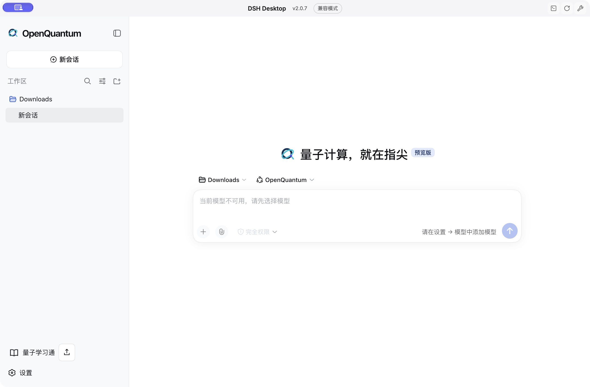
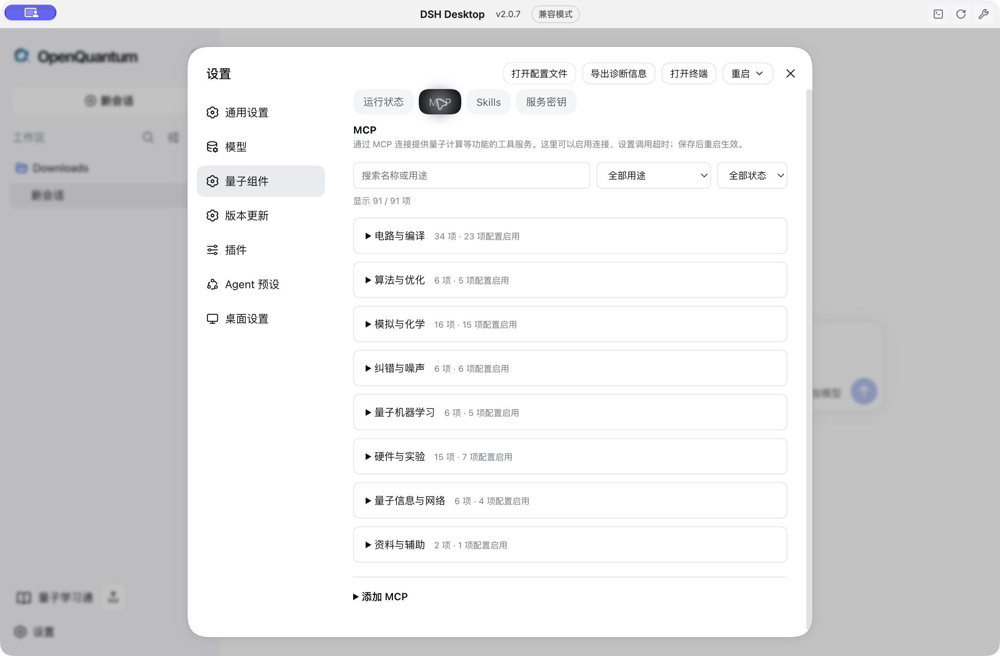
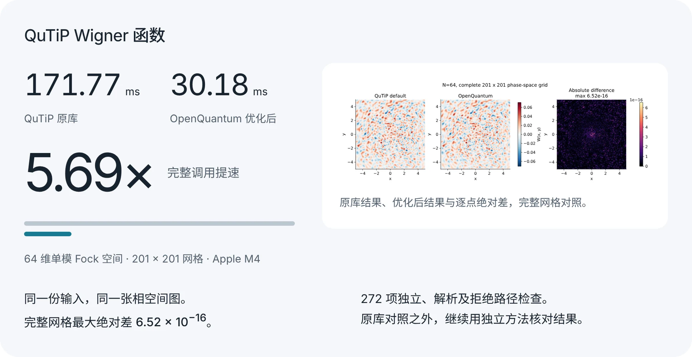
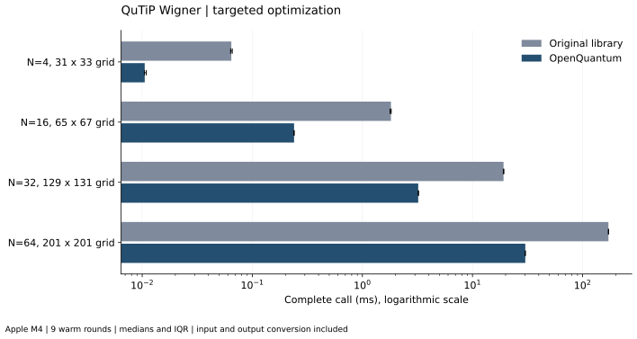
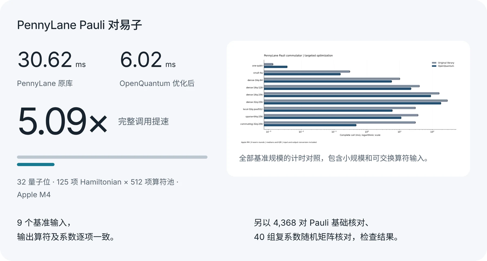

<p align="center">
  <a href="https://xi-zhao.github.io/OpenQuantum/"></a>
</p>

<p align="center"><a href="./README.md">简体中文</a> · <a href="./docs/readme/README.en.md">English</a> · <a href="./docs/readme/README.ja.md">日本語</a> · <a href="./docs/readme/README.ko.md">한국어</a> · <a href="./docs/readme/README.es.md">Español</a> · <a href="./docs/readme/README.fr.md">Français</a> · <a href="./docs/readme/README.de.md">Deutsch</a> · <a href="./docs/readme/README.pt.md">Português</a> · <a href="./docs/readme/README.ru.md">Русский</a> · <a href="./docs/readme/README.ar.md">العربية</a></p>

<p align="center">
  <a href="#科研能力">科研能力</a>　·　<a href="#优化实测">优化实测</a>　·　<a href="#开放共建">开放共建</a>　·　<a href="https://xi-zhao.github.io/OpenQuantum/">官网</a>　·　<a href="#开始使用"><strong>开始使用 ↗</strong></a>
</p>

<p align="center">
  <strong>186</strong> 个内置 Skill　　<strong>91</strong> 个 MCP 服务连接　　<strong>114</strong> 个 SDK 环境　　开源 · MIT 许可
</p>

<p align="center">
  <a href="https://github.com/xi-zhao/openQuantum/actions/workflows/ci.yml"></a>
  <a href="https://github.com/xi-zhao/OpenQuantum/releases/tag/v0.8.10"></a>
  <a href="./THIRD_PARTY_NOTICES.md"></a>
  
</p>

<br />

<a id="科研能力"></a>
<a id="可以用它做什么"></a>
<a id="openquantum-的核心能力"></a>
<a id="能力接口目录"></a>

## 让研究思路，有路可走

从一个问题、一篇论文或一段程序出发，让 AI 选择方法、执行计算、核对结果，把一次探索留给下一次研究。

**广阔的专业世界，一个共同的起点。** 社区提供专业软件、算法与研究方法；OpenQuantum 持续筛选、适配、整合与优化，连接到 AI 科研工作流。

| 量子算法与线路 | 量子系统与多体 | 纠错与误差抑制 |
| --- | --- | --- |
| [Qiskit](https://github.com/Qiskit/qiskit) | [QuTiP](https://github.com/qutip/qutip) | [Stim](https://github.com/quantumlib/Stim) |
| [PennyLane](https://github.com/PennyLaneAI/pennylane) | [TeNPy](https://github.com/tenpy/tenpy) | [PyMatching](https://github.com/oscarhiggott/PyMatching) |
| [PyZX](https://github.com/zxcalc/pyzx) | [OpenFermion](https://github.com/quantumlib/OpenFermion) | [Mitiq](https://github.com/unitaryfoundation/mitiq) |
| [Graphix](https://github.com/TeamGraphix/graphix) | [Dynamiqs](https://github.com/dynamiqs/dynamiqs) | [MQT QECC](https://github.com/munich-quantum-toolkit/qecc) |

### 完整能力目录

按研究任务选择能力，直接使用现成的计算入口，或通过 SDK 工作台编写自己的研究程序。

| 研究任务 | 代表能力与入口 | 需要核对的边界 |
| --- | --- | --- |
| <a id="算法学习与方法比较"></a>学习算法、比较方法 | [49 项可执行示例](examples/quantum-algorithms/README.md)：QFT、HHL、VQE、QAOA、QSP、态制备等 | 默认输入用于教学；实际误差、收敛和方法适用条件逐项检查 |
| 电路编译、仿真与信息分析 | Qiskit、PennyLane、PyZX、Graphix、QCEC、密度矩阵审计；[任务与接口](docs/CAPABILITIES.md#电路与量子信息) | 门集、位序、噪声模型与等价性检查范围 |
| 基态、化学与多体计算 | VQE、SQD、TeNPy、OpenFermion；[方法选择](docs/CAPABILITIES.md#基态化学与优化) | 活性空间、粒子扇区、收敛和独立参考 |
| 误差缓解与量子纠错 | Mitiq、Stim / PyMatching、LDPC、Chromobius；[纠错能力](docs/CAPABILITIES.md#误差缓解与量子纠错) | 采样预算、统计误差及解码器的适用模型 |
| <a id="纠错模型静态诊断"></a>检查 detector error model | [emlint](.agents/skills/emlint-dem-audit/SKILL.md)：结构诊断、反例及不完整检查状态 | 保留告警、跳过项和缺失上下文；不证明码距或解码正确性 |
| 动力学与实验模拟 | Trotter / qDrift、Dynamiqs、OQuPy、Bloqade、Pulser、PairInteraction；[模拟与硬件入口](docs/CAPABILITIES.md#哈密顿量模拟与开放系统) | 单位、截断、时间步长；模拟与真实设备操作分别说明 |
| 光子计算与量子网络 | Perceval、Piquasso、Lightworks、SimQN、NetQASM；[使用范围](docs/CAPABILITIES.md#光子计算与量子网络) | 后端、损耗模型、采样与网络协议 |
| <a id="数学与物理形式化"></a>形式化数学与物理命题 | [Lean 4、mathlib、physlib](.agents/skills/lean-physics/SKILL.md)：复用定理、检查证明与依赖公理 | 证明只覆盖文件中的定义、假设和公理，不证明物理模型真实 |
| 查询方法与公开基准 | [Quantum-Practices 与 Metriq](docs/CAPABILITIES.md#参考资料与选型) | 固定资料和历史记录，不代表当前设备性能 |
| <a id="量子学习通"></a>组织教学材料与课堂 | [量子学习通 / OpenMAIC](docs/integrations/OPENMAIC.md)：材料、课件、测验与课堂 | 完整课程体系仍在建设，真实在线 AI 教学流程尚未完整验收 |

能力可以组合使用：先用 PyZX 优化电路，再用 QCEC 检查等价性，最后用噪声模拟比较含噪表现。跨工具组合需要核对模型、单位、位序和预算，见[计算与资源配置](docs/integrations/SCALABLE_BRIDGES.md)。

当前源码分发 **186 个内置 Skill、91 个 MCP 服务连接、5 个原生量子 Tool**，并为 **114 个 SDK/源码环境**提供原生 API 使用路径。
清单数量、配置启用、环境就绪与科学验收是不同状态；每项能力按需准备，平台、账户和许可限制见对应说明。

[完整 Skill 目录](docs/CAPABILITIES.md#内置-skills) · [MCP 服务及默认开关](docs/CAPABILITIES.md#mcp-服务目录) · [原生 Tool 与副作用](docs/CAPABILITIES.md#原生量子-tools) · [SDK API 与逐库验证](docs/integrations/FULL_SDK_ACCESS.md) · [相近方法怎么选](docs/integrations/CAPABILITY_SELECTION.md)

<br />

<a id="使用与结果"></a>
<a id="执行记录与科学验收"></a>

## 从研究问题，走到计算与结果

让 AI 参与探索，让研究留下依据。

<table>
  <tr>
    <td width="50%" valign="top"><strong>分析问题，选择方法</strong><br />围绕你的任务，调用社区软件、算法与论文方法，让研究想法找到实际的计算路径。</td>
    <td width="50%" valign="top"><strong>执行计算，留下依据</strong><br />保留程序、参数、对照与核对记录，让结果可回看，让下一次研究接着向前。</td>
  </tr>
  <tr>
    <td valign="top"><a href="./docs/images/openquantum-desktop-20261013.jpg"></a><br /><sub>科研工作台 · 2026-10-13 实际界面</sub></td>
    <td valign="top"><a href="./docs/images/openquantum-settings-categories-20261013.jpg"></a><br /><sub>能力分类设置 · 2026-10-13 实际界面</sub></td>
  </tr>
</table>

Skill 说明方法与步骤，Tool 执行具体动作，原生 SDK 也可以通过宿主的代码工具直接使用。日常使用遵循 **发现 → 准备 → 执行**：先查能力和条件，再为所选 SDK 准备依赖与连接，最后执行计算；计算调用本身不会隐式安装科学依赖。

- **看实际执行记录。** 配置启用和模型的文字回复，不能替代 Tool 调用、程序与结果文件。
- **分清检查范围。** 工程 CI、数值参考对照、形式证明和科学验收分别说明；只有支持完整证据链的能力，才能按相应合同给出科学验收结论。
- **保留可复算材料。** 记录输入、单位、随机种子、依赖版本、程序、结果和检查状态，也保留失败与负结果。
- **按需连接外部资源。** 本地数值计算无需量子云账户；真实硬件和付费服务需要另行配置凭据、权限及额度。

科学判断仍由使用者负责。[结果与证据说明](docs/EXAMPLES.md#方法与结果可以继续复用) · [能力与宿主边界](docs/README.md) · [常见问题](docs/TROUBLESHOOTING.md)

<br />

<a id="优化实测"></a>
<a id="实测案例"></a>
<a id="optimization-cases"></a>

## 更快，也经得起核对

把时间还给新的想法。两项针对性优化，保留完整调用计时、独立核对和复跑记录。

<a id="qutip-rust-case"></a>

<p align="center"></p>

<details>
<summary>QuTiP：查看计时与核对条件</summary>

Apple M4，QuTiP 5.3.1；64 维、rank-4 单模密度矩阵，201 × 201 网格。单线程设定，2 次预热，9 轮交错热运行中位数。包含输入读取、转换、检查与完整输出构造；不含准备、编译、输入生成及结果核对。提速仅对应此项固定输入计算。



</details>

[核对与复跑](experiments/qutip-rust-wigner/README.md) · [原始计时](experiments/qutip-rust-wigner/results/summary.json) · 专项基准 · 9 轮热运行中位数 · 含输入转换与输出构造

<a id="pennylane-rust-case"></a>

<p align="center"></p>

<details>
<summary>PennyLane：查看计时与核对条件</summary>

Apple M4，PennyLane 0.45.1；32 量子位、125 项 Hamiltonian 与 512 项局域双体算符池。单线程设定，2 次预热，9 轮热运行中位数。完整调用从 PauliSentence 输入到 PauliSentence 输出，包含双向转换与结果构造，不含准备、编译及核对。5.09 倍仅对应此项输入；其他规模结果见完整报告。

</details>

[核对与复跑](experiments/pennylane-rust-commutator/README.md) · [原始计时](experiments/pennylane-rust-commutator/results/benchmark.json) · 专项基准 · 9 轮热运行中位数 · 含输入转换与输出构造

<sub>两项计时包含输入输出转换，不含环境准备与编译；收益限于各报告定义的任务与条件，不能推广为所有量子计算的加速比。</sub>

<br />

<a id="开始使用"></a>
<a id="快速开始"></a>

## 你的下一个想法，从这里开始

一个 OpenQuantum，两种熟悉的入口。两者复用同一份领域能力，科学计算依赖在用到时按需准备。

<table>
  <tr>
    <td width="50%" valign="top">
      <strong>Codex 插件</strong><br />
      在 Codex 原生对话中使用量子科研能力。<br /><br />
      <a href="#codex-插件"><strong>安装 Codex 插件 ↗</strong></a><br />
      <sub>需要支持插件的 Codex、Node.js 24+ 和 npm</sub>
    </td>
    <td width="50%" valign="top">
      <strong>Desktop</strong><br />
      独立科研工作台，按需配置模型服务。<br /><br />
      <a href="#桌面安装包"><strong>下载 Desktop ↗</strong></a><br />
      <sub>macOS Apple Silicon，自带 Node / uv 与运行依赖</sub>
    </td>
  </tr>
</table>

想使用主线能力或参与开发，可以[从源码运行](#从源码运行)。

<a id="codex-plugin"></a>

### Codex 插件

**让 Codex 帮你安装：** 新建聊天，复制下面的请求：

```text
请帮我安装 OpenQuantum Codex 插件 0.8.10。先阅读安装指南：
https://github.com/xi-zhao/OpenQuantum/blob/codex-v0.8.10/docs/integrations/CODEX_AGENT_INSTALL.md
从 https://github.com/xi-zhao/OpenQuantum/releases/tag/codex-v0.8.10 下载完整安装包与 SHA256SUMS，
核对摘要后，检查 Codex、Node.js 24+ 和 npm，使用包内安装器完成安装。
请保留已有插件和用户配置，核对 Skills、MCP 工具和左侧全局“OpenQuantum 设置”入口。
需要我重载应用时，告诉我具体操作。最后报告实际验证的结果，以及仍需准备的科学计算依赖。
```

安装后按提示重载 Codex，在新聊天中直接提出量子任务；能力和连接在「OpenQuantum 设置」中管理。

[完整安装包与校验摘要](https://github.com/xi-zhao/OpenQuantum/releases/tag/codex-v0.8.10) · [手动安装与故障处理](docs/integrations/CODEX_AGENT_INSTALL.md) · [插件功能与宿主边界](docs/integrations/CODEX_PLUGIN.md)

### 桌面安装包

1. 下载 **[OpenQuantum 0.8.10 DMG](https://github.com/xi-zhao/OpenQuantum/releases/download/v0.8.10/OpenQuantum-0.8.10-macOS-arm64.dmg)**（Mac Apple Silicon），按 [SHA256SUMS](https://github.com/xi-zhao/OpenQuantum/releases/tag/v0.8.10) 核对摘要。
2. 将 `OpenQuantum.app` 拖入「应用程序」。
3. 在「设置 → 模型」中配置模型服务。

安装包采用 ad-hoc 本地签名，尚无 Apple 分发签名或公证；首次打开、升级备份与数据保留见[安装说明](docs/DESKTOP_INSTALLERS.md)。
Intel Mac 与 Windows 暂使用 [0.8.4 能力包](https://github.com/xi-zhao/OpenQuantum/releases/tag/v0.8.4)及其配套说明，或从源码运行。

<a id="安装源码"></a>

### 从源码运行

```bash
git clone https://github.com/xi-zhao/openQuantum.git
cd openQuantum
npm ci
npm run dev
```

打开启动日志中带登录令牌的本机地址，认证后进入工作台。

<a id="配置模型"></a>

**配置模型：** 在「设置 → 模型」添加服务地址、模型名称和 API Key。Agent 执行任务需要模型支持 **Tool Calling**；
模型凭据与量子云凭据分别配置。没有模型密钥也可以先运行[固定本地案例](#无需模型密钥复算基态案例)。

<details>
<summary><strong>其他入口：源码桌面、量子学习通与消息渠道</strong></summary>

| 入口 | 准备 / 启动命令（在源码目录中） | 详细说明 |
| --- | --- | --- |
| 桌面客户端 | `npm run desktop:setup` → `npm run desktop:verify-install` → `npm run desktop -- --source` | [源码构建与运行条件](docs/DEPLOYMENT.md#方式三原生桌面工作台) |
| 量子学习通 | `npm run learning:ui:setup` | [教学应用、启动与数据备份](docs/integrations/OPENMAIC.md) |
| 微信、飞书等消息渠道 | `npm run cc-connect:setup` | [渠道连接与凭据配置](docs/integrations/CC_CONNECT.md) |

源码桌面另需 Corepack 与系统 C++ 构建工具。Web 与源码 Desktop 共用本机 Home，切换入口前先退出正在运行的进程。

</details>

[模型与部署配置](docs/DEPLOYMENT.md) · [按需准备计算环境](docs/integrations/LOCAL_ENVIRONMENTS.md) · [升级与数据保留](docs/UPDATES.md) · [故障排查](docs/TROUBLESHOOTING.md)

### 跑通第一个任务

#### 无需模型密钥：复算基态案例

完成源码的 `npm ci` 后，运行固定的二量子位 VQE 案例，并与独立参考比较：

```bash
npm run demo:quantum-ground-state
```

该命令给出本地计算及逐项检查；完整科学验收还需要会话来源和可重读的验收报告。见[输入、历史结果与验证边界](docs/EXAMPLES.md#不需要模型密钥复算一个固定案例)。

#### 让 Agent 执行：Bell 态采样

先准备 FatQat 的固定环境（需要 uv），再在已配置模型的工作台中发起任务：

```bash
node scripts/setup-paper-tools.mjs fatqat-workbench
```

> 用 FatQat 从双量子位全零态出发，对 q0 施加 H，再以 q0 为控制位、q1 为目标位施加 CX。返回无噪声精确概率，并用 1024 次采样、seed=7 比较频数。

理想概率是 `00`、`11` 各 50%，有限采样会有波动。查看实际的 Tool 调用、输入和输出，再调整参数比较结果。

[更多可复制的任务](docs/EXAMPLES.md) · [直接运行 HHL 等算法示例](docs/EXAMPLES.md#直接运行开源算法示例)

<br />

<a id="开放共建"></a>
<a id="开发与贡献"></a>

## 让专业积累，成为共同的能力

优秀的软件、算法与研究方法，来自开放的科研社区。OpenQuantum 将这些成果连接起来，持续适配、优化与核对，让更多研究者能够直接用起来。

欢迎把你的研究问题、工具、论文方法或复现实验带进来，一起建设研究者用得上、能检验、愿意信赖的量子科研智能。

**[参与共建 ↗](CONTRIBUTING.md)**　·　[提出研究问题](https://github.com/xi-zhao/OpenQuantum/issues)

| 你想贡献什么 | 从哪里开始 |
| --- | --- |
| 领域方法、操作步骤或工具选择 | 编写 Skill；见[贡献指南](CONTRIBUTING.md)与[现有 Skill](.agents/skills/README.md) |
| 计算、查询或设备动作 | 按边界选择原生 Tool Provider 或 MCP Server；见[扩展模型](docs/architecture/EXTENSION_MODEL.md) |
| 科学检查与验收 | 使用 Validator、科学合同与相应证据链；见[四条贡献路径](docs/README.md#四条贡献路径) |
| 应用、课程或可复算案例 | 说明用户任务、输入输出、来源、许可与验证范围；提交到 [GitHub Issues](https://github.com/xi-zhao/OpenQuantum/issues) |

共享实现只维护一份：研究方法进入共享插件，再适配 DSH、Codex 等宿主，不新增通用 Agent Runtime。全仓质量检查入口为 `npm run check`，按改动选择的数值与宿主验证见[开发验证示例](docs/EXAMPLES.md#开发与验证)。

<a id="长期发展规划"></a>
<a id="rsi"></a>

**路线图：** 长期方向包括专业软件接入、量子与经典计算协同、教学应用，以及经验证的研究能力改进（RSI）。**完整 RSI 闭环尚未实现**；愿景、评估条件与权限边界见[长期发展规划](docs/roadmap/VISION.md)。

<br />

## 文档导航

| 想查什么 | 文档 |
| --- | --- |
| 安装、部署、升级与故障 | [Desktop](docs/DESKTOP_INSTALLERS.md) · [Codex](docs/integrations/CODEX_AGENT_INSTALL.md) · [部署](docs/DEPLOYMENT.md) · [升级](docs/UPDATES.md) · [排障](docs/TROUBLESHOOTING.md) |
| 能力、接口、SDK 与准备条件 | [能力参考](docs/CAPABILITIES.md) · [完整 SDK](docs/integrations/FULL_SDK_ACCESS.md) · [环境准备](docs/integrations/LOCAL_ENVIRONMENTS.md) |
| 任务、结果与验证命令 | [任务示例](docs/EXAMPLES.md) · [算法示例](examples/quantum-algorithms/README.md) |
| 架构、代码归属与贡献规则 | [文档总入口](docs/README.md) · [全项目架构图](docs/architecture/PROJECT_ARCHITECTURE.md) · [贡献指南](CONTRIBUTING.md) |
| 版本变化与长期方向 | [GitHub Releases](https://github.com/xi-zhao/OpenQuantum/releases) · [长期规划](docs/roadmap/VISION.md) |
| 界面与截图来源 | [图片说明](docs/images/README.md) |

## 开源生态与许可

OpenQuantum 建立在量子开源社区和宿主平台的工作之上，保留原作者、项目来源与贡献归属。[上游项目及适配关系](docs/CAPABILITIES.md#开源生态与致谢)与 [THIRD_PARTY_NOTICES.md](THIRD_PARTY_NOTICES.md) 集中列出来源和许可。

自有代码除单独声明的目录外采用 [MIT License](LICENSE)，© 2026 Xi Zhao。Mitiq 能力目录采用 [GPL-3.0-only](.agents/skills/mitiq-error-mitigation/LICENSE)，Metriq 数据快照采用 [CC-BY-4.0](src/metriq-data/upstream/LICENSE)；对应 NOTICE 与发行约束继续适用。只分享已获授权的内容，安全问题按[安全政策](SECURITY.md)私密报告。

<br />

<p align="center">
  <picture>
    <source media="(prefers-color-scheme: dark)" srcset="./packages/openquantum-web-branding/assets/lockup-inverse.svg" />
    
  </picture>
</p>

<p align="center">
  <strong>开源开放，一起向前。</strong><br />
  <sub>OpenQuantum · 量子计算，就在指尖。</sub>
</p>

<p align="center">
  <sub><a href="https://xi-zhao.github.io/OpenQuantum/">官网</a> · <a href="https://github.com/xi-zhao/OpenQuantum">源码</a> · <a href="./LICENSE">MIT 许可</a> · <a href="./THIRD_PARTY_NOTICES.md">组件与开源许可</a></sub>
</p>
