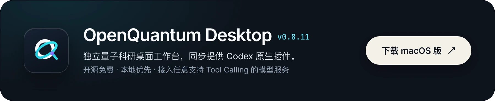
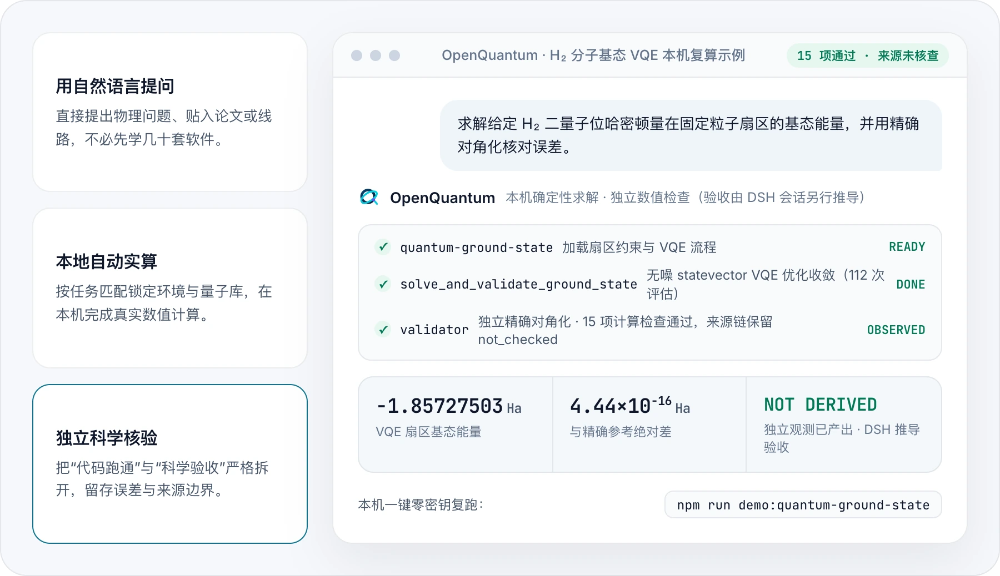
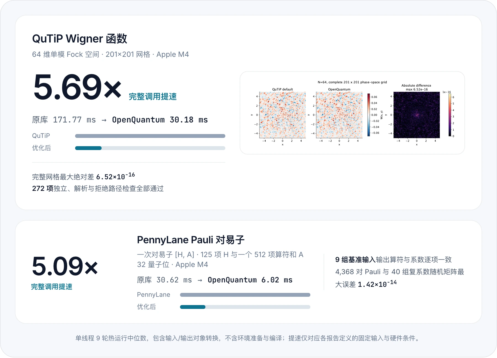

<h1 align="center">
  <picture>
    <source media="(prefers-color-scheme: dark)" srcset="./packages/openquantum-web-branding/assets/lockup-inverse.svg" />
    
  </picture>
</h1>

<p align="center">
  <a href="https://github.com/xi-zhao/OpenQuantum/stargazers"></a>
  <a href="https://github.com/xi-zhao/OpenQuantum/releases/tag/v0.8.11"></a>
  <a href="https://github.com/xi-zhao/OpenQuantum/actions/workflows/ci.yml"></a>
  <a href="./THIRD_PARTY_NOTICES.md"></a>
</p>

<p align="center">
  <sub>
    <a href="./README.md"><strong>简体中文</strong></a> ·
    <a href="./docs/readme/README.en.md">English</a> ·
    <a href="./docs/readme/README.ja.md">日本語</a> ·
    <a href="./docs/readme/README.ko.md">한국어</a> ·
    <a href="./docs/readme/README.es.md">Español</a> ·
    <a href="./docs/readme/README.fr.md">Français</a> ·
    <a href="./docs/readme/README.de.md">Deutsch</a> ·
    <a href="./docs/readme/README.pt.md">Português</a> ·
    <a href="./docs/readme/README.ru.md">Русский</a> ·
    <a href="./docs/readme/README.ar.md">العربية</a>
  </sub>
</p>

<p align="center">
  <a href="https://xi-zhao.github.io/OpenQuantum/">
    <picture>
      <source media="(prefers-color-scheme: dark)" srcset="./docs/images/readme/hero-zh-dark.webp" />
      
    </picture>
  </a>
</p>

<p align="center">
  <a href="https://github.com/xi-zhao/OpenQuantum/releases/download/v0.8.11/OpenQuantum-0.8.11-macOS-arm64.dmg">
    <picture>
      <source media="(prefers-color-scheme: dark)" srcset="./docs/images/readme/launch-card-dark.webp" />
      
    </picture>
  </a>
</p>

<a id="发布演示"></a>
<a id="使用与结果"></a>
<a id="执行记录与科学验收"></a>
<a id="科研能力"></a>
<a id="可以用它做什么"></a>

**OpenQuantum** 是开源的量子智能体，同时交付为 **Desktop 桌面工作台**与 **Codex 插件**。用自然语言提出一个量子问题、附上一篇论文或一段线路，它自动调动本地专业量子软件完成真实计算，并把“代码跑通”与“科学核验”分开检查。

<p align="center">
  <picture>
    <source media="(prefers-color-scheme: dark)" srcset="./docs/images/readme/workflow-zh-dark.webp" />
    
  </picture>
</p>

<details>
<summary>观看 78 秒产品演示视频与真实界面截图</summary>

<br />

https://github.com/user-attachments/assets/5c00a30d-eef0-493a-975f-3faeb200cc9e

<sub><a href="docs/communications/video/README.md">视频来源与复跑说明（2026-11-02 快照）</a> · <a href="docs/images/openquantum-desktop-20261013.jpg">Desktop 工作台截图</a> · <a href="docs/images/openquantum-settings-categories-20261013.jpg">分类设置界面</a> · <a href="docs/images/openquantum-codex-settings-20261011.png">Codex 设置界面</a> · <a href="docs/images/openquantum-evidence-flow.png">科学证据流</a></sub>

</details>

<a id="优化实测"></a>
<a id="实测案例"></a>
<a id="optimization-cases"></a>
<a id="qutip-rust-case"></a>
<a id="pennylane-rust-case"></a>

## 更快，也经得起核对

不止于调用既有软件——两项针对高频算子的端到端重构均公开原始计时、独立精度核对与一键复跑脚本，把时间还给新的想法。

<p align="center">
  <a href="experiments/qutip-rust-wigner/README.md">
    <picture>
      <source media="(prefers-color-scheme: dark)" srcset="./docs/images/readme/benchmarks-zh-dark.webp" />
      
    </picture>
  </a>
</p>

[QuTiP 复跑报告](experiments/qutip-rust-wigner/README.md) · [QuTiP 多规模图](site/assets/qutip-timings.svg) · [PennyLane 复跑报告](experiments/pennylane-rust-commutator/README.md) · [PennyLane 全部 9 组图](site/assets/pennylane-timings.svg)

<a id="openquantum-的核心能力"></a>
<a id="能力接口目录"></a>
<a id="算法学习与方法比较"></a>
<a id="纠错模型静态诊断"></a>
<a id="数学与物理形式化"></a>
<a id="量子学习通"></a>

## 覆盖全球主流量子软件栈

当前源码分发 **194 个内置 Skill、91 个 MCP 服务连接、5 个原生量子 Tool**，直连 **122 个锁定科学环境**，横跨 Python、Julia、Rust 与 Lean 4。

<table>
  <tr>
    <th width="14%" align="left">领域</th>
    <th width="86%" align="left">已接入的开源软件、论文方法与生态入口</th>
  </tr>
  <tr>
    <td width="14%"><strong>电路编译</strong></td>
    <td width="86%"><a href="https://github.com/Qiskit/qiskit"><kbd>IBM Qiskit</kbd></a> <a href="https://github.com/PennyLaneAI/pennylane"><kbd>Xanadu PennyLane</kbd></a> <a href="https://github.com/CQCL/tket"><kbd>Quantinuum pytket</kbd></a> <a href="https://github.com/zxcalc/pyzx"><kbd>PyZX</kbd></a> <a href="https://github.com/TeamGraphix/graphix"><kbd>Graphix</kbd></a> <a href="https://github.com/munich-quantum-toolkit/qcec"><kbd>MQT QCEC</kbd></a></td>
  </tr>
  <tr>
    <td width="14%"><strong>纠错控制</strong></td>
    <td width="86%"><a href="https://github.com/quantumlib/Stim"><kbd>Google Stim</kbd></a> <a href="https://github.com/oscarhiggott/PyMatching"><kbd>PyMatching</kbd></a> <a href="https://github.com/unitaryfoundation/mitiq"><kbd>Mitiq</kbd></a> <a href="https://github.com/munich-quantum-toolkit/qecc"><kbd>MQT QECC</kbd></a> <a href="https://github.com/quantumlib/chromobius"><kbd>Chromobius</kbd></a> <a href="https://github.com/Deltakit/deltakit"><kbd>Deltakit</kbd></a> <a href=".agents/skills/mwpf-decoding/SKILL.md"><kbd>MWPF</kbd></a> <a href=".agents/skills/emlint-dem-audit/SKILL.md"><kbd>emlint</kbd></a> <a href=".agents/skills/tropidist-distance/SKILL.md"><kbd>tropidist</kbd></a> <a href=".agents/skills/erasure-recovery/SKILL.md"><kbd>erasure-recovery</kbd></a> <a href=".agents/skills/stgrape-control/SKILL.md"><kbd>ST-GRAPE</kbd></a></td>
  </tr>
  <tr>
    <td width="14%"><strong>多体化学</strong></td>
    <td width="86%"><a href="https://github.com/qutip/qutip"><kbd>QuTiP</kbd></a> <a href="https://github.com/tenpy/tenpy"><kbd>TeNPy</kbd></a> <a href="https://github.com/quantumlib/OpenFermion"><kbd>OpenFermion</kbd></a> <a href="https://github.com/dynamiqs/dynamiqs"><kbd>Dynamiqs</kbd></a> <a href=".agents/skills/slowquant-response/SKILL.md"><kbd>SlowQuant</kbd></a> <a href=".agents/skills/tnqs-dynamics/SKILL.md"><kbd>TNQS</kbd></a> <a href=".agents/skills/rcmps-field-theory/SKILL.md"><kbd>RcmpsCore</kbd></a> <a href=".agents/skills/ppvm-simulation/SKILL.md"><kbd>PPVM</kbd></a> <a href="https://github.com/QuEraComputing/bloqade-python"><kbd>QuEra Bloqade</kbd></a> <a href="https://github.com/pasqal-io/Pulser"><kbd>Pasqal Pulser</kbd></a></td>
  </tr>
  <tr>
    <td width="14%"><strong>形式与云</strong></td>
    <td width="86%"><a href=".agents/skills/lean-physics/SKILL.md"><kbd>Lean 4 / mathlib / physlib</kbd></a> <a href="examples/quantum-algorithms/README.md"><kbd>49 项开源算法</kbd></a> <a href="docs/integrations/OPENMAIC.md"><kbd>量子学习通</kbd></a> <a href="docs/CAPABILITIES.md#本地计算与量子云"><kbd>IBM · IonQ · 本源 · 夸父 · 天衍</kbd></a> <a href="docs/integrations/FULL_SDK_ACCESS.md"><kbd>+ 122 个锁定环境</kbd></a></td>
  </tr>
</table>

[完整 Skill 目录](docs/CAPABILITIES.md#内置-skills) · [MCP 服务目录](docs/CAPABILITIES.md#mcp-服务目录) · [原生量子 Tools](docs/CAPABILITIES.md#原生量子-tools) · [环境准备](docs/integrations/LOCAL_ENVIRONMENTS.md) · [方法选型](docs/integrations/CAPABILITY_SELECTION.md) · [系统架构](docs/README.md)

<a id="开始使用"></a>
<a id="快速开始"></a>

## 安装与使用

### Desktop 桌面版（macOS Apple Silicon）

下载 **[OpenQuantum 0.8.11 DMG](https://github.com/xi-zhao/OpenQuantum/releases/download/v0.8.11/OpenQuantum-0.8.11-macOS-arm64.dmg)**（内置 Node / uv，核对 [SHA256SUMS](https://github.com/xi-zhao/OpenQuantum/releases/tag/v0.8.11)），拖入「应用程序」，在「设置 → 模型」填入任意支持 **Tool Calling** 的模型服务即可开始。首次打开见[安装说明](docs/DESKTOP_INSTALLERS.md)；Intel Mac 与 Windows 可使用 [0.8.4 能力包](https://github.com/xi-zhao/OpenQuantum/releases/tag/v0.8.4) 或下方源码启动。

<a id="codex-plugin"></a>

### Codex 插件

**让 Codex 帮你安装：** 新建对话，复制发送以下请求（需要支持插件的 Codex、Node.js 24+ 与 npm）：

```text
请帮我安装 OpenQuantum Codex 插件 0.8.11。先阅读安装指南：
https://github.com/xi-zhao/OpenQuantum/blob/codex-v0.8.11/docs/integrations/CODEX_AGENT_INSTALL.md
从 https://github.com/xi-zhao/OpenQuantum/releases/tag/codex-v0.8.11 下载完整安装包与 SHA256SUMS，
核对摘要后，检查 Codex、Node.js 24+ 和 npm，使用包内安装器完成安装。
请保留已有插件和用户配置，核对 Skills、MCP 工具和左侧全局“OpenQuantum 设置”入口。
需要我重载应用时，告诉我具体操作。最后报告实际验证的结果，以及仍需准备的科学计算依赖。
```

[安装包与 SHA256SUMS](https://github.com/xi-zhao/OpenQuantum/releases/tag/codex-v0.8.11) · [手动安装](docs/integrations/CODEX_AGENT_INSTALL.md) · [插件边界](docs/integrations/CODEX_PLUGIN.md)

<a id="安装源码"></a>
<a id="配置模型"></a>

### 从源码复算（无需模型密钥）

```bash
git clone https://github.com/xi-zhao/OpenQuantum.git && cd OpenQuantum
npm ci
npm run demo:quantum-ground-state   # 零密钥复算：H₂ 基态 VQE（-1.85727503 Ha，误差 4.44×10⁻¹⁶ Ha）
npm run dev                         # 启动本地 Web 工作台
```

<details>
<summary>更多部署方式：源码 Desktop · Docker（Linux）· 量子学习通 · 微信 / 飞书渠道</summary>

- **源码 Desktop**：`npm run desktop:setup` → `npm run desktop:verify-install` → `npm run desktop -- --source`（[部署指南](docs/DEPLOYMENT.md#方式三原生桌面工作台)）
- **Docker Compose（Linux）**：`cp .env.example .env && docker compose up --build`（[部署指南](docs/DEPLOYMENT.md#方式四docker-compose)）
- **量子学习通**：`npm run learning:ui:setup`（[集成说明](docs/integrations/OPENMAIC.md)）
- **微信 / 飞书等消息渠道**：`npm run cc-connect:setup`（[渠道配置](docs/integrations/CC_CONNECT.md)）

</details>

<a id="长期发展规划"></a>
<a id="rsi"></a>
<a id="开放共建"></a>
<a id="开发与贡献"></a>

## 演进路线与开放共建

- **当前源码主线与发行版**：当前源码包含 194 个 Skill、91 个 MCP 服务连接、122 个锁定环境，并在 DSH 桌面 / Web 宿主接通 11 项可回放 L3 科学验收与完整沙箱隔离（2026-11-09 发布的 `v0.8.11` / `codex-v0.8.11` 安装包含 189 个 Skill、117 个环境与 3 项 DSH L3 验收；Codex 复用共享计算与独立观测）。
- **持续推进**：CPU / GPU / HPC / QPU 协同调度、实验仪器标准接口探索，以及体系化的[量子学习通](docs/integrations/OPENMAIC.md)教学与动手实验。
- **长期愿景**：探索受独立评估与版本授权约束的科研自我进化闭环（RSI）；**完整闭环尚未实现**，安全边界见[长期发展规划](docs/roadmap/VISION.md)。

[参与贡献](CONTRIBUTING.md) · [需求与合作交流](https://github.com/xi-zhao/OpenQuantum/issues) · [文档与架构总入口](docs/README.md) · [任务示例](docs/EXAMPLES.md) · [更新日志](CHANGELOG.md) · 本地全仓校验 `npm run check`

<details>
<summary>学术引用（BibTeX）与合规许可详情</summary>

```bibtex
@software{zhao2026openquantum,
  author  = {Zhao, Xi and {OpenQuantum contributors}},
  title   = {OpenQuantum: Building Trustworthy AI for Quantum Research},
  year    = {2026},
  version = {0.8.11},
  url     = {https://github.com/xi-zhao/OpenQuantum}
}
```

仓库根目录已提供 [`CITATION.cff`](CITATION.cff)（支持 GitHub 侧栏一键引用）。安全问题请按 [`SECURITY.md`](SECURITY.md) 私密报告。

</details>

<sub>自有代码除单独声明外采用 <a href="LICENSE">MIT License</a>（© 2026 Xi Zhao）；<code>mitiq-error-mitigation</code> 采用 <a href=".agents/skills/mitiq-error-mitigation/LICENSE">GPL-3.0-only</a>，Metriq 公开数据快照采用 <a href="src/metriq-data/upstream/LICENSE">CC-BY-4.0</a>。完整第三方清单见 <a href="THIRD_PARTY_NOTICES.md">THIRD_PARTY_NOTICES.md</a>。</sub>

<br />

<p align="center">
  <picture>
    <source media="(prefers-color-scheme: dark)" srcset="./packages/openquantum-web-branding/assets/lockup-inverse.svg" />
    
  </picture>
</p>

<p align="center">
  <strong>开源开放，一起向前。</strong><br />
  <sub>OpenQuantum · 量子计算，就在指尖。</sub>
</p>
