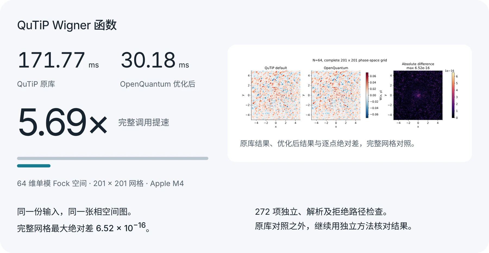

<h1 align="center">
  <picture>
    <source media="(prefers-color-scheme: dark)" srcset="./packages/openquantum-web-branding/assets/lockup-inverse.svg" />
    
  </picture>
</h1>

<p align="center">
  <a href="https://github.com/xi-zhao/OpenQuantum/stargazers"></a>
  <a href="https://github.com/xi-zhao/OpenQuantum/releases/tag/v0.8.11"></a>
  <a href="https://github.com/xi-zhao/OpenQuantum/actions/workflows/ci.yml"></a>
  <a href="./THIRD_PARTY_NOTICES.md"></a>
</p>

<p align="center">
  <sub>
    <a href="./README.md"><strong>简体中文</strong></a> ·
    <a href="./docs/readme/README.en.md">English</a> ·
    <a href="./docs/readme/README.ja.md">日本語</a> ·
    <a href="./docs/readme/README.ko.md">한국어</a> ·
    <a href="./docs/readme/README.es.md">Español</a> ·
    <a href="./docs/readme/README.fr.md">Français</a> ·
    <a href="./docs/readme/README.de.md">Deutsch</a> ·
    <a href="./docs/readme/README.pt.md">Português</a> ·
    <a href="./docs/readme/README.ru.md">Русский</a> ·
    <a href="./docs/readme/README.ar.md">العربية</a>
  </sub>
</p>

<h2 align="center">量子智能体</h2>

<p align="center">
  <strong>让研究思路，有路可走。</strong><br />
  从一个问题、一篇论文或一段程序出发，让 AI 选择方法、执行计算、核对结果，把一次探索留给下一次研究。
</p>

<h3 align="center">
  <a href="#开始使用"><ins>下载与安装</ins></a> &nbsp;·&nbsp;
  <a href="#优化实测"><ins>实测突破 →</ins></a> &nbsp;·&nbsp;
  <a href="https://xi-zhao.github.io/OpenQuantum/"><ins>访问官网</ins></a>
</h3>

<p align="center">
  <a href="https://xi-zhao.github.io/OpenQuantum/">
    <picture>
      <source media="(prefers-reduced-motion: reduce)" srcset="./docs/images/readme/banner.webp" />
      
    </picture>
  </a>
</p>

<br />

<a id="使用与结果"></a>
<a id="执行记录与科学验收"></a>
<a id="科研能力"></a>
<a id="可以用它做什么"></a>

## 从一个问题，到可核验的量子计算

普通聊天 AI 只能回复概念或一段未经运行的代码。**OpenQuantum 是面向学习与科研的量子智能体**——你用自然语言提出问题，它自动调用专业量子软件在本地完成真实计算，并把结果独立核对清楚。

<table>
<tr>
<td width="50%" valign="middle">

1. **直接提问**：不用先学一堆软件——比如 *“算一下氢分子的基态能量”*、*“构建 Bell 态电路并对比不同噪声”*、*“复现一篇量子纠错论文的实验”*。
2. **真实计算**：自动按需准备并调用 Qiskit、PennyLane、QuTiP、Stim 等专业科学软件，在你的电脑本地完成数值模拟、线路编译与推导。
3. **独立核对**：将“程序跑通”与“物理结果成立”分开检查，保留误差范围、过程记录与可复跑脚本；本地计算无需量子云账号。

</td>
<td width="50%">
  <a href="./docs/images/openquantum-desktop-20261013.jpg"></a>
</td>
</tr>
</table>

<details>
<summary>观看 78 秒产品演示视频：看它如何从提问完成一次量子计算（2026-11-02 快照）</summary>

<br />

https://github.com/user-attachments/assets/5c00a30d-eef0-493a-975f-3faeb200cc9e

<sub><a href="docs/communications/video/README.md">视频数据来源与复跑说明</a> · <a href="docs/images/openquantum-evidence-flow.png">科学证据流</a> · <a href="docs/images/openquantum-settings-categories-20261013.jpg">桌面分类设置</a> · <a href="docs/images/openquantum-codex-settings-20261011.png">Codex 设置界面</a></sub>

</details>

<table>
  <tr>
    <td width="33%" valign="top">
      <strong>本科生与初学者</strong><br />
      免去繁琐环境配置，用自然语言边问边做量子线路、能级、噪声与脉冲实验，并配套交互式<a href="docs/integrations/OPENMAIC.md">量子学习通</a>。
    </td>
    <td width="33%" valign="top">
      <strong>科研人员与研究生</strong><br />
      在一个工作台里打通化学多体、开放系统、量子纠错与形式化证明，完整保留对照基准与可回放证据链。
    </td>
    <td width="34%" valign="top">
      <strong>算法与软件工程师</strong><br />
      在 Codex 或桌面端直接调用并对比全球主流量子软件栈，重构底层性能瓶颈，并将验证过的能力沉淀复用。
    </td>
  </tr>
</table>

<br />

<a id="开始使用"></a>
<a id="快速开始"></a>

## 下载与安装

### Desktop 桌面版 — macOS Apple Silicon（推荐首次使用）

无需命令行，像常规桌面软件一样打开即用：

1. 下载 **[OpenQuantum 0.8.11 DMG](https://github.com/xi-zhao/OpenQuantum/releases/download/v0.8.11/OpenQuantum-0.8.11-macOS-arm64.dmg)**（内置 Node / uv，核对 [SHA256SUMS](https://github.com/xi-zhao/OpenQuantum/releases/tag/v0.8.11)），拖入「应用程序」。
2. 打开应用后，在「设置 → 模型」中填入你已有的任意支持 **Tool Calling** 的模型服务，即可开始提问与计算。

<sub>首次打开（ad-hoc 签名）见<a href="docs/DESKTOP_INSTALLERS.md">安装说明</a>；Intel Mac 与 Windows 可使用 <a href="https://github.com/xi-zhao/OpenQuantum/releases/tag/v0.8.4">0.8.4 能力包</a> 或下方源码方式启动。</sub>

<a id="codex-plugin"></a>

### Codex 插件（推荐 Codex 用户）

**让 Codex 帮你安装：** 新建对话，复制发送以下请求（需要支持插件的 Codex、Node.js 24+ 与 npm）：

```text
请帮我安装 OpenQuantum Codex 插件 0.8.11。先阅读安装指南：
https://github.com/xi-zhao/OpenQuantum/blob/codex-v0.8.11/docs/integrations/CODEX_AGENT_INSTALL.md
从 https://github.com/xi-zhao/OpenQuantum/releases/tag/codex-v0.8.11 下载完整安装包与 SHA256SUMS，
核对摘要后，检查 Codex、Node.js 24+ 和 npm，使用包内安装器完成安装。
请保留已有插件和用户配置，核对 Skills、MCP 工具和左侧全局“OpenQuantum 设置”入口。
需要我重载应用时，告诉我具体操作。最后报告实际验证的结果，以及仍需准备的科学计算依赖。
```

[安装包与 SHA256SUMS](https://github.com/xi-zhao/OpenQuantum/releases/tag/codex-v0.8.11) · [手动安装](docs/integrations/CODEX_AGENT_INSTALL.md) · [插件边界](docs/integrations/CODEX_PLUGIN.md)

<a id="安装源码"></a>
<a id="配置模型"></a>

### 从源码体验（无需模型密钥，30 秒复算一次真实量子基态）

```bash
git clone https://github.com/xi-zhao/OpenQuantum.git && cd OpenQuantum
npm ci
npm run demo:quantum-ground-state   # 零密钥复算：H₂ 算符基态 VQE（-1.85727503 Ha，误差 4.44×10⁻¹⁶ Ha）
npm run dev                         # 启动本地 Web 工作台
```

<details>
<summary>更多部署方式：源码 Desktop · Docker（Linux）· 量子学习通 · 微信 / 飞书渠道</summary>

- **源码 Desktop**：`npm run desktop:setup` → `npm run desktop:verify-install` → `npm run desktop -- --source`（[部署指南](docs/DEPLOYMENT.md#方式三原生桌面工作台)）
- **Docker Compose（Linux）**：`cp .env.example .env && docker compose up --build`（[部署指南](docs/DEPLOYMENT.md#方式四docker-compose)）
- **量子学习通**：`npm run learning:ui:setup`（[集成说明](docs/integrations/OPENMAIC.md)）
- **微信 / 飞书等消息渠道**：`npm run cc-connect:setup`（[渠道配置](docs/integrations/CC_CONNECT.md)）

</details>

<br />

## 为什么是 OpenQuantum

**广阔的专业世界，一个共同的起点。** 将全球分散的量子软件栈、前沿论文方法与独立科学验证收敛为统一的智能体工作层：

<table>
  <tr>
    <td width="50%" valign="top">
      <strong>统一的跨语言量子软件层</strong><br />
      覆盖 Python、Julia、Rust 与 Lean 4 共 <strong>122 个锁定环境</strong>、<strong>194 个内置 Skill</strong>、<strong>91 个 MCP 服务连接</strong>与 <strong>49 项可执行算法</strong>，打通电路编译、化学多体、纠错解码、开放系统与量子云发现；按需准备，消除跨栈迁移成本。
    </td>
    <td width="50%" valign="top">
      <strong>独立于模型的科学验证</strong><br />
      将“程序跑通”与“科学成立”彻底分离。内置独立数值对照、电路等价检查（MQT QCEC）、DEM 静态审计（emlint）、桌面 / Web 宿主 <strong>11 项可回放科学验收</strong>，以及 <strong>Lean 4 / mathlib / physlib</strong> 形式化路径。
    </td>
  </tr>
  <tr>
    <td width="50%" valign="top">
      <strong>可沉淀的底层计算加速</strong><br />
      不止于调用既有软件。高频核心算子经重构与独立核验后直接沉淀进共享核心：固定基准下 <strong>QuTiP Wigner 提速 5.69×</strong>、<strong>PennyLane Pauli 对易子提速 5.09×</strong>，逐点误差低至 <code>10⁻¹⁴–10⁻¹⁶</code>。
    </td>
    <td width="50%" valign="top">
      <strong>一份核心，跨宿主原生交付</strong><br />
      同一套量子科研核心原生运行于 <strong>OpenQuantum Desktop</strong> 与 <strong>Codex 插件</strong>，模型无关、本地优先，兼容任意支持 Tool Calling 的模型服务，随基础模型演进而持续放大能力边界。
    </td>
  </tr>
</table>

<br />

<a id="优化实测"></a>
<a id="实测案例"></a>
<a id="optimization-cases"></a>
<a id="qutip-rust-case"></a>
<a id="pennylane-rust-case"></a>

## 更快，也经得起核对

**把时间还给新的想法。** 不止于调用既有软件——两项面向高频算子的端到端重构，均基于完整调用计时（含输入/输出对象转换，单线程 9 轮热运行中位数），公开全部原始计时、独立精度核对与一键复跑脚本。

<p align="center">
  <a href="experiments/qutip-rust-wigner/README.md">
    
  </a>
</p>

- **QuTiP Wigner 函数（Apple M4 · 64 维 Fock 空间 201×201 网格）**：`171.77 ms → 30.18 ms`（**5.69×**），完整网格最大绝对差 `6.52 × 10⁻¹⁶`，272 项独立/解析/拒绝路径检查全部通过 · [复跑报告](experiments/qutip-rust-wigner/README.md) · [多规模对比图](site/assets/qutip-timings.svg)
- **PennyLane Pauli 对易子（Apple M4 · 32 量子位 125×512 项）**：`30.62 ms → 6.02 ms`（**5.09×**），9 组基准输出逐项一致，4,368 对 Pauli 与 40 组复系数随机矩阵最大误差 `1.42 × 10⁻¹⁴` · [复跑报告](experiments/pennylane-rust-commutator/README.md) · [全部 9 组图](site/assets/pennylane-timings.svg)

<details>
<summary>查看 PennyLane 5.09× 实测卡片与计时边界说明</summary>

<br />

<p align="center"></p>

<sub>两项计时包含输入/输出转换，不含环境准备与编译；收益仅对应各报告定义的固定输入与硬件条件，不推广为通用加速比。</sub>

</details>

<br />

<a id="openquantum-的核心能力"></a>
<a id="能力接口目录"></a>
<a id="算法学习与方法比较"></a>
<a id="纠错模型静态诊断"></a>
<a id="数学与物理形式化"></a>
<a id="量子学习通"></a>

## 覆盖全球主流量子生态

当前源码分发 **194 个内置 Skill、91 个 MCP 服务连接、5 个原生量子 Tool**，并为 **122 个 SDK/源码环境**提供原生 API 路径。

<p>
  <a href="https://github.com/Qiskit/qiskit"><kbd>IBM Qiskit</kbd></a> &nbsp;
  <a href="https://github.com/PennyLaneAI/pennylane"><kbd>Xanadu PennyLane</kbd></a> &nbsp;
  <a href="https://github.com/qutip/qutip"><kbd>QuTiP</kbd></a> &nbsp;
  <a href="https://github.com/quantumlib/Stim"><kbd>Google Stim</kbd></a> &nbsp;
  <a href="https://github.com/oscarhiggott/PyMatching"><kbd>PyMatching</kbd></a> &nbsp;
  <a href="https://github.com/unitaryfoundation/mitiq"><kbd>Mitiq</kbd></a> &nbsp;
  <a href="https://github.com/zxcalc/pyzx"><kbd>PyZX</kbd></a> &nbsp;
  <a href="https://github.com/TeamGraphix/graphix"><kbd>Graphix</kbd></a> &nbsp;
  <a href="https://github.com/munich-quantum-toolkit/qcec"><kbd>MQT QCEC / QECC</kbd></a> &nbsp;
  <a href="https://github.com/CQCL/tket"><kbd>Quantinuum pytket</kbd></a> &nbsp;
  <a href="https://github.com/tenpy/tenpy"><kbd>TeNPy</kbd></a> &nbsp;
  <a href="https://github.com/quantumlib/OpenFermion"><kbd>OpenFermion</kbd></a> &nbsp;
  <a href="https://github.com/dynamiqs/dynamiqs"><kbd>Dynamiqs</kbd></a> &nbsp;
  <a href="https://github.com/QuEraComputing/bloqade-python"><kbd>QuEra Bloqade</kbd></a> &nbsp;
  <a href="https://github.com/pasqal-io/Pulser"><kbd>Pasqal Pulser</kbd></a> &nbsp;
  <a href="https://github.com/Deltakit/deltakit"><kbd>Deltakit</kbd></a> &nbsp;
  <a href="https://github.com/quantumlib/chromobius"><kbd>Chromobius</kbd></a> &nbsp;
  <a href=".agents/skills/slowquant-response/SKILL.md"><kbd>SlowQuant</kbd></a> &nbsp;
  <a href=".agents/skills/tnqs-dynamics/SKILL.md"><kbd>TNQS</kbd></a> &nbsp;
  <a href=".agents/skills/rcmps-field-theory/SKILL.md"><kbd>RcmpsCore</kbd></a> &nbsp;
  <a href=".agents/skills/mwpf-decoding/SKILL.md"><kbd>MWPF</kbd></a> &nbsp;
  <a href=".agents/skills/ppvm-simulation/SKILL.md"><kbd>PPVM</kbd></a> &nbsp;
  <a href=".agents/skills/erasure-recovery/SKILL.md"><kbd>erasure-recovery</kbd></a> &nbsp;
  <a href=".agents/skills/stgrape-control/SKILL.md"><kbd>ST-GRAPE</kbd></a> &nbsp;
  <a href=".agents/skills/tropidist-distance/SKILL.md"><kbd>tropidist</kbd></a> &nbsp;
  <a href=".agents/skills/emlint-dem-audit/SKILL.md"><kbd>emlint</kbd></a> &nbsp;
  <a href=".agents/skills/lean-physics/SKILL.md"><kbd>Lean 4 / mathlib / physlib</kbd></a> &nbsp;
  <a href="examples/quantum-algorithms/README.md"><kbd>49 项开源算法示例</kbd></a> &nbsp;
  <a href="docs/CAPABILITIES.md#本地计算与量子云"><kbd>IBM · IonQ · 本源 · 夸父 · 天衍</kbd></a> &nbsp;
  <a href="docs/integrations/FULL_SDK_ACCESS.md"><kbd>+ 122 个锁定环境</kbd></a>
</p>

[完整 Skill 目录](docs/CAPABILITIES.md#内置-skills) · [MCP 服务目录](docs/CAPABILITIES.md#mcp-服务目录) · [原生量子 Tools](docs/CAPABILITIES.md#原生量子-tools) · [环境准备](docs/integrations/LOCAL_ENVIRONMENTS.md) · [方法选型](docs/integrations/CAPABILITY_SELECTION.md) · [系统架构](docs/README.md)

<br />

<a id="长期发展规划"></a>
<a id="rsi"></a>
<a id="开放共建"></a>
<a id="开发与贡献"></a>

## 演进路线与开放共建

**今天，让全球量子科研基础设施开箱即用；明天，让每一次经验证的研究产出，反哺下一次研究本身。**

- **Phase 1 · 统一量子科研层（已交付）**：194 Skill · 91 MCP · 122 锁定环境 · Desktop & Codex `v0.8.11` 同步发行 · 11 项可回放科学验收与完整沙箱隔离。
- **Phase 2 · 量子—经典协同与实验接口（持续推进）**：面向 CPU / GPU / HPC / QPU 的协同调度、实验仪器标准接口探索，以及体系化的[量子学习通](docs/integrations/OPENMAIC.md)教学与科研应用。
- **Phase 3 · 经验证的科研自我进化（长期愿景）**：探索“真实任务 → 候选改进 → 独立评估与新任务对照 → 授权升级”的科研闭环（RSI）；**完整 RSI 闭环尚未实现**，评估门槛与安全边界见[长期发展规划](docs/roadmap/VISION.md)。

欢迎科研团队、量子软件维护者与生态伙伴交流与共建：[参与贡献](CONTRIBUTING.md) · [提出需求与合作交流](https://github.com/xi-zhao/OpenQuantum/issues) · [文档与架构总入口](docs/README.md) · [任务示例](docs/EXAMPLES.md) · [更新日志](CHANGELOG.md) · 本地全仓校验 `npm run check`。

<details>
<summary>学术引用（BibTeX）与合规许可详情</summary>

```bibtex
@software{zhao2026openquantum,
  author  = {Zhao, Xi and {OpenQuantum contributors}},
  title   = {OpenQuantum: Building Trustworthy AI for Quantum Research},
  year    = {2026},
  version = {0.8.11},
  url     = {https://github.com/xi-zhao/OpenQuantum}
}
```

仓库根目录已提供 [`CITATION.cff`](CITATION.cff)（支持 GitHub 侧栏一键引用）。安全问题请按 [`SECURITY.md`](SECURITY.md) 私密报告。

</details>

自有代码除单独声明外采用 [MIT License](LICENSE)（© 2026 Xi Zhao）；`mitiq-error-mitigation` 采用 [GPL-3.0-only](.agents/skills/mitiq-error-mitigation/LICENSE)，Metriq 公开数据快照采用 [CC-BY-4.0](src/metriq-data/upstream/LICENSE)。完整第三方来源、作者署名与许可清单见 [`THIRD_PARTY_NOTICES.md`](THIRD_PARTY_NOTICES.md)。

<br />

<p align="center">
  <picture>
    <source media="(prefers-color-scheme: dark)" srcset="./packages/openquantum-web-branding/assets/lockup-inverse.svg" />
    
  </picture>
</p>

<p align="center">
  <strong>开源开放，一起向前。</strong><br />
  <sub>OpenQuantum · 量子计算，就在指尖。</sub>
</p>
