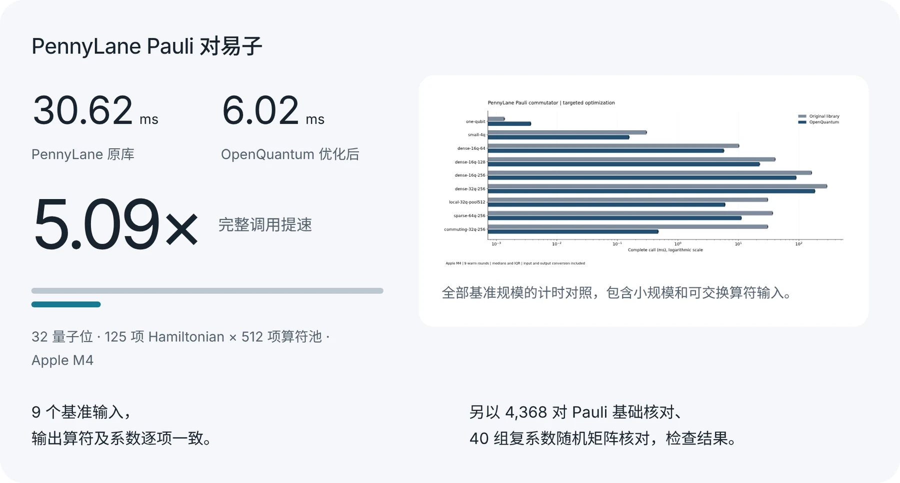

<h1 align="center">
  <picture>
    <source media="(prefers-color-scheme: dark)" srcset="./packages/openquantum-web-branding/assets/lockup-inverse.svg" />
    
  </picture>
</h1>

<p align="center">
  <strong>共建可信的量子科研智能</strong><br />
  <sub>开源量子科研智能体插件与工作台 · 同时支持 Codex 与 Desktop</sub>
</p>

<p align="center">
  <a href="https://github.com/xi-zhao/OpenQuantum/stargazers"></a>
  <a href="https://github.com/xi-zhao/OpenQuantum/releases/tag/v0.8.11"></a>
  <a href="https://github.com/xi-zhao/OpenQuantum/actions/workflows/ci.yml"></a>
  <a href="./THIRD_PARTY_NOTICES.md"></a>
</p>

<p align="center">
  <sub>
    <a href="./README.md"><strong>简体中文</strong></a> ·
    <a href="./docs/readme/README.en.md">English</a> ·
    <a href="./docs/readme/README.ja.md">日本語</a> ·
    <a href="./docs/readme/README.ko.md">한국어</a> ·
    <a href="./docs/readme/README.es.md">Español</a> ·
    <a href="./docs/readme/README.fr.md">Français</a> ·
    <a href="./docs/readme/README.de.md">Deutsch</a> ·
    <a href="./docs/readme/README.pt.md">Português</a> ·
    <a href="./docs/readme/README.ru.md">Русский</a> ·
    <a href="./docs/readme/README.ar.md">العربية</a>
  </sub>
</p>

<p align="center">
  <a href="#开始使用"><strong>快速开始 ↗</strong></a> ·
  <a href="#使用与结果">界面与演示</a> ·
  <a href="#科研能力">科研能力</a> ·
  <a href="#优化实测">优化实测</a> ·
  <a href="https://xi-zhao.github.io/OpenQuantum/">官网</a> ·
  <a href="docs/README.md">文档</a>
</p>

<p align="center">
  <a href="https://xi-zhao.github.io/OpenQuantum/">
    <picture>
      <source media="(prefers-reduced-motion: reduce)" srcset="./docs/images/readme/banner.webp" />
      
    </picture>
  </a>
</p>

<p align="center">
  <strong>194</strong> 个内置 Skill　·　<strong>91</strong> 个 MCP 服务连接　·　<strong>122</strong> 个锁定 SDK 环境　·　开源 MIT
</p>

<br />

<a id="使用与结果"></a>
<a id="执行记录与科学验收"></a>

## 产品界面与 78 秒演示

从一个研究问题、一篇论文或一段程序出发，让 AI 直接调用社区专业量子软件、执行真实计算并留下可核对的记录。一份共享科研插件，同时提供 **Codex 插件** 与 **OpenQuantum Desktop** 两种入口。

<table>
  <tr>
    <td width="50%" valign="top"><a href="./docs/images/openquantum-desktop-20261013.jpg"></a><br /><sub>Desktop 科研工作台 · 对话、工作区与科研能力一体呈现</sub></td>
    <td width="50%" valign="top"><a href="./docs/images/openquantum-settings-categories-20261013.jpg"></a><br /><sub>按用途分组的能力设置 · 搜索、筛选与连接管理</sub></td>
  </tr>
</table>

<p align="center"><sub>上图为 2026-10-13 实际界面（0.8.11 已进一步精简侧栏与设置）· <a href="./docs/images/openquantum-codex-settings-20261011.png">查看 Codex 插件设置界面</a> · <a href="./docs/images/README.md">截图说明</a></sub></p>

<br />

<p align="center"><strong>▶ 78 秒了解 OpenQuantum</strong></p>

https://github.com/user-attachments/assets/5c00a30d-eef0-493a-975f-3faeb200cc9e

<p align="center"><sub>2026-11-02 演示（片中数量为当时快照）· <a href="docs/communications/video/README.md">数据来源与复跑说明</a></sub></p>

<br />

<a id="开始使用"></a>
<a id="快速开始"></a>

## 快速开始

<a id="codex-plugin"></a>

### 方式一：Codex 插件

**让 Codex 帮你安装：** 新建对话，复制发送以下请求，安装完成后按提示重载即可使用：

```text
请帮我安装 OpenQuantum Codex 插件 0.8.11。先阅读安装指南：
https://github.com/xi-zhao/OpenQuantum/blob/codex-v0.8.11/docs/integrations/CODEX_AGENT_INSTALL.md
从 https://github.com/xi-zhao/OpenQuantum/releases/tag/codex-v0.8.11 下载完整安装包与 SHA256SUMS，
核对摘要后，检查 Codex、Node.js 24+ 和 npm，使用包内安装器完成安装。
请保留已有插件和用户配置，核对 Skills、MCP 工具和左侧全局“OpenQuantum 设置”入口。
需要我重载应用时，告诉我具体操作。最后报告实际验证的结果，以及仍需准备的科学计算依赖。
```

<sub>需要支持插件的 Codex、Node.js 24+ 与 npm · <a href="https://github.com/xi-zhao/OpenQuantum/releases/tag/codex-v0.8.11">安装包与校验和</a> · <a href="docs/integrations/CODEX_AGENT_INSTALL.md">手动安装</a> · <a href="docs/integrations/CODEX_PLUGIN.md">插件说明</a></sub>

### 方式二：Desktop 独立应用

1. 下载 **[OpenQuantum 0.8.11 DMG](https://github.com/xi-zhao/OpenQuantum/releases/download/v0.8.11/OpenQuantum-0.8.11-macOS-arm64.dmg)**（macOS Apple Silicon，内置 Node / uv），核对 [SHA256SUMS](https://github.com/xi-zhao/OpenQuantum/releases/tag/v0.8.11)。
2. 将 `OpenQuantum.app` 拖入「应用程序」并打开。
3. 在「设置 → 模型」中配置支持 **Tool Calling** 的模型服务。

<sub>安装包为 ad-hoc 本地签名，首次打开见 <a href="docs/DESKTOP_INSTALLERS.md">Desktop 安装说明</a>；Intel Mac 与 Windows 可用 <a href="https://github.com/xi-zhao/OpenQuantum/releases/tag/v0.8.4">0.8.4 能力包</a> 或下方源码启动。</sub>

<a id="安装源码"></a>
<a id="配置模型"></a>

### 方式三：从源码运行（30 秒零密钥体验）

```bash
git clone https://github.com/xi-zhao/OpenQuantum.git && cd OpenQuantum
npm ci
npm run demo:quantum-ground-state   # 无需模型密钥：复算固定 H₂ 算符基态 VQE
npm run dev                         # 启动本地 Web 工作台（需配置 Tool Calling 模型）
```

<sub><code>demo:quantum-ground-state</code> 参考结果：VQE <code>-1.85727503 Ha</code> vs 独立精确解 <code>-1.85727503 Ha</code>，误差 <code>4.44 × 10⁻¹⁶ Ha</code>，15 项本地检查通过（<a href="docs/examples/quantum-ground-state-local-demo-2026-09-12.json">复验记录</a>）。</sub>

<details>
<summary><strong>更多启动方式与示例：源码 Desktop · Docker · 量子学习通 · 消息渠道 · Agent 试跑</strong></summary>

- **源码 Desktop**：`npm run desktop:setup` → `npm run desktop:verify-install` → `npm run desktop -- --source`（[部署文档](docs/DEPLOYMENT.md#方式三原生桌面工作台)）
- **Docker Compose（Linux）**：`cp .env.example .env && docker compose up --build`（[部署文档](docs/DEPLOYMENT.md#方式四docker-compose)）
- **量子学习通（教学应用）**：`npm run learning:ui:setup`（[集成说明](docs/integrations/OPENMAIC.md)）
- **微信 / 飞书等消息渠道**：`npm run cc-connect:setup`（[渠道配置](docs/integrations/CC_CONNECT.md)）
- **让 Agent 跑 Bell 态采样**：先运行 `node scripts/setup-paper-tools.mjs fatqat-workbench`，再提问：“用 FatQat 对 q0 施加 H、对 (q0,q1) 施加 CX，返回精确概率并与 1024 次采样（seed=7）比较”。[更多示例与 49 项开源算法](docs/EXAMPLES.md)

</details>

<br />

<a id="科研能力"></a>
<a id="可以用它做什么"></a>
<a id="openquantum-的核心能力"></a>
<a id="能力接口目录"></a>

## 科研能力

社区提供专业软件、算法与公开研究；OpenQuantum 将其整理、锁定环境并接入 AI 工作流，所有科学依赖在用到时按需准备。

| 方向 | 覆盖软件、算法与入口 |
| --- | --- |
| <a id="算法学习与方法比较"></a>**算法与教学** | [49 项可执行开源示例](examples/quantum-algorithms/README.md)（QFT、HHL、VQE、QAOA、QSP/QSVT、态制备、薛定谔化）· <a id="量子学习通"></a>[量子学习通 / OpenMAIC](docs/integrations/OPENMAIC.md) |
| **电路与验证** | [Qiskit](https://github.com/Qiskit/qiskit)、[PennyLane](https://github.com/PennyLaneAI/pennylane)、[PyZX](https://github.com/zxcalc/pyzx)、[Graphix](https://github.com/TeamGraphix/graphix)、[MQT QCEC / QMAP / DDSIM](https://github.com/munich-quantum-toolkit/qcec)、pytket、QCut、qBraid、Clifft、PPVM、密度矩阵审计 |
| **化学与多体** | 基态 VQE、SQD、[TeNPy](https://github.com/tenpy/tenpy) DMRG、[OpenFermion](https://github.com/quantumlib/OpenFermion)、SlowQuant、TNQS、RcmpsCore、Symmer、PauLie、QPanda / Ocean / Kaiwu |
| <a id="纠错模型静态诊断"></a>**纠错与缓解** | [Mitiq](https://github.com/unitaryfoundation/mitiq)、[Stim](https://github.com/quantumlib/Stim) / [PyMatching](https://github.com/oscarhiggott/PyMatching)、Deltakit、BP+LSD、Chromobius、MWPF、tropidist、erasure-recovery、emlint |
| **系统与硬件** | [QuTiP](https://github.com/qutip/qutip)、[Dynamiqs](https://github.com/dynamiqs/dynamiqs)、OQuPy、Bloqade、Pulser、ST-GRAPE、Perceval、NetQASM、IBM / IonQ / 国内量子云发现与 QDMI |
| <a id="数学与物理形式化"></a>**证明与基准** | [Lean 4 / mathlib / physlib](.agents/skills/lean-physics/SKILL.md) 定理与公理检查、Quantum-Practices（66 份算法指南）与 Metriq（410 条公开基准） |

当前源码分发 **194 个内置 Skill、91 个 MCP 服务连接、5 个原生量子 Tool**，并为 **122 个 SDK/源码环境**提供原生 API 路径。

[完整 Skill 目录](docs/CAPABILITIES.md#内置-skills) · [MCP 服务目录](docs/CAPABILITIES.md#mcp-服务目录) · [原生量子 Tools](docs/CAPABILITIES.md#原生量子-tools) · [完整 SDK 清单](docs/integrations/FULL_SDK_ACCESS.md) · [本地环境准备](docs/integrations/LOCAL_ENVIRONMENTS.md)

<br />

<a id="优化实测"></a>
<a id="实测案例"></a>
<a id="optimization-cases"></a>

## 实测优化

针对高频量子计算瓶颈的专项端到端优化，保留完整调用计时、独立逐点核对与全部复跑材料。

<a id="qutip-rust-case"></a>

<p align="center"></p>

<p align="center"><sub>QuTiP Wigner 函数（Apple M4 · 9 轮热运行中位数）· <a href="experiments/qutip-rust-wigner/README.md">复跑指南</a> · <a href="experiments/qutip-rust-wigner/results/summary.json">原始计时</a> · <a href="site/assets/qutip-timings.svg">多规模对比图</a></sub></p>

<br />

<a id="pennylane-rust-case"></a>

<p align="center"></p>

<p align="center"><sub>PennyLane Pauli 对易子（Apple M4 · 9 轮热运行中位数）· <a href="experiments/pennylane-rust-commutator/README.md">复跑指南</a> · <a href="experiments/pennylane-rust-commutator/results/benchmark.json">原始计时</a> · <a href="site/assets/pennylane-timings.svg">全部 9 组对比图</a></sub></p>

<p align="center"><sub>两项计时包含输入/输出转换，不含环境准备与编译；加速收益仅对应各报告定义的固定输入，不推广为通用加速比。</sub></p>

<br />

<a id="开放共建"></a>
<a id="开发与贡献"></a>
<a id="长期发展规划"></a>
<a id="rsi"></a>

## 可信原则、共建与许可

- **以实际执行为准**：遵循「发现 → 按需准备 → 执行」，不隐式安装科学依赖；本地数值计算无需量子云凭据，真机任务按需显式开启。
- **区分运行完成与科学验收**：独立数值对照、形式化证明与科学验收分别记录（DSH 侧已支持 11 项可回放科学验收，详细架构与证据链见[文档与架构总入口](docs/README.md)与[证据流程图](docs/images/openquantum-evidence-flow.png)）。
- **开放共建与路线图**：共享实现只维护一份，欢迎贡献 Skill、Tool、独立检查或复现案例（[贡献指南](CONTRIBUTING.md) · [Issues](https://github.com/xi-zhao/OpenQuantum/issues) · 本地检查 `npm run check`）。长期愿景见[路线图](docs/roadmap/VISION.md)（完整 RSI 闭环尚未实现）。

<details>
<summary><strong>引用本项目（BibTeX）与文档快捷入口</strong></summary>

- **文档入口**：[部署启动](docs/DEPLOYMENT.md) · [能力参考](docs/CAPABILITIES.md) · [任务示例](docs/EXAMPLES.md) · [升级指南](docs/UPDATES.md) · [故障排查](docs/TROUBLESHOOTING.md) · [更新日志](CHANGELOG.md)
- **学术引用**（或直接点击 GitHub 侧栏 `Cite this repository` / [`CITATION.cff`](CITATION.cff)）：

```bibtex
@software{zhao2026openquantum,
  author  = {Zhao, Xi and {OpenQuantum contributors}},
  title   = {OpenQuantum: Building Trustworthy AI for Quantum Research},
  year    = {2026},
  version = {0.8.11},
  url     = {https://github.com/xi-zhao/OpenQuantum}
}
```

</details>

自有代码除单独声明外采用 [MIT License](LICENSE)（© 2026 Xi Zhao）；`mitiq-error-mitigation` 采用 [GPL-3.0-only](.agents/skills/mitiq-error-mitigation/LICENSE)，Metriq 数据快照采用 [CC-BY-4.0](src/metriq-data/upstream/LICENSE)。完整上游归属见 [`THIRD_PARTY_NOTICES.md`](THIRD_PARTY_NOTICES.md)，安全问题请按 [`SECURITY.md`](SECURITY.md) 私密报告。

<br />

<p align="center">
  <picture>
    <source media="(prefers-color-scheme: dark)" srcset="./packages/openquantum-web-branding/assets/lockup-inverse.svg" />
    
  </picture>
</p>

<p align="center">
  <strong>开源开放，一起向前。</strong><br />
  <sub>OpenQuantum · 量子计算，就在指尖。</sub>
</p>
