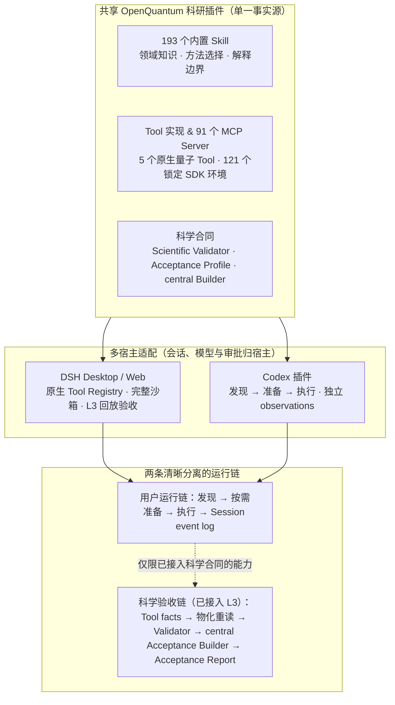
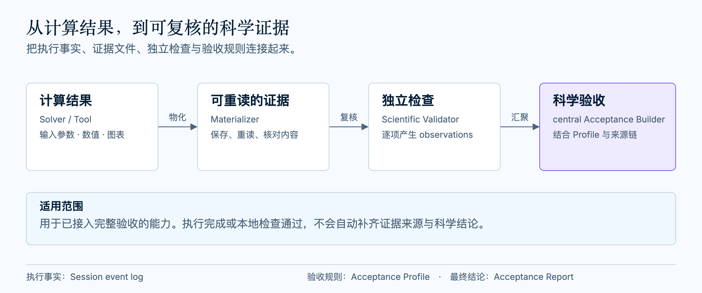

<h1 align="center">
  <picture>
    <source media="(prefers-color-scheme: dark)" srcset="./packages/openquantum-web-branding/assets/lockup-inverse.svg" />
    
  </picture>
</h1>

<p align="center">
  <strong>OpenQuantum — 共建可信的量子科研智能</strong><br />
  <sub>开源量子科研智能体插件与工作台 · 连接 121 个锁定量子与形式化环境 · 同时支持 Codex 与 Desktop</sub>
</p>

<p align="center">
  <a href="https://github.com/xi-zhao/OpenQuantum/stargazers"></a>
  <a href="https://github.com/xi-zhao/OpenQuantum/releases/tag/v0.8.11"></a>
  <a href="https://github.com/xi-zhao/OpenQuantum/actions/workflows/ci.yml"></a>
  <a href="./THIRD_PARTY_NOTICES.md"></a>
  
  <a href="https://xi-zhao.github.io/OpenQuantum/"></a>
  <a href="./CONTRIBUTING.md"></a>
</p>

<p align="center">
  <a href="./README.md"><strong>简体中文</strong></a> ·
  <a href="./docs/readme/README.en.md">English</a> ·
  <a href="./docs/readme/README.ja.md">日本語</a> ·
  <a href="./docs/readme/README.ko.md">한국어</a> ·
  <a href="./docs/readme/README.es.md">Español</a> ·
  <a href="./docs/readme/README.fr.md">Français</a> ·
  <a href="./docs/readme/README.de.md">Deutsch</a> ·
  <a href="./docs/readme/README.pt.md">Português</a> ·
  <a href="./docs/readme/README.ru.md">Русский</a> ·
  <a href="./docs/readme/README.ar.md">العربية</a>
</p>

<p align="center">
  <a href="#为什么选择-openquantum">核心亮点</a> ·
  <a href="#科研能力">科研能力</a> ·
  <a href="#优化实测">优化实测</a> ·
  <a href="#开始使用"><strong>快速开始 ↗</strong></a> ·
  <a href="#使用与结果">架构与可信机制</a> ·
  <a href="#长期发展规划">路线图</a> ·
  <a href="#开放共建">参与共建</a>
</p>

<p align="center">
  <a href="https://xi-zhao.github.io/OpenQuantum/">
    <picture>
      <source media="(prefers-reduced-motion: reduce)" srcset="./docs/images/readme/banner.webp" />
      
    </picture>
  </a>
</p>

<table>
  <tr>
    <td align="center" width="25%"><strong>193</strong><br /><sub>内置 Skill（180 自动 / 13 索引）</sub></td>
    <td align="center" width="25%"><strong>91</strong><br /><sub>MCP 服务连接（66 默认 / 25 按需）</sub></td>
    <td align="center" width="25%"><strong>121</strong><br /><sub>锁定 SDK 与源码环境</sub></td>
    <td align="center" width="25%"><strong>11 项 L3</strong><br /><sub>DSH 可回放科学验收能力</sub></td>
  </tr>
</table>

<p align="center">
  <sub>把量子科研的专业积累，汇聚到一个 OpenQuantum。上述规模对应当前源码主线静态声明，环境按需准备，科学验收逐项核对。</sub>
</p>

---

## 最新动态

- **2026-11-26** · 科学验收扩展至 **11 项可回放 L3 能力**（覆盖基态 VQE、量子信息审计、QCEC 等价性、QEC 存储、哈密顿量演化、QPanda QUBO、LDPC 译码、PyZX、Symmer、PauLie 与 Graphix），所有宿主侧科学参考子进程统一纳入完整沙箱隔离。
- **2026-11** · 源码主线新增 **MWPF**（超图译码与权重界）、**PPVM**（近 Clifford 丢失/泄漏）、**tropidist**（纠错故障距离见证）与 **ST-GRAPE**（多误差源鲁棒脉冲控制）固定原生 SDK 环境，并完成 PyZX 0.10.8 升级回归。
- **2026-11-09** · 统一发布 **[OpenQuantum v0.8.11](docs/releases/v0.8.11.md)**（[Desktop DMG](https://github.com/xi-zhao/OpenQuantum/releases/tag/v0.8.11) & [Codex 插件](https://github.com/xi-zhao/OpenQuantum/releases/tag/codex-v0.8.11)）：双端共用有界 Tool 执行后端，新增 **SlowQuant**、**TNQS** 与 **RcmpsCore** 工作流。
- **2026-10** · 发布两项完整调用实测优化案例：**QuTiP Wigner 函数 5.69× 提速**（最大绝对差 `6.52 × 10⁻¹⁶`）与 **PennyLane Pauli 对易子 5.09× 提速**，全部原始计时与核对脚本公开可复跑。

<p align="center"><strong>▶ 78 秒了解 OpenQuantum</strong></p>

https://github.com/user-attachments/assets/5c00a30d-eef0-493a-975f-3faeb200cc9e

<p align="center"><sub>2026-11-02 演示，片中能力数量为当时快照；当前能力与验证边界见下方目录。<a href="docs/communications/video/README.md">来源与复跑说明</a></sub></p>

---

## 为什么选择 OpenQuantum

让通用大模型直接做量子科研，往往卡在三件事：**反复从零手写容易出错的代码、上百个跨语言量子软件环境碎片化、以及看似合理却难以核对的计算结果。**

OpenQuantum 以一份**共享量子科研插件**连接社区专业软件、论文方法与独立核对机制，让 AI 从研究问题出发，选对方法、跑出真实计算、留下可复算的依据。

<table>
  <tr>
    <td width="50%" valign="top">
      <strong>全面 · 覆盖量子科研主流软件栈</strong><br />
      整合 Qiskit、PennyLane、QuTiP、Stim、PyMatching、TeNPy、Mitiq、PyZX、OpenFermion、Lean 4 等 <strong>121 个锁定环境</strong>（Python 109 / Julia 9 / Native 2 / Lean 1）与 <strong>49 项可执行算法示例</strong>，从教学入门到前沿多体、场论、纠错与硬件发现一站直达。
    </td>
    <td width="50%" valign="top">
      <strong>高效 · 针对核心瓶颈持续优化</strong><br />
      不止于封装调用：针对高频计算瓶颈提供可复跑的端到端加速实践，在固定输入上实测 <strong>QuTiP 5.69×</strong> 与 <strong>PennyLane 5.09×</strong> 完整调用提速，并保留逐点误差与独立复算对照。
    </td>
  </tr>
  <tr>
    <td width="50%" valign="top">
      <strong>可信 · 运行完成 ≠ 科学验收通过</strong><br />
      严格区分 Tool 执行完成与科学验收：支持独立数值参考、物化结果重读、Scientific Validator 独立检查、central Acceptance Builder 统一推导验收，以及 <strong>Lean 4 / mathlib / physlib</strong> 机器证明核查。
    </td>
    <td width="50%" valign="top">
      <strong>开放 · 共享插件，多宿主自由切换</strong><br />
      同一套领域能力同时支持 <strong>Codex 插件</strong> 与 <strong>OpenQuantum Desktop / Web</strong>，不造第二套 Agent Runtime，不绑定模型厂商（BYOM，支持任意 Tool Calling 模型），自有代码 MIT 开源。
    </td>
  </tr>
</table>

---

<a id="科研能力"></a>
<a id="可以用它做什么"></a>
<a id="openquantum-的核心能力"></a>
<a id="能力接口目录"></a>

## 科研能力全景

**广阔的专业世界，一个共同的起点。** 社区提供专业软件、算法与公开研究；OpenQuantum 持续筛选、适配、锁定环境并补齐核对路径，把专业积累变成 AI 可直接调用的科研工作流。

| 量子算法与线路 | 量子系统与多体 | 纠错与误差抑制 |
| --- | --- | --- |
| [Qiskit](https://github.com/Qiskit/qiskit) · [PennyLane](https://github.com/PennyLaneAI/pennylane) | [QuTiP](https://github.com/qutip/qutip) · [TeNPy](https://github.com/tenpy/tenpy) | [Stim](https://github.com/quantumlib/Stim) · [PyMatching](https://github.com/oscarhiggott/PyMatching) |
| [PyZX](https://github.com/zxcalc/pyzx) · [Graphix](https://github.com/TeamGraphix/graphix) | [OpenFermion](https://github.com/quantumlib/OpenFermion) · [Dynamiqs](https://github.com/dynamiqs/dynamiqs) | [Mitiq](https://github.com/unitaryfoundation/mitiq) · [MQT QECC](https://github.com/munich-quantum-toolkit/qecc) |
| [pytket](https://github.com/CQCL/tket) · [MQT QCEC](https://github.com/munich-quantum-toolkit/qcec) | [Bloqade](https://github.com/QuEraComputing/bloqade-python) · [Pulser](https://github.com/pasqal-io/Pulser) | [Chromobius](https://github.com/quantumlib/chromobius) · [Deltakit](https://github.com/Deltakit/deltakit) |

### 按研究方向查找能力

按任务直接调用现成入口，或通过 `quantum-sdk-workbench` 编写自定义 Python / Julia / Lean 研究程序；跨工具组合时（例如先用 PyZX 优化电路、再用 QCEC 检查等价性、最后运行噪声模拟）请核对模型、单位、位序与预算，见[计算与资源配置](docs/integrations/SCALABLE_BRIDGES.md)。

| 研究方向 | 代表能力与入口 | 需要核对的边界 |
| --- | --- | --- |
| <a id="算法学习与方法比较"></a>**算法学习与方法比较** | [49 项可执行开源示例](examples/quantum-algorithms/README.md)：QFT、QPE、HHL、VQE、VQD、QAOA、QSP/QSVT、态制备、qLDPC 与薛定谔化 | 默认输入用于教学；实际误差、收敛与方法假设逐项检查 |
| **电路编译、仿真与互操作** | Qiskit、PennyLane、PyZX、Graphix、MQT QCEC / QMAP / DDSIM、pytket、Compact、QCut、qBraid、Clifft、[PPVM](.agents/skills/ppvm-simulation/SKILL.md)、密度矩阵审计；[目录](docs/CAPABILITIES.md#电路与量子信息) | 门集、位序、噪声模型、等价性范围；PPVM 非对称丢失存活反作用未实现 |
| **基态、量子化学与多体** | VQE（含可回放 L3 验收）、SQD、TeNPy DMRG、OpenFermion、pyChemiQ、Flow-VQE、OpenQARP、Symmer、PauLie、QPanda / Ocean / Kaiwu；[目录](docs/CAPABILITIES.md#基态化学与优化) | 活性空间、粒子与对称性扇区、收敛条件与独立参考 |
| **分子光谱、图张量与场论** | [SlowQuant](.agents/skills/slowquant-response/SKILL.md)（分子线性响应与吸收谱）、[TNQS](.agents/skills/tnqs-dynamics/SKILL.md)（非规则图张量网络与 CTMRG）、[RcmpsCore](.agents/skills/rcmps-field-theory/SKILL.md)（1+1 维标量场 RCMPS） | 活性空间与响应近似、平面嵌入与环境截断、传递 gap 与 Hamiltonian 能隙区分 |
| <a id="纠错模型静态诊断"></a>**误差缓解与量子纠错** | Mitiq（ZNE/REM/PEC/CDR）、Stim / PyMatching、Deltakit、BP+LSD、Chromobius、[MWPF](.agents/skills/mwpf-decoding/SKILL.md)、[tropidist](.agents/skills/tropidist-distance/SKILL.md)、[emlint](.agents/skills/emlint-dem-audit/SKILL.md)；[目录](docs/CAPABILITIES.md#误差缓解与量子纠错) | 采样预算与统计误差、故障模型假设；静态 DEM 诊断与小例回归不证明码距或阈值 |
| **动力学、中性原子与脉冲控制** | Trotter / qDrift、Dynamiqs、OQuPy、TJM、Bloqade Analog、Pulser、PairInteraction、[ST-GRAPE](.agents/skills/stgrape-control/SKILL.md)、QUA / LabOne Q / Qblox / Qililab / OQC QAT；[目录](docs/CAPABILITIES.md#哈密顿量模拟与开放系统) | 单位、截断、时间网格与噪声假设；离线脉冲编译与真实设备控制严格区分 |
| **光子计算与量子网络** | Perceval、Piquasso、Lightworks、MerLin、MrMustard、SimQN、NetQASM / SquidASM；[目录](docs/CAPABILITIES.md#光子计算与量子网络) | 模式顺序、Fock 截断、损耗模型与外部许可（NetSquid 需另行授权） |
| **量子硬件发现与云接口** | FieldQKit、IBM Quantum、IonQ、本源、夸父、天衍、国盾、腾讯、逻辑比特与本地 QDMI C 驱动；[后端列表](docs/CAPABILITIES.md#本地计算与量子云) | 凭据、配额与权限隔离；默认只读发现，真机任务接口按需显式开启 |
| <a id="数学与物理形式化"></a>**形式化证明与公开基准** | [Lean 4 / mathlib / physlib](.agents/skills/lean-physics/SKILL.md)（定理复用与公理检查）、[Quantum-Practices（66 指南）与 Metriq（410 历史基准）](docs/CAPABILITIES.md#参考资料与选型) | 形式证明仅覆盖文件中定义与公理；历史基准不代表当前硬件实时性能 |
| <a id="量子学习通"></a>**教学材料与互动课堂** | [量子学习通 / OpenMAIC](docs/integrations/OPENMAIC.md)：课程库、课件编辑、PPTX 导入、测验与互动课堂 | 完整课程体系仍在建设，真实在线 AI 教学流程尚未完整验收 |

<details>
<summary><strong>展开查看：前沿原生 SDK 环境快速准备与专项边界（SlowQuant / TNQS / RcmpsCore / PPVM / MWPF / tropidist / ST-GRAPE）</strong></summary>

以下新增原生 SDK 环境均遵循“显式准备 → 通过宿主代码工具调用公开 API”，不会在普通计算调用时隐式安装依赖：

| 能力 | 显式准备命令 | 示例与说明 | 专项验证边界 |
| --- | --- | --- | --- |
| **SlowQuant** | `node scripts/setup-sdk.mjs slowquant-response` | [Skill](.agents/skills/slowquant-response/SKILL.md) · [边界说明](docs/integrations/SLOWQUANT.md) | 已验证小规模离线响应；Qiskit 分子谱学与硬件另行核验 |
| **TNQS** | `node scripts/setup-sdk.mjs tnqs-dynamics` | [Skill](.agents/skills/tnqs-dynamics/SKILL.md) · [边界说明](docs/integrations/TNQS.md) | 公开 Julia API；小系统对照不代表大规模收敛或科学验收 |
| **RcmpsCore** | `node scripts/setup-sdk.mjs rcmps-field-theory` | [Skill](.agents/skills/rcmps-field-theory/SKILL.md) · [边界说明](docs/integrations/RCMPS.md) | 传递 gap 不等于 Hamiltonian 能隙；试探态示例不证明相互作用基态或质量谱 |
| **PPVM** | `node scripts/setup-sdk.mjs ppvm-simulation` | [Skill](.agents/skills/ppvm-simulation/SKILL.md) · [边界说明](docs/integrations/PPVM.md) | 准备会构建固定版本 Rust 扩展；`LOST` 与比特分开，`reset_state` 不恢复丢失/泄漏 |
| **MWPF** | `node scripts/setup-sdk.mjs mwpf-decoding` | [可编辑示例](.agents/skills/mwpf-decoding/references/native-example.py) · [独立小例](docs/integrations/evidence/mwpf-2026-11-06.json) | Sinter 显式使用 `PanicAction.RAISE`，零 cluster 预算非无限预算；浮点 primal/dual 界非形式化证明 |
| **tropidist** | `node scripts/setup-sdk.mjs tropidist-distance` | [可编辑示例](.agents/skills/tropidist-distance/references/native-example.py) · [独立对照](docs/ecosystem/proposals/tropidist.md) | 限已声明的单位权故障模型，分别核对下界与上界见证 |
| **ST-GRAPE** | `node scripts/setup-sdk.mjs stgrape-control` | [两比特示例](.agents/skills/stgrape-control/references/native-example.py) · [独立传播对照](docs/ecosystem/proposals/st-grape.md) | 限固定时间网格与噪声假设；核对分裂子步精度与迭代预算终止状态 |

</details>

<details>
<summary><strong>展开查看：支持的本地计算与量子云后端（发现只读，真机按需开启）</strong></summary>

本地数值计算无需任何量子云账户。真实硬件与付费云服务默认关闭或保持只读发现，按需在「OpenQuantum 设置」保存对应凭据并显式启用：

| 后端 | 支持范围 | 凭据与开关策略 |
| --- | --- | --- |
| **本地数值后端** | 电路、噪声、基态、化学、多体、纠错、光学、脉冲仿真（121 个锁定环境） | 无需云凭据；首次使用前显式准备对应锁定依赖 |
| **IBM Quantum** | Runtime、AI Transpiler、硬件查询；可选真机任务提交与取消 | `QISKIT_IBM_TOKEN`；任务类 MCP 连接默认关闭（按需开启） |
| **IonQ** | 硬件查询；可选真机任务提交、取消与成本估算 | `IONQ_API_KEY`；任务类 MCP 连接默认关闭（按需开启） |
| **本源量子云** | 只读后端发现（FieldQKit）；另经 QPanda3 Runtime 查询悟空 QPU 与可选真机任务 | `ORIGIN_API_TOKEN` 只读发现；`QPANDA3_API_KEY` 可选真机任务 |
| **国内量子云（只读发现）** | 夸父、天衍、国盾、腾讯、FieldQuantum、逻辑比特的后端发现、拓扑与校准摘要 | 各自 API Token，默认只读发现，不改变远端服务状态 |
| **QDMI 本地设备接口** | 通过显式配置的固定 C 驱动只读查询设备、门集与耦合关系 | 需显式运行 `npm run capability:qdmi:setup`；示例驱动不代表在线 QPU |

</details>

当前源码分发 **193 个内置 Skill、91 个 MCP 服务连接、5 个原生量子 Tool**，并为 **121 个 SDK/源码环境**提供原生 API 使用路径（其中 **11 项能力**已接入 DSH 侧可回放 L3 科学验收）。清单数量、配置启用、环境就绪与科学验收是相互独立的状态；已发布安装包的功能范围以各自 Release 为准。

[完整 Skill 目录](docs/CAPABILITIES.md#内置-skills) · [MCP 服务及默认开关](docs/CAPABILITIES.md#mcp-服务目录) · [原生 Tool 与副作用](docs/CAPABILITIES.md#原生量子-tools) · [SDK API 与逐库验证](docs/integrations/FULL_SDK_ACCESS.md) · [相近方法怎么选](docs/integrations/CAPABILITY_SELECTION.md)

---

<a id="优化实测"></a>
<a id="实测案例"></a>
<a id="optimization-cases"></a>

## 实测优化：更快，也经得起核对

把时间还给新的想法。针对量子科研中的高频计算瓶颈，我们保留完整端到端调用计时、逐点独立核对与全部复跑材料：

| 优化任务 | 硬件与固定基准输入 | 完整调用（原库 → 优化后） | 提速 | 独立核对与复跑材料 |
| --- | --- | ---: | ---: | --- |
| **QuTiP Wigner 函数** | Apple M4 · QuTiP 5.3.1（64 维 Fock，201×201 网格） | 171.77 ms → **30.18 ms** | **5.69×** | 最大绝对差 `6.52 × 10⁻¹⁶` · 272 项核对通过 · [报告](experiments/qutip-rust-wigner/README.md) / [JSON](experiments/qutip-rust-wigner/results/summary.json) |
| **PennyLane Pauli 对易子** | Apple M4 · PennyLane 0.45.1（32 比特，125×512 项） | 30.62 ms → **6.02 ms** | **5.09×** | 9 组基准一致 · 4,368 对 Pauli 最大误差 `1.42 × 10⁻¹⁴` · [报告](experiments/pennylane-rust-commutator/README.md) / [JSON](experiments/pennylane-rust-commutator/results/benchmark.json) |

<a id="qutip-rust-case"></a>

<p align="center"></p>

<details>
<summary><strong>QuTiP：查看计时条件与多规模对比图</strong></summary>

Apple M4，QuTiP 5.3.1；64 维、rank-4 单模密度矩阵，201 × 201 网格。单线程设定，2 次预热，9 轮交错热运行中位数。包含输入读取、转换、检查与完整输出构造；不含准备、编译、输入生成及结果核对。


[复跑指南](experiments/qutip-rust-wigner/README.md) · [汇总数据](experiments/qutip-rust-wigner/results/summary.json) · [全部原始采样](experiments/qutip-rust-wigner/results/raw-timings.csv)

</details>

<a id="pennylane-rust-case"></a>

<p align="center"></p>

<details>
<summary><strong>PennyLane：查看计时条件与全部 9 组场景对比图</strong></summary>

Apple M4，PennyLane 0.45.1；32 量子位、125 项 Hamiltonian 与 512 项局域双体算符池。单线程设定，2 次预热，9 轮热运行中位数。完整调用从 `PauliSentence` 输入到 `PauliSentence` 输出，包含双向转换与结果构造，不含准备、编译及核对。


[复跑指南](experiments/pennylane-rust-commutator/README.md) · [汇总数据](experiments/pennylane-rust-commutator/results/benchmark.json) · [全部原始采样](experiments/pennylane-rust-commutator/results/raw-timings.csv)

</details>

> [!NOTE]
> 两项计时均为专项基准（9 轮热运行中位数），包含完整输入/输出对象转换，不含环境准备与编译；加速收益仅对应各报告定义的任务与输入，不推广为所有量子计算的通用加速比，也不构成正式科学验收报告。

---

<a id="开始使用"></a>
<a id="快速开始"></a>

## 快速开始

一个 OpenQuantum，三种接入方式。它们复用同一份领域能力，所有科学计算依赖均在用到时按需准备。

| 方式 | 适合谁 | 环境前提 | 入口 |
| --- | --- | --- | --- |
| **Codex 插件** | 已使用 Codex，希望直接在原生对话中调用量子能力 | 支持插件的 Codex、Node.js 24+、npm | [安装 Codex 插件 ↓](#codex-插件) |
| **Desktop 独立应用** | 想要开箱即用的个人量子科研桌面工作台 | macOS Apple Silicon（内置 Node / uv） | [下载 Desktop ↓](#桌面安装包) |
| **源码 / Docker** | 开发者、Linux / Windows 用户、体验主线最新能力 | Git、Node.js 24+（可选 uv / Docker） | [从源码运行 ↓](#从源码运行) |

<a id="codex-plugin"></a>
<a id="codex-插件"></a>

### 方式一：Codex 插件

**让 Codex 帮你安装：** 新建聊天，直接复制以下请求：

```text
请帮我安装 OpenQuantum Codex 插件 0.8.11。先阅读安装指南：
https://github.com/xi-zhao/OpenQuantum/blob/codex-v0.8.11/docs/integrations/CODEX_AGENT_INSTALL.md
从 https://github.com/xi-zhao/OpenQuantum/releases/tag/codex-v0.8.11 下载完整安装包与 SHA256SUMS，
核对摘要后，检查 Codex、Node.js 24+ 和 npm，使用包内安装器完成安装。
请保留已有插件和用户配置，核对 Skills、MCP 工具和左侧全局“OpenQuantum 设置”入口。
需要我重载应用时，告诉我具体操作。最后报告实际验证的结果，以及仍需准备的科学计算依赖。
```

安装完成后按提示重载 Codex，在新对话中直接提出量子任务；能力开关、环境与凭据可在全局「OpenQuantum 设置」中管理。

[完整安装包与 SHA256SUMS](https://github.com/xi-zhao/OpenQuantum/releases/tag/codex-v0.8.11) · [手动安装与排障](docs/integrations/CODEX_AGENT_INSTALL.md) · [插件功能与宿主边界](docs/integrations/CODEX_PLUGIN.md)

<a id="桌面安装包"></a>

### 方式二：桌面安装包

1. 下载 **[OpenQuantum 0.8.11 DMG](https://github.com/xi-zhao/OpenQuantum/releases/download/v0.8.11/OpenQuantum-0.8.11-macOS-arm64.dmg)**（macOS Apple Silicon），按 [Release 页 SHA256SUMS](https://github.com/xi-zhao/OpenQuantum/releases/tag/v0.8.11) 核对校验和。
2. 打开镜像，将 `OpenQuantum.app` 拖入「应用程序」。
3. 启动后在「设置 → 模型」中配置你的模型服务（支持 Tool Calling）。

> [!NOTE]
> 安装包采用 ad-hoc 本地签名，尚无 Apple Developer ID 分发签名或公证；首次打开、升级备份与数据保留见[安装说明](docs/DESKTOP_INSTALLERS.md)。Intel Mac 与 Windows 暂使用 [0.8.4 能力包](https://github.com/xi-zhao/OpenQuantum/releases/tag/v0.8.4)及配套说明，或选择下方源码启动。

<a id="安装源码"></a>
<a id="从源码运行"></a>

### 方式三：从源码运行

```bash
git clone https://github.com/xi-zhao/OpenQuantum.git
cd OpenQuantum
npm ci
npm run dev
```

打开启动日志中带登录令牌的本机地址，认证后即可进入工作台（<http://127.0.0.1:3000>）。

<a id="配置模型"></a>

**配置模型：** 在「设置 → 模型」中添加 OpenAI 兼容服务地址、模型名称与 API Key。Agent 执行计算任务需要模型支持 **Tool Calling**；模型凭据与量子云凭据分别隔离存储。暂未配置模型密钥时，也可以直接运行下方[零密钥基态复算案例](#无需模型密钥复算基态案例)。

<details>
<summary><strong>其他启动方式：源码桌面、Docker（Linux）、量子学习通与消息渠道</strong></summary>

| 入口 | 命令（在源码目录执行） | 说明 |
| --- | --- | --- |
| **桌面客户端（源码）** | `npm run desktop:setup` → `npm run desktop:verify-install` → `npm run desktop -- --source` | 另需 Corepack 与系统 C++ 构建工具；[详细说明](docs/DEPLOYMENT.md#方式三原生桌面工作台) |
| **Docker Compose（Linux）** | `cp .env.example .env && docker compose up --build` | 仅限 Linux host network 本机隔离试用；[详细说明](docs/DEPLOYMENT.md#方式四docker-compose) |
| **量子学习通（教学应用）** | `npm run learning:ui:setup` | 独立课程与互动课堂界面；[启动与备份说明](docs/integrations/OPENMAIC.md) |
| **微信 / 飞书等消息渠道** | `npm run cc-connect:setup` | 通过 CC Connect 复用工作台能力；[渠道配置](docs/integrations/CC_CONNECT.md) |

Web 与源码 Desktop 共用本机 `.openquantum/dsh` 目录，切换入口前先退出正在运行的进程。

</details>

[模型与部署配置](docs/DEPLOYMENT.md) · [按需准备计算环境](docs/integrations/LOCAL_ENVIRONMENTS.md) · [升级与数据保留](docs/UPDATES.md) · [故障排查](docs/TROUBLESHOOTING.md)

### 30 秒跑通第一个可核对任务

<a id="无需模型密钥复算基态案例"></a>

#### 1. 无需模型密钥：复算固定 H₂ 算符基态

完成 `npm ci` 后即可运行原生 `solve_and_validate_ground_state` Tool，在固定 `hamming-weight = 1` 扇区中运行无噪声 VQE 并用独立闭式解核对：

```bash
npm run demo:quantum-ground-state
```

<table>
  <tr>
    <td align="center" width="25%"><strong>-1.85727503 Ha</strong><br /><sub>VQE 计算能量</sub></td>
    <td align="center" width="25%"><strong>-1.85727503 Ha</strong><br /><sub>独立闭式精确参考</sub></td>
    <td align="center" width="25%"><strong>4.44 × 10⁻¹⁶ Ha</strong><br /><sub>绝对能量差</sub></td>
    <td align="center" width="25%"><strong>15 项通过</strong><br /><sub>本地计算检查</sub></td>
  </tr>
</table>

<sub>以上参考数值来自 [2026-09-12 本地复验记录](docs/examples/quantum-ground-state-local-demo-2026-09-12.json)。该命令执行本地计算与 15 项独立检查，未执行会话来源链检查，因此不构成完整科学验收结论；见[输入与验证边界](docs/EXAMPLES.md#不需要模型密钥复算一个固定案例)。</sub>

#### 2. 让 Agent 执行：Bell 态制备与有限采样

先为 FatQat 准备固定依赖（需安装 [uv](https://docs.astral.sh/uv/getting-started/installation/)），再在已配置模型的工作台或 Codex 中发送请求：

```bash
node scripts/setup-paper-tools.mjs fatqat-workbench
```

> 用 FatQat 从双量子位全零态出发，对 q0 施加 H，再以 q0 为控制位、q1 为目标位施加 CX。返回无噪声精确概率，并用 1024 次采样、seed=7 比较频数。

理想概率为 `00`、`11` 各 50%，有限采样存在统计波动。工作台会保留完整的 Tool 调用、输入参数与返回输出，方便继续追问或对比 8192 次采样的偏差。

<details>
<summary><strong>3. 直接从命令行运行 49 项开源算法示例（如 HHL）</strong></summary>

无需模型密钥或量子云账户，先准备最小基础环境（NumPy / SciPy / Qiskit）：

```bash
npm run capability:algorithms:setup -- --minimal
examples/quantum-algorithms/.venv/bin/python examples/quantum-algorithms/run.py --list
examples/quantum-algorithms/.venv/bin/python examples/quantum-algorithms/run.py --algorithm hhl
```

更多依赖组（`pennylane`、`gradients`、`tensor`、`chemistry`）与 Windows 命令见[算法示例指南](docs/EXAMPLES.md#直接运行开源算法示例)。

</details>

[更多可复制的研究任务](docs/EXAMPLES.md) · [49 项开源算法目录](examples/quantum-algorithms/README.md)

---

<a id="使用与结果"></a>
<a id="执行记录与科学验收"></a>

## 架构与可信科研机制

OpenQuantum 的产品核心是一份**与宿主解耦的共享科研插件**（Skills、Tool implementation、MCP Server 与科学合同）。DSH Desktop / Web 与 Codex 各自拥有会话、模型、权限、审批与执行循环；OpenQuantum 不引入第二套通用 Agent Runtime。



<table>
  <tr>
    <td width="50%" valign="top"><a href="./docs/images/openquantum-desktop-20261013.jpg"></a><br /><sub>Desktop 科研工作台 · 2026-10-13 实际界面（0.8.11 已进一步收拢侧栏与设置）</sub></td>
    <td width="50%" valign="top"><a href="./docs/images/openquantum-settings-categories-20261013.jpg"></a><br /><sub>按用途分组的能力设置（支持搜索、筛选与连接管理）· 2026-10-13 实际界面</sub></td>
  </tr>
</table>

<details>
<summary><strong>查看更多界面与完整架构 / 证据流程图（Codex 设置页 · 平台架构图 · 科学证据流）</strong></summary>

- **Codex 插件全局设置页（历史界面参考 0.7.5）**：[查看原图](docs/images/openquantum-codex-settings-20261011.png)
- **科研工作台架构图**：[查看原图](docs/images/openquantum-platform-overview.png) · [全项目架构图与运行流程](docs/architecture/PROJECT_ARCHITECTURE.md)
- **科学证据与验收流程**：

<p align="center"></p>

</details>

> [!IMPORTANT]
> **四条科学可信原则（日常使用遵循「发现 → 准备 → 执行」，计算调用不隐式安装依赖）：**
> 1. **以实际执行记录为准**：设置中“已启用”和模型文字回复，不能替代 Tool 调用、程序源码与真实结果文件。
> 2. **严格区分完成与验收**：工程 CI、独立数值参照、形式证明和科学验收分别报告；只有经物化重读、独立 Validator 与 central Acceptance Builder 结合来源链推导后，才给出科学验收结论（当前 DSH 侧已接通 11 项可回放 L3 能力；Codex 侧提供执行期独立 observations，自动物化与会话验收尚未接通）。
> 3. **沙箱与工作区隔离**：DSH 的研究工作区须与 OpenQuantum 安装目录、运行环境和 DSH Home 分开；内置科学 MCP 与宿主侧独立参考子进程均在完整文件沙箱内运行，见[科学计算执行边界](docs/DEPLOYMENT.md#科学计算执行边界)。
> 4. **保留完整可复算材料**：记录输入、单位、随机种子、依赖版本、失败与负结果；科学判断仍由研究者本人负责。

[结果与证据说明](docs/EXAMPLES.md#方法与结果可以继续复用) · [架构总入口](docs/README.md) · [常见问题](docs/TROUBLESHOOTING.md)

---

<a id="长期发展规划"></a>
<a id="rsi"></a>

## 路线图

OpenQuantum 的目标是让每一次量子研究不仅产出可核对的结果，也留下能帮助下一次研究的方法与工具。以下区分已交付基线与长期探索方向，后者不视为承诺交付清单：

| 阶段 | 核心主题 | 当前状态与说明 |
| --- | --- | --- |
| **已交付基线** | 共享科研插件与双宿主交付 | 193 Skill、91 MCP 连接、121 锁定 SDK 环境；Desktop & Codex 插件同步至 `v0.8.11`；11 项可回放 L3 科学验收与全沙箱参考隔离 |
| **持续演进** | 专业软件生态、量子-经典协同与教学 | 持续扩大高质量 L2/L3 科学验收覆盖，完善本地 CPU / GPU / HPC / QPU 协同调度、仪器接口探索与[量子学习通](docs/integrations/OPENMAIC.md)课程体系 |
| **长期愿景（RSI）** | 经验证的研究能力递归自改进 | 探索“真实任务 → 候选改进 → 独立评估与新任务对照 → 授权升级”闭环；**完整 RSI 闭环尚未实现**，权限边界与评估条件见[长期发展规划](docs/roadmap/VISION.md) |

---

<a id="开放共建"></a>
<a id="开发与贡献"></a>

## 参与共建

优秀的软件、算法与论文方法来自开放的科研社区。欢迎把你的研究问题、工具、论文复现或高质量负结果带进来，一起建设研究者用得上、能检验、愿意信赖的量子科研智能。

**[阅读贡献指南 ↗](CONTRIBUTING.md)** · **[提出研究问题 / Issue](https://github.com/xi-zhao/OpenQuantum/issues)** · **[社区行为准则](CODE_OF_CONDUCT.md)**

| 你想贡献什么 | 成熟度路径 | 从哪里开始 |
| --- | --- | --- |
| **领域方法、步骤、工具选择与边界** | `L0` Skill | 编写原生 `SKILL.md`；见[贡献指南](CONTRIBUTING.md)与[现有 Skill 目录](.agents/skills/README.md) |
| **确定性计算、查询或设备接口** | `L1` Tool / MCP | 按隔离边界选择原生 Tool Provider 或 MCP Server；见[扩展对象模型](docs/architecture/EXTENSION_MODEL.md) |
| **独立科学检查与可回放验收** | `L2 / L3` Validator | 接入 JSON Schema、Scientific Validator、Acceptance Profile 与 central Builder；见[四条贡献路径](docs/README.md#四条贡献路径) |
| **完整应用、课程或可复算案例** | 案例 / 应用 | 说明用户任务、输入输出、来源、许可与验证范围；提交至 [GitHub Issues](https://github.com/xi-zhao/OpenQuantum/issues) |

共享实现只维护一份：研究方法进入共享插件，再适配 DSH、Codex 等宿主。本地开发全仓离线质量检查入口为：

```bash
npm run check
```

按改动选择的专项数值与宿主验证见[开发与验证示例](docs/EXAMPLES.md#开发与验证)。

---

## 文档导航

| 主题 | 权威文档 |
| --- | --- |
| **安装、部署、升级与排障** | [Desktop 安装](docs/DESKTOP_INSTALLERS.md) · [Codex 插件安装](docs/integrations/CODEX_AGENT_INSTALL.md) · [部署启动](docs/DEPLOYMENT.md) · [升级指南](docs/UPDATES.md) · [故障排查](docs/TROUBLESHOOTING.md) |
| **能力、接口与环境准备** | [能力与接口参考](docs/CAPABILITIES.md) · [完整 SDK 与逐库审计](docs/integrations/FULL_SDK_ACCESS.md) · [本地计算环境](docs/integrations/LOCAL_ENVIRONMENTS.md) · [相近方法选型](docs/integrations/CAPABILITY_SELECTION.md) |
| **任务示例与算法程序** | [任务示例与验证](docs/EXAMPLES.md) · [49 项算法示例](examples/quantum-algorithms/README.md) · [QuTiP 案例](experiments/qutip-rust-wigner/README.md) · [PennyLane 案例](experiments/pennylane-rust-commutator/README.md) |
| **架构、治理与贡献规范** | [文档与架构总入口](docs/README.md) · [全项目架构图](docs/architecture/PROJECT_ARCHITECTURE.md) · [扩展治理清单](docs/architecture/EXTENSION_GOVERNANCE.md) · [贡献指南](CONTRIBUTING.md) |
| **版本演进与图片来源** | [Changelog](CHANGELOG.md) · [GitHub Releases](https://github.com/xi-zhao/OpenQuantum/releases) · [长期发展规划](docs/roadmap/VISION.md) · [图片与截图说明](docs/images/README.md) |

---

## 引用

如果 OpenQuantum 对你的量子科研、算法对比或教学工作有所帮助，欢迎通过仓库的 [`CITATION.cff`](CITATION.cff) 或下方 BibTeX 引用本项目：

```bibtex
@software{zhao2026openquantum,
  author  = {Zhao, Xi and {OpenQuantum contributors}},
  title   = {OpenQuantum: Building Trustworthy AI for Quantum Research},
  year    = {2026},
  version = {0.8.11},
  url     = {https://github.com/xi-zhao/OpenQuantum}
}
```

## 开源生态与许可

OpenQuantum 建立在量子开源社区和宿主平台的工作之上，完整保留原作者、项目来源与贡献归属。[上游项目及适配关系](docs/CAPABILITIES.md#开源生态与致谢)与 [`THIRD_PARTY_NOTICES.md`](THIRD_PARTY_NOTICES.md) 集中列出了全部来源与许可协议。

- 自有代码除单独声明的目录外采用 [MIT License](LICENSE)（© 2026 Xi Zhao）。
- `mitiq-error-mitigation` 能力目录采用 [GPL-3.0-only](.agents/skills/mitiq-error-mitigation/LICENSE)；Metriq 公开数据快照采用 [CC-BY-4.0](src/metriq-data/upstream/LICENSE)；对应 NOTICE 与再分发条款继续适用。
- 仅分享已获授权的内容；发现安全漏洞请按[安全政策](SECURITY.md)私密报告。

<br />

<p align="center">
  <picture>
    <source media="(prefers-color-scheme: dark)" srcset="./packages/openquantum-web-branding/assets/lockup-inverse.svg" />
    
  </picture>
</p>

<p align="center">
  <strong>开源开放，一起向前。</strong><br />
  <sub>OpenQuantum · 量子计算，就在指尖。</sub>
</p>

<p align="center">
  <sub>
    如果 OpenQuantum 对你的研究有帮助，欢迎点亮一颗 <a href="https://github.com/xi-zhao/OpenQuantum">⭐ Star</a> ·
    <a href="https://xi-zhao.github.io/OpenQuantum/">官网</a> ·
    <a href="https://github.com/xi-zhao/OpenQuantum">GitHub</a> ·
    <a href="./LICENSE">MIT 许可</a> ·
    <a href="./THIRD_PARTY_NOTICES.md">组件与开源许可</a>
  </sub>
</p>
