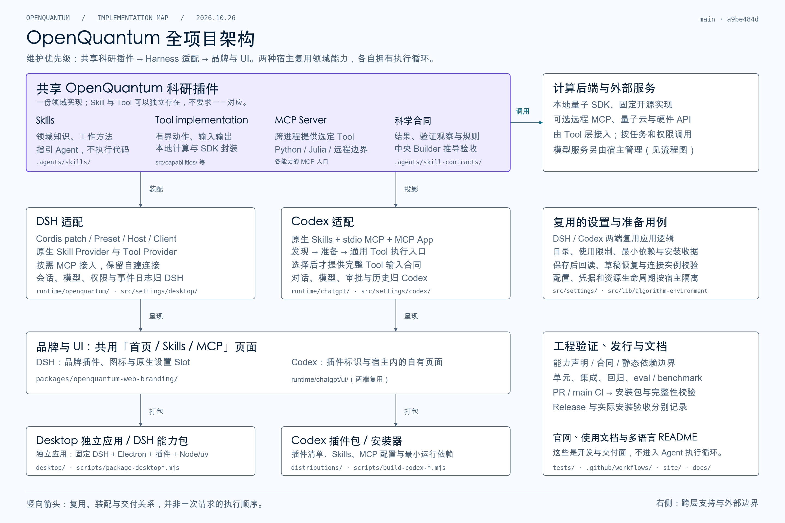
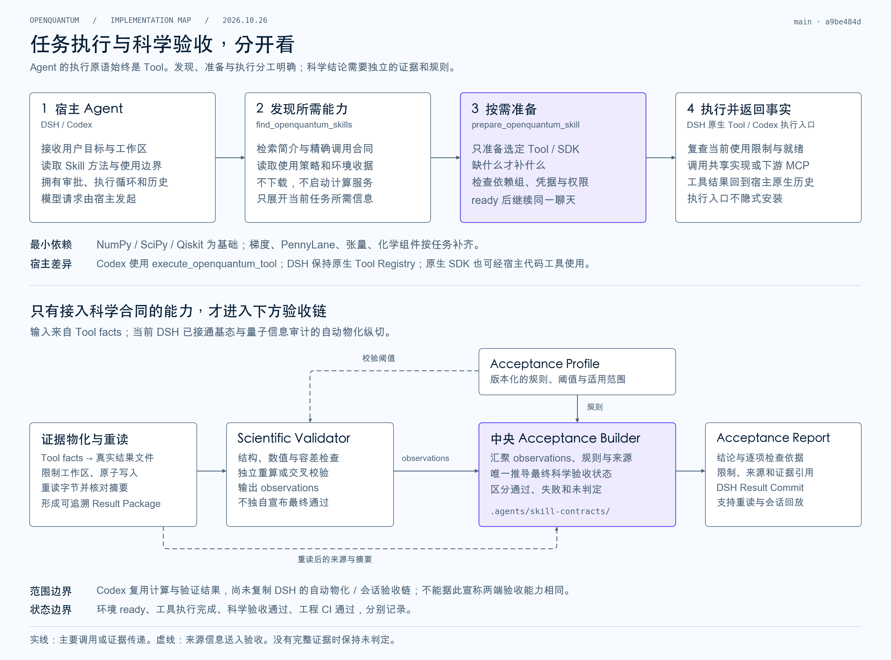

# OpenQuantum 全项目架构与运行流程

用户于 2026-10-26 确认以下架构，作为后续维护方向。维护顺序固定为：
**共享科研插件 → Harness 适配 → 品牌与 UI**，打包负责组合和交付。

本页保存架构图及其阅读边界；执行约束见根目录
[AGENTS.md](../../AGENTS.md#已确认的架构图与维护约束)。
术语、模块接口和状态权威继续分别由 [CONTEXT.md](../../CONTEXT.md)、
[模块地图](MODULES.md)与[文档总入口](../README.md)定义，不建立第二套架构契约。

## 全景架构

图中竖向箭头表示复用、装配与交付关系，不是一次请求的执行顺序。右侧展示跨层支持与外部边界。
能力目录按职责归并，没有逐项罗列所有量子库。

- **共享插件**拥有领域 Skill、Tool implementation、MCP Server 与科学合同；共享执行不依赖某个宿主。
- **DSH / Codex 适配**负责各自的注册、协议、权限、凭据映射和生命周期；会话、模型、执行循环与历史由宿主拥有。
- **设置与准备**复用目录和用例逻辑，各宿主保存自己的配置和凭据。实现复用不等于已经拆成独立通用包。
- **品牌与 UI**复用自有页面，通过宿主扩展控制相应品牌元素；Desktop 是带品牌的 DSH 交付形态。
- **打包与工程交付**组合发行内容、检查和文档；CI、Release、实际安装与科学验收分别验证。

## 任务执行与科学验收

发现保持只读；准备只补齐所选能力的依赖和配置；执行入口不隐式安装。
Codex 使用 `execute_openquantum_tool`，DSH 保持原生 Tool Registry。Skill 指导 Agent，实际动作由 Tool 执行。

科学验收链独立于执行完成：Tool facts 经 Materializer 保存、重读和核对摘要，Validator 产生 observations，
Acceptance Profile 提供规则，只有 central Acceptance Builder 推导最终 Acceptance。

**图示时的实现范围：**DSH 已为量子基态与量子信息审计接通自动物化和会话验收；Codex 复用计算与验证结果，
其原生适配仍将未核实的 provenance 保留为 `not_checked`，没有复制 DSH 的自动物化和会话验收链。
这不是所有能力或所有宿主均已完成科学验收的声明；后续维护应重新核对相关实现。

## 实现导航与更新方式

| 关注点 | 实现与契约 |
| --- | --- |
| 对象职责和依赖方向 | [扩展对象模型](EXTENSION_MODEL.md)、[模块地图](MODULES.md) |
| 共享能力与科学合同 | [能力声明](../../.agents/capability-packages.yml)、[原生 Tool](../../src/capabilities/native-quantum-tools.mjs)、[科学合同](../../.agents/skill-contracts/index.mjs) |
| DSH 装配、准备与资源所有权 | [Desktop 按需准备](../integrations/DESKTOP_PREPARATION.md)、[Desktop Application Interface](../../src/settings/desktop/application.mjs) |
| Codex 接入与执行 | [Codex 插件](../integrations/CODEX_PLUGIN.md)、[执行入口](../../runtime/chatgpt/agent-tools.mjs)、[原生适配边界](../../runtime/chatgpt/native-adapter.mjs) |
| 设置保存与最小依赖 | [设置恢复](../../runtime/chatgpt/ui/settings-recovery.mjs)、[算法环境](../../src/lib/algorithm-environment.mjs) |
| 品牌与打包 | [品牌插件](../../packages/openquantum-web-branding/desktop.mjs)、[Desktop 打包](../../scripts/package-desktop-app.mjs)、[Codex 打包](../../scripts/build-codex-plugin.mjs) |
| 科学验收接入 | [结果适配器](../../runtime/openquantum/agent-presets/openquantum/scientific-result-adapters.mjs)、[证据物化](../../runtime/openquantum/agent-presets/openquantum/scientific-result-materializer.mjs) |

图的源码快照为 [main · a9be484d](https://github.com/xi-zhao/OpenQuantum/commit/a9be484d081e404b8077a35bca55d3fca33a4b9b)，
包含 PR #64 的按需执行、最小依赖和设置恢复改进。源码快照不代表已发布或本机已安装的版本同步更新。

两图由 Matplotlib 3.10.7 绘制，沿用 OpenQuantum 配色；仓库内图片可独立查看，不依赖本机聊天工件路径。
职责、接口或宿主支持范围变化时，在同一改动中更新受影响的图、快照说明和相应契约。
局部实现调整不要求重画全图；不以更新图表为由扩大产品改动范围。
