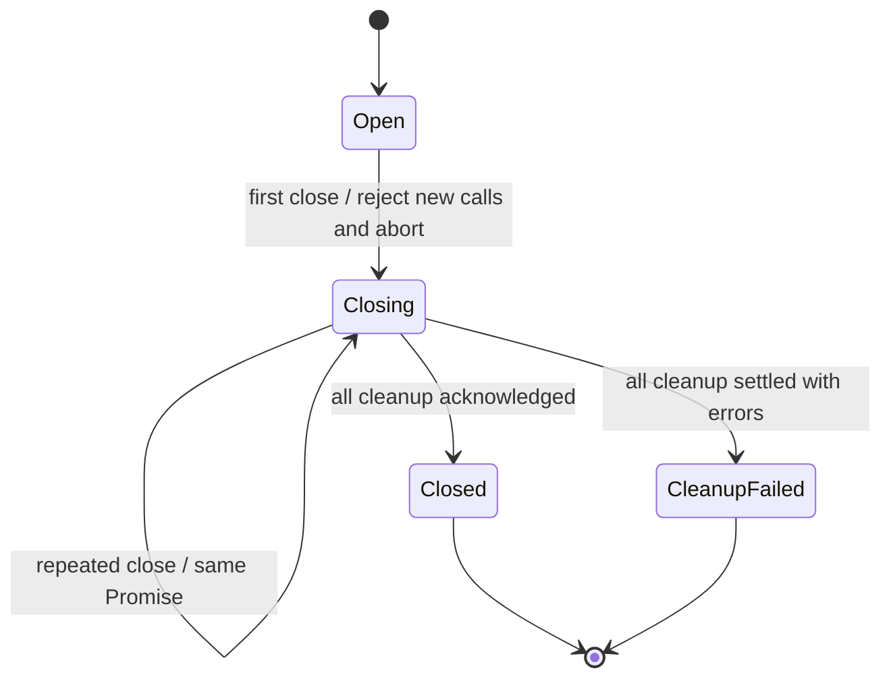

# 隐式状态协议清单与维护决策

审计日期：2026-11-09。初始扫描基线：`f8f01152`；共享 backend 抽取基线：`f9cd8044`。本文包含其后的关闭与轮询修复。

## 范围与结论

从 1,031 个 Git 跟踪的源码文件中筛选并扫描 561 个主要自有实现文件，得到 159 个候选文件，再追踪生命周期、异步边界、持久标记和相关测试，归并出 **44 组状态协议**。另核对官网、工程探针及代表性示例；不展开第三方依赖内部，也不检查未跟踪研究输出。

44 是按职责归组的维护清单，包含部分已有显式状态字段的协议，不是 44 个缺陷，也不是对任意运行路径的完备性证明。清单中的“验证入口”说明已有测试落点，不表示本轮执行了全部测试。初始审计后，本轮重点复核和验证共享 backend、两端设置及准备路径。

决定是保留已有的专用协议和宿主边界，修复可复现的失败路径。没有新增生产依赖、通用状态机框架或第二套 Agent Runtime。成熟方案已经存在于仓库：外部会话通过一次关闭 Promise 回收资源，设置通过串行命令与回读恢复，安装通过事务 journal 恢复；各处应复用相同原则，但不合并不同所有权和持久化语义。

## 已落实的改进

| 范围 | 原来的失败场景 | 当前规则 | UX / DX / AX 收益 |
| --- | --- | --- | --- |
| C01 共享关闭 | 外部 MCP 回收抛错时，关闭流程提前返回，普通调用仍可能清理资源 | 禁止新调用后，等待所有在途清理，再统一返回唯一关闭结果；重复关闭不重复调用 Adapter | 用户得到准确结束反馈；两个宿主共用同一合同；Agent 不把取消请求误当资源释放 |
| C01 清理错误 | 普通连接的 finally 清理错误绕过调用错误保护；关闭也可能未报告该错误 | 清理回执归属调用本身；关闭等待者收集失败；配置了凭据时使用安全错误，不附原错误 cause | 失败可判断，错误路径保持凭据保护 |
| B02 设置进度 | 页面通过宿主通知取得 preparing 快照时，没有启动轮询，需手动刷新；并发入口可能安排重叠读取 | 所有快照统一进入 PreparationPoller；单次读取、隐藏暂停、回来恢复、结束停止 | UI 跟上 Agent 启动的准备；开发者只维护一处调度；Agent 与用户看到同一设置事实 |

普通设置保存协议 B01 保持原合同：**成功读到最新 snapshot 会清除 pending，但不一定能确认那次写入**。连接新增/编辑还需要实例回执；无法确认时保留草稿并提示核对。只有回读仍失败才继续阻止写入；任何恢复路径都不自动重发写命令。密钥输入遵循不同规则，提交后及页面关闭时清空。



图描述共享 backend 的关闭合同，不新增持久状态、事件日志或 Agent 执行状态。调用容量直接来自 calls Map，移除单独计数器与 drain 集合，减少需要同时维护的数据。

## 全部协议及处理决定

除 B02、C01 本轮修复外，其余条目保留现有实现。高风险不自动意味着重写：带任务身份、租约、事务或验收证据的协议，首先维护归属和失败路径；简单展示状态继续保持局部实现。

### A · 准备与执行

**A01 · 环境安装／检查任务**（半显式；保留现有专用协议）

归属：[src/settings/codex/environments.mjs](../../src/settings/codex/environments.mjs)、[src/settings/codex/environment-worker.mjs](../../src/settings/codex/environment-worker.mjs)。

状态载体：record.job.{id,status,phase,pid}、check、ownedJobs、starts、closed。

迁移：starting → running → completed；starting/running → cancelling → cancelled；启动或检查失败 → failed。进程死亡时 status() 派生 interrupted，并非写回同名持久状态。

不变量：完成检查才保存 check；取消必须绑定 jobId；phase 是进度文案，不能替代控制状态。manager 关闭先禁止新启动，再等待 ownedJobs 退出。

验证入口：[tests/codex-plugin-environments.test.mjs](../../tests/codex-plugin-environments.test.mjs)

**A02 · 环境使用租约与安装互斥**（隐式；保留现有专用协议）

归属：[src/settings/codex/environments.mjs](../../src/settings/codex/environments.mjs)、[src/settings/codex/application.mjs](../../src/settings/codex/application.mjs)。

状态载体：leases[{nonce,pid}]、ready 证据、jobAlive。

迁移：可用且无安装任务 → acquire 增加执行租约 → 调用结束 release；死进程租约在下一次操作中过滤。存活租约禁止安装、检查与改配置。

不变量：执行资源仍在回收时不能提前释放租约；ready 同时依赖检查指纹、文件和安装标记，不能仅看 completed。

验证入口：[tests/codex-plugin-environments.test.mjs](../../tests/codex-plugin-environments.test.mjs)、[tests/codex-plugin-external.test.mjs](../../tests/codex-plugin-external.test.mjs)

**A03 · Desktop 准备等待与取消所有权**（隐式；保留现有专用协议）

归属：[src/settings/desktop/preparation.mjs](../../src/settings/desktop/preparation.mjs)、[src/settings/codex/preparation.mjs](../../src/settings/codex/preparation.mjs)。

状态载体：started、jobId、waited、value、deadline/调用 signal。

迁移：inspect/prepare → 等待同一个任务 → 重新检查权限和就绪 → 返回；取消/超时/权限改变 → 只取消自己启动的任务并等待退出。

不变量：等待者不拥有其他调用的 worker；结束前再检查，不能把准备期间的旧权限当成执行时许可。inspectPreparation 的 state 本身是派生判定，不是另一个持久状态机。

验证入口：[tests/desktop-preparation-wait.test.mjs](../../tests/desktop-preparation-wait.test.mjs)、[tests/desktop-preparation.test.mjs](../../tests/desktop-preparation.test.mjs)

**A04 · SDK 安装成功标记与依赖组**（隐式；保留现有专用协议）

归属：[scripts/setup-open-algorithm-examples.mjs](../../scripts/setup-open-algorithm-examples.mjs)、[src/lib/algorithm-environment.mjs](../../src/lib/algorithm-environment.mjs)、[scripts/setup-paper-tools.mjs](../../scripts/setup-paper-tools.mjs)、[scripts/setup-native-sdk.mjs](../../scripts/setup-native-sdk.mjs)、[scripts/setup-lean-sdk.mjs](../../scripts/setup-lean-sdk.mjs)、[.agents/skills/pairinteraction-rydberg/scripts/setup.mjs](../../.agents/skills/pairinteraction-rydberg/scripts/setup.mjs)。

状态载体：解释器/二进制、锁文件摘要、group marker、native/Lean receipt 的存在和内容。

迁移：旧标记有效 → 安装前移除成功标记 → 同步/构建/核验 → 原子发布新标记；失败/取消留下未准备状态；新增依赖组后重新核验。

不变量：半成品不能沿用旧成功标记。algorithmPreparation 的 prepared/missing_groups/stale 是这些文件状态的投影。

验证入口：[tests/prepared-python.test.mjs](../../tests/prepared-python.test.mjs)、[tests/codex-plugin-environments.test.mjs](../../tests/codex-plugin-environments.test.mjs)、[tests/open-algorithm-skills.test.mjs](../../tests/open-algorithm-skills.test.mjs)

**A05 · 本地文件锁竞争及失主回收**（隐式；保留现有专用协议）

归属：[src/settings/codex/storage.mjs](../../src/settings/codex/storage.mjs)、[src/lib/algorithm-environment.mjs](../../src/lib/algorithm-environment.mjs)、[scripts/lib/desktop-install-transaction.mjs](../../scripts/lib/desktop-install-transaction.mjs)、[.agents/skills/pasqal-experiments/scripts/workflow.py](../../.agents/skills/pasqal-experiments/scripts/workflow.py)。

状态载体：锁文件/目录、pid、nonce、inode、超时；四个实现有不同恢复规则。

迁移：未占用 → 独占占用 → 释放；竞争者等待/拒绝；可证明死 owner 才清理。Pasqal 的锁保守保留，不自动推断失效。

不变量：不能仅凭时间或旧路径删除新 owner 的锁。这里归为一族，不代表四处合同可直接合并。

验证入口：[tests/codex-plugin-environments.test.mjs](../../tests/codex-plugin-environments.test.mjs)、[tests/desktop-install-transaction.test.mjs](../../tests/desktop-install-transaction.test.mjs)

### B · 设置、连接与凭据

**B01 · 设置保存、回读确认和未知结果恢复**（隐式；保留现有专用协议）

归属：[runtime/chatgpt/ui/settings-recovery.mjs](../../runtime/chatgpt/ui/settings-recovery.mjs)、[runtime/chatgpt/ui/app.mjs](../../runtime/chatgpt/ui/app.mjs)。

状态载体：queue、snapshot、pending.{input,before,receipt}。

迁移：可保存 → 已发出/待回读；写响应丢失时尝试回读；回读仍失败则保留 pending、阻止后续写入。只要成功取得新 snapshot 就清除 pending，再计算 confirmed；不匹配或缺少必要收据时 confirmed=false，界面报需核对并保留草稿，允许后续显式操作。

不变量：丢失回复不等于写入失败；恢复过程不自动重发。读取最新状态成功与确认本次写入成功是两种结果，后者还可能要求连接实例收据。不能把 confirmed=false 描述成继续持有 pending 写锁。

验证入口：[tests/codex-settings-recovery.test.mjs](../../tests/codex-settings-recovery.test.mjs)

**B02 · 设置页交互、草稿保留与进度轮询**（隐式；本轮修复并集中所有权）

归属：[runtime/chatgpt/ui/app.mjs](../../runtime/chatgpt/ui/app.mjs)、[runtime/chatgpt/ui/preparation-poller.mjs](../../runtime/chatgpt/ui/preparation-poller.mjs)。

状态载体：app 拥有导航、busy、草稿和按 jobId 的完成提示；PreparationPoller 拥有单一计时器、在途读取、是否仍需轮询和页面暂停。

迁移：普通草稿编辑 → 保存待确认 → 确认后删除；实例被替换则保留旧草稿。任一入口取得新快照 → 无任务时停止 / preparing 或 cancelling 时安排读取 → 单次读取 → 按新快照继续或停止；页面隐藏暂停，恢复后继续。

不变量：同页至多一个轮询读取；宿主通知和凭据刷新也更新轮询需求。编辑、命令执行或待核对写入期间不轮询；暂停不取消共享设置请求，迟到读取不会恢复隐藏页的循环。导航、草稿、保存和安装进度是正交状态。

验证入口：[tests/settings-preparation-polling.test.mjs](../../tests/settings-preparation-polling.test.mjs)、[tests/codex-settings-recovery.test.mjs](../../tests/codex-settings-recovery.test.mjs)

**B03 · 自定义 MCP 连接配置及 Tool 授权**（隐式；保留现有专用协议）

归属：[src/settings/codex/application.mjs](../../src/settings/codex/application.mjs)、[src/settings/codex/credential-window.mjs](../../src/settings/codex/credential-window.mjs)。

状态载体：connection.instance、enabled、authentication、凭据是否存在、tools[].enabled、statuses。

迁移：新建默认关闭 → 配凭据/测试目录 → 逐项允许；目的地变化 → 新 instance + 关闭 + 清空工具，必要时清除旧凭据；合同变化 → 对应 Tool 禁用；关闭并移除凭据后才允许删连接。

不变量：配置存在、连通、允许执行是不同轴；所有旧窗口/旧测试/旧草稿必须绑定原实例。

验证入口：[tests/codex-plugin-settings.test.mjs](../../tests/codex-plugin-settings.test.mjs)、[tests/codex-plugin-credential-bridge.test.mjs](../../tests/codex-plugin-credential-bridge.test.mjs)

**B04 · 自定义 MCP 短连接和调用容量**（隐式；保留现有专用协议）

归属：[src/settings/codex/connections.mjs](../../src/settings/codex/connections.mjs)。

状态载体：active 计数、clients Set、连接实例与工具合同快照。

迁移：取得容量 → 连接 → 列目录/校验合同 → 再核对实例及授权 → 调用 → finally 关闭并归还容量；失败进入同一回收路径。

不变量：最多两个操作；连接启动后的权限变化也须生效。这里拥有客户端资源，不拥有云端任务状态。

验证入口：[tests/codex-plugin-connections.test.mjs](../../tests/codex-plugin-connections.test.mjs)

**B05 · 一次性凭据许可及安全保存通道**（隐式；保留现有专用协议）

归属：[src/settings/codex/credential-requests.mjs](../../src/settings/codex/credential-requests.mjs)、[src/settings/codex/credential-channel.mjs](../../src/settings/codex/credential-channel.mjs)、[src/settings/codex/credential-bridge.mjs](../../src/settings/codex/credential-bridge.mjs)、[src/settings/codex/credential-window.mjs](../../src/settings/codex/credential-window.mjs)。

状态载体：requests Map、expires、scope、closed；通道另有 keyPair Promise。

迁移：未签发 → 有效许可 → 消费/过期/通道关闭；读取可重复，消费同步且不可逆；加密通道和跨域字段通道先消费后解密/读取请求体/等待写锁。

不变量：一次 nonce 不可重放；窗口路径在写锁中复核许可与连接实例；系统凭据写入成功不等于云账户认证通过。

验证入口：[tests/codex-plugin-credential-requests.test.mjs](../../tests/codex-plugin-credential-requests.test.mjs)、[tests/codex-plugin-credential-channel.test.mjs](../../tests/codex-plugin-credential-channel.test.mjs)、[tests/codex-plugin-credential-bridge.test.mjs](../../tests/codex-plugin-credential-bridge.test.mjs)

**B06 · 凭据字段表单和独立窗口提交**（隐式；保留现有专用协议）

归属：[runtime/chatgpt/ui/credential-cards.mjs](../../runtime/chatgpt/ui/credential-cards.mjs)、[src/settings/codex/credential-ui.mjs](../../src/settings/codex/credential-ui.mjs)。

状态载体：drafts/pending/failures、confirmRemoval、attempted；窗口 ready/submitting。

迁移：编辑 → 删除确认或取得许可 → 加密提交 → 成功/结果未知 → 清空敏感输入并刷新；独立窗口提交后无论成功失败都变为不可再次提交，需新开许可。

不变量：密钥草稿不同于普通设置草稿：提交结束和 pagehide 会清空；网络失败不得自动重试写。

验证入口：[tests/codex-plugin-credential-channel.test.mjs](../../tests/codex-plugin-credential-channel.test.mjs)、[tests/codex-plugin-credential-bridge.test.mjs](../../tests/codex-plugin-credential-bridge.test.mjs)

**B07 · 旧项目设置的保存与 Desktop 投影**（隐式；保留现有专用协议）

归属：[src/settings/server/project-settings.mjs](../../src/settings/server/project-settings.mjs)、[src/settings/server/desktop-preset.mjs](../../src/settings/server/desktop-preset.mjs)、[runtime/openquantum/web-capabilities/client.js](../../runtime/openquantum/web-capabilities/client.js)。

状态载体：revision、managed 文件摘要、projectSaved 错误标记、同步闭包。

迁移：预检可同步 → 项目设置落盘 → Desktop 投影同步；提前冲突意味着未保存，后续冲突意味着项目已保存但 Desktop 未应用。

不变量：两个阶段不能统一报成“保存失败”；旧入口与按需准备入口有适用边界，不表示当前 Desktop 同时走两套保存链。

验证入口：[tests/project-settings-concurrency.test.mjs](../../tests/project-settings-concurrency.test.mjs)、[tests/project-settings.test.mjs](../../tests/project-settings.test.mjs)

**B08 · 旧设置/消息渠道面板异步交互**（隐式；保留局部轻量实现）

归属：[runtime/openquantum/web-capabilities/client.js](../../runtime/openquantum/web-capabilities/client.js)。

状态载体：snapshot、busy/error/notice、readinessBusy/readinessError、effect current、mcpDraft；channel/busy/error。

迁移：首次加载 → 可操作 → 保存/刷新 → 成功或错误；组件切换撤销旧加载的发布权；渠道 setup 后重新显示快照。

不变量：普通 UI 状态，已归组。runtime-readiness 的 observed/incomplete 等是只读观测结果，不是此组件拥有的运行状态。

验证入口：[tests/project-settings.test.mjs](../../tests/project-settings.test.mjs)

### C · 调用、进程与宿主资源

**C01 · 共享 Tool backend 调用与关闭**（隐式；本轮修复并集中所有权）

归属：[src/lib/tool-backend.mjs](../../src/lib/tool-backend.mjs)、[runtime/chatgpt/backend.mjs](../../runtime/chatgpt/backend.mjs)、[src/settings/desktop/backend.mjs](../../src/settings/desktop/backend.mjs)。

状态载体：calls Map 同时拥有调用容量和清理回执；closePromise 拥有唯一关闭结果。

迁移：接受调用 → 授权/连接/合同校验/执行 → 清理；首次 close 同步禁止新调用并取消在途调用 → 等待外部会话及所有在途调用清理 → 完成或报告回收失败。后续 close 返回同一 Promise。

不变量：发出取消不等于资源已释放；任一回收失败不能跳过其他清理。普通连接清理错误沿用凭据保护；未发生清理失败的执行错误不升级为关闭失败。

验证入口：[tests/shared-tool-backend.test.mjs](../../tests/shared-tool-backend.test.mjs)、[tests/codex-plugin-external.test.mjs](../../tests/codex-plugin-external.test.mjs)、[tests/plugin-boundaries.test.mjs](../../tests/plugin-boundaries.test.mjs)

**C02 · 持久外部 MCP 会话**（隐式；保留现有专用协议）

归属：[runtime/chatgpt/external/client.mjs](../../runtime/chatgpt/external/client.mjs)。

状态载体：sessions、closing Set、session.{opening,client,busy,authenticated,generation,lastUsed,lease,controller,closing}、closed。

迁移：无会话 → 取得租约/连接/验证 → 空闲 ↔ 调用；QPanda 第一次云调用增加认证状态；取消、禁用、凭据轮换、超时、合同漂移 → closing → 回收完毕。

不变量：opening 未完成也要等待后再关连接，最后释放 lease；本地会话关闭不等于已提交云任务取消；Gym 停训练会关进程。

验证入口：[tests/codex-plugin-external.test.mjs](../../tests/codex-plugin-external.test.mjs)

**C03 · 本地子进程停止、升级终止与回收**（隐式；保留现有专用协议）

归属：[src/lib/local-json-process.mjs](../../src/lib/local-json-process.mjs)、[src/lib/setup-process.mjs](../../src/lib/setup-process.mjs)、[runtime/chatgpt/external/process.mjs](../../runtime/chatgpt/external/process.mjs)、[.agents/skills/flagquantum-workbench/mcp/server.mjs](../../.agents/skills/flagquantum-workbench/mcp/server.mjs)、[scripts/run-harness.mjs](../../scripts/run-harness.mjs)、[scripts/run-desktop.mjs](../../scripts/run-desktop.mjs)、[scripts/run-cc-connect.mjs](../../scripts/run-cc-connect.mjs)。

状态载体：failure/cleanup/cleanupFailure/exited；其他实现 closing/escalation。

迁移：运行 → 收输出 → 成功；abort/timeout/输出超限 → 停止进程组 → 必要时 TERM 升级 KILL → exit/close → 确认清理后 resolve/reject。

不变量：直接子进程 exit 与所有后代/管道 close 不等价；Windows 与 POSIX 的可确认边界不同，不能合并为一个 done。 CLI 启动器是这一族的轻量子协议：转发信号和映射 exitCode，没有共享 runner 的完整升级回收机制。

验证入口：[tests/local-json-process.test.mjs](../../tests/local-json-process.test.mjs)、[tests/codex-plugin-environments.test.mjs](../../tests/codex-plugin-environments.test.mjs)

**C04 · 科学 MCP 服务的并发占位与关闭**（隐式；保留现有专用协议）

归属：[src/lib/bounded-science-mcp.mjs](../../src/lib/bounded-science-mcp.mjs)、[.agents/skills/fatqat-workbench/mcp/server.mjs](../../.agents/skills/fatqat-workbench/mcp/server.mjs)、[.agents/skills/pairinteraction-rydberg/mcp/server.mjs](../../.agents/skills/pairinteraction-rydberg/mcp/server.mjs)、[.agents/skills/qdmi-device/mcp/server.mjs](../../.agents/skills/qdmi-device/mcp/server.mjs)。

状态载体：active AbortController 或 active Set。

迁移：空闲 → 接受调用/占位 → 执行 → finally 释放；满额拒绝；连接关闭/信号中断活跃调用。共享 wrapper 多数单槽，FatQat 两槽。

不变量：finally 只能释放本次占位；多数能力经共享 wrapper 继承这套机器，不按每个 SDK 重复计数。

验证入口：[tests/local-json-process.test.mjs](../../tests/local-json-process.test.mjs)、[tests/harness-fatqat.test.mjs](../../tests/harness-fatqat.test.mjs)

**C05 · Desktop 聊天资源拥有者**（隐式；保留现有专用协议）

归属：[src/settings/desktop/application.mjs](../../src/settings/desktop/application.mjs)、[src/settings/desktop/workflow.mjs](../../src/settings/desktop/workflow.mjs)。

状态载体：agents Promise Map、disposedAgents WeakSet、closingAgents、pending、lifetime；工作流 calls。

迁移：未创建 → owned 懒创建 → 使用；agent/disposed → 标记不可重建 → 等待创建完成 → abort/关闭/移除；插件关闭同时停止所有 owner 并排空调用。

不变量：已经销毁的聊天不能被迟到异步请求重建；一个聊天的 teardown 不可关闭另一个聊天资源。

验证入口：[tests/desktop-preparation.test.mjs](../../tests/desktop-preparation.test.mjs)、[tests/desktop-preparation-wait.test.mjs](../../tests/desktop-preparation-wait.test.mjs)

**C06 · Desktop 调用授权凭证**（隐式；保留现有专用协议）

归属：[src/settings/desktop/provider.mjs](../../src/settings/desktop/provider.mjs)。

状态载体：installationApproved、standingInstallations、standingWrites 三个 WeakSet，以 exec.token 为身份。

迁移：pre-execute 得到宿主决定 → 记录本次 ask 或 standing grant → 异步准备后检查当前权限 → 才执行安装或写入。

不变量：这不是自建审批系统；批准属于宿主。已有 deny/ask 不能被覆盖，standing grant 必须在执行边界再次有效。

验证入口：[tests/desktop-preparation.test.mjs](../../tests/desktop-preparation.test.mjs)

**C07 · 动态 Tool 注册与 Agent 可见范围**（隐式；保留现有专用协议）

归属：[src/settings/desktop/provider.mjs](../../src/settings/desktop/provider.mjs)、[runtime/openquantum/agent-presets/openquantum/optional-tool-profiles.mjs](../../runtime/openquantum/agent-presets/openquantum/optional-tool-profiles.mjs)。

状态载体：registered Map、refreshes Promise、closed；旧可选 profile 的 masks Map、refreshing 防重入。

迁移：策略/工具变化 → 串行计算允许集 → 增删注册；Agent 创建 → 应用 mask → 工具重连时重算 → Agent/插件销毁释放。

不变量：首个 prompt 也须遵守 mask；不能由限制触发 tools/change 后递归刷新；清理不应留下原 Agent 的注册/限制。

验证入口：[tests/desktop-preparation.test.mjs](../../tests/desktop-preparation.test.mjs)、[tests/optional-tool-profiles.test.mjs](../../tests/optional-tool-profiles.test.mjs)

### D · 版本检查与提醒

**D01 · 版本检查、合并请求与关闭**（隐式；保留现有专用协议）

归属：[src/updates/service.mjs](../../src/updates/service.mjs)。

状态载体：status、pending、controller、lastCheckedAt、timer、disposed、writes/commands。

迁移：可检查 → 请求进行中（并发复用）→ available/current/unpublished/error → 冷却；关闭 → abort + 等待请求/写入/命令结束。

不变量：checking 与上次 release/status 可并存；失败保留已验证发布信息，不能直接等价为 current。

验证入口：[tests/updates.test.mjs](../../tests/updates.test.mjs)

**D02 · 更新提醒认领、延后与跳过**（隐式；保留现有专用协议）

归属：[src/updates/service.mjs](../../src/updates/service.mjs)。

状态载体：automatic、skippedVersion、notifiedVersion、remindVersion/remindAfter、commands。

迁移：符合提醒条件 → claim 原子认领 → 已提醒；later → 延后 → 到期可再提醒；skip → 对该版本不提醒；新版本重新判断。

不变量：版本是身份的一部分；旧版本的延后不能隐藏新版本，手动查看也消费该次自动提醒。

验证入口：[tests/updates.test.mjs](../../tests/updates.test.mjs)

**D03 · 更新面板轮询和乱序快照接收**（隐式；保留局部轻量实现）

归属：[runtime/openquantum/web-updates/client.js](../../runtime/openquantum/web-updates/client.js)。

状态载体：snapshot.instanceId/revision、desktopCheck、polling、busy/open/error、disposed。

迁移：订阅/轮询 → 接收新实例或不旧于当前的 revision → 认领提醒/打开面板；隐藏暂停，销毁 abort 清理；用户动作另有 busy 状态。

不变量：Host 检查、提醒认领、前端展示是三个不同生命周期；界面本身不安装更新。

验证入口：[tests/updates.test.mjs](../../tests/updates.test.mjs)

### E · 云端提交与恢复

**E01 · Pasqal 提交、未知结果和恢复**（半显式；保留现有专用协议）

归属：[.agents/skills/pasqal-experiments/scripts/workflow.py](../../.agents/skills/pasqal-experiments/scripts/workflow.py)。

状态载体：state、send_attempted、batch_id、jobs、request claim、pending-batches、权威 recovery_record。

迁移：prepared → submitting → mapping_required → submitted；发送后异常 → outcome_unknown 或 mapping_required；recover 在未尝试发送时 → not_submitted，有可核对 batch/job 身份时 → submitted。

不变量：请求 claim 在发送前持久化且不可因未知结果删除；更换收据路径/复制计划不允许重买 shots；未知结果只查询恢复，不能重发。

验证入口：[tests/pasqal-experiments.test.mjs](../../tests/pasqal-experiments.test.mjs)、[.agents/skills/pasqal-experiments/test/workflow_test.py](../../.agents/skills/pasqal-experiments/test/workflow_test.py)

**E02 · Pasqal 批次追加与 close/cancel 控制**（半显式；保留现有专用协议）

归属：[.agents/skills/pasqal-experiments/scripts/workflow.py](../../.agents/skills/pasqal-experiments/scripts/workflow.py)。

状态载体：pending-batches 预留、batch.open、parent.state/jobs；control.{action,state}。

迁移：可追加批次 → 预留未解决 append → 映射完成后清除预留；控制命令先记录 requested → 收到响应才 response_received。

不变量：本地 requested 不等于远端已取消；未解决 append 阻止下一次追加。云端 batch.status 是外部事实，客户端不另造云 Job 状态机。

验证入口：[tests/pasqal-experiments.test.mjs](../../tests/pasqal-experiments.test.mjs)、[.agents/skills/pasqal-experiments/test/workflow_test.py](../../.agents/skills/pasqal-experiments/test/workflow_test.py)

### F · 安装、迁移与交付

**F01 · Desktop 可恢复安装事务**（半显式；保留现有专用协议）

归属：[scripts/lib/desktop-install-transaction.mjs](../../scripts/lib/desktop-install-transaction.mjs)。

状态载体：journal.status、entries、writers、persistenceFailed、备份目录与已恢复 inode。

迁移：无事务 → pending（先记日志再改）→ committed → 清备份；失败 → 逆序恢复 entries → rolled-back → 清理；进程中断 → 下次 recover 继续。

不变量：已经相当显式，剩余隐含部分是 pending 内部阶段。活跃 writer/不能证明后代退出时禁止回滚；持久化失败保留日志，不用内存状态假装恢复。

验证入口：[tests/desktop-install-transaction.test.mjs](../../tests/desktop-install-transaction.test.mjs)

**F02 · Desktop 安装 writer 启动门**（隐式；保留现有专用协议）

归属：[scripts/lib/desktop-install-transaction.mjs](../../scripts/lib/desktop-install-transaction.mjs)。

状态载体：armed、finished、IPC 连接、journal.writers。

迁移：未武装子进程 → 父进程持久登记 PID/进程组 → 发消息后 armed 并启动 writer → 完成后 finished；父进程断开时按 armed/finished 决定退出或终止整个进程组。

不变量：登记必须先于副作用；parent 死亡后不能留下仍写文件的 pnpm 子孙。

验证入口：[tests/desktop-install-transaction.test.mjs](../../tests/desktop-install-transaction.test.mjs)

**F03 · Codex 插件安装、登记和回退**（隐式；保留现有专用协议）

归属：[scripts/install-codex-plugin.mjs](../../scripts/install-codex-plugin.mjs)。

状态载体：内容摘要目录、installed.json、previous/updated marketplace、probe。

迁移：独占创建目录 → 解包安装并 probe → 写成功 marker → 原子登记 marketplace → 宿主 probe/启用；安装阶段失败清理本次目录；登记阶段失败仅在内容仍为本次写入时回退 marketplace。

不变量：“目录存在”“runtime 已验证”“宿主已启用”不同；已有半安装目录不会被盲目接管；回退不得覆盖并发修改。

验证入口：[tests/codex-plugin-package.test.mjs](../../tests/codex-plugin-package.test.mjs)

**F04 · 受管 Home 文件与 OpenMAIC overlay 所有权**（隐式；保留现有专用协议）

归属：[scripts/lib/managed-home-files.mjs](../../scripts/lib/managed-home-files.mjs)、[scripts/lib/desktop-profile-bundle.mjs](../../scripts/lib/desktop-profile-bundle.mjs)、[scripts/lib/openmaic-ui-source.mjs](../../scripts/lib/openmaic-ui-source.mjs)。

状态载体：previous.files/defaults 摘要、当前文件或缺失、legacyFiles。

迁移：从未管理 → 安装默认 → 仍匹配旧摘要则可升级；用户改动/主动删除 → 保留用户状态、生成候选默认；内容与新默认一致时记录当前摘要。 OpenMAIC overlay 对照原版/目标/前次 manifest SHA，先检查全部受保护文件再写入，最后发布 manifest。

不变量：文件不存在不一定是待安装，也可能是用户主动删除；转换不能把用户文件意外认领为安装器所有。 overlay 对不认识的修改直接拒绝；Home 的保留用户修改规则不同，二者仅按所有权主题归组。

验证入口：[tests/desktop-home.test.mjs](../../tests/desktop-home.test.mjs)、[tests/harness-home-roundtrip.test.mjs](../../tests/harness-home-roundtrip.test.mjs)、[tests/learning-ui-runtime.test.mjs](../../tests/learning-ui-runtime.test.mjs)

**F05 · 一次性配置、凭据与数据目录迁移**（隐式；保留现有专用协议）

归属：[scripts/lib/desktop-preparation-migration.mjs](../../scripts/lib/desktop-preparation-migration.mjs)、[scripts/lib/desktop-environment.mjs](../../scripts/lib/desktop-environment.mjs)、[scripts/lib/desktop-credential-migration.mjs](../../scripts/lib/desktop-credential-migration.mjs)、[src/channels/cc-connect.mjs](../../src/channels/cc-connect.mjs)、[src/learning/ui-service.mjs](../../src/learning/ui-service.mjs)。

状态载体：migration.json、considered references、旧/新凭据 schema、备份摘要。

迁移：未迁移 → 预检/保存原内容 → 转换/接管 → 最后写迁移标记；已接管的凭据引用以后归宿主所有，即使删除也不再由 .env 自动复活；旧登录凭据先备份再投影 flat refs。 CC Connect 仅迁移精确受管旧配置，锁内备份替换；学习材料目录按源/目标存在及 symlink 指向决定搬迁、复用或拒绝。

不变量：同属 marker 驱动协议，但拥有不同数据和完成条件；单次迁移成功标记不能提前写。 数据目录两份并存或自定义链接时不猜测所有权；这些迁移并非一个可互换实现。

验证入口：[tests/desktop-preparation.test.mjs](../../tests/desktop-preparation.test.mjs)、[tests/desktop-credential-migration.test.mjs](../../tests/desktop-credential-migration.test.mjs)、[tests/project-environment.test.mjs](../../tests/project-environment.test.mjs)、[tests/cc-connect-integration.test.mjs](../../tests/cc-connect-integration.test.mjs)、[tests/learning-ui-bridge.test.mjs](../../tests/learning-ui-bridge.test.mjs)

**F06 · 固定源码与发行载荷分阶段落地**（隐式；保留现有专用协议）

归属：[scripts/lib/install-pinned-source.mjs](../../scripts/lib/install-pinned-source.mjs)、[scripts/lib/desktop-payload.mjs](../../scripts/lib/desktop-payload.mjs)、[desktop/install.mjs](../../desktop/install.mjs)、[src/lib/sdk-source.mjs](../../src/lib/sdk-source.mjs)。

状态载体：temporary/staging 目录、完整性 marker、最终目录是否存在。

迁移：不存在 → 临时目录下载/复制 → 验证 → rename 发布；存在且身份一致则复用；未知/不匹配目录拒绝覆盖；并发发布由最终目录身份复核。 SDK 源码另有独立次序：临时 checkout 后 rename，再核验来源、改动及 submodule，最后写 openquantum-source.json；rename 本身不代表已完成认证。

不变量：这是文件存在驱动的安装协议，不是通用 Job runtime；普通顺序打包步骤未另行计数。

验证入口：[tests/desktop-payload.test.mjs](../../tests/desktop-payload.test.mjs)、[tests/desktop-distribution.test.mjs](../../tests/desktop-distribution.test.mjs)

### G · 工程探针与官网交互

**G01 · 宿主/CDP 探针的请求关联与失联**（隐式；保留局部轻量实现）

归属：[scripts/probe-codex-host.mjs](../../scripts/probe-codex-host.mjs)、[scripts/verify-codex-plugin-host.mjs](../../scripts/verify-codex-plugin-host.mjs)、[scripts/lib/desktop-settings-smoke.mjs](../../scripts/lib/desktop-settings-smoke.mjs)。

状态载体：pending Map、request id、timer、hostError、socket/child 生命周期。

迁移：发请求 → pending → 响应/错误/超时删除并完成 Promise；宿主断开拒绝所有在途请求；关闭阶段等待或终止测试宿主。

不变量：这些是工程验证工具中的小协议，不属于用户科研请求的执行状态。各实现清理方式并不完全相同。

验证入口：未定位独立行为测试；不能据此宣称覆盖。

**G02 · 官网复制反馈、动画与减少动态效果**（轻量隐式；保留局部轻量实现）

归属：[site/main.mjs](../../site/main.mjs)。

状态载体：button.dataset.state、原标签、2400ms timer、moving Set、IntersectionObserver、reduceMotion。

迁移：复制点击 → 异步写剪贴板 → done/selected → 定时恢复；动画创建 → finished/cancelled 释放；首次入屏后 unobserve；减少动态效果启用时断开 observer 并取消动画。

不变量：DOM 和定时器也承载历史。减少动态效果切回 false 的 handler 不重建入屏 observer；这里只记录行为，未据此判定缺陷。普通 menu/case 切换是展示子状态，不再单列。

验证入口：未定位独立行为测试；不能据此宣称覆盖。

### L · 学习、科学证据与浏览器生命周期

**L01 · 课堂生成、失败重试与模型预算**（隐式；保留现有专用协议）

归属：[src/learning/application.mjs](../../src/learning/application.mjs)、[runtime/openquantum/agent-presets/openquantum/learning-tools.mjs](../../runtime/openquantum/agent-presets/openquantum/learning-tools.mjs)。

状态载体：course.sessionId/requirements/document、active、failedAttempts、calls。

迁移：创建/复用课堂 → 生成占位 → 成功持久化或失败/取消释放；已有 document 直接复用；最近失败 attempt 限制重试；单桥接对象模型调用不超过 15 次。

不变量：active 只在应用实例内互斥；每个 Agent 只保存一个最近失败 attempt，不是整个 Turn 的失败集合。

验证入口：[tests/quantum-learning.test.mjs](../../tests/quantum-learning.test.mjs)

**L02 · 学习库迁移、恢复与禁止复活**（隐式；保留现有专用协议）

归属：[src/learning/library-migration.mjs](../../src/learning/library-migration.mjs)、[runtime/openquantum/openmaic-ui/bridge.tsx](../../runtime/openquantum/openmaic-ui/bridge.tsx)。

状态载体：迁移集合、copying/done marker、folder/targetId、importedKey、stageDeletionEpoch、syncing Promise。

迁移：文档及事件按前缀检查后续传；文件夹迁移保存恢复快照；Harness 课程单向导入后记已导入；删除后的目标不自动重建。

不变量：课程、session、folder 是不同持久子协议；navigator.locks 只覆盖迁移部分，未覆盖整个课程导入循环。

验证入口：[tests/learning-library-migration.test.mjs](../../tests/learning-library-migration.test.mjs)

**L03 · OpenMAIC 服务与进程树生命周期**（隐式；保留现有专用协议）

归属：[src/learning/ui-service.mjs](../../src/learning/ui-service.mjs)、[src/learning/ui-worker.mjs](../../src/learning/ui-worker.mjs)、[src/learning/database-service.mjs](../../src/learning/database-service.mjs)、[src/learning/database-worker.mjs](../../src/learning/database-worker.mjs)、[src/learning/ui-readiness.mjs](../../src/learning/ui-readiness.mjs)、[src/learning/ui-route-diagnostics.mjs](../../src/learning/ui-route-diagnostics.mjs)、[runtime/openquantum/web-learning/index.mjs](../../runtime/openquantum/web-learning/index.mjs)。

状态载体：child/starting/descriptor/instance/stopped/closing、terminating、appGroups、owned.closing/appClosed。

迁移：启动并等待同身份 readiness → 健康复用；显式重开先等旧实例退出再启动；dispose 禁止新启动并等待监督进程、应用进程组、数据库和 gateway 释放。

不变量：status 仅观测；异步准备不能复活已 disposed 实例；进程资源必须属于当前 owner。

验证入口：[tests/learning-ui-service-lifecycle.test.mjs](../../tests/learning-ui-service-lifecycle.test.mjs)、[tests/learning-ui-supervision.test.mjs](../../tests/learning-ui-supervision.test.mjs)、[tests/learning-ui-readiness.test.mjs](../../tests/learning-ui-readiness.test.mjs)、[tests/learning-ui-route-diagnostics.test.mjs](../../tests/learning-ui-route-diagnostics.test.mjs)

**L04 · 嵌入课堂握手、健康监控与重试**（隐式；保留现有专用协议）

归属：[runtime/openquantum/web-learning/client.jsx](../../runtime/openquantum/web-learning/client.jsx)、[src/learning/ui-connection.mjs](../../src/learning/ui-connection.mjs)、[runtime/openquantum/openmaic-ui/bridge.tsx](../../runtime/openquantum/openmaic-ui/bridge.tsx)、[src/learning/ui-bridge.mjs](../../src/learning/ui-bridge.mjs)。

状态载体：service/loaded/error/attempt、frame 身份、AbortController、failures、requestId/timer/listener。

迁移：打开服务 → iframe → 合法 peer 握手 → 可用；连续三次健康失败后报错；用户 retry 重开；卸载清理；child 请求响应或超时后清理。

不变量：onload 不等于可信握手；旧 effect 失去结果发布权；监控不隐式重启服务。

验证入口：[tests/learning-ui-client.test.mjs](../../tests/learning-ui-client.test.mjs)、[tests/learning-ui-supervision.test.mjs](../../tests/learning-ui-supervision.test.mjs)、[tests/learning-ui-bridge.test.mjs](../../tests/learning-ui-bridge.test.mjs)

**L05 · 模型请求、流完成与大纲失败恢复**（隐式；保留现有专用协议）

归属：[src/learning/model-gateway.mjs](../../src/learning/model-gateway.mjs)、[scripts/lib/openmaic-ui-source.mjs](../../scripts/lib/openmaic-ui-source.mjs)。

状态载体：controllers、headersSent/destroyed/writableEnded、finish、text/reasoning/calls、parsedOutlines。

迁移：请求占位 → 首个有效 delta 前可 HTTP 失败 → SSE 流式输出 → 合法 finish 才成功；断连/超时/dispose 取消；重试大纲前清掉失败流的解析前缀。

不变量：最多六个 gateway 并行请求；EOF 不是成功；取消传递给真实 stream；保留上游有界重试。

验证入口：[tests/learning-model-gateway.test.mjs](../../tests/learning-model-gateway.test.mjs)、[tests/learning-openmaic-model.test.mjs](../../tests/learning-openmaic-model.test.mjs)

**L06 · 科学结果候选、日志提交、物化与展示**（隐式；保留现有专用协议）

归属：[runtime/openquantum/agent-presets/openquantum/scientific-result-projection.mjs](../../runtime/openquantum/agent-presets/openquantum/scientific-result-projection.mjs)、[runtime/openquantum/agent-presets/openquantum/scientific-result-materializer.mjs](../../runtime/openquantum/agent-presets/openquantum/scientific-result-materializer.mjs)、[runtime/openquantum/agent-presets/openquantum/science-result-delivery.mjs](../../runtime/openquantum/agent-presets/openquantum/science-result-delivery.mjs)。

状态载体：sessions.candidates/jobs、executions、candidate.finalized、job.publishing、事件是否仍在 surface。

迁移：成功原始结果 → 候选 → 最终结果核对 → 精确日志事件 → 物化/回读/central Acceptance Builder → 再检查 → 发布替换；取消或外部替换清理。

不变量：运行完成不等于科学验收；session+callId+call.seq 绑定证据；自身发布不能误触发自我取消；大结果交付单独回读确认，不生成 Acceptance。

验证入口：[tests/scientific-result-materialization.test.mjs](../../tests/scientific-result-materialization.test.mjs)、[tests/quantum-circuit-materialization.test.mjs](../../tests/quantum-circuit-materialization.test.mjs)、[tests/science-result-delivery.test.mjs](../../tests/science-result-delivery.test.mjs)、[tests/harness-science-result-delivery.test.mjs](../../tests/harness-science-result-delivery.test.mjs)

**L07 · OpenMAIC Pro 连接恢复与执行状态分离**（隐式；保留现有专用协议）

归属：[scripts/lib/openmaic-ui-source.mjs](../../scripts/lib/openmaic-ui-source.mjs)、[runtime/openquantum/openmaic-ui/session-connection.tsx](../../runtime/openquantum/openmaic-ui/session-connection.tsx)。

状态载体：isCurrent/connected、source/replayWatchdog、attached/replaying/error/status。

迁移：metadata 永久错误关闭 SSE；暂时错误保留重连；只让当前未连接会话接收失败；runner 已终结时 stream 关闭不再显示断线错误。

不变量：传输故障不伪造 runner failed；这里只审项目 patch，不展开上游 runner 内部状态。

验证入口：[tests/learning-ui-runtime.test.mjs](../../tests/learning-ui-runtime.test.mjs)

**L08 · 启动 token 与有限寿命 cookie 鉴权**（隐式；保留现有专用协议）

归属：[packages/openquantum-web-security/browser-auth.mjs](../../packages/openquantum-web-security/browser-auth.mjs)、[packages/openquantum-web-security/index.mjs](../../packages/openquantum-web-security/index.mjs)。

状态载体：PROCESS_LAUNCH_TOKENS、activation secret、cookie.authority/issuedAt/expiresAt。

迁移：root GET 交换 launch token 为 cookie 并跳转清理 URL → cookie 授权 → 过期/authority 或 activation 改变后失效。

不变量：launch token 没有已消费标记，不是一次性许可；服务器不复制可变浏览器 session registry。

验证入口：[tests/web-security.test.mjs](../../tests/web-security.test.mjs)

**L09 · 宿主扩展所有权与就绪发布**（隐式；保留现有专用协议）

归属：[packages/openquantum-web-security/index.mjs](../../packages/openquantum-web-security/index.mjs)、[packages/openquantum-web-branding/desktop.mjs](../../packages/openquantum-web-branding/desktop.mjs)、[runtime/openquantum/cc-connect/ready.mjs](../../runtime/openquantum/cc-connect/ready.mjs)。

状态载体：original/wrapper 函数身份、disposed/pending；ACP finished/stopped/timer/Loader subtree。

迁移：安装宿主 wrapper → scope 退出仅归还自己仍持有的 wrapper；公告等待 Loader；ACP 先等 model adapter，再等 Tool composition，最后发布 ready。

不变量：不覆盖后装 wrapper；不把仅 adapter 已注册当成全部 Tool 就绪；不同 ready 子协议的取消路径分别由代码定义。

验证入口：[tests/desktop-branding.test.mjs](../../tests/desktop-branding.test.mjs)、[tests/cc-connect-readiness.test.mjs](../../tests/cc-connect-readiness.test.mjs)

**L10 · 空模型提示的并发读取与挂载**（隐式；保留局部轻量实现）

归属：[packages/openquantum-web-branding/client.js](../../packages/openquantum-web-branding/client.js)。

状态载体：generation、disposed、removeHint、事件订阅。

迁移：触发更新 → generation 自增并读取 → 最新响应才可注册/撤销提示；reset 清旧提示再读；dispose 移除提示及订阅。

不变量：旧响应不能覆盖新配置；迟到响应不能在 scope 销毁后重新挂载；提示不改变 Session history。

验证入口：[tests/harness-web-branding.test.mjs](../../tests/harness-web-branding.test.mjs)

**L11 · PPTX 导入的异步阶段与目标文件夹**（轻量隐式；保留局部轻量实现）

归属：[scripts/lib/openmaic-ui-source.mjs](../../scripts/lib/openmaic-ui-source.mjs)、[runtime/openquantum/openmaic-ui/pptx-classroom.ts](../../runtime/openquantum/openmaic-ui/pptx-classroom.ts)。

状态载体：pptxImportFolderRef、saving、上游导入控件进度。

迁移：打开文件选择时捕获 folder → 解析 → saving=true → 保存 classroom aggregate → await onImported → 成功；失败按解析/保存阶段区分。

不变量：不能使用异步完成时已经切换的当前 folder；保存/后续回调未完成不能显示成功。

验证入口：[tests/learning-pptx-import.test.mjs](../../tests/learning-pptx-import.test.mjs)

## 后续代码决策

- 一项副作用由一个 owner 推进。UI 发出意图和显示快照；宿主拥有执行日志；连接、进程和租约由创建它们的 owner 回收。
- 持久协议用现有 journal、revision、jobId、instance 或 nonce，避免新增一份可漂移的“统一状态”。独立事实保持独立：允许使用、凭据已保存、环境 ready、Tool 完成、科学 Acceptance、发行与实际安装。
- 增加分支前先写清事件与不变量。只在重复逻辑跨入口出现或出现真实失败时提取模块；同样叫 close 的云端任务、子进程、窗口和安装事务并不共享一个取消含义。
- 对新状态优先验证失联、重入、迟到结果、身份被替换、取消期间仍持有资源和进程中断恢复。测试从用例 Interface 观察结果，避免只断言枚举值。
- 产品版本继续使用根 package.json 和现有 release:version / release:check；协议 schema 仅在合同发生变化时演进。本轮没有变更 Tool 名称、输入 schema、能力目录、设置持久格式或产品版本。
- 品牌体验通过共享页面与准确反馈保持一致。轮询属于展示控制，不能由 UI 推导环境准备成功、云端任务取消或科学验收。

## 本轮验证边界

新增失败用例先在修改前复现：宿主快照没有驱动轮询、外部关闭失败提前返回、普通清理错误绕过凭据保护。修复后验证结果：

| 验证 | 结果 |
| --- | --- |
| 19 个相关测试文件的主回归 | 184 项：180 通过、4 条件跳过、0 失败 |
| 最后调整清理错误处理并补充多处清理同时失败的用例后，重跑 shared-tool-backend、codex-plugin-external、plugin-boundaries | 45/45 通过 |
| 修改的 JavaScript 文件 ESLint、Git diff 空白检查 | 通过 |
| 共享设置页 esbuild 浏览器构建（仅内存输出） | 通过，新轮询模块已进入模块图 |
| release:check | Desktop、Codex 插件与安装器均保持 0.8.10 |
| 清单与导航检查 | 44 个唯一条目；相关文档中 264 个本地链接可解析 |

主回归的文件选择可用以下命令复现；最后新增的聚合失败用例会使主回归比上述历史执行多一项：

```sh
node --test --test-concurrency=2 \
  tests/{shared-tool-backend,settings-preparation-polling,codex-settings-recovery,plugin-boundaries}.test.mjs \
  tests/codex-plugin-{on-demand,external,catalog,services,package,settings,connections,credential-groups,relations,environments,preparation,credential-channel,credential-bridge}.test.mjs \
  tests/desktop-preparation{,-wait}.test.mjs
```

4 个跳过项是 3 个真实系统凭据库用例（需 `OPENQUANTUM_TEST_KEYCHAIN=1`）及 1 个真实 Desktop 准备回路（需 `OPENQUANTUM_DESKTOP_LIVE=1`）。本轮没有打开这些真实环境开关。

本地回归不等于真实 Codex/Desktop 窗口验收、模型或云端验收、实际安装验收。本轮未运行真实云任务、硬件或外部模型，不做发布和安装。大体积发行构建仍受 Elements 的 40 GiB 保留线约束。
