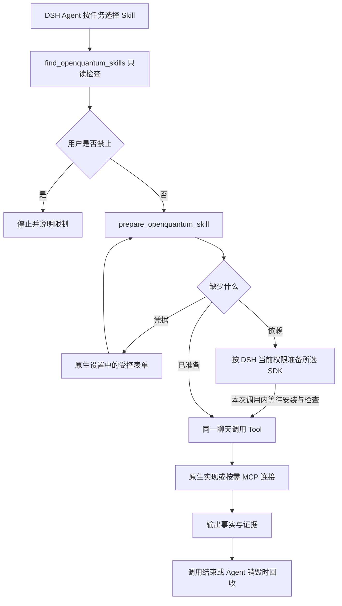

# Desktop 原生插件与按需准备

Desktop 使用固定的 DSH Desktop 2.0.0 / Harness 0.1.0-rc.6 的 Cordis Plugin、Tool Registry、Skill Provider、审批和 Agent 生命周期。
Codex 与 Desktop 共用领域 Skill、固定 Tool 合同、SDK 安装器、环境收据和凭据字段定义。
两个发行入口分别保存使用限制和凭据；共用实现不等于复制用户密钥。



## 装配与职责

- deployment-scoped `@openquantum/harness-capability-host` 注册 Application Interface、
  `/openquantum/settings` 与有界 `/openquantum/api/preparation`。原生 Client Slot 内嵌共用设置页，从「设置 → OpenQuantum」进入。沿用 Codex 0.8.4 的首页、Skills、MCP 导航与卡片版式，工具和账户配置归入对应卡片。页面与设置逻辑继续共用，宿主各自保存配置和凭据。
- agent-scoped `adaptive-capabilities.mjs` 向 DSH 注册原生 Tool Provider 和 Skill Provider。
  搜索只读取说明和收据；准备只处理明确选择的一项，不执行科学任务。
- `src/settings/desktop/application.mjs` 复用受控设置与准备用例，按 Agent 分配连接和安装所有权。
  它不接管 Session、Turn、Tool 调度、审批或事件日志。
- 纯 JavaScript Tool 经共用 `native-adapter.mjs` 在进程内执行。跨语言 MCP 沿用已审查的
  固定合同与隔离连接实现；此处是原生 Tool implementation 的 MCP 适配，不是另一套 Harness MCP Client。
  该 Harness 基线的通用 MCP Client 在加载时连接并注册上游全部 Tool，不能直接替代本实现的按需合同。
- `additional-skills.mjs` 委托 DSH 原生文件 Skill Provider 保留用户自建 Skill。
  内置 Skill 由受控 Provider 拥有；同名文件不能绕过明确禁用。
- 原有科学结果 Host hook 保留。裸 Tool 名与原 MCP 前缀名进入同一结果物化、Validator 和中央验收链。
  普通执行成功、环境就绪和科学验收仍是不同状态。

## 状态、权限与生命周期

默认允许 Agent 选择；用户明确禁止的 Skill、Tool、MCP 在发现、准备和执行处都检查。
安装前的只读计划不构成授权。准备固定依赖和本地写入经 DSH `tools/pre-execute` 使用当前 Session 的
原生权限：`danger-full-access` 允许这些本地动作；其他模式请求原生审批。`approval=never` 本身不授予权限，
受限模式仍拒绝无法获批的安装。其他策略的拒绝或审批要求不能被覆盖，外部写入仍按最大影响请求审批。
审批与实际准备之间状态发生变化时重新规划，不静默安装。

Tool 合同在聊天创建时已经注册，准备成功后可直接在同一聊天调用。
Desktop 的准备 Tool 在同一次调用内等待所选安装与检查，成功才返回 `ready`，不再让模型轮询发现或 Job。
等待复用安装收据，并继续检查禁用与凭据；失败、配置缺失或禁用返回对应状态，不自动重试。
本次调用拥有的安装在取消或等待超时后停止，并等待子进程退出；加入已有安装的等待者不能取消它。
等待上限沿用安装器的 30 分钟界限并预留收尾时间，原生 Tool 超时再多预留 30 秒。
设置页的安装请求仍立即返回进度，等待只应用于 Agent 的原生准备 Tool，不阻塞表单操作。
算法 SDK 的准备选择包含最小 `dependencyGroups`；依赖组经过同一安装器、收据检查和 SDK 定位器，
不因基本环境已就绪而把缺少化学或梯度组件的任务当作可执行。两个任务需要不同组时，后一个先等待已有安装，
再按其选择补齐；安装所有权和取消规则保持一致。
使用限制修改后更新原生 Registry，同时执行层再次检查当前策略，拦截旧 schema 或缓存调用。
Tool 返回值在原生边界使用与 MCP/HTTP 一致的 JSON 表示，避免进行中的收据可选字段被 DSH 拒绝。

安装器和 MCP 的 Node 进程使用部署定位文件中的 `nodeExecutable`，不依赖 Electron 的 `process.execPath`。
普通 MCP 在调用结束后关闭；Gym 与 QPanda 的有状态连接归当前 Agent 所有，显式关闭、闲置回收、
取消或 Agent/plugin 销毁都会关闭本地资源。关闭本地连接不等于取消已经提交的云端任务。
安装所有者关闭时仅取消自己启动的 job nonce，并等待子进程树退出；不能取消另一聊天的安装。

凭据写入 DSH 原生 Credential Interface。表单逐字段加密提交，不回显已有值，不把密钥送给模型。
Pasqal 的原生 `run_pasqal_workflow` 调用既有受控工作流；租约获取、读取凭据和解释器准备之间重复检查限制。
凭据变更会使旧连接失效，下次调用读取新值。来自宿主只读认证来源的字段显示其来源与不可写状态。

## 升级与发行

旧的受管 MCP rows 转为单个按需 Tool Provider；用户自建连接和其他插件保留。
首次迁移保留现有关闭选择和精确 preset 备份。旧 `disabled: true` 无法可靠区分历史默认与用户操作，
因此现有安装保守保留为禁止；全新安装使用自动选择默认值。旧配置中的 Qiskit 环境禁用标志同样保留。
三个旧原生 Tool Provider 的关闭选择也迁入对应的 `native:<plugin>` 禁用项。
迁移仅自动转换与受审阅模板一致的 MCP 和原生 Tool rows，以及生成器产生的路径投影。
自定义 command、args、env、凭据引用、调用预算或未识别的禁用表达式会在写入配置前中止迁移，
指出对应 row；原 preset、设置和禁用列表保持原样。先对照源码 preset 手动合并该项，再重试升级；
不能用保留备份替代保留生效配置，也不自动恢复默认值。
旧 `.env` 中对应凭据一次性纳入原生凭据存储；迁移后删除的值不会从 `.env` 再次恢复。

Web 与源码 Desktop 继续使用同一 Home 和既有 preset 路径；两端都通过摘要记录区分已应用默认与用户修改。
只有仍匹配已应用摘要的文件才自动升级。未应用的新默认单独记录并放入 `.openquantum-defaults/`，不会因此取得现有文件的所有权。
未修改的旧 preset 从当前发行模板重新生成；用户的 persona 和自建 rows 保留，旧 `persona.prefix` 仅在语义明确时转换为 `text`。
已修改的 Desktop 按需 preset 在切回 Web 前需要手动合并，不能通过覆盖用户配置完成切换。

安装器先只读检查 Home，再将程序、依赖链接、本次准备涉及的配置和版本收据纳入同一可恢复事务。
准备失败恢复之前的文件与链接；启动时先恢复未完成事务，再进行版本比较及加载项目模块。
恢复材料留在项目 `.openquantum/desktop-install-backups/`，权限仅限当前用户；事务日志不保存凭据正文。
仍须先退出使用该 Home 的 Host。恢复不能证明活动的准备进程已退出时会停止并保留材料，不覆盖仍在写入的数据。
macOS/Linux 用进程组核验安装子进程已退出；Windows 在准备子进程期间发生异常中断时可能保持待恢复状态，需要人工确认进程退出后处理。

`desktop:package` 包含原生 Host package、Preset、共享实现、设置页与带摘要的 Tool 目录。
能力包供原版 DSH Desktop 加载；独立 OpenQuantum 应用则捆绑固定的桌面运行时与同一份能力包；0.8.7 的最小原生菜单源码扩展和摘要验证见 [Desktop 安装说明](../DESKTOP_INSTALLERS.md)。首次源码启动缺少目录时由构建步骤生成；打开设置不安装 SDK。

## 可复现验证

```sh
node --test tests/desktop-preparation.test.mjs tests/desktop-preparation-wait.test.mjs tests/desktop-home.test.mjs tests/desktop-profile-bundle.test.mjs
node --test tests/harness-home-roundtrip.test.mjs tests/desktop-preset-upgrade.test.mjs tests/desktop-install-transaction.test.mjs tests/desktop-install-home.test.mjs tests/desktop-payload.test.mjs
node --test tests/codex-plugin-environments.test.mjs
OPENQUANTUM_DESKTOP_LIVE=1 node --test tests/desktop-preparation.test.mjs
```

live 用例在隔离目录真实安装 Qiskit，经过 DSH 原生 Tool Runtime 审批，一次准备调用等待到 `ready`，
无需轮询发现，再在同一 Agent 对象上连续执行两次，
检查租约释放、禁用、销毁、重新读取后的状态，并用不可用的宿主 `process.execPath` 验证部署 Node 定位。
它不证明模型自主选择，也不代表所有 SDK 或云硬件已实测。

`node scripts/probe-desktop-preparation.mjs` 使用现有模型路由，在隔离 DSH Web Host 中验证真实模型的同聊两轮调用；
`--serve` 仅启动同一原生插件组合用于界面检查。该 Web Host 与原版 Electron 窗口是不同验收对象。
模型无权限时报告阻断，不自动切换模型。验收结果以当前运行的输出和 Session 事件为准。
