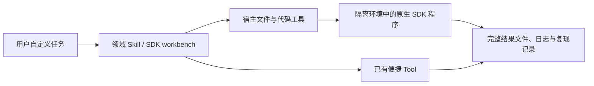

# 原生 SDK 完整接入与分批核验

本轮按“用户可编写并运行库的原生程序”梳理现有接入。便捷 Tool 保留，用于它的 schema 能完整表达的请求；其他模型、算法、参数、数据和控制流程由 Agent 使用库的公开 API 实现。预设案例和便捷 Tool 的字段不再定义库的功能范围。

这里的“完整接入”指固定版本的完整包或源码可访问，用户可组合其公开 API，输入与程序不受预设案例限制。它不表示每个 API、可选后端、操作系统或云服务都已测试。安装与 import 成功只能作为工程证据之一。

## 全量梳理结果

[SDK 清单](SDK_INVENTORY.md)当前覆盖 113 个环境入口：103 个 Python（含算法共享环境）、7 个 Julia、2 个原生源码或 ABI 入口、1 个 Lean 项目。2026-10-14 的[生态扩展](SDK_ECOSYSTEM_2026-10-14.md)增加 26 个入口；此前 85 个环境的日期化工程证据保留。它们不是 113 个不同的上游库；例如共享环境同时含 Qiskit、PennyLane、quimb 和 PySCF，同一库也可能因兼容性保留多个版本。

每个条目记录原生模块、任务对象、直接依赖、固定依赖锁、原有便捷 Tool、启用条件和已知限制。其他能力单独列出：6 项外部 MCP、8 项原生实现或宿主工作流、66 项方法/知识参考。外部 MCP 连接和 OpenQuantum 自有模拟器不冒充供应商完整 SDK。

## 接入方式



源码和 Desktop 使用仓库内的原生 Skill。Codex 的 SDK workbench 提供全目录导航，已启用的领域 Skill 投影保留同样的原生代码路径；当前源码候选随包携带 113 个环境的目录、依赖锁、显式 setup、完整算法代码和工件辅助脚本。原有未启用连接与 Skill 的状态保持不变。缓存 Skill 通过插件自己的 `mcp.json` 定位运行时，适配解压包与插件/运行时分开安装；不依赖研究项目的当前目录。

执行、权限、超时、取消与进程管理继续由宿主负责。`sdk-access.mjs` 只读取目录和准备状态，不安装依赖、不 import 第三方包、不执行用户程序；没有新增通用任意 Python 执行 MCP 或另一套 Runtime。

源码版使用：

```sh
node scripts/sdk-access.mjs list
node scripts/sdk-access.mjs inspect tenpy-ground-state
node scripts/setup-sdk.mjs tenpy-ground-state
```

Agent 读取 `inspect` 返回的绝对解释器路径和 argv，在用户工作区保存并运行自定义程序。Codex 使用所选 Skill 内的 `scripts/sdk-access.mjs`。`prepared` 只表示解释器和锁标记匹配；Flow-VQE 与 QPanda 还检查所需源码或原生依赖。Julia 与 QDMI 单独报告需要的运行时/构建检查，不伪造就绪。

部分固定版本需要导入前 bootstrap。它处理已有 SDK 的兼容性或离线配置，不替换数值算法：Qcover 的 Python 名称、SpinQit/VQNet 的 macOS loader、QPanda 的隔离 fmt ABI、Flow-VQE 的完整源码路径，以及 PairInteraction 的显式数据库。Classiq 与 Q-CTRL 的导入配置关闭不必要的遥测或更新查询。CQLib 则固定上游已完成 API 迁移的配对版本，不靠类型占位符掩盖梯度接口冲突。详细使用规则见[工作流](../../.agents/skills/quantum-sdk-workbench/references/workflow.md)。

已有 Tool 禁用、用户拒绝、账户权限及外部操作边界继续有效。安装完整客户端不自动启用远程服务，也不授权云提交、设备连接或收费作业。宿主缺少代码执行工具时，应明确缺少的运行条件。

## 分批补齐

| 批次 | 本次交付 | 核验边界 |
| --- | --- | --- |
| 全目录与产品入口 | 85 个环境的原生导航、源 Skill 与 Codex 投影；66 个算法指南明确支持自定义程序；打包携带锁、setup 与源码资源 | 静态覆盖、真实打包及缓存/外置运行时路径检查；不据此宣称 85 个环境均已运行 |
| 已发现的接入缺口 | Flow-VQE 完整源码与依赖、CQLib 完整 QML 包、Ocean 完整元包、QPanda 完整包的导入依赖；Qcover/SpinQit/VQNet 共用导入兼容层 | 自定义 API 对象与导入检查；具体通过项和失败记录见下方版本化证据 |
| 其余本地 SDK | 30 个电路/编译/QML 环境与 24 个物理/化学/纠错/光学/网络环境已逐库运行原生工程程序 | 固定版本、公开模块、自定义对象和工件检查；范围按逐库证据列出 |
| 平台及外部服务 | 18 个环境的本地接口已逐库运行，包含 Julia、QDMI C 接口、CUDA-Q CPU 内核和服务 SDK 的本地程序/配置 | 未连接账户、云服务、QPU 或仪器；其他操作系统与 GPU 仍未验证 |

## 首批 13 个环境的检查记录

首批在 macOS arm64 上，**13 个环境通过下列原生 API 工程检查**。[首批证据](evidence/full-sdk-access-2026-10-12.json)保留当时 72 个环境尚未执行的历史状态。本轮补齐这 72 项，没有改写首批记录，也没有将便捷 Tool 的历史结果补算为原生检查。

| 环境 | 已运行的检查范围 |
| --- | --- |
| Flow-VQE | 完整源码包、训练与 baseline API 可达、自定义 ansatz 构造；未训练 |
| CQLib | 完整 QML 包、自定义 QNN、符号参数绑定、梯度矩阵与 adjoint 调用；旧 angle-kernel Tool 回归通过 |
| Ocean | 完整元包、自定义 CQM 与 nonlinear Model；云客户端导入但未连接服务 |
| QPanda | 完整 `pyqpanda_alg` 初始化，包含 VQE、HHL、QUBO 模块；未运行算法求解 |
| Qcover、SpinQit、VQNet | 自定义图分解、电路旋转、tensor 与 quantum machine 构造 |
| TeNPy、Dynamiqs、FatQat/QuTiP、OQuPy | 自定义模型、MPS、时变算符、复合系统、浴关联函数，以及 QuTiP 原生保存/读回 |
| Stim/PyMatching | 自定义电路、detector model、matching graph 与序列化 |
| 算法共享环境 | Qiskit 参数化电路/QPY 读回、PennyLane 算符、quimb 张量网络、PySCF 分子构造；未求解 |

首批每个环境还检查了完整文件输出与失败后中间文件保留；另外验证宿主子进程停止后按 checkpoint 重跑。真实插件打包、缓存 Skill 定位、外置运行时与安装失败恢复有独立测试。完整默认检查通过；最后的安装器、合同与打包检查 20 项通过，独立审查未发现剩余 P1/P2。没有运行真实模型驱动的宿主会话或 UI 验收。

检查中发现并处理了几项真实缺口：CQLib 改用配套上游版本；QPanda 增补完整导入依赖和隔离 fmt；Flow-VQE 调整 SciPy 固定版本；Ocean 修复磁盘写满造成的残缺安装。通用 Python、算法和 PairInteraction 安装器现在均在标记成功前核对原始 wheel `RECORD` 的文件存在性与大小；该检查不替代 API 测试。Flow 的旧 PROPACK 加载错误与 [SciPy 上游问题](https://github.com/scipy/scipy/issues/25635) 一致，本批使用的 1.17.1 属于 [PROPACK 改为 C 实现之后的版本](https://docs.scipy.org/doc/scipy/release/1.17.0-notes.html)，实际运行通过。

## 剩余 72 个环境的实际结果

**本轮 72/72 通过各自声明范围内的原生 API 工程检查**，加上首批 13 项，85 个环境均有逐库工程运行记录。这里的“通过”不代表穷尽上游 API，也不替代真实科研任务验收。[逐库证据](evidence/full-sdk-engineering-2026-10-12.json)保存程序、实际版本、锁摘要、原生对象、完整文件哈希和失败/重试记录。

| 剩余三批 | 实际通过 | 检查内容举例 |
| --- | --- | --- |
| 电路、编译、QML | 30/30 | 自定义电路与参数、原生 IR/序列化、编译配置、自动微分与优化器接口 |
| 物理、化学、纠错、光学、网络 | 24/24 | 自定义算符、原子基、张量/光学对象、纠错配置、化学数据和网络程序 |
| 平台及服务 SDK 本地接口 | 18/18 | QDMI 原生 C 编译及示例驱动生命周期、Julia RandomMeas 数据与约化、CUDA-Q CPU 内核、云/控制 SDK 本地模型与程序导出 |

Python 的 70 个环境均运行保存到磁盘的自定义程序，导入其目录声明的公开模块，并核验完整文件输出、错误诊断和失败后文件保留。大文件交付使用独立的合成二进制工件检查，不将其称为 SDK 科研结果。Julia 另查实际运行时和包版本、原生测量数据与失败文件；QDMI 查固定源码/头文件/驱动哈希、变长元数据、无效属性错误和资源释放。工程程序在 macOS 的操作系统级网络隔离下运行，TCP、UDP 与子进程的阻断另有实际检查。下载只发生在显式准备阶段。

本轮修复了三类接入缺口：

- **MQT QCEC**：补上其 Qiskit extra，自定义 Qiskit 电路可以直接进入原生验证 API。
- **TensorCircuit**：补上 Optax、Qiskit 和 Cirq。固定兼容的 Qiskit 0.46.3，使原生转换接口可用；自定义梯度、优化器更新和 Qiskit 往返检查通过。TensorFlow、PyTorch、CuPy 和 GPU 仍属需另备兼容依赖的可选后端。
- **安装完整性检查**：OQC QAT 的两个上游包声明同名 console wrapper。保留缺失文件及普通文件长度异常的拒绝；共享 wrapper 的长度冲突仅在匹配已声明所有者的大小和 SHA-256 时放行。该例外不表示所有安装文件都做内容哈希校验。

Classiq 与 Q-CTRL 的离线 bootstrap 已实际验证。下载中断涉及的 CUDA-Q、Symmer、PairInteraction 等最终均按原固定版本与哈希准备成功；未更换来源或放宽校验。Qblox 等检查程序按固定版本的原生 API 修正。证据汇总还加入开始记录，较新的失败或中断尝试不会被旧成功覆盖；缺失收据、工件损坏和检查程序变化均拒绝计为通过。

最终 `npm run check` 通过；安装器与证据汇总的 9 项回归检查通过。默认检查跳过的可选实跑不计为通过，72 项原生运行由上面的独立证据确认。[验证日志索引](evidence/full-sdk-engineering-validation-2026-10-12.json)记录命令、退出码、源码哈希与 72 项显式准备日志。

这 72 项没有运行真实科研任务、远程账户/收费服务、QPU、实验室仪器、GPU 或其他操作系统。NetQASM 的本地编译不代表私有 NetSquid/SquidASM 后端已运行；服务 SDK 的本地序列化不代表远程服务验收。首批与本轮均未进行真实模型驱动的宿主会话或 UI 验收。

两轮的工程判据是：用户代码能使用原生 API 表达自定义对象；依赖与源码可定位并锁定；完整工件可保存；错误能暴露且中间文件保留；宿主能停止并重新运行程序；安装路径与用户项目路径分离后仍可工作。停止与重跑属于首批已经验证的共享宿主机制，本轮没有为每个库重复进行取消检查。小输入仅用于检查接口与运行机制，不是产品规模上限。

每批工程记录包含锁摘要、实际版本、程序和输入、检查范围、失败原因及未验证项。来源入口为[首批证据](evidence/full-sdk-access-2026-10-12.json)与[本轮逐库证据](evidence/full-sdk-engineering-2026-10-12.json)。三份报告引用的原始收据、程序、完整工件、日志以及失败/中断记录已收入[随仓库保存的离线证据包](evidence/full-sdk-2026-10-12.bundle/README.md)。包内按内容哈希去重、无损压缩；报告中的 `.openquantum/` 路径是原始运行位置，由 manifest 映射到归档对象，复核不依赖那台机器或 SDK。历史源文件按路径和 SHA-256 保留多个版本，没有改写旧报告。依赖环境仍使用独立目录，未替换运行中的插件。可复跑命令：

```sh
# 新检出仓库即可离线核对全部已归档证据，无需安装 SDK 或 npm 依赖。
node scripts/sdk-evidence-bundle.mjs verify
npm run sdk:test
npm run sdk:guides:check
node scripts/audit-sdk-integration.mjs --check
npm run capability:algorithms:catalog
# 先显式准备测试列出的 SDK 环境；本命令不安装、不连接远程服务。
OPENQUANTUM_NATIVE_SDK_CHECKS=1 OPENQUANTUM_SDK_CHECK_OUTPUT=.openquantum/sdk-checks \
  node --test tests/sdk-native-code.test.mjs
# 本轮 72 项；当前隔离 runner 仅支持 macOS，需先完成各环境 setup。
# 依赖外置时先设置 OPENQUANTUM_PYTHON_ENV_ROOT 为对应目录。
OPENQUANTUM_NATIVE_SDK_CHECKS=1 OPENQUANTUM_SDK_CHECK_OUTPUT=.openquantum/sdk-checks/remaining \
  node --test --test-concurrency=1 tests/sdk-native-remaining.test.mjs tests/sdk-native-platforms.test.mjs
node --test tests/prepared-python.test.mjs tests/sdk-engineering-evidence.test.mjs
node scripts/sdk-engineering-evidence.mjs .openquantum/sdk-checks/remaining \
  .openquantum/sdk-checks/remaining/report.json --require-complete
```

本轮没有运行真实科研任务，不作科学有效性判断。所有记录保持 `scientificValidation=not_evaluated`。Validator observations、Acceptance Profile 和 central Acceptance Builder 的既有职责不变；工程检查不升级能力的科学验收等级。

## Lean 数学与物理形式化（2026-10-28）

`lean-physics` 增加 Lean 4.35.0、mathlib 与 physlib 的固定兼容项目，复用 SDK 发现与显式准备入口。默认准备 Pauli 示例的导入闭包，其他模块按任务准备；不用新的 Tool 或 MCP Server。使用绝对 Lean 可执行文件与准备后的 `LEAN_PATH` 检查用户证明，执行不隐式安装。

详见 [Skill 与固定来源](../../.agents/skills/lean-physics/SKILL.md)。文件编译、目标的证明及公理审计、物理适用性和科学验收分别报告；不声明全库或全平台已验证。
