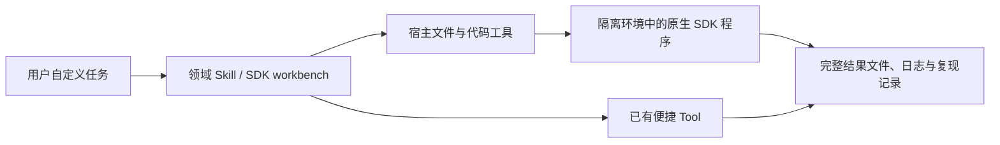

# 原生 SDK 完整接入与分批核验

本轮按“用户可编写并运行库的原生程序”梳理现有接入。便捷 Tool 保留，用于它的 schema 能完整表达的请求；其他模型、算法、参数、数据和控制流程由 Agent 使用库的公开 API 实现。预设案例和便捷 Tool 的字段不再定义库的功能范围。

这里的“完整接入”指固定版本的完整包或源码可访问，用户可组合其公开 API，输入与程序不受预设案例限制。它不表示每个 API、可选后端、操作系统或云服务都已测试。安装与 import 成功只能作为工程证据之一。

## 全量梳理结果

[SDK 清单](SDK_INVENTORY.md)覆盖 85 个环境入口：83 个 Python 依赖项目（包含 QDMI 的桥接环境）、一个 Julia 环境、一个算法共享环境。它们不是 85 个不同的上游库；例如共享环境同时含 Qiskit、PennyLane、quimb 和 PySCF，同一库也可能因兼容性保留多个版本。

每个条目记录原生模块、任务对象、直接依赖、固定依赖锁、原有便捷 Tool、启用条件和已知限制。其他能力单独列出：6 项外部 MCP、7 项原生实现或宿主工作流、66 项方法/知识参考。外部 MCP 连接和 OpenQuantum 自有模拟器不冒充供应商完整 SDK。

## 接入方式



源码和 Desktop 使用仓库内的原生 Skill。Codex 的 SDK workbench 提供全目录导航，已启用的领域 Skill 投影保留同样的原生代码路径；随包携带 85 个环境的目录、依赖锁、显式 setup、完整算法代码和工件辅助脚本。原有未启用连接与 Skill 的状态保持不变。缓存 Skill 通过插件自己的 `mcp.json` 定位运行时，适配解压包与插件/运行时分开安装；不依赖研究项目的当前目录。

执行、权限、超时、取消与进程管理继续由宿主负责。`sdk-access.mjs` 只读取目录和准备状态，不安装依赖、不 import 第三方包、不执行用户程序；没有新增通用任意 Python 执行 MCP 或另一套 Runtime。

源码版使用：

```sh
node scripts/sdk-access.mjs list
node scripts/sdk-access.mjs inspect tenpy-ground-state
node scripts/setup-sdk.mjs tenpy-ground-state
```

Agent 读取 `inspect` 返回的绝对解释器路径和 argv，在用户工作区保存并运行自定义程序。Codex 使用所选 Skill 内的 `scripts/sdk-access.mjs`。`prepared` 只表示解释器和锁标记匹配；Flow-VQE 与 QPanda 还检查所需源码或原生依赖。Julia 与 QDMI 单独报告需要的运行时/构建检查，不伪造就绪。

部分固定版本需要导入前 bootstrap。它处理已有 SDK 的兼容性或离线配置，不替换数值算法：Qcover 的 Python 名称、SpinQit/VQNet 的 macOS loader、QPanda 的隔离 fmt ABI、Flow-VQE 的完整源码路径，以及 PairInteraction 的显式数据库。Classiq 与 Q-CTRL 的导入配置关闭不必要的遥测或更新查询。CQLib 则固定上游已完成 API 迁移的配对版本，不靠类型占位符掩盖梯度接口冲突。详细使用规则见[工作流](../../.agents/skills/quantum-sdk-workbench/references/workflow.md)。

已有 Tool 禁用、用户拒绝、账户权限及外部操作边界继续有效。安装完整客户端不自动启用远程服务，也不授权云提交、设备连接或收费作业。宿主缺少代码执行工具时，应明确缺少的运行条件。

## 分批补齐

| 批次 | 本次交付 | 核验边界 |
| --- | --- | --- |
| 全目录与产品入口 | 85 个环境的原生导航、源 Skill 与 Codex 投影；66 个算法指南明确支持自定义程序；打包携带锁、setup 与源码资源 | 静态覆盖、真实打包及缓存/外置运行时路径检查；不据此宣称 85 个环境均已运行 |
| 已发现的接入缺口 | Flow-VQE 完整源码与依赖、CQLib 完整 QML 包、Ocean 完整元包、QPanda 完整包的导入依赖；Qcover/SpinQit/VQNet 共用导入兼容层 | 自定义 API 对象与导入检查；具体通过项和失败记录见下方版本化证据 |
| 其余本地 SDK | 统一原生入口已提供，各 SDK 的完整模块/可选依赖兼容性继续按清单逐项核验 | 未执行的环境保持 `not_checked`；下一批按电路/编译/QML、纠错/测量、多体/光学分组，不能沿用便捷 Tool 的历史通过状态 |
| 平台及外部服务 | Julia、QDMI、CUDA/GPU、其他操作系统和云/硬件接口分别记录运行条件 | 本机未验证的目标保持未验证；外部服务需要对应授权与环境，不属于本轮真实科研验收 |

## 本批实际检查结果

macOS arm64 上，**13 个环境通过下列原生 API 工程检查，72 个环境尚未执行这类检查**。完整矩阵逐项记录通过范围、版本、锁摘要、工件哈希与后续批次，不把历史便捷 Tool 的结果补算进来。

| 环境 | 已运行的检查范围 |
| --- | --- |
| Flow-VQE | 完整源码包、训练与 baseline API 可达、自定义 ansatz 构造；未训练 |
| CQLib | 完整 QML 包、自定义 QNN、符号参数绑定、梯度矩阵与 adjoint 调用；旧 angle-kernel Tool 回归通过 |
| Ocean | 完整元包、自定义 CQM 与 nonlinear Model；云客户端导入但未连接服务 |
| QPanda | 完整 `pyqpanda_alg` 初始化，包含 VQE、HHL、QUBO 模块；未运行算法求解 |
| Qcover、SpinQit、VQNet | 自定义图分解、电路旋转、tensor 与 quantum machine 构造 |
| TeNPy、Dynamiqs、FatQat/QuTiP、OQuPy | 自定义模型、MPS、时变算符、复合系统、浴关联函数，以及 QuTiP 原生保存/读回 |
| Stim/PyMatching | 自定义电路、detector model、matching graph 与序列化 |
| 算法共享环境 | Qiskit 参数化电路/QPY 读回、PennyLane 算符、quimb 张量网络、PySCF 分子构造；未求解 |

每个环境还检查了完整文件输出与失败后中间文件保留；另外验证宿主子进程停止后按 checkpoint 重跑。真实插件打包、缓存 Skill 定位、外置运行时与安装失败恢复有独立测试。完整默认检查通过；最后的安装器、合同与打包检查 20 项通过，独立审查未发现剩余 P1/P2。没有运行真实模型驱动的宿主会话或 UI 验收。

检查中发现并处理了几项真实缺口：CQLib 改用配套上游版本；QPanda 增补完整导入依赖和隔离 fmt；Flow-VQE 调整 SciPy 固定版本；Ocean 修复磁盘写满造成的残缺安装。通用 Python、算法和 PairInteraction 安装器现在均在标记成功前核对原始 wheel `RECORD` 的文件存在性与大小；该检查不替代 API 测试。Flow 的旧 PROPACK 加载错误与 [SciPy 上游问题](https://github.com/scipy/scipy/issues/25635) 一致，本批使用的 1.17.1 属于 [PROPACK 改为 C 实现之后的版本](https://docs.scipy.org/doc/scipy/release/1.17.0-notes.html)，实际运行通过。

后续工程核验按三批列入矩阵：电路/编译/QML 等 30 个环境；物理/化学/纠错/光学/网络等 24 个环境；平台专用与服务 SDK 的本地接口 18 个环境。Classiq 与 Q-CTRL 的新增 bootstrap 尚未实际导入验证。远程账户、收费服务、QPU、其他操作系统与 GPU 不从本批结果推断。

本轮的工程判据是：用户代码能使用原生 API 表达自定义对象；依赖与源码可定位并锁定；完整工件可保存；错误能暴露且中间文件保留；宿主能停止并重新运行程序；安装路径与用户项目路径分离后仍可工作。小输入仅用于检查接口与运行机制，不是产品规模上限。

每批工程记录包含锁摘要、实际版本、程序和输入、检查范围、失败原因及未验证项。来源入口为[版本化工程证据](evidence/full-sdk-access-2026-10-12.json)。可复跑命令：

```sh
npm run sdk:test
npm run sdk:guides:check
node scripts/audit-sdk-integration.mjs --check
npm run capability:algorithms:catalog
# 先显式准备测试列出的 SDK 环境；本命令不安装、不连接远程服务。
OPENQUANTUM_NATIVE_SDK_CHECKS=1 OPENQUANTUM_SDK_CHECK_OUTPUT=.openquantum/sdk-checks \
  node --test tests/sdk-native-code.test.mjs
```

本轮没有运行真实科研任务，不作科学有效性判断。所有记录保持 `scientificValidation=not_evaluated`。Validator observations、Acceptance Profile 和 central Acceptance Builder 的既有职责不变；工程检查不升级能力的科学验收等级。
