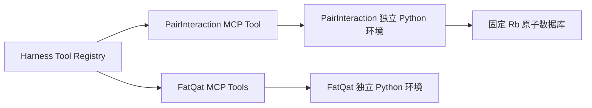

# PairInteraction 独立接入

本接入提供有界的 Rb 原子对势能和二阶有效哈密顿量。FatQat 保留现有独立接入；两者没有相互依赖，也没有自动的 Hamiltonian 转换链。当前为 L1，所有计算返回 `scientificValidation=not_evaluated`。



## 版本与升级边界

| 对象 | 当前固定值 | 版本权威 |
| --- | --- | --- |
| PairInteraction | 2.7.0，Python 3.12 | `pairinteraction-rydberg/pyproject.toml`、`uv.lock` |
| Rb SQDT 与公共 Wigner 表 | database-sqdt v2.0 | `pairinteraction-rydberg/database-lock.json`，两个压缩包和七个数据文件的 SHA-256 |
| PairInteraction 接口 | `calculate_rydberg_pair`，结果 schemaVersion 1.0 | `pairinteraction-rydberg/mcp/contracts.mjs` |
| FatQat | 0.1.0a1 / `39b75e30ae50ddb4a8c7b840847edce678aa814c` | `fatqat-workbench/pyproject.toml`、`uv.lock` 与自身 Tool 合同 |

以上能力路径均位于 `.agents/skills/`。Harness 分别通过 `pairinteraction_local` 和 `fatqat_local` 注册 Tool；两个 MCP Server 均不拥有 Session 或模型路由。FatQat 的模型、单位与输入范围见 [FatQat 说明](FATQAT.md)。

升级 PairInteraction 时，只更新其版本声明、依赖锁和适配器；数据库升级单独审查并更新清单。重新运行本页的合同、数值与 Harness 检查，比较已保存的输入和误差，审查上游 API、单位、数据和微扰算法变化。不得仅因安装成功就批准科学兼容性。独立环境隔离依赖冲突，不能保证任意未来版本自动兼容。

不需要为 PairInteraction 的升级改变 FatQat 的依赖锁。以后确需把两个能力串联，应增加单独、有版本的物理模型转换合同及组合测试，明确基底、符号、单位和适用范围。当前不开放此转换。

## 准备与调用

在项目根目录运行：

```sh
npm ci
npm run capability:pairinteraction:setup
```

需要 `uv` 与 Python 3.12。显式 setup 从锁定源安装软件，下载约 104 MiB 的原子数据库压缩包，校验压缩包及逐文件哈希后原子式写入本地目录。上游 Python 包还包含 PySide6 等依赖，即便本工具只使用无图形界面的数值 API，首次准备仍有较大的下载与磁盘开销。无需云凭据或真实量子硬件。

运行环境位于 `.openquantum/python-envs/pairinteraction-rydberg`；数据库位于 `.openquantum/pairinteraction-databases/<manifestSha256>/tables/`。安装器完成后记录依赖锁摘要；计算前按主线的 prepared-environment 合同核对摘要。可用 `OPENQUANTUM_PYTHON_ENV_ROOT` 选择独立环境根目录。数据库缺失、被改动或混入其他版本时，计算失败并给出原因；不会悄悄下载替换。每次计算显式使用 `download_missing=False`，并复核数据内容。缓存和配置写入该项目 `.openquantum/`。计算副作用声明为 `workspace-write`；`tools/list` 不安装依赖。

默认 Preset 注册此独立连接。使用新增源码的 Host 需重启后加载；单独安装依赖不等于正在运行的 Host 已加载能力。在科研对话中可以要求：

> 用 PairInteraction 计算两颗 Rb 60S1/2、m=1/2 原子沿 z 的相互作用。磁场 20 G，距离 8、12、16 µm。报告有效能移、截断矩阵精确谱、目标态权重和微扰偏差，再比较更大的基底。

对应 Tool 输入：

```json
{"channel":"ss","nS":60,"magneticFieldG":20,"distancesUm":[8,12,16],"deltaN":2,"energyWindowGHz":10}
```

S–P 交换使用 `channel="sp_exchange"`，并增加 `nP=60`；其 P 态固定为 P3/2、m=1/2。有效基底次序是 |S;P>、|P;S> 对应的场修饰态。

## 物理和计算范围

- 仅 Rb 单通道量子亏损理论（SQDT），n=45..70；S 与 P 主量子数之差最多 2。零电场，Bz=1..30 G，两原子沿 z，仅电偶极相互作用；忽略超精细结构与抗磁项。
- 距离 4..30 µm，最多 9 点且严格递增；`deltaN=1..3`，能窗 1..25 GHz。原子基底至多 300 态，原子对至多 1024 态。每次至多一个 worker，可取消；`execution.timeoutMs`、`maxOutputBytes`、`threads` 遵循部署资源策略；超限失败，不静默缩小基底。
- S–S 原子角动量范围 l=0..1；S–P 为 l=0..2。先对有磁场的单原子系统对角化，再构建总投影 M=1 的原子对基底。目标与场修饰态的识别权重必须至少 0.99。
- `effectiveHamiltonianMHz` 为公共参考能量下的 **H/h，单位 MHz**。`energyReferenceMHz` 为减掉的能量零点。该单位是普通频率；FatQat 使用 H/ħ 的 rad/µs 时需要 2π 转换，但单位转换本身不足以保证物理模型匹配。
- “exact”只表示当前截断原子对矩阵的对角化。按目标子空间权重选态后依能量排序，不声称逐距离绝热跟踪。`convergence.status=not_evaluated`；增加两个截断参数的比较只报告变化，不宣称完备基底极限。

二阶参考独立计算

\[
(H_{\mathrm{eff}})_{ab}=H_{ab}+\frac12\sum_{q\in Q}H_{aq}H_{qb}
\left[\frac{1}{E_a-E_q}+\frac{1}{E_b-E_q}\right].
\]

无耦合中间态或耦合态能隙接近零时拒绝二阶计算。参考求和与上游结果比较，另用 SciPy 对平移后的完整矩阵对角化，检查 PairInteraction 的谱。它们共享原子数据，不是量子亏损或实验测量的独立验证。

`perturbationStatus` 是筛选提示：最大单通道 |V/Δ| ≤0.1 且选中精确态的目标子空间权重均 ≥0.9 时为 `within_screen`，否则 `outside_screen`。这些阈值不是误差保证、收敛证明或科学验收规则。结果同时返回实际谱偏差；用户仍需根据目标精度判断。矩阵一致性容差 2e-4 MHz 用于发现数值/适配器错误，不是物理预测的不确定度；减去较大的绝对能量还会限制小能移的数值精度。

## 验证与证据

```sh
npm run capability:pairinteraction:test
npm run capability:pairinteraction:live
node --test .agents/skills/fatqat-workbench/test/mcp.test.mjs
```

2026-10-09 在 macOS arm64 本地完成：

| 检查 | 实际覆盖 |
| --- | --- |
| MCP 合同 | 输入范围、缺失环境、独立依赖、版本/数据/输入摘要、输出形状、失败、取消恢复与凭据隔离 |
| 解析与数据完整性 | 两能级二阶位移、准简并厄米化公式、简并/空中间空间拒绝、数据缺失/篡改/额外版本拒绝 |
| 实际数值 | S–S 二阶位移 R^-6、S–P 交换 R^-3、独立矩阵与谱对照、确定性重放及微扰失效可见性 |
| 截断比较 | S–S 基底 43→139；S–P 基底 146→451；仅记录变化，不验收收敛 |
| 真实 Harness | 本地模型协议替身依次调用两个真实计算，通过 Session event log 重读结果；未使用外部模型 |
| FatQat 回归 | 现有 6 项 MCP 合同测试通过；本次未改动 FatQat 代码或依赖锁 |

默认测试 nS=nP=60、B=20 G、R=8 µm：S–S 二阶位移约 0.529411 MHz。S–P 交换矩阵元约 −11.946795 MHz；有效谱与截断精确谱最大偏差约 1.250324 MHz，最小目标权重约 0.798809，明确返回 `outside_screen`。这是保留近似失效信息的回归例，不是建议采用该有效模型。

本地完整输入、输出、基底变化与 Harness 记录保存在 `.openquantum/pairinteraction-evidence/`；[版本化验证摘要](evidence/pairinteraction-2026-10-09.json)保存输入、数值、环境与摘要。本次未复现论文全部物理验证案例，未完成独立领域审阅或 central Acceptance；不声称科学验收通过。Linux、Windows 和外部模型自主使用尚未实测。

主线合入另以 `0e8221ad` 为基线验证 Harness `0.1.5-rc.1`，保留主线现有 Runtime 与模型路由；原始实现记录对应工作分支的 Harness `0.2.0-rc.2`。主线适配使用共享的环境准备摘要校验与执行资源设置，兼容两种已测试的 Session 结果格式。完整 `npm run check`、70 项相关检查、真实数值与真实 Harness 重读通过，见[主线集成记录](evidence/pairinteraction-main-2026-10-09.json)。默认跳过的可选 live 检查仍记为跳过；PairInteraction 的 live 检查单独实跑。

## 来源与许可

- [PairInteraction v2.7.0](https://github.com/pairinteraction/pairinteraction/releases/tag/v2.7.0)；[许可证声明](https://github.com/pairinteraction/pairinteraction/blob/v2.7.0/LICENSE.txt)：LGPL-3.0-or-later。通过包管理器安装，未把其源码复制到本能力目录；二进制中的其他依赖保留各自许可证。
- [SQDT 数据库 v2.0](https://github.com/pairinteraction/database-sqdt/releases/tag/v2.0)；[仓库许可证](https://github.com/pairinteraction/database-sqdt/blob/main/LICENSE.txt)：MIT。数据在显式 setup 时下载，仓库只保存发布地址与校验清单。
- [固定版本的有效哈密顿量实现](https://github.com/pairinteraction/pairinteraction/blob/v2.7.0/src/pairinteraction/perturbative/effective_system_pair.py)与 [v2 论文](https://arxiv.org/abs/2605.14993)用于 API 和物理范围核对；本地验证层级以上表为准。
