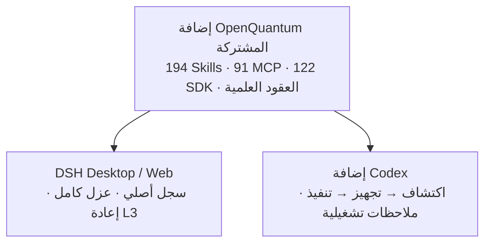

<h1 align="center">
  <picture>
    <source media="(prefers-color-scheme: dark)" srcset="../../packages/openquantum-web-branding/assets/lockup-inverse.svg" />
    
  </picture>
</h1>

<p align="center">
  <strong>OpenQuantum — نبني معًا ذكاءً اصطناعيًا موثوقًا للبحث الكمي.</strong><br />
  <sub>خبرات البحث الكمي مجتمعة في OpenQuantum واحد · إضافة وبيئة عمل بحثية مفتوحة المصدر لـ Codex وDesktop</sub>
</p>

<p align="center">
  <a href="https://github.com/xi-zhao/OpenQuantum/stargazers"></a>
  <a href="https://github.com/xi-zhao/OpenQuantum/releases/tag/v0.8.11"></a>
  <a href="https://github.com/xi-zhao/OpenQuantum/actions/workflows/ci.yml"></a>
  <a href="../../THIRD_PARTY_NOTICES.md"></a>
  
  <a href="https://xi-zhao.github.io/OpenQuantum/"></a>
  <a href="../../CONTRIBUTING.md"></a>
</p>

<p align="center">
  <a href="../../README.md">简体中文</a> ·
  <a href="./README.en.md">English</a> ·
  <a href="./README.ja.md">日本語</a> ·
  <a href="./README.ko.md">한국어</a> ·
  <a href="./README.es.md">Español</a> ·
  <a href="./README.fr.md">Français</a> ·
  <a href="./README.de.md">Deutsch</a> ·
  <a href="./README.pt.md">Português</a> ·
  <a href="./README.ru.md">Русский</a> ·
  <a href="./README.ar.md"><strong>العربية</strong></a>
</p>

<p align="center">
  <a href="#why-openquantum">لماذا OpenQuantum</a> ·
  <a href="#what-you-can-do">الوظائف</a> ·
  <a href="#optimization-cases">التحسينات المقيسة</a> ·
  <a href="#quick-start"><strong>البدء السريع ↗</strong></a> ·
  <a href="#use-and-inspect-results">المعمارية والثقة</a> ·
  <a href="#roadmap-and-rsi">خارطة الطريق</a> ·
  <a href="#extend-the-platform">المساهمة</a>
</p>

<p align="center">
  <a href="https://xi-zhao.github.io/OpenQuantum/">
    <picture>
      <source media="(prefers-color-scheme: dark)" srcset="../images/readme/hero-en-dark.webp" />
      
    </picture>
  </a>
</p>

<p align="center">
  <a href="https://github.com/xi-zhao/OpenQuantum/releases/download/v0.8.11/OpenQuantum-0.8.11-macOS-arm64.dmg">
    <picture>
      <source media="(prefers-color-scheme: dark)" srcset="../images/readme/launch-card-en-dark.webp" />
      
    </picture>
  </a>
</p>

تضمّ حزم الإصدار `v0.8.11` 189 مهارة و117 بيئة و3 مسارات قبول علمي من المستوى L3 على DSH. ويعرض الجدول أعداد الشيفرة المصدرية الحالية في `main`، وهي 194 مهارة و122 بيئة و11 مسارًا من المستوى L3.

<table>
  <tr>
    <td align="center" width="25%"><strong>194</strong><br /><sub>Skill مدمجة (181 تلقائية / 13 فهرس)</sub></td>
    <td align="center" width="25%"><strong>91</strong><br /><sub>اتصال MCP (66 افتراضي / 25 اختياري)</sub></td>
    <td align="center" width="25%"><strong>122</strong><br /><sub>بيئة SDK ومصدر مثبتة</sub></td>
    <td align="center" width="25%"><strong>11 L3</strong><br /><sub>قبول علمي قابل للإعادة (DSH)</sub></td>
  </tr>
</table>

---

## أحدث المستجدات

- **2026-11-26** · توسيع **القبول العلمي L3** القابل للإعادة إلى **11 وظيفة** (VQE للحالة الأرضية، تدقيق المعلومات الكمية، تكافؤ QCEC، ذاكرة QEC، محاكاة هاملتونيان، QPanda QUBO، فك ترميز LDPC، وPyZX وSymmer وPauLie وGraphix) مع عزل كامل في sandbox لجميع عمليات المرجع المستقل.
- **2026-11** · إضافة بيئات SDK أصلية مثبتة لـ **MWPF** و**PPVM** و**tropidist** و**ST-GRAPE**، إلى جانب ترقية موثّقة إلى **PyZX 0.10.8**.
- **2026-11-09** · الإصدار الموحّد **[OpenQuantum v0.8.11](../releases/v0.8.11.md)** ([Desktop DMG](https://github.com/xi-zhao/OpenQuantum/releases/tag/v0.8.11) و[إضافة Codex](https://github.com/xi-zhao/OpenQuantum/releases/tag/codex-v0.8.11)) مع نواة تنفيذ مشتركة ودعم **SlowQuant** و**TNQS** و**RcmpsCore**.
- **2026-10** · حالتان مقيسان قابلتان لإعادة الإنتاج: **تسريع 5.69× لدالة ويغنر في QuTiP** (أقصى فرق `6.52 × 10⁻¹⁶`) و**تسريع 5.09× لمبدّل باولي في PennyLane**.

<p align="center"><strong>▶ تعرّف على OpenQuantum في 78 ثانية</strong></p>

https://github.com/user-attachments/assets/5c00a30d-eef0-493a-975f-3faeb200cc9e

<p align="center"><sub>عرض بتاريخ 2026-11-02 (بترجمة صينية وأرقام ذلك التاريخ). <a href="../communications/video/README.md">المصادر وإعادة الإنتاج</a></sub></p>

---

<a id="why-openquantum"></a>

## لماذا OpenQuantum

يواجه استخدام النماذج اللغوية العامة في البحث الكمي ثلاث عقبات: **إعادة كتابة شيفرات هشة من الصفر، وتشتّت أكثر من مئة حزمة SDK عبر لغات متعددة، وتوليد إجابات مقنعة شكليًا دون تحقق مستقل.** يجمع OpenQuantum البرمجيات المفتوحة والأساليب المنشورة ومسارات التحقق المستقل داخل **إضافة بحثية مشتركة**.

- **تغطية شاملة**: 122 بيئة مثبتة (110 Python، 9 Julia، 2 أصلية، 1 Lean 4) و49 مثالًا قابلًا للتشغيل للخوارزميات الكمية (Qiskit وPennyLane وQuTiP وStim وPyMatching وTeNPy وMitiq وPyZX وOpenFermion وLean 4 وغيرها).
- **أداء مقيس وقابل للتحقق**: تسريع الاستدعاء الكامل (**5.69×** في QuTiP و**5.09×** في PennyLane) مع تحقق دقيق لكل نقطة.
- **علم قابل للتدقيق**: يُعرَّف *القبول العلمي* بأنه التوصل إلى موثوقية علمية للنتيجة استنادًا إلى فحوص مستقلة وسلسلة مصدر كاملة، ويظل منفصلًا تمامًا عن مجرد اكتمال تنفيذ أداة.
- **مفتوح ومتعدد المضيفين**: تعمل الإضافة نفسها داخل **إضافة Codex** و**OpenQuantum Desktop / Web** مع أي نموذج يدعم Tool Calling (BYOM)، وبترخيص MIT للشيفرة الأصلية.

---

<a id="what-you-can-do"></a>

## الوظائف والمنظومة

| المجال البحثي | أبرز الأدوات وحزم SDK | الحدود الواجب التحقق منها |
| --- | --- | --- |
| <a id="algorithm-learning-and-method-comparison"></a>**الخوارزميات ومقارنة الأساليب** | [49 مثالًا مفتوح المصدر](../../examples/quantum-algorithms/README.md): QFT، QPE، HHL، VQE، VQD، QAOA، QSP/QSVT، تحضير الحالات، qLDPC، ومعادلة شرودنغر | الإعدادات الافتراضية تعليمية؛ راجع الدقة والتقارب لكل مهمة |
| <a id="circuits-and-quantum-information"></a>**الدوائر والتصريف والتوافق** | Qiskit، PennyLane، PyZX، Graphix، MQT QCEC / QMAP / DDSIM، pytket، Compact، QCut، qBraid، Clifft، [PPVM](../../.agents/skills/ppvm-simulation/SKILL.md)، وتدقيق مصفوفات الكثافة | مجموعات البوابات، ترتيب البتات، نماذج الضوضاء ونطاق التكافؤ |
| <a id="ground-states-chemistry-and-optimization"></a>**الحالة الأرضية والكيمياء والتحسين** | VQE (L3 قابل للإعادة)، SQD، TeNPy DMRG، OpenFermion، pyChemiQ، Flow-VQE، OpenQARP، Symmer، PauLie، وQPanda / Ocean / Kaiwu | الفضاء النشط، قطاع الجسيمات/التماثل والمرجع المستقل |
| **الأطياف الجزيئية وشبكات الموتر ونظرية الحقل** | [SlowQuant](../../.agents/skills/slowquant-response/SKILL.md)، [TNQS](../../.agents/skills/tnqs-dynamics/SKILL.md)، [RcmpsCore](../../.agents/skills/rcmps-field-theory/SKILL.md) | تقريبات الاستجابة، التضمين المستوي، والفصل بين فجوة الانتقال وفجوة هاملتونيان |
| <a id="error-mitigation-and-error-correction"></a>**تخفيف الأخطاء وتصحيحها (QEC)** | Mitiq، Stim / PyMatching، Deltakit، BP+LSD، Chromobius، [MWPF](../../.agents/skills/mwpf-decoding/SKILL.md)، [tropidist](../../.agents/skills/tropidist-distance/SKILL.md)، [erasure-recovery](../../.agents/skills/erasure-recovery/SKILL.md)، [emlint](../../.agents/skills/emlint-dem-audit/SKILL.md) | ميزانية العينات ونموذج الأعطال؛ الفحص الساكن لـ DEM لا يثبت مسافة الشيفرة |
| <a id="hamiltonian-simulation-and-open-systems"></a>**الديناميكا والذرات المحايدة والنبضات** | Trotter / qDrift، Dynamiqs، OQuPy، TJM، Bloqade Analog، Pulser، PairInteraction، [ST-GRAPE](../../.agents/skills/stgrape-control/SKILL.md)، وQUA / LabOne Q / Qblox / Qililab / OQC QAT | الوحدات والقطع والشبكة الزمنية الثابتة؛ التصريف دون اتصال لا يشغّل الأجهزة المخبرية |
| <a id="photonics-and-quantum-networks"></a>**الفوتونيات والشبكات الكمية** | Perceval، Piquasso، Lightworks، MerLin، MrMustard، SimQN، وNetQASM / SquidASM | ترتيب الأنماط وقطع فوك والترخيص المنفصل لـ NetSquid |
| <a id="experiment-simulation-and-hardware"></a>**استكشاف العتاد والسحب الكمية** | FieldQKit، IBM Quantum، IonQ، OriginQ، Quafu، Tianyan، Guodun، Tencent، LogicalQubit، وQDMI | استكشاف للقراءة فقط افتراضيًا؛ إرسال المهام الفعلية إلى QPU يتطلب تفعيلًا صريحًا |
| <a id="reference-material-and-selection"></a>**البراهين الشكلية والمعايير العامة** | [Lean 4 / mathlib / physlib](../../.agents/skills/lean-physics/SKILL.md)، و[Quantum-Practices (66) وMetriq (410)](../CAPABILITIES.md#参考资料与选型) | البراهين تغطي التعريفات والمسلّمات المصرح بها فقط؛ المعايير التاريخية لا تثبت أداء العتاد الحالي |
| <a id="quantum-learning"></a>**التعليم والفصول التفاعلية** | [Quantum Learning / OpenMAIC](../integrations/OPENMAIC.md) | المنهج الكامل قيد البناء؛ تدفقات التدريس بالذكاء الاصطناعي عبر الإنترنت لم تستكمل القبول بعد |

يوفّر التوزيع المصدري الحالي **[194 Skill مدمجة](../../.agents/skills/README.md)**، و**91 اتصال خدمة MCP** (66 مفعّلة افتراضيًا و25 اختيارية)، و**5 Tools كمية أصلية**، و**[122 بيئة SDK ومصدر](../integrations/SDK_INVENTORY.md)** (منها **11 وظيفة L3** قابلة للإعادة على DSH). [الفهرس الكامل (بالصينية)](../CAPABILITIES.md#接口总览) · [تدقيق SDK](../integrations/FULL_SDK_ACCESS.md)

---

<a id="optimization-cases"></a>

## التحسينات المقيسة

| المهمة | خط الأساس المثبت (Apple M4) | المكتبة الأصلية | OpenQuantum | التسريع | التحقق المستقل | إعادة الإنتاج |
| --- | --- | ---: | ---: | ---: | --- | --- |
| **QuTiP Wigner** | QuTiP 5.3.1 (فوك 64، شبكة 201×201) | 171.77 ms | **30.18 ms** | **5.69×** | أقصى فرق `6.52 × 10⁻¹⁶`؛ اجتياز 272 فحصًا | [التقرير](../../experiments/qutip-rust-wigner/README.md) · [JSON](../../experiments/qutip-rust-wigner/results/summary.json) |
| **PennyLane Pauli** | PennyLane 0.45.1 (32 كيوبت، 125×512 حدًا) | 30.62 ms | **6.02 ms** | **5.09×** | تطابق تام في 9 اختبارات؛ 4,368 زوجًا من سلاسل باولي و40 مصفوفة عشوائية (`1.42 × 10⁻¹⁴`) | [التقرير](../../experiments/pennylane-rust-commutator/README.md) · [JSON](../../experiments/pennylane-rust-commutator/results/benchmark.json) |

<a id="qutip-rust-case"></a>

<p align="center"></p>

<a id="pennylane-rust-case"></a>

<p align="center"></p>

---

<a id="quick-start"></a>

## البدء السريع

<a id="codex"></a>

### الخيار 1: إضافة Codex

افتح محادثة جديدة في Codex والصق الطلب التالي:

```text
Please install the OpenQuantum Codex plugin 0.8.11. First read the installation guide:
https://github.com/xi-zhao/OpenQuantum/blob/codex-v0.8.11/docs/integrations/CODEX_AGENT_INSTALL.md
Download the complete installer and SHA256SUMS from https://github.com/xi-zhao/OpenQuantum/releases/tag/codex-v0.8.11,
verify the checksum, check Codex, Node.js 24+ and npm, and install with the bundled installer.
Keep existing plugins and user settings, and check the Skills, MCP tools and the global "OpenQuantum settings" entry.
Tell me exactly what to do if the app needs reloading. Finally, report what was actually verified and which scientific dependencies still need preparation.
```

**[تنزيل المثبّت الكامل ZIP](https://github.com/xi-zhao/OpenQuantum/releases/download/codex-v0.8.11/openquantum-0.8.11-codex-install.zip)** · [ملاحظات الإصدار وSHA256SUMS](https://github.com/xi-zhao/OpenQuantum/releases/tag/codex-v0.8.11) · [التثبيت اليدوي](../integrations/CODEX_AGENT_INSTALL.md)

<a id="desktop-installer"></a>

### الخيار 2: تطبيق Desktop

نزّل **[OpenQuantum 0.8.11 DMG](https://github.com/xi-zhao/OpenQuantum/releases/download/v0.8.11/OpenQuantum-0.8.11-macOS-arm64.dmg)** (لأجهزة macOS Apple Silicon)، وتحقق من [SHA256SUMS](https://github.com/xi-zhao/OpenQuantum/releases/tag/v0.8.11)، ثم اسحب `OpenQuantum.app` إلى التطبيقات وأضف نموذجًا يدعم Tool Calling في **Settings → Models** ([دليل التثبيت](../DESKTOP_INSTALLERS.md)؛ ولأجهزة Intel Mac وWindows: [حزم 0.8.4](https://github.com/xi-zhao/OpenQuantum/releases/tag/v0.8.4)).

<a id="install-from-source"></a>

### الخيار 3: التشغيل من الشيفرة المصدرية

```bash
git clone https://github.com/xi-zhao/OpenQuantum.git
cd OpenQuantum
npm ci
npm run dev
```

<details>
<summary><strong>خيارات تشغيل إضافية: Desktop من المصدر وDocker (Linux) وQuantum Learning والرسائل</strong></summary>

- **Desktop من المصدر**: `npm run desktop:setup` و`npm run desktop:verify-install` و`npm run desktop -- --source` ([النشر](../DEPLOYMENT.md))
- **Docker Compose (Linux)**: `cp .env.example .env && docker compose up --build`
- **Quantum Learning**: `npm run learning:ui:setup` ([OpenMAIC](../integrations/OPENMAIC.md))
- **قنوات الرسائل**: `npm run cc-connect:setup` ([CC Connect](../integrations/CC_CONNECT.md))

</details>

### أول حساب قابل للتحقق خلال 30 ثانية (دون مفتاح نموذج)

```bash
npm run demo:quantum-ground-state
```

<table>
  <tr>
    <td align="center" width="25%"><strong>-1.85727503 Ha</strong><br /><sub>طاقة VQE</sub></td>
    <td align="center" width="25%"><strong>-1.85727503 Ha</strong><br /><sub>المرجع الدقيق</sub></td>
    <td align="center" width="25%"><strong>4.44 × 10⁻¹⁶ Ha</strong><br /><sub>الفرق المطلق</sub></td>
    <td align="center" width="25%"><strong>15 فحصًا ناجحًا</strong><br /><sub>فحوص محلية</sub></td>
  </tr>
</table>

---

<a id="use-and-inspect-results"></a>
<a id="execution-records-and-scientific-acceptance"></a>

## المعمارية والعلم القابل للتحقق



<table>
  <tr>
    <td width="50%" valign="top"><a href="../images/openquantum-desktop-20261013.jpg"></a><br /><sub>بيئة العمل Desktop (2026-10-13)</sub></td>
    <td width="50%" valign="top"><a href="../images/openquantum-settings-categories-20261013.jpg"></a><br /><sub>إعدادات مصنفة مع البحث والتصفية (2026-10-13)</sub></td>
  </tr>
</table>

---

<a id="roadmap-and-rsi"></a>
<a id="rsi"></a>

## خارطة الطريق · <a id="extend-the-platform"></a><a id="documentation-and-support"></a>المساهمة والاستشهاد

- **خارطة الطريق**: توسيع تغطية L2/L3 وتنسيق CPU/GPU/HPC/QPU وواجهات الأجهزة المخبرية ومناهج Quantum Learning. يبقى التحسين الذاتي التكراري (RSI) توجهًا طويل المدى؛ **ولم تُنفَّذ حلقة RSI الكاملة بعد** ([الرؤية](../roadmap/VISION.md)).
- **المساهمة**: [دليل المساهمة](../../CONTRIBUTING.md) · [Issues](https://github.com/xi-zhao/OpenQuantum/issues) · [مدونة السلوك](../../CODE_OF_CONDUCT.md) · [سياسة الأمان](../../SECURITY.md) (`npm run check`).
- **التواصل**: [zx4612@mail.ustc.edu.cn](mailto:zx4612@mail.ustc.edu.cn) · WeChat: `sincerely1019`

```bibtex
@software{zhao2026openquantum,
  author  = {Zhao, Xi and {OpenQuantum contributors}},
  title   = {OpenQuantum: Building Trustworthy AI for Quantum Research},
  year    = {2026},
  version = {0.8.11},
  url     = {https://github.com/xi-zhao/OpenQuantum}
}
```

<a id="license-and-acknowledgments"></a>

## الترخيص والشكر

الشيفرة الخاصة بالمشروع مرخّصة تحت [MIT License](../../LICENSE) (© 2026 Xi Zhao)، باستثناء `mitiq-error-mitigation` ([GPL-3.0-only](../../.agents/skills/mitiq-error-mitigation/LICENSE)) ولقطة بيانات Metriq ([CC-BY-4.0](../../src/metriq-data/upstream/LICENSE)). راجع [`THIRD_PARTY_NOTICES.md`](../../THIRD_PARTY_NOTICES.md).

<p align="center">
  <picture>
    <source media="(prefers-color-scheme: dark)" srcset="../../packages/openquantum-web-branding/assets/lockup-inverse.svg" />
    
  </picture><br />
  <sub>OpenQuantum · الحوسبة الكمية في متناول يدك.</sub>
</p>
