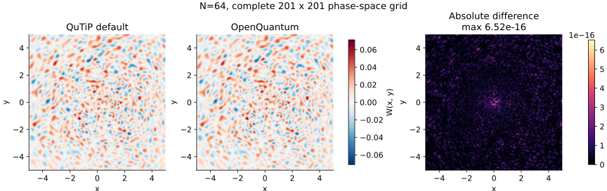
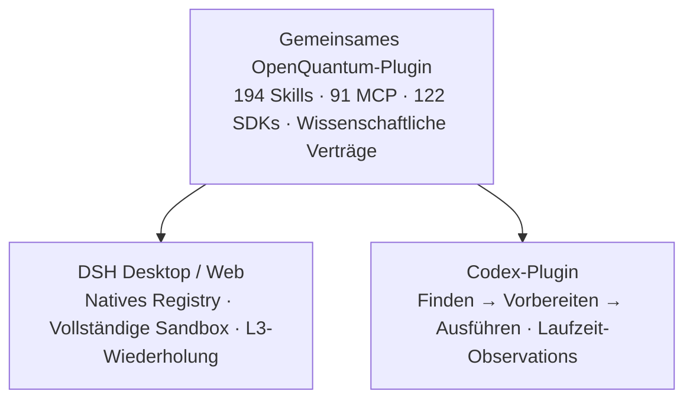

<h1 align="center">
  <picture>
    <source media="(prefers-color-scheme: dark)" srcset="../../packages/openquantum-web-branding/assets/lockup-inverse.svg" />
    
  </picture>
</h1>

<p align="center">
  <strong>OpenQuantum — Gemeinsam vertrauenswürdige KI für die Quantenforschung aufbauen.</strong><br />
  <sub>Die Fachkompetenz der Quantenforschung vereint in einem OpenQuantum · Open-Source-Plugin und Workbench für Codex und Desktop</sub>
</p>

<p align="center">
  <a href="https://github.com/xi-zhao/OpenQuantum/stargazers"></a>
  <a href="https://github.com/xi-zhao/OpenQuantum/releases/tag/v0.8.11"></a>
  <a href="https://github.com/xi-zhao/OpenQuantum/actions/workflows/ci.yml"></a>
  <a href="../../THIRD_PARTY_NOTICES.md"></a>
  
  <a href="https://xi-zhao.github.io/OpenQuantum/"></a>
  <a href="../../CONTRIBUTING.md"></a>
</p>

<p align="center">
  <a href="../../README.md">简体中文</a> ·
  <a href="./README.en.md">English</a> ·
  <a href="./README.ja.md">日本語</a> ·
  <a href="./README.ko.md">한국어</a> ·
  <a href="./README.es.md">Español</a> ·
  <a href="./README.fr.md">Français</a> ·
  <a href="./README.de.md"><strong>Deutsch</strong></a> ·
  <a href="./README.pt.md">Português</a> ·
  <a href="./README.ru.md">Русский</a> ·
  <a href="./README.ar.md">العربية</a>
</p>

<p align="center">
  <a href="#why-openquantum">Warum OpenQuantum</a> ·
  <a href="#what-you-can-do">Funktionen</a> ·
  <a href="#optimization-cases">Optimierungen</a> ·
  <a href="#quick-start"><strong>Schnellstart ↗</strong></a> ·
  <a href="#use-and-inspect-results">Architektur</a> ·
  <a href="#roadmap-and-rsi">Roadmap</a> ·
  <a href="#extend-the-platform">Mitwirken</a>
</p>

<p align="center">
  <a href="https://xi-zhao.github.io/OpenQuantum/">
    <picture>
      <source media="(prefers-color-scheme: dark)" srcset="../images/readme/hero-en-dark.webp" />
      
    </picture>
  </a>
</p>

<p align="center">
  <a href="https://github.com/xi-zhao/OpenQuantum/releases/download/v0.8.11/OpenQuantum-0.8.11-macOS-arm64.dmg">
    <picture>
      <source media="(prefers-color-scheme: dark)" srcset="../images/readme/launch-card-en-dark.webp" />
      
    </picture>
  </a>
</p>

Die Installationspakete von `v0.8.11` enthalten 189 Skills, 117 Umgebungen und 3 wissenschaftliche Abnahmeverfahren der Stufe L3 für DSH. Die Tabelle zeigt den aktuellen Quellstand auf `main` mit 194 Skills, 122 Umgebungen und 11 L3-Verfahren.

<table>
  <tr>
    <td align="center" width="25%"><strong>194</strong><br /><sub>Integrierte Skills (181 auto / 13 Index)</sub></td>
    <td align="center" width="25%"><strong>91</strong><br /><sub>MCP-Verbindungen (66 aktiv / 25 optional)</sub></td>
    <td align="center" width="25%"><strong>122</strong><br /><sub>Fixierte SDK- &amp; Quellumgebungen</sub></td>
    <td align="center" width="25%"><strong>11 L3</strong><br /><sub>Wiederholbare wissenschaftliche Abnahme (DSH)</sub></td>
  </tr>
</table>

---

## Aktuelles

- **2026-11-26** · Wiederholbare **L3 wissenschaftliche Abnahme** auf **11 Funktionen** erweitert (Grundzustands-VQE, Quanteninformations-Audit, QCEC-Äquivalenz, QEC-Speicher, Hamilton-Simulation, QPanda QUBO, LDPC-Dekodierung, PyZX, Symmer, PauLie und Graphix) – mit vollständiger Sandbox-Isolierung aller Referenz-Subprozesse.
- **2026-11** · Neue fixierte native SDK-Umgebungen für **MWPF**, **PPVM**, **tropidist** und **ST-GRAPE** sowie ein verifiziertes Upgrade auf **PyZX 0.10.8**.
- **2026-11-09** · Einheitliches Release **[OpenQuantum v0.8.11](../releases/v0.8.11.md)** ([Desktop DMG](https://github.com/xi-zhao/OpenQuantum/releases/tag/v0.8.11) & [Codex-Plugin](https://github.com/xi-zhao/OpenQuantum/releases/tag/codex-v0.8.11)) mit gemeinsamem Ausführungskern sowie **SlowQuant**, **TNQS** und **RcmpsCore**.
- **2026-10** · Zwei reproduzierbare End-to-End-Optimierungen: **5,69× auf QuTiP Wigner-Funktionen** (max. Abweichung `6,52 · 10⁻¹⁶`) und **5,09× auf PennyLane Pauli-Kommutatoren**.

<p align="center"><strong>▶ OpenQuantum in 78 Sekunden</strong></p>

https://github.com/user-attachments/assets/5c00a30d-eef0-493a-975f-3faeb200cc9e

<p align="center"><sub>Demo vom 2026-11-02 (chinesische Untertitel, damaliger Stand). <a href="../communications/video/README.md">Quellen und Reproduktion</a></sub></p>

---

<a id="why-openquantum"></a>

## Warum OpenQuantum

Wenn allgemeine LLMs Quantenforschung betreiben, scheitern sie häufig an drei Hürden: **fragilen Code immer neu zu schreiben, über hundert sprachübergreifende SDKs zu verwalten und plausibel klingende Antworten ohne unabhängige Prüfung zu liefern.** OpenQuantum verbindet Open-Source-Software, publizierte Methoden und unabhängige Prüfpfade in einem **gemeinsamen Forschungs-Plugin**.

- **Breite Abdeckung**: 122 fixierte Umgebungen (110 Python, 9 Julia, 2 nativ, 1 Lean 4) und 49 ausführbare Algorithmusbeispiele (Qiskit, PennyLane, QuTiP, Stim, PyMatching, TeNPy, Mitiq, PyZX, OpenFermion, Lean 4 u. a.).
- **Gemessene Beschleunigung**: gezielte Vollaufruf-Optimierungen (**5,69×** QuTiP, **5,09×** PennyLane) mit punktweiser Prüfung.
- **Nachprüfbare Wissenschaft**: *wissenschaftliche Abnahme* – die Feststellung, dass ein Ergebnis auf Basis unabhängiger Prüfungen und vollständiger Herkunft wissenschaftlich belastbar ist – wird strikt von der bloßen Ausführung einer Funktion getrennt.
- **Offen und plattformübergreifend**: Nutzende arbeiten über dasselbe Plugin im **Codex-Plugin** oder in **OpenQuantum Desktop / Web** mit eigenem Tool-Calling-Modell (BYOM); eigener Code steht unter MIT-Lizenz.

---

<a id="what-you-can-do"></a>

## Funktionen und Ökosystem

| Forschungsbereich | Repräsentative Werkzeuge & SDKs | Zu prüfende Grenzen |
| --- | --- | --- |
| <a id="algorithm-learning-and-method-comparison"></a>**Algorithmen & Methodenvergleich** | [49 ausführbare Beispiele](../../examples/quantum-algorithms/README.md): QFT, QPE, HHL, VQE, VQD, QAOA, QSP/QSVT, Zustandspräparation, qLDPC, Schrödingerisierung | Standardwerte sind Lehrbeispiele; Fehler und Konvergenz aufgabenspezifisch prüfen |
| <a id="circuits-and-quantum-information"></a>**Schaltkreise, Kompilierung & Interop** | Qiskit, PennyLane, PyZX, Graphix, MQT QCEC / QMAP / DDSIM, pytket, Compact, QCut (Circuit Cutting), qBraid, Clifft, [PPVM](../../.agents/skills/ppvm-simulation/SKILL.md), Dichtematrix-Audit | Gattersätze, Bitreihenfolge, Rauschmodelle und Äquivalenzbereich |
| <a id="ground-states-chemistry-and-optimization"></a>**Grundzustände, Chemie & Optimierung** | VQE (wiederholbar L3), SQD, TeNPy DMRG, OpenFermion, pyChemiQ, Flow-VQE, OpenQARP, Symmer, PauLie, QPanda / Ocean / Kaiwu | Aktiver Raum, Teilchen-/Symmetriesektor und unabhängige Referenz |
| **Spektroskopie, Graph-TN & Feldtheorie** | [SlowQuant](../../.agents/skills/slowquant-response/SKILL.md), [TNQS](../../.agents/skills/tnqs-dynamics/SKILL.md), [RcmpsCore](../../.agents/skills/rcmps-field-theory/SKILL.md) | Antwortnäherungen, planare Einbettung, Transfer-Gap ≠ Hamilton-Gap |
| <a id="error-mitigation-and-error-correction"></a>**Fehlerabschwächung & QEC** | Mitiq, Stim / PyMatching (Surface Codes), Deltakit, BP+LSD, Chromobius, [MWPF](../../.agents/skills/mwpf-decoding/SKILL.md), [tropidist](../../.agents/skills/tropidist-distance/SKILL.md), [erasure-recovery](../../.agents/skills/erasure-recovery/SKILL.md), [emlint](../../.agents/skills/emlint-dem-audit/SKILL.md) | Sampling-Budget und Fehlermodell; statische DEM-Prüfung beweist keine Codedistanz |
| <a id="hamiltonian-simulation-and-open-systems"></a>**Dynamik, Neutralatome & Pulssteuerung** | Trotter / qDrift, Dynamiqs, OQuPy, TJM, Bloqade Analog, Pulser, PairInteraction, [ST-GRAPE](../../.agents/skills/stgrape-control/SKILL.md), QUA / LabOne Q / Qblox / Qililab / OQC QAT | Einheiten, Abschneidegrenzen, festes Zeitraster; Offline-Kompilierung steuert keine Laborgeräte |
| <a id="photonics-and-quantum-networks"></a>**Photonik & Quantennetzwerke** | Perceval, Piquasso, Lightworks, MerLin, MrMustard, SimQN, NetQASM / SquidASM | Modenreihenfolge, Fock-Cutoff und separate NetSquid-Lizenz |
| <a id="experiment-simulation-and-hardware"></a>**Hardware-Erkennung & Cloud-APIs** | FieldQKit, IBM Quantum, IonQ, OriginQ, Quafu, Tianyan, Guodun, Tencent, LogicalQubit und QDMI | Standardmäßig nur lesende Erkennung; echte QPU-Aufträge nur nach expliziter Freischaltung |
| <a id="reference-material-and-selection"></a>**Formale Beweise & Benchmarks** | [Lean 4 / mathlib / physlib](../../.agents/skills/lean-physics/SKILL.md), [Quantum-Practices (66) & Metriq (410)](../CAPABILITIES.md#参考资料与选型) | Beweise gelten nur für angegebene Definitionen/Axiome; historische Daten ersetzen keine aktuelle Messung |
| <a id="quantum-learning"></a>**Lehre & interaktive Kurse** | [Quantum Learning / OpenMAIC](../integrations/OPENMAIC.md) | Vollständiges Curriculum im Aufbau; Online-KI-Lehrabläufe noch ohne Gesamtabnahme |

Die aktuelle Quelldistribution umfasst **[194 integrierte Skills](../../.agents/skills/README.md)**, **91 MCP-Dienstverbindungen** (66 standardmäßig aktiv, 25 optional), **5 native Quanten-Tools** und **[122 SDK-/Quellumgebungen](../integrations/SDK_INVENTORY.md)** (davon **11 L3-Funktionen** unter DSH). [Vollständiger Katalog (Chinesisch)](../CAPABILITIES.md#接口总览) · [SDK-Audit](../integrations/FULL_SDK_ACCESS.md)

---

<a id="optimization-cases"></a>

## Gemessene Optimierungen

| Benchmark | Fixierte Basis (Apple M4) | Originalbibliothek | OpenQuantum | Faktor | Unabhängige Prüfung | Reproduktion |
| --- | --- | ---: | ---: | ---: | --- | --- |
| **QuTiP Wigner** | QuTiP 5.3.1 (Fock 64, 201×201 Gitter) | 171,77 ms | **30,18 ms** | **5,69×** | Max. Abweichung `6,52 · 10⁻¹⁶`; 272 Prüfungen bestanden | [Bericht](../../experiments/qutip-rust-wigner/README.md) · [JSON](../../experiments/qutip-rust-wigner/results/summary.json) |
| **PennyLane Pauli** | PennyLane 0.45.1 (32 Qubits, 125×512 Terme) | 30,62 ms | **6,02 ms** | **5,09×** | 9 Benchmarks termweise identisch; 4368 Pauli-Paare & 40 Zufallsmatrizen (`1,42 · 10⁻¹⁴`) | [Bericht](../../experiments/pennylane-rust-commutator/README.md) · [JSON](../../experiments/pennylane-rust-commutator/results/benchmark.json) |

<a id="qutip-rust-case"></a>

<p align="center"></p>

<a id="pennylane-rust-case"></a>

<p align="center"></p>

---

<a id="quick-start"></a>

## Schnellstart

<a id="codex"></a>

### Option 1: Codex-Plugin

Starten Sie in Codex einen neuen Chat und fügen Sie diese Anfrage ein:

```text
Please install the OpenQuantum Codex plugin 0.8.11. First read the installation guide:
https://github.com/xi-zhao/OpenQuantum/blob/codex-v0.8.11/docs/integrations/CODEX_AGENT_INSTALL.md
Download the complete installer and SHA256SUMS from https://github.com/xi-zhao/OpenQuantum/releases/tag/codex-v0.8.11,
verify the checksum, check Codex, Node.js 24+ and npm, and install with the bundled installer.
Keep existing plugins and user settings, and check the Skills, MCP tools and the global "OpenQuantum settings" entry.
Tell me exactly what to do if the app needs reloading. Finally, report what was actually verified and which scientific dependencies still need preparation.
```

**[Vollständigen Installer (ZIP) herunterladen](https://github.com/xi-zhao/OpenQuantum/releases/download/codex-v0.8.11/openquantum-0.8.11-codex-install.zip)** · [Release-Hinweise & SHA256SUMS](https://github.com/xi-zhao/OpenQuantum/releases/tag/codex-v0.8.11) · [Manuelle Installation](../integrations/CODEX_AGENT_INSTALL.md)

<a id="desktop-installer"></a>

### Option 2: Desktop-Anwendung

Laden Sie **[OpenQuantum 0.8.11 DMG](https://github.com/xi-zhao/OpenQuantum/releases/download/v0.8.11/OpenQuantum-0.8.11-macOS-arm64.dmg)** (macOS Apple Silicon) herunter, prüfen Sie [SHA256SUMS](https://github.com/xi-zhao/OpenQuantum/releases/tag/v0.8.11), ziehen Sie `OpenQuantum.app` in Programme und fügen Sie unter **Settings → Models** Ihr Tool-Calling-Modell hinzu ([Installationsanleitung](../DESKTOP_INSTALLERS.md); Intel Mac / Windows: [0.8.4-Pakete](https://github.com/xi-zhao/OpenQuantum/releases/tag/v0.8.4)).

<a id="install-from-source"></a>

### Option 3: Aus dem Quellcode starten

```bash
git clone https://github.com/xi-zhao/OpenQuantum.git
cd OpenQuantum
npm ci
npm run dev
```

<details>
<summary><strong>Weitere Startarten: Desktop aus Quellcode, Docker (Linux), Quantum Learning & Messaging</strong></summary>

- **Desktop aus Quellcode**: `npm run desktop:setup`, `npm run desktop:verify-install`, `npm run desktop -- --source` ([Deployment](../DEPLOYMENT.md))
- **Docker Compose (Linux)**: `cp .env.example .env && docker compose up --build`
- **Quantum Learning**: `npm run learning:ui:setup` ([OpenMAIC](../integrations/OPENMAIC.md))
- **Messaging**: `npm run cc-connect:setup` ([CC Connect](../integrations/CC_CONNECT.md))

</details>

### Erste überprüfte Berechnung in 30 Sekunden (ohne Modell-Schlüssel)

```bash
npm run demo:quantum-ground-state
```

<table>
  <tr>
    <td align="center" width="25%"><strong>-1,85727503 Ha</strong><br /><sub>VQE-Energie</sub></td>
    <td align="center" width="25%"><strong>-1,85727503 Ha</strong><br /><sub>Exakte Referenz</sub></td>
    <td align="center" width="25%"><strong>4,44 · 10⁻¹⁶ Ha</strong><br /><sub>Absolute Abweichung</sub></td>
    <td align="center" width="25%"><strong>15 bestanden</strong><br /><sub>Lokale Prüfungen</sub></td>
  </tr>
</table>

---

<a id="use-and-inspect-results"></a>
<a id="execution-records-and-scientific-acceptance"></a>

## Architektur und nachprüfbare Wissenschaft



<table>
  <tr>
    <td width="50%" valign="top"><a href="../images/openquantum-desktop-20261013.jpg"></a><br /><sub>Desktop Workbench (2026-10-13)</sub></td>
    <td width="50%" valign="top"><a href="../images/openquantum-settings-categories-20261013.jpg"></a><br /><sub>Kategorisierte Einstellungen mit Suche und Filtern (2026-10-13)</sub></td>
  </tr>
</table>

---

<a id="roadmap-and-rsi"></a>
<a id="rsi"></a>

## Roadmap · <a id="extend-the-platform"></a><a id="documentation-and-support"></a>Mitwirken & Zitieren

- **Roadmap**: Ausbau von L2/L3-Prüfungen, CPU/GPU/HPC/QPU-Orchestrierung, Laborgeräte-Schnittstellen und Quantum Learning. Rekursive Selbstverbesserung (RSI) ist eine langfristige Forschungsrichtung; **die vollständige RSI-Schleife ist nicht implementiert** ([Vision](../roadmap/VISION.md)).
- **Mitwirken**: [Beitragsleitfaden](../../CONTRIBUTING.md) · [Issues](https://github.com/xi-zhao/OpenQuantum/issues) · [Verhaltenskodex](../../CODE_OF_CONDUCT.md) · [Sicherheit](../../SECURITY.md) (`npm run check`).
- **Kontakt**: [zx4612@mail.ustc.edu.cn](mailto:zx4612@mail.ustc.edu.cn) · WeChat: `sincerely1019`

```bibtex
@software{zhao2026openquantum,
  author  = {Zhao, Xi and {OpenQuantum contributors}},
  title   = {OpenQuantum: Building Trustworthy AI for Quantum Research},
  year    = {2026},
  version = {0.8.11},
  url     = {https://github.com/xi-zhao/OpenQuantum}
}
```

<a id="license-and-acknowledgments"></a>

## Lizenz und Danksagung

Eigener Code steht unter der [MIT License](../../LICENSE) (© 2026 Xi Zhao), außer `mitiq-error-mitigation` ([GPL-3.0-only](../../.agents/skills/mitiq-error-mitigation/LICENSE)) und den Metriq-Daten ([CC-BY-4.0](../../src/metriq-data/upstream/LICENSE)). Details in [`THIRD_PARTY_NOTICES.md`](../../THIRD_PARTY_NOTICES.md).

<p align="center">
  <picture>
    <source media="(prefers-color-scheme: dark)" srcset="../../packages/openquantum-web-branding/assets/lockup-inverse.svg" />
    
  </picture><br />
  <sub>OpenQuantum · Quantencomputing direkt zur Hand.</sub>
</p>
