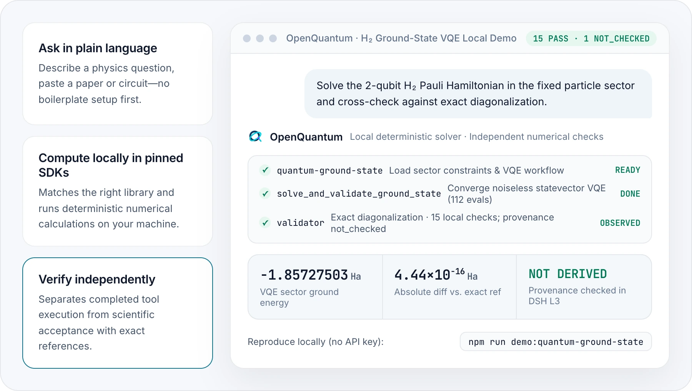
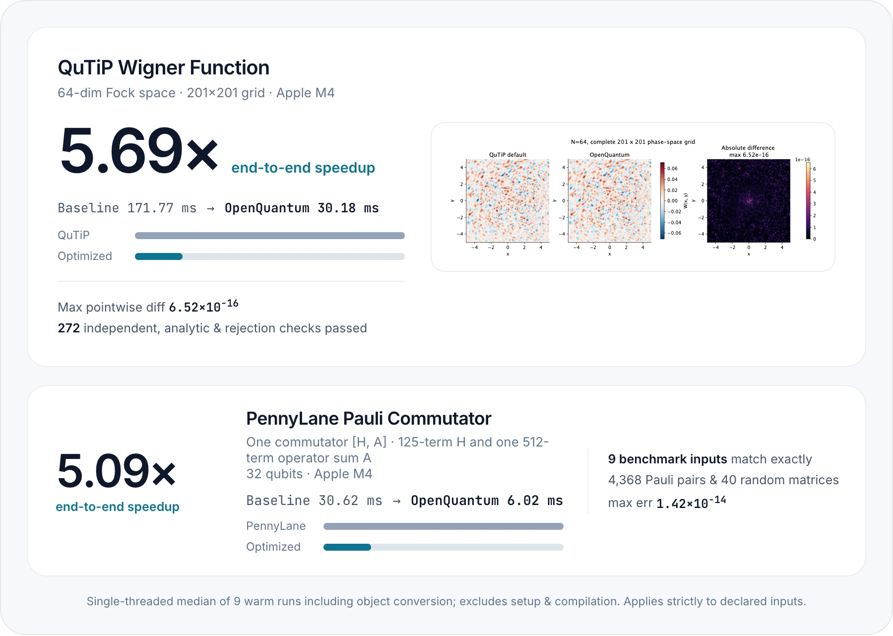

<h1 align="center">
  <picture>
    <source media="(prefers-color-scheme: dark)" srcset="../../packages/openquantum-web-branding/assets/lockup-inverse.svg" />
    
  </picture>
</h1>

<p align="center">
  <a href="https://github.com/xi-zhao/OpenQuantum/stargazers"></a>
  <a href="https://github.com/xi-zhao/OpenQuantum/releases/tag/v0.8.11"></a>
  <a href="https://github.com/xi-zhao/OpenQuantum/actions/workflows/ci.yml"></a>
  <a href="../../THIRD_PARTY_NOTICES.md"></a>
</p>

<p align="center">
  <sub>
    <a href="../../README.md">简体中文</a> ·
    <a href="./README.en.md"><strong>English</strong></a> ·
    <a href="./README.ja.md">日本語</a> ·
    <a href="./README.ko.md">한국어</a> ·
    <a href="./README.es.md">Español</a> ·
    <a href="./README.fr.md">Français</a> ·
    <a href="./README.de.md">Deutsch</a> ·
    <a href="./README.pt.md">Português</a> ·
    <a href="./README.ru.md">Русский</a> ·
    <a href="./README.ar.md">العربية</a>
  </sub>
</p>

<p align="center">
  <a href="https://xi-zhao.github.io/OpenQuantum/">
    <picture>
      <source media="(prefers-color-scheme: dark)" srcset="../images/readme/hero-en-dark.webp" />
      
    </picture>
  </a>
</p>

<p align="center">
  <a href="https://github.com/xi-zhao/OpenQuantum/releases/download/v0.8.11/OpenQuantum-0.8.11-macOS-arm64.dmg">
    <picture>
      <source media="(prefers-color-scheme: dark)" srcset="../images/readme/launch-card-en-dark.webp" />
      
    </picture>
  </a>
</p>

<a id="why-openquantum"></a>
<a id="use-and-inspect-results"></a>
<a id="execution-records-and-scientific-acceptance"></a>

**OpenQuantum — Building trustworthy AI for quantum research, together.** Delivered as one shared open-source plugin for both **OpenQuantum Desktop** and **Codex**, it brings the expertise of quantum research together in a single workbench: ask a physics question, attach a paper, or paste a circuit, and the agent runs deterministic calculations in pinned local environments while separating completed tool execution from *scientific acceptance* (determining that a result is scientifically reliable based on independent checks and complete provenance).

<p align="center">
  <picture>
    <source media="(prefers-color-scheme: dark)" srcset="../images/readme/workflow-en-dark.webp" />
    
  </picture>
</p>

<details>
<summary>Watch the 78-second walkthrough and inspect captured interface screenshots</summary>

<br />

https://github.com/user-attachments/assets/5c00a30d-eef0-493a-975f-3faeb200cc9e

<sub><a href="../communications/video/README.md">Video provenance &amp; reproduction notes (2026-11-02 snapshot)</a> · <a href="../images/openquantum-desktop-20261013.jpg">Desktop workbench</a> · <a href="../images/openquantum-settings-categories-20261013.jpg">Categorized settings</a> · <a href="../images/openquantum-codex-settings-20261011.png">Codex settings</a> · <a href="../images/openquantum-evidence-flow.png">Scientific evidence flow</a></sub>

</details>

<a id="optimization-cases"></a>
<a id="qutip-rust-case"></a>
<a id="pennylane-rust-case"></a>

## Faster—and Built to Be Checked

Beyond connecting existing libraries, targeted end-to-end optimizations of recurring computational bottlenecks ship with raw timings, pointwise independent verification, and one-command reproduction scripts.

<p align="center">
  <a href="../../experiments/qutip-rust-wigner/README.md">
    <picture>
      <source media="(prefers-color-scheme: dark)" srcset="../images/readme/benchmarks-en-dark.webp" />
      
    </picture>
  </a>
</p>

[QuTiP report](../../experiments/qutip-rust-wigner/README.md) · [QuTiP multi-size timings](../../site/assets/qutip-timings.svg) · [PennyLane report](../../experiments/pennylane-rust-commutator/README.md) · [PennyLane all 9 inputs](../../site/assets/pennylane-timings.svg)

<a id="what-you-can-do"></a>
<a id="algorithm-learning-and-method-comparison"></a>
<a id="circuits-and-quantum-information"></a>
<a id="ground-states-chemistry-and-optimization"></a>
<a id="error-mitigation-and-error-correction"></a>
<a id="hamiltonian-simulation-and-open-systems"></a>
<a id="photonics-and-quantum-networks"></a>
<a id="experiment-simulation-and-hardware"></a>
<a id="reference-material-and-selection"></a>
<a id="quantum-learning"></a>

## One Starting Point Across the Quantum Stack

The source tree distributes **[194 built-in Skills](../../.agents/skills/README.md)**, **91 MCP service connections**, and **5 native quantum Tools**, backed by **[122 pinned environments](../integrations/SDK_INVENTORY.md)** spanning Python (110), Julia (9), Native/Rust (2), and Lean 4 (1), plus **11 replayable L3 scientific acceptance workflows** on DSH Desktop / Web.

<table>
  <tr>
    <th width="16%" align="left">Domain</th>
    <th width="84%" align="left">Integrated Open-Source Software, Research Methods &amp; Workflows</th>
  </tr>
  <tr>
    <td width="16%"><strong>Circuits &amp; Compilation</strong></td>
    <td width="84%"><a href="https://github.com/Qiskit/qiskit"><kbd>IBM Qiskit</kbd></a> <a href="https://github.com/PennyLaneAI/pennylane"><kbd>Xanadu PennyLane</kbd></a> <a href="https://github.com/CQCL/tket"><kbd>Quantinuum pytket</kbd></a> <a href="https://github.com/zxcalc/pyzx"><kbd>PyZX</kbd></a> <a href="https://github.com/TeamGraphix/graphix"><kbd>Graphix</kbd></a> <a href="https://github.com/munich-quantum-toolkit/qcec"><kbd>MQT QCEC / QMAP / DDSIM</kbd></a></td>
  </tr>
  <tr>
    <td width="16%"><strong>QEC &amp; Control</strong></td>
    <td width="84%"><a href="https://github.com/quantumlib/Stim"><kbd>Google Stim</kbd></a> <a href="https://github.com/oscarhiggott/PyMatching"><kbd>PyMatching</kbd></a> <a href="https://github.com/unitaryfoundation/mitiq"><kbd>Mitiq</kbd></a> <a href="https://github.com/munich-quantum-toolkit/qecc"><kbd>MQT QECC</kbd></a> <a href="https://github.com/quantumlib/chromobius"><kbd>Chromobius</kbd></a> <a href="https://github.com/Deltakit/deltakit"><kbd>Deltakit</kbd></a> <a href="../../.agents/skills/mwpf-decoding/SKILL.md"><kbd>MWPF</kbd></a> <a href="../../.agents/skills/emlint-dem-audit/SKILL.md"><kbd>emlint</kbd></a> <a href="../../.agents/skills/tropidist-distance/SKILL.md"><kbd>tropidist</kbd></a> <a href="../../.agents/skills/erasure-recovery/SKILL.md"><kbd>erasure-recovery</kbd></a> <a href="../../.agents/skills/stgrape-control/SKILL.md"><kbd>ST-GRAPE</kbd></a></td>
  </tr>
  <tr>
    <td width="16%"><strong>Many-Body &amp; Chemistry</strong></td>
    <td width="84%"><a href="https://github.com/qutip/qutip"><kbd>QuTiP</kbd></a> <a href="https://github.com/tenpy/tenpy"><kbd>TeNPy</kbd></a> <a href="https://github.com/quantumlib/OpenFermion"><kbd>OpenFermion</kbd></a> <a href="https://github.com/dynamiqs/dynamiqs"><kbd>Dynamiqs</kbd></a> <a href="../../.agents/skills/slowquant-response/SKILL.md"><kbd>SlowQuant</kbd></a> <a href="../../.agents/skills/tnqs-dynamics/SKILL.md"><kbd>TNQS</kbd></a> <a href="../../.agents/skills/rcmps-field-theory/SKILL.md"><kbd>RcmpsCore</kbd></a> <a href="../../.agents/skills/ppvm-simulation/SKILL.md"><kbd>PPVM</kbd></a> <a href="https://github.com/QuEraComputing/bloqade-python"><kbd>QuEra Bloqade</kbd></a> <a href="https://github.com/pasqal-io/Pulser"><kbd>Pasqal Pulser</kbd></a></td>
  </tr>
  <tr>
    <td width="16%"><strong>Proofs, Learning &amp; Cloud</strong></td>
    <td width="84%"><a href="../../.agents/skills/lean-physics/SKILL.md"><kbd>Lean 4 / mathlib / physlib</kbd></a> <a href="../../examples/quantum-algorithms/README.md"><kbd>49 Runnable Algorithms</kbd></a> <a href="../integrations/OPENMAIC.md"><kbd>Quantum Learning</kbd></a> <a href="../CAPABILITIES.md#本地计算与量子云"><kbd>IBM · IonQ · OriginQ · Quafu · Tianyan</kbd></a> <a href="../integrations/FULL_SDK_ACCESS.md"><kbd>+ 122 Pinned Environments</kbd></a></td>
  </tr>
</table>

[Full Capability Catalog](../CAPABILITIES.md) · [Local Environments](../integrations/LOCAL_ENVIRONMENTS.md) · [Method Selection](../integrations/CAPABILITY_SELECTION.md) · [Architecture Overview](../README.md)

<a id="quick-start"></a>
<a id="desktop-installer"></a>

## Quick Start

### OpenQuantum Desktop (macOS Apple Silicon)

Download **[OpenQuantum 0.8.11 DMG](https://github.com/xi-zhao/OpenQuantum/releases/download/v0.8.11/OpenQuantum-0.8.11-macOS-arm64.dmg)** (bundled Node and `uv`; verify [SHA256SUMS](https://github.com/xi-zhao/OpenQuantum/releases/tag/v0.8.11)), drag into Applications, and configure any **Tool Calling** model provider in **Settings → Models**. See [Desktop installers](../DESKTOP_INSTALLERS.md) for first launch; Intel Mac and Windows users can use the [0.8.4 bundle](https://github.com/xi-zhao/OpenQuantum/releases/tag/v0.8.4) or source launch below.

<a id="codex"></a>

### Codex Plugin

**Ask Codex to install it for you** (requires plugin-capable Codex, Node.js 24+, and npm):

```text
Please install the OpenQuantum Codex plugin 0.8.11. First read the installation guide:
https://github.com/xi-zhao/OpenQuantum/blob/codex-v0.8.11/docs/integrations/CODEX_AGENT_INSTALL.md
Download the complete release bundle (openquantum-0.8.11-codex-install.zip) and SHA256SUMS from
https://github.com/xi-zhao/OpenQuantum/releases/tag/codex-v0.8.11, verify the checksum, check Codex,
Node.js 24+ and npm, and run the bundled installer. Keep existing plugins and user configuration intact,
verify Skills, MCP tools and the left-sidebar "OpenQuantum settings" entrypoint, tell me if a reload is
needed, and report verified results plus any remaining optional scientific dependencies.
```

[Direct bundle zip](https://github.com/xi-zhao/OpenQuantum/releases/download/codex-v0.8.11/openquantum-0.8.11-codex-install.zip) · [Release &amp; SHA256SUMS](https://github.com/xi-zhao/OpenQuantum/releases/tag/codex-v0.8.11) · [Manual install](../integrations/CODEX_AGENT_INSTALL.md) · [Plugin contract](../integrations/CODEX_PLUGIN.md)

<a id="install-from-source"></a>
<a id="no-model-key-needed-recompute-a-fixed-case"></a>

### Run from Source (No Model API Key Required for Demo)

```bash
git clone https://github.com/xi-zhao/OpenQuantum.git && cd OpenQuantum
npm ci
npm run demo:quantum-ground-state   # No API key: H₂ ground-state VQE (-1.85727503 Ha, 4.44×10⁻¹⁶ Ha diff)
npm run dev                         # Start local Web workbench
```

<details>
<summary>More launch methods: Source Desktop · Docker (Linux) · Quantum Learning · Messaging Channels</summary>

- **Source Desktop**: `npm run desktop:setup` → `npm run desktop:verify-install` → `npm run desktop -- --source` ([Deployment guide](../DEPLOYMENT.md))
- **Docker Compose (Linux)**: `cp .env.example .env && docker compose up --build` ([Deployment guide](../DEPLOYMENT.md))
- **Quantum Learning classroom**: `npm run learning:ui:setup` ([Integration guide](../integrations/OPENMAIC.md))
- **Messaging channels (Feishu / WeChat / Yuanbao)**: `npm run cc-connect:setup` ([Channel setup](../integrations/CC_CONNECT.md))

</details>

<a id="roadmap-and-rsi"></a>
<a id="rsi"></a>
<a id="extend-the-platform"></a>
<a id="documentation-and-support"></a>

## Roadmap &amp; Open Collaboration

- **Current Source (`main`) &amp; v0.8.11 Release**: The current source tree distributes 194 Skills, 91 MCP service connections, 122 pinned environments, two verified 5× targeted end-to-end kernel optimizations, and 11 replayable L3 scientific acceptance workflows on DSH Desktop / Web with full-sandbox host reference confinement (the shipped `v0.8.11` / `codex-v0.8.11` bundles contain 189 Skills, 117 environments, and 3 DSH L3 workflows; Codex reuses shared computation and independent observations).
- **In Progress**: Unified CPU / GPU / HPC / QPU execution interfaces, lab instrument control adapters, and structured interactive curriculum in [Quantum Learning](../integrations/OPENMAIC.md).
- **Long-Term Direction**: Exploring verification-gated scientific self-improvement (RSI), where independently verified optimizations and methods compound into shared research capabilities. **The closed RSI loop is not implemented**; see [Vision &amp; safety boundaries](../roadmap/VISION.md).

[Contributing](../../CONTRIBUTING.md) · [Issues &amp; Research Requests](https://github.com/xi-zhao/OpenQuantum/issues) · [Architecture Docs](../README.md) · [Task Examples](../EXAMPLES.md) · [Changelog](../../CHANGELOG.md) · Full local verification: `npm run check`

<a id="license-and-acknowledgments"></a>

<details>
<summary>Academic Citation (BibTeX) &amp; License Details</summary>

```bibtex
@software{zhao2026openquantum,
  author  = {Zhao, Xi and {OpenQuantum contributors}},
  title   = {OpenQuantum: Building Trustworthy AI for Quantum Research},
  year    = {2026},
  version = {0.8.11},
  url     = {https://github.com/xi-zhao/OpenQuantum}
}
```

Machine-readable citation metadata is available in [`CITATION.cff`](../../CITATION.cff). Report security issues privately per [`SECURITY.md`](../../SECURITY.md).

</details>

<sub>OpenQuantum's own code is licensed under the <a href="../../LICENSE">MIT License</a> (© 2026 Xi Zhao) unless noted otherwise; <code>mitiq-error-mitigation</code> is licensed under <a href="../../.agents/skills/mitiq-error-mitigation/LICENSE">GPL-3.0-only</a>, and the Metriq snapshot is under <a href="../../src/metriq-data/upstream/LICENSE">CC-BY-4.0</a>. See <a href="../../THIRD_PARTY_NOTICES.md">THIRD_PARTY_NOTICES.md</a> for the complete third-party inventory.</sub>

<br />

<p align="center">
  <picture>
    <source media="(prefers-color-scheme: dark)" srcset="../../packages/openquantum-web-branding/assets/lockup-inverse.svg" />
    
  </picture>
</p>

<p align="center">
  <strong>Open by design, moving forward together.</strong><br />
  <sub>OpenQuantum · Quantum computing, right at your fingertips.</sub>
</p>
