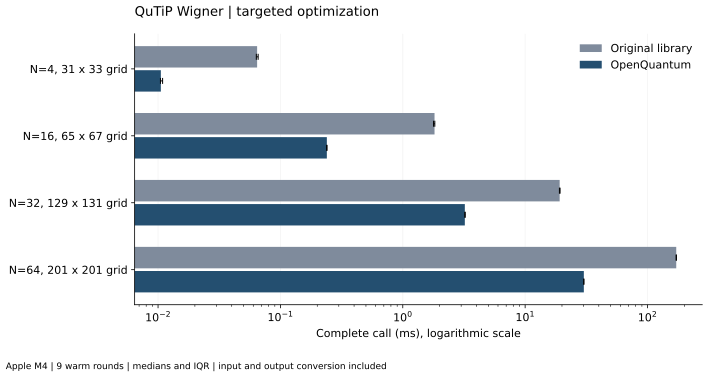
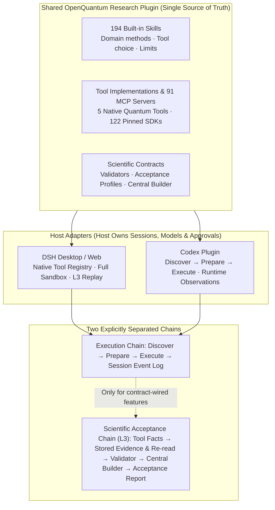
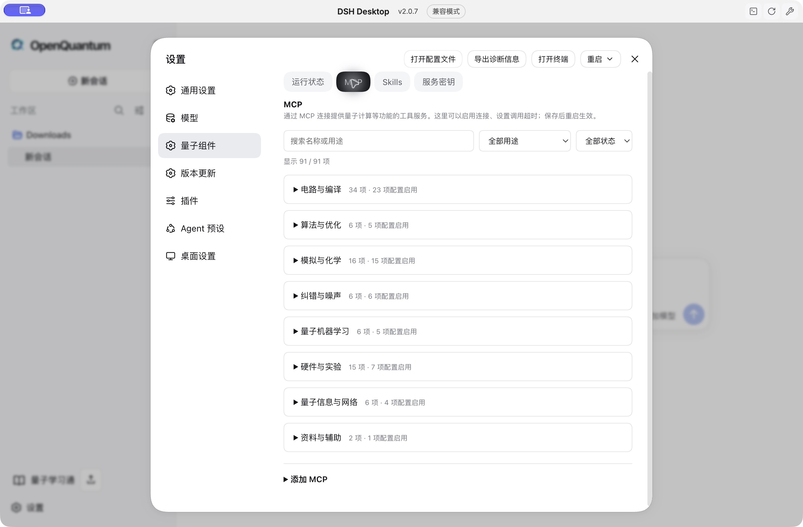

<h1 align="center">
  <picture>
    <source media="(prefers-color-scheme: dark)" srcset="../../packages/openquantum-web-branding/assets/lockup-inverse.svg" />
    
  </picture>
</h1>

<p align="center">
  <strong>OpenQuantum — Building trustworthy AI for quantum research, together.</strong><br />
  <sub>The expertise of quantum research, brought together in OpenQuantum · Shared quantum research plugin &amp; workbench for Codex and Desktop</sub>
</p>

<p align="center">
  <a href="https://github.com/xi-zhao/OpenQuantum/stargazers"></a>
  <a href="https://github.com/xi-zhao/OpenQuantum/releases/tag/v0.8.11"></a>
  <a href="https://github.com/xi-zhao/OpenQuantum/actions/workflows/ci.yml"></a>
  <a href="../../THIRD_PARTY_NOTICES.md"></a>
  
  <a href="https://xi-zhao.github.io/OpenQuantum/"></a>
  <a href="../../CONTRIBUTING.md"></a>
</p>

<p align="center">
  <a href="../../README.md">简体中文</a> ·
  <a href="./README.en.md"><strong>English</strong></a> ·
  <a href="./README.ja.md">日本語</a> ·
  <a href="./README.ko.md">한국어</a> ·
  <a href="./README.es.md">Español</a> ·
  <a href="./README.fr.md">Français</a> ·
  <a href="./README.de.md">Deutsch</a> ·
  <a href="./README.pt.md">Português</a> ·
  <a href="./README.ru.md">Русский</a> ·
  <a href="./README.ar.md">العربية</a>
</p>

<p align="center">
  <a href="#why-openquantum">Why OpenQuantum</a> ·
  <a href="#what-you-can-do">Capabilities</a> ·
  <a href="#optimization-cases">Benchmarks</a> ·
  <a href="#quick-start"><strong>Quick Start ↗</strong></a> ·
  <a href="#use-and-inspect-results">Architecture &amp; Trust</a> ·
  <a href="#roadmap-and-rsi">Roadmap</a> ·
  <a href="#extend-the-platform">Contribute</a>
</p>

<p align="center">
  <a href="https://xi-zhao.github.io/OpenQuantum/">
    
  </a>
</p>

<table>
  <tr>
    <td align="center" width="25%"><strong>194</strong><br /><sub>Built-in Skills (181 auto / 13 index)</sub></td>
    <td align="center" width="25%"><strong>91</strong><br /><sub>MCP connections (66 default / 25 opt-in)</sub></td>
    <td align="center" width="25%"><strong>122</strong><br /><sub>Pinned SDK &amp; source environments</sub></td>
    <td align="center" width="25%"><strong>11 L3</strong><br /><sub>Replayable scientific checks (DSH)</sub></td>
  </tr>
</table>

<p align="center">
  <sub>Static source-tree declarations on <code>main</code>. Environments are prepared on demand; completed tool execution and scientific acceptance are tracked separately.</sub>
</p>

---

## What's New

- **2026-11-26** · Expanded replayable **L3 scientific acceptance** to **11 features** (ground-state VQE, quantum-information audit, QCEC equivalence, QEC memory, Hamiltonian simulation, QPanda QUBO, LDPC decoding, PyZX, Symmer, PauLie, and Graphix) with full-sandbox confinement for all host-side independent reference subprocesses.
- **2026-11** · Added pinned native SDK workflows for **MWPF** (hypergraph decoding & primal/dual bounds), **PPVM** (near-Clifford erasure/leakage), **erasure-recovery** (stabilizer logical state recovery after known erasures), **tropidist** (fault-distance witnesses), and **ST-GRAPE** (robust multi-error pulse control), plus a verified **PyZX 0.10.8** upgrade.
- **2026-11-09** · Shipped **[OpenQuantum v0.8.11](../releases/v0.8.11.md)** ([Desktop DMG](https://github.com/xi-zhao/OpenQuantum/releases/tag/v0.8.11) & [Codex plugin](https://github.com/xi-zhao/OpenQuantum/releases/tag/codex-v0.8.11)): unified bounded Tool execution backend across both hosts, plus **SlowQuant**, **TNQS**, and **RcmpsCore** native SDK workflows.
- **2026-10** · Published two reproducible end-to-end optimization benchmarks: **5.69× speedup on QuTiP Wigner functions** (`6.52 × 10⁻¹⁶` max difference) and **5.09× speedup on PennyLane Pauli commutators**, with full raw timings and validation records.

<p align="center"><strong>▶ 78-Second Overview of OpenQuantum</strong></p>

https://github.com/user-attachments/assets/5c00a30d-eef0-493a-975f-3faeb200cc9e

<p align="center"><sub>2026-11-02 product walkthrough (Chinese captions, snapshot counts from that date). See current inventory and validation limits below · <a href="../communications/video/README.md">Sources &amp; reproduction notes</a></sub></p>

---

<a id="why-openquantum"></a>

## Why OpenQuantum

Asking a general-purpose LLM to conduct quantum research usually breaks down in three places: **reinventing fragile code from scratch, managing over a hundred fragmented cross-language SDKs, and producing plausible-looking answers without independent verification.**

OpenQuantum connects open-source quantum software, published research methods, and independent checking paths through one **shared quantum research plugin**—so AI starts from your research question, picks the right specialist tool, runs real calculations, and preserves verifiable records.

<table>
  <tr>
    <td width="50%" valign="top">
      <strong>Comprehensive · One entry to the quantum stack</strong><br />
      Connects Qiskit, PennyLane, QuTiP, Stim, PyMatching, TeNPy, Mitiq, PyZX, OpenFermion, Lean 4 and more across <strong>122 pinned environments</strong> (110 Python, 9 Julia, 2 Native, 1 Lean) plus <strong>49 executable algorithm examples</strong>.
    </td>
    <td width="50%" valign="top">
      <strong>Fast · Targeted optimization with full benchmarks</strong><br />
      Beyond wrapping APIs: targeted end-to-end optimizations achieve <strong>5.69×</strong> on QuTiP Wigner functions and <strong>5.09×</strong> on PennyLane Pauli commutators on fixed benchmark inputs, complete with pointwise error checks.
    </td>
  </tr>
  <tr>
    <td width="50%" valign="top">
      <strong>Trustworthy · Completed run ≠ scientific acceptance</strong><br />
      <em>Scientific acceptance</em>—determining that a result is scientifically reliable based on independent checks and complete provenance—is kept strictly separate from completed tool execution, backed by versioned Profiles, independent Validators, full-sandbox references, and <strong>Lean 4 / mathlib / physlib</strong> proof checking.
    </td>
    <td width="50%" valign="top">
      <strong>Open &amp; Multi-Host · Shared plugin, BYOM</strong><br />
      One shared plugin serves both the <strong>Codex plugin</strong> and <strong>OpenQuantum Desktop / Web</strong> without building a second Agent Runtime. Bring any Tool Calling model provider; OpenQuantum's own code is MIT-licensed.
    </td>
  </tr>
</table>

---

<a id="what-you-can-do"></a>

## Capabilities & Ecosystem

**A broad specialist world from a single starting point.** The open-source community creates the underlying quantum software and algorithms; OpenQuantum curates, adapts, pins environments, and adds verification paths so agents can use them reliably.

| Algorithms & Circuits | Systems & Many-Body | Error Correction & Mitigation |
| --- | --- | --- |
| [Qiskit](https://github.com/Qiskit/qiskit) · [PennyLane](https://github.com/PennyLaneAI/pennylane) | [QuTiP](https://github.com/qutip/qutip) · [TeNPy](https://github.com/tenpy/tenpy) | [Stim](https://github.com/quantumlib/Stim) · [PyMatching](https://github.com/oscarhiggott/PyMatching) |
| [PyZX](https://github.com/zxcalc/pyzx) · [Graphix](https://github.com/TeamGraphix/graphix) | [OpenFermion](https://github.com/quantumlib/OpenFermion) · [Dynamiqs](https://github.com/dynamiqs/dynamiqs) | [Mitiq](https://github.com/unitaryfoundation/mitiq) · [MQT QECC](https://github.com/munich-quantum-toolkit/qecc) |
| [pytket](https://github.com/CQCL/tket) · [MQT QCEC](https://github.com/munich-quantum-toolkit/qcec) | [Bloqade](https://github.com/QuEraComputing/bloqade-python) · [Pulser](https://github.com/pasqal-io/Pulser) | [Chromobius](https://github.com/quantumlib/chromobius) · [Deltakit](https://github.com/Deltakit/deltakit) |

### Browse by Research Area

Call bounded scientific Tools directly or write custom Python, Julia, and Lean research programs via `quantum-sdk-workbench`. When chaining tools (for example, optimizing a circuit with PyZX, checking equivalence with QCEC, and simulating noise), align models, units, bit order, and budgets; see [computing & resource settings](../integrations/SCALABLE_BRIDGES.md).

| Research Area | Representative Tools & SDKs | Boundaries to Verify |
| --- | --- | --- |
| <a id="algorithm-learning-and-method-comparison"></a>**Algorithms & Method Comparison** | [49 runnable open-source examples](../../examples/quantum-algorithms/README.md): QFT, QPE, HHL, VQE, VQD, QAOA, QSP/QSVT, state preparation, qLDPC, Schrödingerization | Default parameters are teaching cases; verify errors, convergence, and assumptions per task |
| <a id="circuits-and-quantum-information"></a>**Circuits, Compilation & Interop** | Qiskit, PennyLane, PyZX, Graphix, MQT QCEC / QMAP / DDSIM, pytket, Compact, QCut, qBraid, Clifft, [PPVM](../../.agents/skills/ppvm-simulation/SKILL.md), density-matrix audits | Gate sets, bit order, noise models, equivalence scope; PPVM asymmetric-loss survival back-action is not implemented |
| <a id="ground-states-chemistry-and-optimization"></a>**Ground States, Chemistry & Optimization** | VQE (replayable L3), SQD, TeNPy DMRG, OpenFermion, pyChemiQ, Flow-VQE, OpenQARP, Symmer, PauLie, QPanda / Ocean / Kaiwu | Active spaces, particle/symmetry sectors, convergence, and independent references |
| **Spectroscopy, Graph TNs & Field Theory** | [SlowQuant](../../.agents/skills/slowquant-response/SKILL.md) (molecular linear response), [TNQS](../../.agents/skills/tnqs-dynamics/SKILL.md) (irregular-graph tensor networks & CTMRG), [RcmpsCore](../../.agents/skills/rcmps-field-theory/SKILL.md) (1+1D scalar-field RCMPS) | Active-space/response approximations, planar embeddings & cutoffs; transfer gap differs from Hamiltonian rest gap |
| <a id="error-mitigation-and-error-correction"></a>**Error Mitigation & QEC** | Mitiq (ZNE/REM/PEC/CDR), Stim / PyMatching, Deltakit, BP+LSD, Chromobius, [MWPF](../../.agents/skills/mwpf-decoding/SKILL.md), [erasure-recovery](../../.agents/skills/erasure-recovery/SKILL.md), [tropidist](../../.agents/skills/tropidist-distance/SKILL.md), [emlint](../../.agents/skills/emlint-dem-audit/SKILL.md) | Sampling budgets, statistical errors, declared fault models; static DEM checks & small regressions do not prove code distance or threshold |
| <a id="hamiltonian-simulation-and-open-systems"></a>**Dynamics, Neutral Atoms & Pulse Control** | Trotter / qDrift, Dynamiqs, OQuPy, TJM, Bloqade Analog, Pulser, PairInteraction, [ST-GRAPE](../../.agents/skills/stgrape-control/SKILL.md), QUA / LabOne Q / Qblox / Qililab / OQC QAT | Units, cutoffs, fixed time grids, noise assumptions; offline pulse compilation does not control live lab hardware |
| <a id="photonics-and-quantum-networks"></a>**Photonics & Quantum Networks** | Perceval, Piquasso, Lightworks, MerLin, MrMustard, SimQN, NetQASM / SquidASM | Mode order, Fock cutoffs, loss models, and third-party licensing (NetSquid requires a separate license) |
| <a id="experiment-simulation-and-hardware"></a>**Hardware Discovery & Cloud APIs** | FieldQKit, IBM Quantum, IonQ, OriginQ, Quafu, Tianyan, Guodun, Tencent, LogicalQubit, and local QDMI C drivers | Credentials, quotas, and opt-in policies; discovery is read-only by default, real QPU jobs require explicit opt-in |
| <a id="reference-material-and-selection"></a>**Formal Proofs & Public Benchmarks** | [Lean 4 / mathlib / physlib](../../.agents/skills/lean-physics/SKILL.md) (theorem reuse & axiom checks), [Quantum-Practices (66 guides) & Metriq (410 historical benchmarks)](../CAPABILITIES.md#参考资料与选型) | Formal proofs cover stated definitions and axioms only; historical benchmarks do not certify current hardware |
| <a id="quantum-learning"></a>**Teaching & Interactive Classrooms** | [Quantum Learning / OpenMAIC](../integrations/OPENMAIC.md): course library, courseware editor, PPTX import, quizzes, and interactive classrooms | Full curriculum is still under development; live online AI teaching workflows await full acceptance |

<details>
<summary><strong>Expand: Explicit Setup & Limits for Frontier Native SDKs (SlowQuant / TNQS / RcmpsCore / PPVM / MWPF / erasure-recovery / tropidist / ST-GRAPE)</strong></summary>

Each environment is prepared explicitly before running custom programs through the host's code tools; normal computation calls never auto-install dependencies:

| SDK | Explicit Setup Command | Guide & Example | Verification Boundaries |
| --- | --- | --- | --- |
| **SlowQuant** | `node scripts/setup-sdk.mjs slowquant-response` | [Skill](../../.agents/skills/slowquant-response/SKILL.md) · [Notes](../integrations/SLOWQUANT.md) | Small-scale offline response validated; Qiskit molecular spectroscopy and hardware unvalidated |
| **TNQS** | `node scripts/setup-sdk.mjs tnqs-dynamics` | [Skill](../../.agents/skills/tnqs-dynamics/SKILL.md) · [Notes](../integrations/TNQS.md) | Public Julia API; small-system checks do not prove large-scale convergence or scientific acceptance |
| **RcmpsCore** | `node scripts/setup-sdk.mjs rcmps-field-theory` | [Skill](../../.agents/skills/rcmps-field-theory/SKILL.md) · [Notes](../integrations/RCMPS.md) | Transfer gap ≠ Hamiltonian rest gap; trial-state examples do not prove interacting ground states or mass spectra |
| **PPVM** | `node scripts/setup-sdk.mjs ppvm-simulation` | [Skill](../../.agents/skills/ppvm-simulation/SKILL.md) · [Notes](../integrations/PPVM.md) | Setup builds a pinned Rust extension; `LOST` is separate from bit values and `reset_state` does not restore loss/leakage |
| **MWPF** | `node scripts/setup-sdk.mjs mwpf-decoding` | [Editable example](../../.agents/skills/mwpf-decoding/references/native-example.py) · [Evidence](../integrations/evidence/mwpf-2026-11-06.json) | Sinter uses `PanicAction.RAISE`; zero cluster budget is not infinite; floating-point primal/dual bounds are not formal proofs |
| **erasure-recovery** | `node scripts/setup-sdk.mjs erasure-recovery` | [Editable example](../../.agents/skills/erasure-recovery/references/native-example.py) · [Evidence](../ecosystem/proposals/erasure-recovery.md#integration-evidence) | Adaptive stabilizer circuits; only post-erasure CNOTs are charged |
| **tropidist** | `node scripts/setup-sdk.mjs tropidist-distance` | [Editable example](../../.agents/skills/tropidist-distance/references/native-example.py) · [Comparison](../ecosystem/proposals/tropidist.md) | Scoped to declared unit-weight fault models; check lower and upper witness bounds separately |
| **ST-GRAPE** | `node scripts/setup-sdk.mjs stgrape-control` | [Two-qubit example](../../.agents/skills/stgrape-control/references/native-example.py) · [Comparison](../ecosystem/proposals/st-grape.md) | Scoped to fixed time grids and quasi-static noise models; verify split-step error and budget termination |

</details>

<details>
<summary><strong>Expand: Local Computing & Supported Quantum Cloud Backends</strong></summary>

Local numerical computing requires no quantum-cloud account. Real hardware and paid cloud services remain disabled or read-only until you configure credentials and explicitly enable them in **OpenQuantum settings**:

| Backend | Supported Scope | Credentials & Activation Policy |
| --- | --- | --- |
| **Local Numerical Backends** | Circuits, noise, ground states, chemistry, many-body, QEC, photonics, and pulse simulation (122 pinned environments) | No cloud account needed; prepare pinned local dependencies per task |
| **IBM Quantum** | Runtime, AI Transpiler, hardware queries; optional job submission and cancellation | `QISKIT_IBM_TOKEN`; job MCP connections are opt-in (off by default) |
| **IonQ** | Hardware queries; optional job submission, cancellation, and cost estimates | `IONQ_API_KEY`; job MCP connections are opt-in (off by default) |
| **OriginQ Cloud** | Read-only discovery (FieldQKit); Wukong QPU queries and optional jobs via QPanda3 Runtime | `ORIGIN_API_TOKEN` (read-only); `QPANDA3_API_KEY` (opt-in jobs) |
| **Domestic Quantum Clouds (Read-Only)** | Quafu, Tianyan, Guodun, Tencent, FieldQuantum, and LogicalQubit discovery, topology, and calibration | Individual API tokens; read-only discovery, no remote state changes |
| **QDMI Local Device Interface** | Read-only queries of devices, gates, and couplings via a pinned C driver | Requires `npm run capability:qdmi:setup`; official example driver is not an online QPU |

</details>

The current source distribution ships **[194 built-in Skills](../../.agents/skills/README.md)**, **91 MCP service connections** (66 enabled by default, 25 opt-in), and **5 native quantum Tools**, with full native-API workflows for **[122 SDK/source environments](../integrations/SDK_INVENTORY.md)** (including **11 replayable L3 scientific acceptance features** on DSH). Inventory counts, configuration switches, environment readiness, and scientific acceptance are distinct states.

[Full Skill & MCP Catalog (Chinese)](../CAPABILITIES.md#接口总览) · [Native SDK Audit](../integrations/FULL_SDK_ACCESS.md) · [Choosing Between Similar Methods](../integrations/CAPABILITY_SELECTION.md)

---

<a id="optimization-cases"></a>

## Measured Optimizations: Faster and Independently Checked

Targeted optimizations on real quantum research bottlenecks, preserving complete end-to-end call timings, independent accuracy checks, and full reproduction records:

| Benchmark Task | Hardware & Pinned Input | Complete Call (Orig → Opt) | Speedup | Independent Verification & Reproduction |
| --- | --- | ---: | ---: | --- |
| **QuTiP Wigner Function** | Apple M4 · QuTiP 5.3.1 (64-dim Fock, 201×201 grid) | 171.77 ms → **30.18 ms** | **5.69×** | Max diff `6.52 × 10⁻¹⁶` · 272 checks passed · [Report](../../experiments/qutip-rust-wigner/README.md) / [JSON](../../experiments/qutip-rust-wigner/results/summary.json) |
| **PennyLane Pauli Commutator** | Apple M4 · PennyLane 0.45.1 (32 qubits, 125×512 terms) | 30.62 ms → **6.02 ms** | **5.09×** | 9/9 exact match · 4,368 Pauli pairs max err `1.42 × 10⁻¹⁴` · [Report](../../experiments/pennylane-rust-commutator/README.md) / [JSON](../../experiments/pennylane-rust-commutator/results/benchmark.json) |

<a id="qutip-rust-case"></a>

### QuTiP Wigner Function — 5.69× Complete-Call Speedup

<p align="center">
  
</p>

<details>
<summary><strong>QuTiP: View multi-size timing chart, methodology & raw data</strong></summary>

Apple M4, QuTiP 5.3.1, single-threaded, 2 warmups, medians of 9 interleaved warm rounds. Timings include input reading, conversion, validation, and full double-precision output; environment setup, compilation, and verification are excluded.



[Full report](../../experiments/qutip-rust-wigner/README.md) · [Raw timings (144 samples)](../../experiments/qutip-rust-wigner/results/raw-timings.csv) · [Validation](../../experiments/qutip-rust-wigner/results/validation.json) · [Independent review](../../experiments/qutip-rust-wigner/results/review.md)

</details>

<a id="pennylane-rust-case"></a>

### PennyLane Pauli Commutator — 5.09× Complete-Call Speedup

<p align="center">
  
</p>

<details>
<summary><strong>PennyLane: View methodology, accuracy checks & raw data</strong></summary>

Apple M4, PennyLane 0.45.1, 32-qubit 125-term local Hamiltonian × 512-term two-body operator pool, single-threaded, 2 warmups, medians of 9 warm rounds. Complete calls measure `PauliSentence` input to `PauliSentence` output including bidirectional conversion and output construction. Independent exhaustive checks verified 4,368 Pauli-string pairs and 40 random complex-coefficient sums (`1.42 × 10⁻¹⁴` max matrix error).

[Full report](../../experiments/pennylane-rust-commutator/README.md) · [Raw timings (405 samples)](../../experiments/pennylane-rust-commutator/results/raw-timings.csv) · [Validation](../../experiments/pennylane-rust-commutator/results/validation.json) · [Independent review](../../experiments/pennylane-rust-commutator/results/review.md)

</details>

> [!NOTE]
> Both measurements are targeted benchmarks (medians of 9 warm rounds including input/output conversion, excluding environment setup and compilation). Gains apply only to the specified inputs and do not generalize to all quantum workloads or constitute a formal scientific acceptance report.

---

<a id="quick-start"></a>

## Quick Start

One OpenQuantum, three ways to start. All share the same quantum research capabilities and prepare scientific dependencies on demand.

| Option | Best For | Prerequisites | Get Started |
| --- | --- | --- | --- |
| **Codex Plugin** | Using quantum Skills & scientific Tools inside native Codex chats | Plugin-enabled Codex, Node.js 24+, npm | [Install Codex Plugin ↓](#codex) |
| **Desktop App** | Ready-to-use personal quantum research workbench | macOS Apple Silicon (bundles Node / uv) | [Download Desktop ↓](#desktop-installer) |
| **Source / Docker** | Developers, Linux / Windows users, latest `main` capabilities | Git, Node.js 24+ (optional uv / Docker) | [Run from Source ↓](#install-from-source) |

<a id="codex"></a>

### Option 1: Codex Plugin

**Let Codex install it for you:** open Codex, start a new chat, and paste:

```text
Please install the OpenQuantum Codex plugin 0.8.11. First read the installation guide:
https://github.com/xi-zhao/OpenQuantum/blob/codex-v0.8.11/docs/integrations/CODEX_AGENT_INSTALL.md
Download the complete installer and SHA256SUMS from https://github.com/xi-zhao/OpenQuantum/releases/tag/codex-v0.8.11,
verify the checksum, check Codex, Node.js 24+ and npm, and install with the bundled installer.
Keep existing plugins and user settings, and check the Skills, MCP tools and the global "OpenQuantum settings" entry.
Tell me exactly what to do if the app needs reloading. Finally, report what was actually verified and which scientific dependencies still need preparation.
```

Reload Codex when prompted, start a new chat, and manage Skills, MCP connections, environments, and credentials under **OpenQuantum settings**.

**[Download Complete Installer ZIP](https://github.com/xi-zhao/OpenQuantum/releases/download/codex-v0.8.11/openquantum-0.8.11-codex-install.zip)** · [Release Notes & SHA256SUMS](https://github.com/xi-zhao/OpenQuantum/releases/tag/codex-v0.8.11) · [Manual Install & Troubleshooting](../integrations/CODEX_AGENT_INSTALL.md) · [Plugin Boundaries](../integrations/CODEX_PLUGIN.md)

<details>
<summary><strong>Manual CLI installation (optional)</strong></summary>

After downloading, verifying `SHA256SUMS`, and extracting `openquantum-0.8.11-codex-install.zip`:

```sh
npm ci --ignore-scripts
npm run plugin:install
```

</details>

<a id="desktop-installer"></a>

### Option 2: Desktop App

1. Download **[OpenQuantum 0.8.11 DMG](https://github.com/xi-zhao/OpenQuantum/releases/download/v0.8.11/OpenQuantum-0.8.11-macOS-arm64.dmg)** (macOS Apple Silicon) and verify against [SHA256SUMS](https://github.com/xi-zhao/OpenQuantum/releases/tag/v0.8.11).
2. Open the DMG and drag `OpenQuantum.app` into Applications.
3. Configure your model provider (with **Tool Calling** support) under **Settings → Models**.

> [!NOTE]
> The macOS bundle uses ad-hoc local signing and has **no Apple Developer ID distribution signature or notarization**. See the [Desktop installation guide](../DESKTOP_INSTALLERS.md) for first launch and backup steps. Intel Mac and Windows users can use the [0.8.4 capability packages](https://github.com/xi-zhao/OpenQuantum/releases/tag/v0.8.4) or run from source below.

<a id="install-from-source"></a>

### Option 3: Run from Source

```bash
git clone https://github.com/xi-zhao/OpenQuantum.git
cd OpenQuantum
npm ci
npm run dev
```

Open the authenticated local URL printed in the startup logs (redirects to <http://127.0.0.1:3000>).

**Configure a model:** Add an OpenAI-compatible Chat Completions endpoint, model name, and API key under **Settings → Models**. Agents require a model with **Tool Calling** to invoke scientific Tools. Model keys and quantum-cloud keys are stored separately. Without any model key, you can immediately run the zero-key demo below.

<details>
<summary><strong>Additional launch modes: Desktop from source, Docker (Linux), Quantum Learning & Messaging</strong></summary>

| Launch Mode | Commands (from repository root) | Guide |
| --- | --- | --- |
| **Desktop from source** | `npm run desktop:setup` → `npm run desktop:verify-install` → `npm run desktop -- --source` | Needs Corepack & C++ build tools · [Deployment](../DEPLOYMENT.md) |
| **Docker Compose (Linux)** | `cp .env.example .env && docker compose up --build` | Linux host-network local trial only · [Deployment](../DEPLOYMENT.md) |
| **Quantum Learning** | `npm run learning:ui:setup` | Standalone courseware & classroom UI · [OpenMAIC guide](../integrations/OPENMAIC.md) |
| **WeChat, Feishu & Messaging** | `npm run cc-connect:setup` | Connect messaging channels via CC Connect · [Messaging guide](../integrations/CC_CONNECT.md) |

Web and source Desktop share `.openquantum/dsh`; stop the running process before switching.

</details>

[Deployment](../DEPLOYMENT.md) · [Local Environments](../integrations/LOCAL_ENVIRONMENTS.md) · [Upgrades](../UPDATES.md) · [Troubleshooting](../TROUBLESHOOTING.md)

### First Verified Run in 30 Seconds

<a id="no-model-key-needed-recompute-a-fixed-case"></a>

#### 1. Zero Model Key: Recompute a Fixed H₂ Ground-State Case

Right after `npm ci`, invoke the native `solve_and_validate_ground_state` Tool to run noiseless VQE in the fixed `hamming-weight = 1` sector and check against an independent closed-form exact reference:

```bash
npm run demo:quantum-ground-state
```

<table>
  <tr>
    <td align="center" width="25%"><strong>-1.85727503 Ha</strong><br /><sub>VQE energy</sub></td>
    <td align="center" width="25%"><strong>-1.85727503 Ha</strong><br /><sub>Independent exact reference</sub></td>
    <td align="center" width="25%"><strong>4.44 × 10⁻¹⁶ Ha</strong><br /><sub>Absolute difference</sub></td>
    <td align="center" width="25%"><strong>15 passed</strong><br /><sub>Local computation checks</sub></td>
  </tr>
</table>

<sub>Reference values from the [2026-09-12 local rerun record](../examples/quantum-ground-state-local-demo-2026-09-12.json). This standalone run checks local computation only (no Harness session provenance), so it does not constitute full scientific acceptance.</sub>

#### 2. Ask the Agent: Prepare and Sample a Bell State

Prepare the pinned FatQat environment (requires [uv](https://docs.astral.sh/uv/getting-started/installation/)), then send this prompt in your configured workbench or Codex chat:

```bash
node scripts/setup-paper-tools.mjs fatqat-workbench
```

> Use FatQat to start from the two-qubit all-zero state, apply H to q0, then CX with q0 as control and q1 as target. Return the exact noiseless probabilities and compare them with 1024 samples using seed=7.

Ideal probabilities are 50% each for `00` and `11` with finite-sample fluctuations; inspect the actual Tool call, inputs, and outputs, then ask to compare against 8192 shots.

<details>
<summary><strong>3. Run 49 Open-Source Algorithm Examples from the CLI (e.g., HHL)</strong></summary>

No model key or cloud account required—prepare the minimal environment (NumPy / SciPy / Qiskit):

```bash
npm run capability:algorithms:setup -- --minimal
examples/quantum-algorithms/.venv/bin/python examples/quantum-algorithms/run.py --list
examples/quantum-algorithms/.venv/bin/python examples/quantum-algorithms/run.py --algorithm hhl
```

Add optional groups (`pennylane`, `gradients`, `tensor`, `chemistry`) on demand. See the [algorithm examples guide](../../examples/quantum-algorithms/README.md).

</details>

---

<a id="use-and-inspect-results"></a>
<a id="execution-records-and-scientific-acceptance"></a>

## Architecture & Verifiable Science

OpenQuantum centers on a **host-agnostic shared quantum research plugin** (Skills, Tool implementations, MCP Servers, and scientific contracts). Each host—DSH Desktop / Web and Codex—owns its own sessions, models, permissions, approvals, and execution loop; OpenQuantum never introduces a second Agent Runtime.



<table>
  <tr>
    <td width="50%" valign="top"><a href="../images/openquantum-desktop-20261013.jpg"></a><br /><sub>Desktop research workbench · 2026-10-13 interface (0.8.11 streamlines sidebar &amp; settings)</sub></td>
    <td width="50%" valign="top"><a href="../images/openquantum-settings-categories-20261013.jpg"></a><br /><sub>Categorized capability settings (search, filters &amp; connections) · 2026-10-13 interface</sub></td>
  </tr>
</table>

<details>
<summary><strong>View more visuals: Codex Settings (0.7.5) · Platform Overview · Scientific Evidence Flow</strong></summary>

- **Codex global settings page (historical 0.7.5 screenshot)**: [View full image](../images/openquantum-codex-settings-20261011.png)
- **Full architecture overview**: [View diagram](../images/openquantum-platform-overview.png) · [Project architecture guide](../architecture/PROJECT_ARCHITECTURE.md)
- **Evidence generation, independent validation & acceptance flow**: [View diagram](../images/openquantum-evidence-flow.png)

</details>

> [!IMPORTANT]
> **Four Scientific Trust Guardrails (daily workflow follows Discover → Prepare → Execute without auto-installing dependencies during calculations):**
> 1. **Trust execution records, not prose**: Enabled settings or model text replies never substitute for actual Tool calls, programs, and result files.
> 2. **Separate completion from scientific acceptance**: CI, independent numerical references, formal proofs, and scientific acceptance are reported distinctly. Only features wired through evidence storage and re-read, independent Scientific Validators, and the central Acceptance Builder with provenance derive scientific acceptance (currently 11 replayable L3 features on DSH; Codex provides runtime independent observations without automatic evidence storage or session acceptance yet).
> 3. **Sandbox and workspace isolation**: Keep research workspaces separate from OpenQuantum installation paths and DSH Home; built-in scientific MCP servers and host-side independent reference subprocesses run inside full filesystem sandboxes.
> 4. **Keep reproducible artifacts and negative results**: Retain inputs, units, random seeds, pinned versions, and failed or negative runs; scientific judgment stays with the researcher.

---

<a id="roadmap-and-rsi"></a>
<a id="rsi"></a>

## Roadmap & Long-Term Vision

OpenQuantum aims for every investigation to leave both verifiable answers and stronger capabilities for the next one. Long-term directions below are research goals, not guaranteed delivery dates:

| Stage | Focus | Current Status |
| --- | --- | --- |
| **Delivered Baseline** | Shared plugin & dual-host delivery | 194 Skills, 91 MCP connections, 122 pinned SDKs; unified Desktop & Codex `v0.8.11`; 11 replayable L3 features with full-sandbox reference confinement |
| **Active Development** | Ecosystem depth, HPC/QPU workflows & teaching | Expanding L2/L3 verification coverage, local CPU/GPU/HPC/QPU orchestration, laboratory instrument interfaces, and [Quantum Learning](../integrations/OPENMAIC.md) courses |
| **Long-Term Vision (RSI)** | Verified recursive self-improvement | Exploring `real task → candidate improvement → independent checks & new-task comparisons → authorized update`; **the full RSI loop is not implemented** · [Vision & boundaries](../roadmap/VISION.md) |

---

<a id="extend-the-platform"></a>
<a id="documentation-and-support"></a>

## Contributing & Extending

Great quantum software and methods come from the open scientific community. Bring your research questions, SDKs, paper reproductions, or well-checked negative results.

**[Contribution Guide ↗](../../CONTRIBUTING.md)** · **[Open an Issue](https://github.com/xi-zhao/OpenQuantum/issues)** · **[Code of Conduct](../../CODE_OF_CONDUCT.md)**

| What You Want to Contribute | Maturity Track | Where to Start |
| --- | --- | --- |
| **Domain methods, workflow steps & boundaries** | `L0` Skill | Author a native `SKILL.md` · [Contributing](../../CONTRIBUTING.md) & [Skill Index](../../.agents/skills/README.md) |
| **Deterministic calculations, queries or hardware APIs** | `L1` Tool / MCP | Choose native Tool Provider or MCP Server by isolation boundary · [Extension Model](../architecture/EXTENSION_MODEL.md) |
| **Independent scientific checks & replayable acceptance** | `L2 / L3` Validator | Add JSON Schema, Scientific Validator, Acceptance Profile & central Builder · [Four Contribution Tracks](../README.md#四条贡献路径) |
| **Complete apps, courses or reproducible cases** | App / Case | Document task, inputs/outputs, sources, licenses & verification scope in [GitHub Issues](https://github.com/xi-zhao/OpenQuantum/issues) |

Run the offline repository quality gate locally before opening a PR:

```bash
npm run check
```

---

## Documentation Hub

| Topic | Documentation |
| --- | --- |
| **Install, Deploy, Upgrade & Troubleshoot** | [Desktop](../DESKTOP_INSTALLERS.md) · [Codex Plugin](../integrations/CODEX_AGENT_INSTALL.md) · [Deployment](../DEPLOYMENT.md) · [Updates](../UPDATES.md) · [Troubleshooting](../TROUBLESHOOTING.md) |
| **Capabilities, SDKs & Environments** | [Capability Reference (ZH)](../CAPABILITIES.md) · [Full SDK Audit](../integrations/FULL_SDK_ACCESS.md) · [Local Environments](../integrations/LOCAL_ENVIRONMENTS.md) · [Method Selection](../integrations/CAPABILITY_SELECTION.md) |
| **Examples & Benchmarks** | [Task Examples (ZH)](../EXAMPLES.md) · [49 Algorithm Examples](../../examples/quantum-algorithms/README.md) · [QuTiP Case](../../experiments/qutip-rust-wigner/README.md) · [PennyLane Case](../../experiments/pennylane-rust-commutator/README.md) |
| **Architecture & Governance** | [Documentation Index](../README.md) · [Project Architecture](../architecture/PROJECT_ARCHITECTURE.md) · [Extension Governance](../architecture/EXTENSION_GOVERNANCE.md) · [Contributing](../../CONTRIBUTING.md) |
| **Releases & Visual Provenance** | [Changelog](../../CHANGELOG.md) · [GitHub Releases](https://github.com/xi-zhao/OpenQuantum/releases) · [Vision](../roadmap/VISION.md) · [Image Notes](../images/README.md) |

---

## Citation

If OpenQuantum supports your quantum research, benchmarking, or teaching, please cite it via [`CITATION.cff`](../../CITATION.cff) or:

```bibtex
@software{zhao2026openquantum,
  author  = {Zhao, Xi and {OpenQuantum contributors}},
  title   = {OpenQuantum: Building Trustworthy AI for Quantum Research},
  year    = {2026},
  version = {0.8.11},
  url     = {https://github.com/xi-zhao/OpenQuantum}
}
```

<a id="license-and-acknowledgments"></a>

## Open-Source Ecosystem & License

OpenQuantum builds on open science, open-source quantum libraries, and host platforms ([DeepSeek Harness](https://github.com/deepseek-ai/deepseek-harness), [DSH Desktop](https://github.com/anywhere-labs/dsh-desktop), [OpenMAIC](https://github.com/THU-MAIC/OpenMAIC), [CC Connect](../integrations/CC_CONNECT.md)), preserving original authors, sources, and licenses. See [upstream credits](../CAPABILITIES.md#开源生态与致谢) and [`THIRD_PARTY_NOTICES.md`](../../THIRD_PARTY_NOTICES.md).

- OpenQuantum's own code is licensed under the [MIT License](../../LICENSE) (© 2026 Xi Zhao), except for separately licensed directories.
- The `mitiq-error-mitigation` directory is [GPL-3.0-only](../../.agents/skills/mitiq-error-mitigation/LICENSE), and the Metriq public data snapshot is [CC-BY-4.0](../../src/metriq-data/upstream/LICENSE); their LICENSE and NOTICE terms continue to apply.
- Share only authorized material; report security vulnerabilities privately under [`SECURITY.md`](../../SECURITY.md).

<br />

<p align="center">
  <picture>
    <source media="(prefers-color-scheme: dark)" srcset="../../packages/openquantum-web-branding/assets/lockup-inverse.svg" />
    
  </picture>
</p>

<p align="center">
  <strong>Open source, moving forward together.</strong><br />
  <sub>OpenQuantum · Quantum computing at your fingertips.</sub>
</p>

<p align="center">
  <sub>
    If OpenQuantum helps your research, consider giving it a <a href="https://github.com/xi-zhao/OpenQuantum">⭐ Star</a> ·
    <a href="https://xi-zhao.github.io/OpenQuantum/">Website</a> ·
    <a href="https://github.com/xi-zhao/OpenQuantum">GitHub</a> ·
    <a href="../../LICENSE">MIT License</a> ·
    <a href="../../THIRD_PARTY_NOTICES.md">Third-Party Notices</a>
  </sub>
</p>
