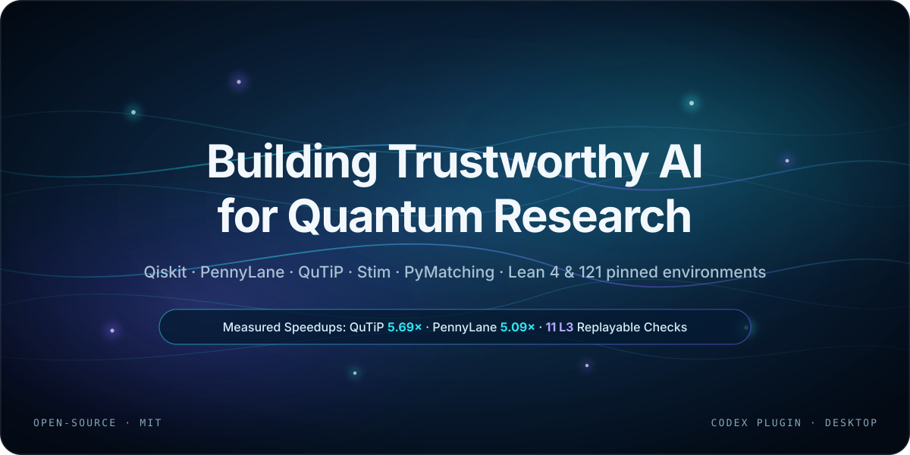
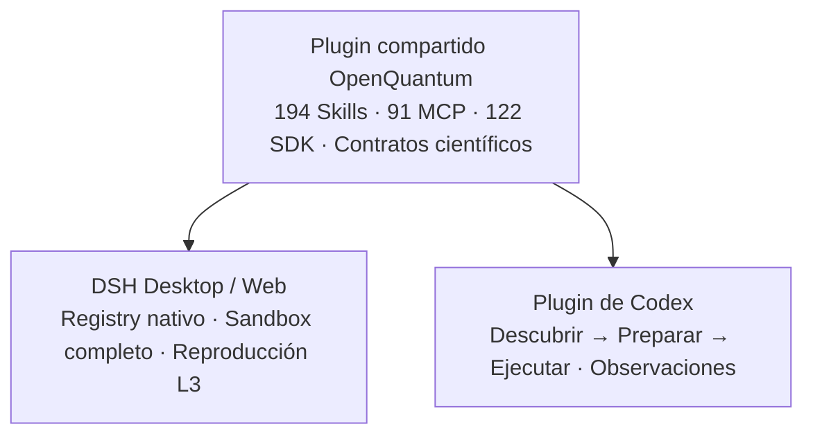

<h1 align="center">
  <picture>
    <source media="(prefers-color-scheme: dark)" srcset="../../packages/openquantum-web-branding/assets/lockup-inverse.svg" />
    
  </picture>
</h1>

<p align="center">
  <strong>OpenQuantum — Construyendo juntos una IA fiable para la investigación cuántica.</strong><br />
  <sub>El conocimiento especializado de la investigación cuántica, reunido en un solo OpenQuantum · Plugin y entorno de investigación abierto para Codex y Desktop</sub>
</p>

<p align="center">
  <a href="https://github.com/xi-zhao/OpenQuantum/stargazers"></a>
  <a href="https://github.com/xi-zhao/OpenQuantum/releases/tag/v0.8.11"></a>
  <a href="https://github.com/xi-zhao/OpenQuantum/actions/workflows/ci.yml"></a>
  <a href="../../THIRD_PARTY_NOTICES.md"></a>
  
  <a href="https://xi-zhao.github.io/OpenQuantum/"></a>
  <a href="../../CONTRIBUTING.md"></a>
</p>

<p align="center">
  <a href="../../README.md">简体中文</a> ·
  <a href="./README.en.md">English</a> ·
  <a href="./README.ja.md">日本語</a> ·
  <a href="./README.ko.md">한국어</a> ·
  <a href="./README.es.md"><strong>Español</strong></a> ·
  <a href="./README.fr.md">Français</a> ·
  <a href="./README.de.md">Deutsch</a> ·
  <a href="./README.pt.md">Português</a> ·
  <a href="./README.ru.md">Русский</a> ·
  <a href="./README.ar.md">العربية</a>
</p>

<p align="center">
  <a href="#why-openquantum">Por qué OpenQuantum</a> ·
  <a href="#what-you-can-do">Funciones</a> ·
  <a href="#optimization-cases">Optimizaciones</a> ·
  <a href="#quick-start"><strong>Inicio rápido ↗</strong></a> ·
  <a href="#use-and-inspect-results">Arquitectura</a> ·
  <a href="#roadmap-and-rsi">Hoja de ruta</a> ·
  <a href="#extend-the-platform">Contribuir</a>
</p>

<p align="center">
  <a href="https://xi-zhao.github.io/OpenQuantum/">
    
  </a>
</p>

<table>
  <tr>
    <td align="center" width="25%"><strong>194</strong><br /><sub>Skills integradas (181 auto / 13 índice)</sub></td>
    <td align="center" width="25%"><strong>91</strong><br /><sub>Conexiones MCP (66 activas / 25 opcionales)</sub></td>
    <td align="center" width="25%"><strong>122</strong><br /><sub>Entornos SDK y fuente fijados</sub></td>
    <td align="center" width="25%"><strong>11 L3</strong><br /><sub>Aceptación científica reproducible (DSH)</sub></td>
  </tr>
</table>

---

## Novedades

- **2026-11-26** · Se amplió la **aceptación científica L3** reproducible a **11 funciones** (VQE de estado fundamental, auditoría de información cuántica, equivalencia QCEC, memoria QEC, simulación hamiltoniana, QPanda QUBO, decodificación LDPC, PyZX, Symmer, PauLie y Graphix) con aislamiento completo en sandbox para todos los subprocesos de referencia del host.
- **2026-11** · Nuevos entornos SDK nativos fijados para **MWPF**, **PPVM**, **tropidist** y **ST-GRAPE**, junto con la actualización verificada de **PyZX 0.10.8**.
- **2026-11-09** · Lanzamiento unificado **[OpenQuantum v0.8.11](../releases/v0.8.11.md)** ([Desktop DMG](https://github.com/xi-zhao/OpenQuantum/releases/tag/v0.8.11) y [plugin de Codex](https://github.com/xi-zhao/OpenQuantum/releases/tag/codex-v0.8.11)) con backend compartido de ejecución acotada y soporte para **SlowQuant**, **TNQS** y **RcmpsCore**.
- **2026-10** · Dos optimizaciones reproducibles medidas de extremo a extremo: **5.69× en la función de Wigner de QuTiP** (diferencia máxima `6.52 × 10⁻¹⁶`) y **5.09× en conmutadores de Pauli en PennyLane**.

<p align="center"><strong>▶ OpenQuantum en 78 segundos</strong></p>

https://github.com/user-attachments/assets/5c00a30d-eef0-493a-975f-3faeb200cc9e

<p align="center"><sub>Demostración del 2026-11-02 (subtítulos en chino y cifras de esa fecha). <a href="../communications/video/README.md">Fuentes y reproducción</a></sub></p>

---

<a id="why-openquantum"></a>

## Por qué OpenQuantum

Usar un LLM genérico para investigar en computación cuántica suele chocar con tres límites: **reescribir código frágil desde cero, gestionar más de cien SDKs fragmentados y obtener respuestas verosímiles sin comprobación independiente.** OpenQuantum conecta software científico abierto, métodos publicados y comprobaciones independientes en un único **plugin compartido**.

- **Cobertura completa**: 122 entornos fijados (110 Python, 9 Julia, 2 nativos, 1 Lean 4) y 49 ejemplos ejecutables de algoritmos (Qiskit, PennyLane, QuTiP, Stim, PyMatching, TeNPy, Mitiq, PyZX, OpenFermion, Lean 4 y más).
- **Más rápido y comprobable**: aceleraciones medidas en llamada completa (**5.69×** en QuTiP, **5.09×** en PennyLane) con verificación punto a punto.
- **Ciencia verificable**: la *aceptación científica* —determinar que un resultado es científicamente fiable a partir de comprobaciones independientes y procedencia completa— se mantiene separada de la simple ejecución completada de una herramienta.
- **Abierto y multihost**: un solo plugin sirve tanto al **plugin de Codex** como a **OpenQuantum Desktop / Web** con tu propio modelo Tool Calling (BYOM) y licencia MIT para el código propio.

---

<a id="what-you-can-do"></a>

## Funciones y ecosistema

| Área de investigación | Herramientas y SDKs destacados | Límites a comprobar |
| --- | --- | --- |
| <a id="algorithm-learning-and-method-comparison"></a>**Algoritmos y comparación** | [49 ejemplos ejecutables](../../examples/quantum-algorithms/README.md): QFT, QPE, HHL, VQE, VQD, QAOA, QSP/QSVT, preparación de estados, qLDPC y schrödingerización | Parámetros por defecto docentes; comprueba error y convergencia en tu problema |
| <a id="circuits-and-quantum-information"></a>**Circuitos, compilación e interoperabilidad** | Qiskit, PennyLane, PyZX, Graphix, MQT QCEC / QMAP / DDSIM, pytket, Compact, QCut, qBraid, Clifft, [PPVM](../../.agents/skills/ppvm-simulation/SKILL.md), auditoría de matrices de densidad | Conjunto de puertas, orden de bits, ruido y alcance de equivalencia |
| <a id="ground-states-chemistry-and-optimization"></a>**Estados fundamentales, química y optimización** | VQE (L3 reproducible), SQD, TeNPy DMRG, OpenFermion, pyChemiQ, Flow-VQE, OpenQARP, Symmer, PauLie, QPanda / Ocean / Kaiwu | Espacio activo, sector de partículas/simetría y referencia independiente |
| **Espectroscopia, redes tensoriales y teoría de campos** | [SlowQuant](../../.agents/skills/slowquant-response/SKILL.md), [TNQS](../../.agents/skills/tnqs-dynamics/SKILL.md), [RcmpsCore](../../.agents/skills/rcmps-field-theory/SKILL.md) | Aproximaciones de respuesta, incrustación planar y diferencia entre brecha de transferencia y brecha hamiltoniana |
| <a id="error-mitigation-and-error-correction"></a>**Mitigación y corrección de errores** | Mitiq, Stim / PyMatching, Deltakit, BP+LSD, Chromobius, [MWPF](../../.agents/skills/mwpf-decoding/SKILL.md), [tropidist](../../.agents/skills/tropidist-distance/SKILL.md), [erasure-recovery](../../.agents/skills/erasure-recovery/SKILL.md), [emlint](../../.agents/skills/emlint-dem-audit/SKILL.md) | Presupuesto de muestreo, modelo de fallos; el diagnóstico DEM estático no prueba distancia ni umbral |
| <a id="hamiltonian-simulation-and-open-systems"></a>**Dinámica, átomos neutros y pulsos** | Trotter / qDrift, Dynamiqs, OQuPy, TJM, Bloqade Analog, Pulser, PairInteraction, [ST-GRAPE](../../.agents/skills/stgrape-control/SKILL.md), QUA / LabOne Q / Qblox / Qililab / OQC QAT | Unidades, cortes y malla temporal fija; la compilación offline no opera equipos físicos |
| <a id="photonics-and-quantum-networks"></a>**Fotónica y redes cuánticas** | Perceval, Piquasso, Lightworks, MerLin, MrMustard, SimQN, NetQASM / SquidASM | Orden de modos, corte de Fock y licencia externa de NetSquid |
| <a id="experiment-simulation-and-hardware"></a>**Hardware y nubes cuánticas** | FieldQKit, IBM Quantum, IonQ, OriginQ, Quafu, Tianyan, Guodun, Tencent, LogicalQubit y QDMI | Descubrimiento en solo lectura por defecto; envío real a QPU bajo activación explícita |
| <a id="reference-material-and-selection"></a>**Pruebas formales y benchmarks** | [Lean 4 / mathlib / physlib](../../.agents/skills/lean-physics/SKILL.md), [Quantum-Practices (66) y Metriq (410)](../CAPABILITIES.md#参考资料与选型) | Pruebas acotadas a definiciones y axiomas declarados; datos históricos no certifican hardware actual |
| <a id="quantum-learning"></a>**Docencia y aulas interactivas** | [Quantum Learning / OpenMAIC](../integrations/OPENMAIC.md) | Currículo completo en construcción; flujo docente con IA online pendiente de aceptación completa |

La distribución fuente actual incluye **[194 Skills integradas](../../.agents/skills/README.md)**, **91 conexiones de servicios MCP** (66 activadas por defecto y 25 opcionales), **5 Tools cuánticas nativas** y **[122 entornos SDK/fuente](../integrations/SDK_INVENTORY.md)** (con **11 funciones L3** reproducibles en DSH). [Catálogo completo (chino)](../CAPABILITIES.md#接口总览) · [Auditoría SDK](../integrations/FULL_SDK_ACCESS.md)

---

<a id="optimization-cases"></a>

## Optimizaciones medidas

| Caso | Baseline fijado (Apple M4) | Biblioteca original | OpenQuantum | Aceleración | Comprobación independiente | Reproducción |
| --- | --- | ---: | ---: | ---: | --- | --- |
| **QuTiP Wigner** | QuTiP 5.3.1 (Fock 64, malla 201×201) | 171.77 ms | **30.18 ms** | **5.69×** | Dif. máx. `6.52 × 10⁻¹⁶`; 272 comprobaciones superadas | [Informe](../../experiments/qutip-rust-wigner/README.md) · [JSON](../../experiments/qutip-rust-wigner/results/summary.json) |
| **PennyLane Pauli** | PennyLane 0.45.1 (32 qubits, 125×512 términos) | 30.62 ms | **6.02 ms** | **5.09×** | 9 benchmarks idénticos; 4368 pares de cadenas de Pauli y 40 matrices aleatorias (`1.42 × 10⁻¹⁴`) | [Informe](../../experiments/pennylane-rust-commutator/README.md) · [JSON](../../experiments/pennylane-rust-commutator/results/benchmark.json) |

<a id="qutip-rust-case"></a>

<p align="center"></p>

<a id="pennylane-rust-case"></a>

<p align="center"></p>

---

<a id="quick-start"></a>

## Inicio rápido

<a id="codex"></a>

### Opción 1: Plugin de Codex

Abre un nuevo chat en Codex y pega esta solicitud:

```text
Please install the OpenQuantum Codex plugin 0.8.11. First read the installation guide:
https://github.com/xi-zhao/OpenQuantum/blob/codex-v0.8.11/docs/integrations/CODEX_AGENT_INSTALL.md
Download the complete installer and SHA256SUMS from https://github.com/xi-zhao/OpenQuantum/releases/tag/codex-v0.8.11,
verify the checksum, check Codex, Node.js 24+ and npm, and install with the bundled installer.
Keep existing plugins and user settings, and check the Skills, MCP tools and the global "OpenQuantum settings" entry.
Tell me exactly what to do if the app needs reloading. Finally, report what was actually verified and which scientific dependencies still need preparation.
```

**[Descargar instalador completo ZIP](https://github.com/xi-zhao/OpenQuantum/releases/download/codex-v0.8.11/openquantum-0.8.11-codex-install.zip)** · [Notas y SHA256SUMS](https://github.com/xi-zhao/OpenQuantum/releases/tag/codex-v0.8.11) · [Guía manual](../integrations/CODEX_AGENT_INSTALL.md)

<a id="desktop-installer"></a>

### Opción 2: Aplicación Desktop

Descarga **[OpenQuantum 0.8.11 DMG](https://github.com/xi-zhao/OpenQuantum/releases/download/v0.8.11/OpenQuantum-0.8.11-macOS-arm64.dmg)** (macOS Apple Silicon), verifica [SHA256SUMS](https://github.com/xi-zhao/OpenQuantum/releases/tag/v0.8.11), arrastra `OpenQuantum.app` a Aplicaciones y añade tu modelo con Tool Calling en **Settings → Models** ([guía de instalación](../DESKTOP_INSTALLERS.md); Intel Mac / Windows: [paquetes 0.8.4](https://github.com/xi-zhao/OpenQuantum/releases/tag/v0.8.4)).

<a id="install-from-source"></a>

### Opción 3: Ejecutar desde el código fuente

```bash
git clone https://github.com/xi-zhao/OpenQuantum.git
cd OpenQuantum
npm ci
npm run dev
```

<details>
<summary><strong>Otras opciones: Desktop desde fuente, Docker (Linux), Quantum Learning y mensajería</strong></summary>

- **Desktop desde fuente**: `npm run desktop:setup`, `npm run desktop:verify-install`, `npm run desktop -- --source` ([despliegue](../DEPLOYMENT.md))
- **Docker Compose (Linux)**: `cp .env.example .env && docker compose up --build`
- **Quantum Learning**: `npm run learning:ui:setup` ([OpenMAIC](../integrations/OPENMAIC.md))
- **Mensajería**: `npm run cc-connect:setup` ([CC Connect](../integrations/CC_CONNECT.md))

</details>

### Primer cálculo verificable en 30 segundos (sin clave de modelo)

```bash
npm run demo:quantum-ground-state
```

<table>
  <tr>
    <td align="center" width="25%"><strong>-1.85727503 Ha</strong><br /><sub>Energía VQE</sub></td>
    <td align="center" width="25%"><strong>-1.85727503 Ha</strong><br /><sub>Referencia exacta</sub></td>
    <td align="center" width="25%"><strong>4.44 × 10⁻¹⁶ Ha</strong><br /><sub>Diferencia absoluta</sub></td>
    <td align="center" width="25%"><strong>15 superadas</strong><br /><sub>Comprobaciones locales</sub></td>
  </tr>
</table>

---

<a id="use-and-inspect-results"></a>
<a id="execution-records-and-scientific-acceptance"></a>

## Arquitectura y ciencia verificable



<table>
  <tr>
    <td width="50%" valign="top"><a href="../images/openquantum-desktop-20261013.jpg"></a><br /><sub>Entorno de investigación Desktop (2026-10-13)</sub></td>
    <td width="50%" valign="top"><a href="../images/openquantum-settings-categories-20261013.jpg"></a><br /><sub>Configuración clasificada por uso con búsqueda y filtros (2026-10-13)</sub></td>
  </tr>
</table>

---

<a id="roadmap-and-rsi"></a>
<a id="rsi"></a>

## Hoja de ruta · <a id="extend-the-platform"></a><a id="documentation-and-support"></a>Contribuir y citar

- **Hoja de ruta**: ampliar cobertura L2/L3, orquestación CPU/GPU/HPC/QPU, interfaces de instrumentación y cursos de Quantum Learning. La mejora recursiva (RSI) sigue siendo una dirección a largo plazo; **el ciclo RSI completo aún no está implementado** ([visión](../roadmap/VISION.md)).
- **Contribuir**: [Guía de contribución](../../CONTRIBUTING.md) · [Issues](https://github.com/xi-zhao/OpenQuantum/issues) · [Código de conducta](../../CODE_OF_CONDUCT.md) · [Seguridad](../../SECURITY.md) (`npm run check`).

```bibtex
@software{zhao2026openquantum,
  author  = {Zhao, Xi and {OpenQuantum contributors}},
  title   = {OpenQuantum: Building Trustworthy AI for Quantum Research},
  year    = {2026},
  version = {0.8.11},
  url     = {https://github.com/xi-zhao/OpenQuantum}
}
```

<a id="license-and-acknowledgments"></a>

## Licencia y agradecimientos

El código propio usa [MIT License](../../LICENSE) (© 2026 Xi Zhao), salvo `mitiq-error-mitigation` ([GPL-3.0-only](../../.agents/skills/mitiq-error-mitigation/LICENSE)) y los datos de Metriq ([CC-BY-4.0](../../src/metriq-data/upstream/LICENSE)). Consulta [`THIRD_PARTY_NOTICES.md`](../../THIRD_PARTY_NOTICES.md).

<p align="center">
  <picture>
    <source media="(prefers-color-scheme: dark)" srcset="../../packages/openquantum-web-branding/assets/lockup-inverse.svg" />
    
  </picture><br />
  <sub>OpenQuantum · La computación cuántica, al alcance de tu mano.</sub>
</p>
