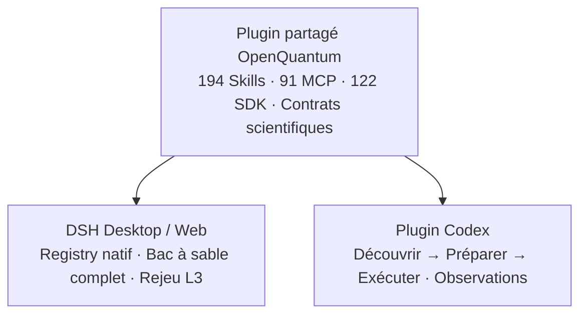

<h1 align="center">
  <picture>
    <source media="(prefers-color-scheme: dark)" srcset="../../packages/openquantum-web-branding/assets/lockup-inverse.svg" />
    
  </picture>
</h1>

<p align="center">
  <strong>OpenQuantum — Construire ensemble une IA de confiance pour la recherche quantique.</strong><br />
  <sub>L'expertise de la recherche quantique réunie dans un seul OpenQuantum · Plugin et environnement de recherche open source pour Codex et Desktop</sub>
</p>

<p align="center">
  <a href="https://github.com/xi-zhao/OpenQuantum/stargazers"></a>
  <a href="https://github.com/xi-zhao/OpenQuantum/releases/tag/v0.8.11"></a>
  <a href="https://github.com/xi-zhao/OpenQuantum/actions/workflows/ci.yml"></a>
  <a href="../../THIRD_PARTY_NOTICES.md"></a>
  
  <a href="https://xi-zhao.github.io/OpenQuantum/"></a>
  <a href="../../CONTRIBUTING.md"></a>
</p>

<p align="center">
  <a href="../../README.md">简体中文</a> ·
  <a href="./README.en.md">English</a> ·
  <a href="./README.ja.md">日本語</a> ·
  <a href="./README.ko.md">한국어</a> ·
  <a href="./README.es.md">Español</a> ·
  <a href="./README.fr.md"><strong>Français</strong></a> ·
  <a href="./README.de.md">Deutsch</a> ·
  <a href="./README.pt.md">Português</a> ·
  <a href="./README.ru.md">Русский</a> ·
  <a href="./README.ar.md">العربية</a>
</p>

<p align="center">
  <a href="#why-openquantum">Pourquoi OpenQuantum</a> ·
  <a href="#what-you-can-do">Fonctionnalités</a> ·
  <a href="#optimization-cases">Optimisations</a> ·
  <a href="#quick-start"><strong>Démarrage rapide ↗</strong></a> ·
  <a href="#use-and-inspect-results">Architecture</a> ·
  <a href="#roadmap-and-rsi">Feuille de route</a> ·
  <a href="#extend-the-platform">Contribuer</a>
</p>

<p align="center">
  <a href="https://xi-zhao.github.io/OpenQuantum/">
    <picture>
      <source media="(prefers-color-scheme: dark)" srcset="../images/readme/hero-en-dark.webp" />
      
    </picture>
  </a>
</p>

<p align="center">
  <a href="https://github.com/xi-zhao/OpenQuantum/releases/download/v0.8.11/OpenQuantum-0.8.11-macOS-arm64.dmg">
    <picture>
      <source media="(prefers-color-scheme: dark)" srcset="../images/readme/launch-card-en-dark.webp" />
      
    </picture>
  </a>
</p>

Les paquets d’installation de `v0.8.11` contiennent 189 Skills, 117 environnements et 3 procédures de validation scientifique L3 sur DSH. Le tableau décrit le code source actuel de `main`, avec 194 Skills, 122 environnements et 11 procédures L3.

<table>
  <tr>
    <td align="center" width="25%"><strong>194</strong><br /><sub>Skills intégrés (181 auto / 13 index)</sub></td>
    <td align="center" width="25%"><strong>91</strong><br /><sub>Connexions MCP (66 par défaut / 25 opt-in)</sub></td>
    <td align="center" width="25%"><strong>122</strong><br /><sub>Environnements SDK et sources figés</sub></td>
    <td align="center" width="25%"><strong>11 L3</strong><br /><sub>Acceptation scientifique rejouable (DSH)</sub></td>
  </tr>
</table>

---

## Actualités

- **2026-11-26** · Extension de l'**acceptation scientifique L3** rejouable à **11 fonctionnalités** (VQE état fondamental, audit d'information quantique, équivalence QCEC, mémoire QEC, simulation hamiltonienne, QPanda QUBO, décodage LDPC, PyZX, Symmer, PauLie et Graphix), avec confinement complet en bac à sable des sous-processus de référence.
- **2026-11** · Ajout des SDK natifs figés **MWPF**, **PPVM**, **tropidist** et **ST-GRAPE**, ainsi que la mise à niveau vérifiée de **PyZX 0.10.8**.
- **2026-11-09** · Publication unifiée **[OpenQuantum v0.8.11](../releases/v0.8.11.md)** ([Desktop DMG](https://github.com/xi-zhao/OpenQuantum/releases/tag/v0.8.11) et [plugin Codex](https://github.com/xi-zhao/OpenQuantum/releases/tag/codex-v0.8.11)) avec exécution bornée partagée et prise en charge de **SlowQuant**, **TNQS** et **RcmpsCore**.
- **2026-10** · Deux optimisations mesurées et reproductibles de bout en bout : **5,69× sur la fonction de Wigner QuTiP** (écart maximal `6,52 · 10⁻¹⁶`) et **5,09× sur le commutateur de Pauli PennyLane**.

<p align="center"><strong>▶ Découvrir OpenQuantum en 78 secondes</strong></p>

https://github.com/user-attachments/assets/5c00a30d-eef0-493a-975f-3faeb200cc9e

<p align="center"><sub>Démonstration du 2026-11-02 (sous-titres chinois, effectifs à cette date). <a href="../communications/video/README.md">Sources et reproduction</a></sub></p>

---

<a id="why-openquantum"></a>

## Pourquoi OpenQuantum

Confier la recherche quantique à un LLM générique se heurte généralement à trois obstacles : **réécrire du code fragile à partir de zéro, gérer plus d'une centaine de SDK hétérogènes et obtenir des réponses plausibles sans vérification indépendante.** OpenQuantum relie les bibliothèques open source, les méthodes publiées et les vérifications indépendantes au sein d'un **plugin partagé**.

- **Couverture complète** : 122 environnements figés (110 Python, 9 Julia, 2 natifs, 1 Lean 4) et 49 exemples exécutables d'algorithmes (Qiskit, PennyLane, QuTiP, Stim, PyMatching, TeNPy, Mitiq, PyZX, OpenFermion, Lean 4…).
- **Performance mesurée** : accélérations en appel complet (**5,69×** sur QuTiP, **5,09×** sur PennyLane) avec vérification point par point.
- **Science vérifiable** : l'*acceptation scientifique* — conclure qu'un résultat est scientifiquement fiable sur la base de contrôles indépendants et d'une provenance complète — reste distincte de la simple fin d'exécution d'un outil.
- **Ouvert et multi-hôtes** : un même plugin sert le **plugin Codex** et **OpenQuantum Desktop / Web**, avec votre propre modèle Tool Calling (BYOM) et une licence MIT pour le code propre.

---

<a id="what-you-can-do"></a>

## Fonctionnalités et écosystème

| Domaine | Outils et SDK représentatifs | Limites à vérifier |
| --- | --- | --- |
| <a id="algorithm-learning-and-method-comparison"></a>**Algorithmes et comparaison** | [49 exemples exécutables](../../examples/quantum-algorithms/README.md) : QFT, QPE, HHL, VQE, VQD, QAOA, QSP/QSVT, préparation d'états, qLDPC, schrödingerisation | Paramètres par défaut pédagogiques ; vérifier erreur et convergence selon la tâche |
| <a id="circuits-and-quantum-information"></a>**Circuits, compilation et interopérabilité** | Qiskit, PennyLane, PyZX, Graphix, MQT QCEC / QMAP / DDSIM, pytket, Compact, QCut, qBraid, Clifft, [PPVM](../../.agents/skills/ppvm-simulation/SKILL.md), audit de matrices densité | Jeux de portes, ordre des bits, modèles de bruit et périmètre d'équivalence |
| <a id="ground-states-chemistry-and-optimization"></a>**États fondamentaux, chimie et optimisation** | VQE (L3 rejouable), SQD, TeNPy DMRG, OpenFermion, pyChemiQ, Flow-VQE, OpenQARP, Symmer, PauLie, QPanda / Ocean / Kaiwu | Espace actif, secteur de particules/symétrie et référence indépendante |
| **Spectroscopie, TN sur graphes et théorie des champs** | [SlowQuant](../../.agents/skills/slowquant-response/SKILL.md), [TNQS](../../.agents/skills/tnqs-dynamics/SKILL.md), [RcmpsCore](../../.agents/skills/rcmps-field-theory/SKILL.md) | Approximations de réponse, plongement planaire, distinction entre gap de transfert et gap hamiltonien |
| <a id="error-mitigation-and-error-correction"></a>**Atténuation et correction d'erreurs** | Mitiq, Stim / PyMatching, Deltakit, BP+LSD, Chromobius, [MWPF](../../.agents/skills/mwpf-decoding/SKILL.md), [tropidist](../../.agents/skills/tropidist-distance/SKILL.md), [erasure-recovery](../../.agents/skills/erasure-recovery/SKILL.md), [emlint](../../.agents/skills/emlint-dem-audit/SKILL.md) | Budget d'échantillonnage et modèle de fautes ; le diagnostic DEM statique ne prouve ni distance ni seuil |
| <a id="hamiltonian-simulation-and-open-systems"></a>**Dynamique, atomes neutres et impulsions** | Trotter / qDrift, Dynamiqs, OQuPy, TJM, Bloqade Analog, Pulser, PairInteraction, [ST-GRAPE](../../.agents/skills/stgrape-control/SKILL.md), QUA / LabOne Q / Qblox / Qililab / OQC QAT | Unités, troncatures, grille temporelle fixe ; la compilation hors ligne ne pilote pas de matériel physique |
| <a id="photonics-and-quantum-networks"></a>**Photonique et réseaux quantiques** | Perceval, Piquasso, Lightworks, MerLin, MrMustard, SimQN, NetQASM / SquidASM | Ordre des modes, troncature de Fock et licence distincte de NetSquid |
| <a id="experiment-simulation-and-hardware"></a>**Matériel et clouds quantiques** | FieldQKit, IBM Quantum, IonQ, OriginQ, Quafu, Tianyan, Guodun, Tencent, LogicalQubit et QDMI | Découverte en lecture seule par défaut ; soumission QPU sur activation explicite |
| <a id="reference-material-and-selection"></a>**Preuves formelles et benchmarks** | [Lean 4 / mathlib / physlib](../../.agents/skills/lean-physics/SKILL.md), [Quantum-Practices (66) et Metriq (410)](../CAPABILITIES.md#参考资料与选型) | Preuves limitées aux définitions et axiomes déclarés ; les données historiques ne certifient pas le matériel actuel |
| <a id="quantum-learning"></a>**Enseignement et salles interactives** | [Quantum Learning / OpenMAIC](../integrations/OPENMAIC.md) | Cursus complet en construction ; acceptation complète des flux IA en ligne en attente |

La distribution source actuelle fournit **[194 Skills intégrés](../../.agents/skills/README.md)**, **91 connexions de services MCP** (66 activées par défaut, 25 optionnelles), **5 Tools quantiques natifs** et **[122 environnements SDK/sources](../integrations/SDK_INVENTORY.md)** (dont **11 fonctionnalités L3** rejouables sur DSH). [Catalogue complet (chinois)](../CAPABILITIES.md#接口总览) · [Audit SDK](../integrations/FULL_SDK_ACCESS.md)

---

<a id="optimization-cases"></a>

## Optimisations mesurées

| Tâche | Référence figée (Apple M4) | Bibliothèque d'origine | OpenQuantum | Accélération | Vérification indépendante | Reproduction |
| --- | --- | ---: | ---: | ---: | --- | --- |
| **QuTiP Wigner** | QuTiP 5.3.1 (Fock 64, grille 201×201) | 171,77 ms | **30,18 ms** | **5,69×** | Écart max `6,52 · 10⁻¹⁶` ; 272 contrôles réussis | [Rapport](../../experiments/qutip-rust-wigner/README.md) · [JSON](../../experiments/qutip-rust-wigner/results/summary.json) |
| **PennyLane Pauli** | PennyLane 0.45.1 (32 qubits, 125×512 termes) | 30,62 ms | **6,02 ms** | **5,09×** | 9 benchmarks identiques ; 4 368 paires de chaînes de Pauli et 40 matrices aléatoires (`1,42 · 10⁻¹⁴`) | [Rapport](../../experiments/pennylane-rust-commutator/README.md) · [JSON](../../experiments/pennylane-rust-commutator/results/benchmark.json) |

<a id="qutip-rust-case"></a>

<p align="center"></p>

<a id="pennylane-rust-case"></a>

<p align="center"></p>

---

<a id="quick-start"></a>

## Démarrage rapide

<a id="codex"></a>

### Option 1 : Plugin Codex

Ouvrez un nouveau chat Codex et collez la demande ci-dessous :

```text
Please install the OpenQuantum Codex plugin 0.8.11. First read the installation guide:
https://github.com/xi-zhao/OpenQuantum/blob/codex-v0.8.11/docs/integrations/CODEX_AGENT_INSTALL.md
Download the complete installer and SHA256SUMS from https://github.com/xi-zhao/OpenQuantum/releases/tag/codex-v0.8.11,
verify the checksum, check Codex, Node.js 24+ and npm, and install with the bundled installer.
Keep existing plugins and user settings, and check the Skills, MCP tools and the global "OpenQuantum settings" entry.
Tell me exactly what to do if the app needs reloading. Finally, report what was actually verified and which scientific dependencies still need preparation.
```

**[Télécharger l'installateur complet ZIP](https://github.com/xi-zhao/OpenQuantum/releases/download/codex-v0.8.11/openquantum-0.8.11-codex-install.zip)** · [Notes et SHA256SUMS](https://github.com/xi-zhao/OpenQuantum/releases/tag/codex-v0.8.11) · [Installation manuelle](../integrations/CODEX_AGENT_INSTALL.md)

<a id="desktop-installer"></a>

### Option 2 : Application Desktop

Téléchargez **[OpenQuantum 0.8.11 DMG](https://github.com/xi-zhao/OpenQuantum/releases/download/v0.8.11/OpenQuantum-0.8.11-macOS-arm64.dmg)** (macOS Apple Silicon), vérifiez [SHA256SUMS](https://github.com/xi-zhao/OpenQuantum/releases/tag/v0.8.11), glissez `OpenQuantum.app` dans Applications et configurez un modèle compatible Tool Calling dans **Settings → Models** ([guide d'installation](../DESKTOP_INSTALLERS.md) ; Intel Mac / Windows : [paquets 0.8.4](https://github.com/xi-zhao/OpenQuantum/releases/tag/v0.8.4)).

<a id="install-from-source"></a>

### Option 3 : Exécuter depuis les sources

```bash
git clone https://github.com/xi-zhao/OpenQuantum.git
cd OpenQuantum
npm ci
npm run dev
```

<details>
<summary><strong>Autres lancements : Desktop depuis les sources, Docker (Linux), Quantum Learning et messagerie</strong></summary>

- **Desktop depuis les sources** : `npm run desktop:setup`, `npm run desktop:verify-install`, `npm run desktop -- --source` ([déploiement](../DEPLOYMENT.md))
- **Docker Compose (Linux)** : `cp .env.example .env && docker compose up --build`
- **Quantum Learning** : `npm run learning:ui:setup` ([OpenMAIC](../integrations/OPENMAIC.md))
- **Messagerie** : `npm run cc-connect:setup` ([CC Connect](../integrations/CC_CONNECT.md))

</details>

### Premier calcul vérifiable en 30 secondes (sans clé de modèle)

```bash
npm run demo:quantum-ground-state
```

<table>
  <tr>
    <td align="center" width="25%"><strong>-1,85727503 Ha</strong><br /><sub>Énergie VQE</sub></td>
    <td align="center" width="25%"><strong>-1,85727503 Ha</strong><br /><sub>Référence exacte</sub></td>
    <td align="center" width="25%"><strong>4,44 · 10⁻¹⁶ Ha</strong><br /><sub>Écart absolu</sub></td>
    <td align="center" width="25%"><strong>15 réussis</strong><br /><sub>Contrôles locaux</sub></td>
  </tr>
</table>

---

<a id="use-and-inspect-results"></a>
<a id="execution-records-and-scientific-acceptance"></a>

## Architecture et science vérifiable



<table>
  <tr>
    <td width="50%" valign="top"><a href="../images/openquantum-desktop-20261013.jpg"></a><br /><sub>Environnement de recherche Desktop (2026-10-13)</sub></td>
    <td width="50%" valign="top"><a href="../images/openquantum-settings-categories-20261013.jpg"></a><br /><sub>Paramètres classés par usage avec recherche et filtres (2026-10-13)</sub></td>
  </tr>
</table>

---

<a id="roadmap-and-rsi"></a>
<a id="rsi"></a>

## Feuille de route · <a id="extend-the-platform"></a><a id="documentation-and-support"></a>Contribuer et citer

- **Feuille de route** : étendre la couverture L2/L3, l'orchestration CPU/GPU/HPC/QPU, les interfaces d'instrumentation et Quantum Learning. L'auto-amélioration récursive (RSI) reste une piste de long terme ; **la boucle RSI complète n'est pas implémentée** ([vision](../roadmap/VISION.md)).
- **Contribuer** : [Guide de contribution](../../CONTRIBUTING.md) · [Issues](https://github.com/xi-zhao/OpenQuantum/issues) · [Code de conduite](../../CODE_OF_CONDUCT.md) · [Sécurité](../../SECURITY.md) (`npm run check`).

```bibtex
@software{zhao2026openquantum,
  author  = {Zhao, Xi and {OpenQuantum contributors}},
  title   = {OpenQuantum: Building Trustworthy AI for Quantum Research},
  year    = {2026},
  version = {0.8.11},
  url     = {https://github.com/xi-zhao/OpenQuantum}
}
```

<a id="license-and-acknowledgments"></a>

## Licence et remerciements

Le code propre est sous [MIT License](../../LICENSE) (© 2026 Xi Zhao), sauf `mitiq-error-mitigation` ([GPL-3.0-only](../../.agents/skills/mitiq-error-mitigation/LICENSE)) et les données Metriq ([CC-BY-4.0](../../src/metriq-data/upstream/LICENSE)). Voir [`THIRD_PARTY_NOTICES.md`](../../THIRD_PARTY_NOTICES.md).

<p align="center">
  <picture>
    <source media="(prefers-color-scheme: dark)" srcset="../../packages/openquantum-web-branding/assets/lockup-inverse.svg" />
    
  </picture><br />
  <sub>OpenQuantum · Le calcul quantique, à portée de main.</sub>
</p>
