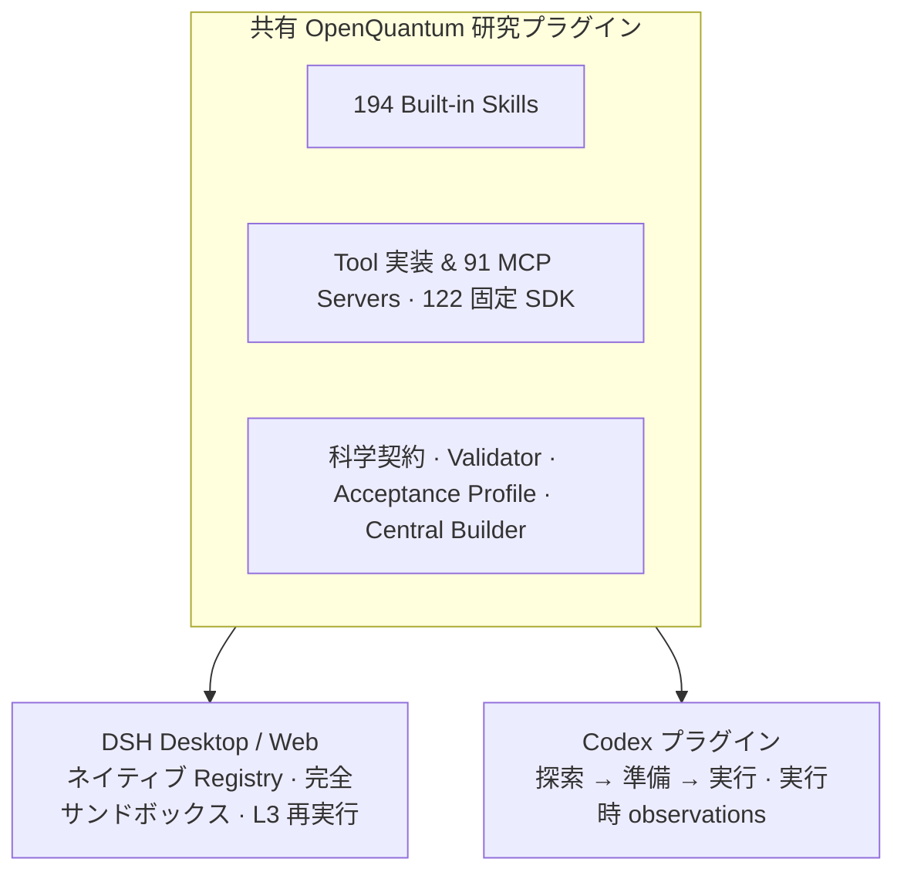

<h1 align="center">
  <picture>
    <source media="(prefers-color-scheme: dark)" srcset="../../packages/openquantum-web-branding/assets/lockup-inverse.svg" />
    
  </picture>
</h1>

<p align="center">
  <strong>OpenQuantum — 信頼できる量子研究 AI を、ともに育てる。</strong><br />
  <sub>量子研究の専門知を、一つの OpenQuantum に · Codex と Desktop に対応するオープンソース量子研究プラグイン＆ワークベンチ</sub>
</p>

<p align="center">
  <a href="https://github.com/xi-zhao/OpenQuantum/stargazers"></a>
  <a href="https://github.com/xi-zhao/OpenQuantum/releases/tag/v0.8.11"></a>
  <a href="https://github.com/xi-zhao/OpenQuantum/actions/workflows/ci.yml"></a>
  <a href="../../THIRD_PARTY_NOTICES.md"></a>
  
  <a href="https://xi-zhao.github.io/OpenQuantum/"></a>
  <a href="../../CONTRIBUTING.md"></a>
</p>

<p align="center">
  <a href="../../README.md">简体中文</a> ·
  <a href="./README.en.md">English</a> ·
  <a href="./README.ja.md"><strong>日本語</strong></a> ·
  <a href="./README.ko.md">한국어</a> ·
  <a href="./README.es.md">Español</a> ·
  <a href="./README.fr.md">Français</a> ·
  <a href="./README.de.md">Deutsch</a> ·
  <a href="./README.pt.md">Português</a> ·
  <a href="./README.ru.md">Русский</a> ·
  <a href="./README.ar.md">العربية</a>
</p>

<p align="center">
  <a href="#why-openquantum">選ばれる理由</a> ·
  <a href="#what-you-can-do">研究機能</a> ·
  <a href="#optimization-cases">実測最適化</a> ·
  <a href="#quick-start"><strong>クイックスタート ↗</strong></a> ·
  <a href="#use-and-inspect-results">アーキテクチャと信頼性</a> ·
  <a href="#roadmap-and-rsi">ロードマップ</a> ·
  <a href="#extend-the-platform">参加・貢献</a>
</p>

<p align="center">
  <a href="https://xi-zhao.github.io/OpenQuantum/">
    <picture>
      <source media="(prefers-color-scheme: dark)" srcset="../images/readme/hero-en-dark.webp" />
      
    </picture>
  </a>
</p>

<p align="center">
  <a href="https://github.com/xi-zhao/OpenQuantum/releases/download/v0.8.11/OpenQuantum-0.8.11-macOS-arm64.dmg">
    <picture>
      <source media="(prefers-color-scheme: dark)" srcset="../images/readme/launch-card-en-dark.webp" />
      
    </picture>
  </a>
</p>

<table>
  <tr>
    <td align="center" width="25%"><strong>194</strong><br /><sub>組み込み Skill（自動 181 / 索引 13）</sub></td>
    <td align="center" width="25%"><strong>91</strong><br /><sub>MCP 接続（既定 66 / 任意 25）</sub></td>
    <td align="center" width="25%"><strong>122</strong><br /><sub>固定 SDK・ソース環境</sub></td>
    <td align="center" width="25%"><strong>11 件の L3</strong><br /><sub>再実行可能な科学的受入れ（DSH）</sub></td>
  </tr>
</table>

<p align="center">
  <sub><code>main</code> ソースツリーの静的宣言に基づく規模です。環境はタスクごとに明示的に準備し、ツール実行完了と科学的受入れは別個に記録します。</sub>
</p>

---

## 最新アップデート

- **2026-11-26** · 再実行可能な **L3 科学的受入れ** を **11 機能**（基底状態 VQE・量子情報監査・QCEC 等価性・QEC メモリ・ハミルトニアン発展・QPanda QUBO・LDPC 復号・PyZX・Symmer・PauLie・Graphix）へ拡大し、ホスト側の独立参照サブプロセスをすべて完全サンドボックス下に統合しました。
- **2026-11** · **MWPF**（ハイパーグラフ復号と主双対限界）、**PPVM**（近 Clifford 消失・リーク）、**tropidist**（故障距離の証人）、**ST-GRAPE**（多誤差源ロバストパルス制御）の固定ネイティブ SDK 環境と **PyZX 0.10.8** 回帰検証を追加しました。
- **2026-11-09** · **[OpenQuantum v0.8.11](../releases/v0.8.11.md)**（[Desktop DMG](https://github.com/xi-zhao/OpenQuantum/releases/tag/v0.8.11) / [Codex プラグイン](https://github.com/xi-zhao/OpenQuantum/releases/tag/codex-v0.8.11)）を統一リリース。両ホストで有界 Tool 実行バックエンドを共有し、**SlowQuant**・**TNQS**・**RcmpsCore** を追加しました。
- **2026-10** · 呼び出し全体の実測最適化事例を 2 件公開：**QuTiP Wigner 関数 5.69× 高速化**（最大絶対差 `6.52 × 10⁻¹⁶`）、**PennyLane Pauli 交換子 5.09× 高速化**。生の計測値と再現スクリプトを公開しています。

<p align="center"><strong>▶ 78 秒でわかる OpenQuantum</strong></p>

https://github.com/user-attachments/assets/5c00a30d-eef0-493a-975f-3faeb200cc9e

<p align="center"><sub>2026-11-02 公開デモ（中国語字幕・撮影時点の規模）。最新の機能一覧と検証境界は下記をご覧ください · <a href="../communications/video/README.md">出典と再現手順</a></sub></p>

---

<a id="why-openquantum"></a>

## OpenQuantum が選ばれる理由

汎用 LLM に量子研究を任せると、**壊れやすいコードを毎回ゼロから書き直す負担、言語をまたぐ 100 以上の分断された SDK 環境、そして独立検証のない「それらしい回答」**という 3 つの壁にぶつかります。

OpenQuantum は、オープンソースの専門ソフトウェア・論文手法・独立した確認経路を一つの**共有量子研究プラグイン**として接続し、研究の問いから実際の計算・検証可能な記録までを一直線につなぎます。

<table>
  <tr>
    <td width="50%" valign="top">
      <strong>網羅性 · 量子ソフトウェア群を一つの起点に</strong><br />
      Qiskit・PennyLane・QuTiP・Stim・PyMatching・TeNPy・Mitiq・PyZX・OpenFermion・Lean 4 など <strong>122 の固定環境</strong>（Python 110 / Julia 9 / Native 2 / Lean 1）と <strong>49 件の実行可能アルゴリズム例</strong>を接続します。
    </td>
    <td width="50%" valign="top">
      <strong>高速化 · 実測と検証を伴う最適化</strong><br />
      API の橋渡しにとどまらず、頻出計算ボトルネックを最適化。固定入力の呼び出し全体で <strong>QuTiP 5.69×</strong>、<strong>PennyLane 5.09×</strong> の高速化を実測し、各点の数値誤差と独立照合を保存しています。
    </td>
  </tr>
  <tr>
    <td width="50%" valign="top">
      <strong>信頼性 · 実行完了と科学的受入れを分離</strong><br />
      独立チェックと完全な来歴に基づき結果の科学的信頼性を判断する<em>科学的受入れ</em>を、ツールの実行完了と厳密に区別。バージョン管理された Acceptance Profile・独立 Validator・<strong>Lean 4 / mathlib / physlib</strong> による証明検査を備えます。
    </td>
    <td width="50%" valign="top">
      <strong>開放性 · 共有プラグイン＆マルチホスト</strong><br />
      同一の専門機能を <strong>Codex プラグイン</strong>と <strong>OpenQuantum Desktop / Web</strong> の両方で利用可能。独自の Agent Runtime は作らず、Tool Calling 対応の任意のモデル（BYOM）が使えます。独自コードは MIT ライセンスです。
    </td>
  </tr>
</table>

---

<a id="what-you-can-do"></a>

## 研究機能とエコシステム

| 量子アルゴリズムと回路 | 量子系と多体物理 | 誤り訂正と誤差抑制 |
| --- | --- | --- |
| [Qiskit](https://github.com/Qiskit/qiskit) · [PennyLane](https://github.com/PennyLaneAI/pennylane) | [QuTiP](https://github.com/qutip/qutip) · [TeNPy](https://github.com/tenpy/tenpy) | [Stim](https://github.com/quantumlib/Stim) · [PyMatching](https://github.com/oscarhiggott/PyMatching) |
| [PyZX](https://github.com/zxcalc/pyzx) · [Graphix](https://github.com/TeamGraphix/graphix) | [OpenFermion](https://github.com/quantumlib/OpenFermion) · [Dynamiqs](https://github.com/dynamiqs/dynamiqs) | [Mitiq](https://github.com/unitaryfoundation/mitiq) · [MQT QECC](https://github.com/munich-quantum-toolkit/qecc) |
| [pytket](https://github.com/CQCL/tket) · [MQT QCEC](https://github.com/munich-quantum-toolkit/qcec) | [Bloqade](https://github.com/QuEraComputing/bloqade-python) · [Pulser](https://github.com/pasqal-io/Pulser) | [Chromobius](https://github.com/quantumlib/chromobius) · [Deltakit](https://github.com/Deltakit/deltakit) |

### 研究領域ごとの機能一覧

| 研究領域 | 主なツールと SDK | 確認すべき適用境界 |
| --- | --- | --- |
| <a id="algorithm-learning-and-method-comparison"></a>**アルゴリズム学習と手法比較** | [49 件の実行可能な公開例](../../examples/quantum-algorithms/README.md)：QFT・QPE・HHL・VQE・VQD・QAOA・QSP/QSVT・状態準備・qLDPC・シュレディンガー化 | 既定値は教育用設定。実課題の誤差・収束・前提条件を都度確認 |
| <a id="circuits-and-quantum-information"></a>**回路コンパイル・計算・相互運用** | Qiskit・PennyLane・PyZX・Graphix・MQT QCEC / QMAP / DDSIM・pytket・Compact・QCut・qBraid・Clifft・[PPVM](../../.agents/skills/ppvm-simulation/SKILL.md)・密度行列監査 | ゲート集合・ビット順・ノイズモデル・等価性範囲（PPVM の非対称消失における生存反作用は未実装） |
| <a id="ground-states-chemistry-and-optimization"></a>**基底状態・量子化学・最適化** | VQE（再実行可能 L3）・SQD・TeNPy DMRG・OpenFermion・pyChemiQ・Flow-VQE・OpenQARP・Symmer・PauLie・QPanda / Ocean / Kaiwu | 活性空間・粒子数／対称性セクター・収束条件と独立参照 |
| **分子スペクトル・グラフ TN・場の理論** | [SlowQuant](../../.agents/skills/slowquant-response/SKILL.md)（分子線形応答）、[TNQS](../../.agents/skills/tnqs-dynamics/SKILL.md)（不規則グラフ TN と CTMRG）、[RcmpsCore](../../.agents/skills/rcmps-field-theory/SKILL.md)（1+1 次元スカラー場 RCMPS） | 活性空間・応答近似、平面埋め込みと打ち切り、伝達ギャップとハミルトニアン静止ギャップの区別 |
| <a id="error-mitigation-and-error-correction"></a>**誤差抑制と量子誤り訂正** | Mitiq（ZNE/REM/PEC/CDR）・Stim / PyMatching・Deltakit・BP+LSD・Chromobius・[MWPF](../../.agents/skills/mwpf-decoding/SKILL.md)・[tropidist](../../.agents/skills/tropidist-distance/SKILL.md)・[erasure-recovery](../../.agents/skills/erasure-recovery/SKILL.md)・[emlint](../../.agents/skills/emlint-dem-audit/SKILL.md) | サンプリング予算・統計誤差・故障モデル前提；静的 DEM 検査や小規模回帰は符号距離やしきい値を証明しない |
| <a id="hamiltonian-simulation-and-open-systems"></a>**ダイナミクス・中性原子・パルス制御** | Trotter / qDrift・Dynamiqs・OQuPy・TJM・Bloqade Analog・Pulser・PairInteraction・[ST-GRAPE](../../.agents/skills/stgrape-control/SKILL.md)・QUA / LabOne Q / Qblox / Qililab / OQC QAT | 単位・打ち切り・固定時間格子・ノイズ仮定；オフラインのパルス生成は実機制御と区別 |
| <a id="photonics-and-quantum-networks"></a>**光量子計算と量子ネットワーク** | Perceval・Piquasso・Lightworks・MerLin・MrMustard・SimQN・NetQASM / SquidASM | モード順・Fock 打ち切り・損失モデル・外部ライセンス（NetSquid は別途許諾が必要） |
| <a id="experiment-simulation-and-hardware"></a>**ハードウェア探索とクラウド API** | FieldQKit・IBM Quantum・IonQ・OriginQ・Quafu・Tianyan・Guodun・Tencent・LogicalQubit・QDMI C ドライバ | 認証情報・利用枠・任意有効化方針；探索は既定で読み取り専用、実機ジョブは明示的有効化が必要 |
| <a id="reference-material-and-selection"></a>**形式証明と公開ベンチマーク** | [Lean 4 / mathlib / physlib](../../.agents/skills/lean-physics/SKILL.md)（定理再利用と公理確認）、[Quantum-Practices（66 ガイド）と Metriq（410 履歴記録）](../CAPABILITIES.md#参考资料与选型) | 形式証明は記述した定義と公理のみを保証；履歴ベンチマークは現行実機の性能証明ではない |
| <a id="quantum-learning"></a>**教材とインタラクティブ授業** | [Quantum Learning / OpenMAIC](../integrations/OPENMAIC.md)：コースライブラリ・教材編集・PPTX 取込・小テスト・対話型教室 | 完全なカリキュラムは整備中。オンライン AI 授業フローの全体受入れは未完了 |

<details>
<summary><strong>展開：最新ネイティブ SDK 環境の明示的準備コマンドと境界</strong></summary>

| SDK | 準備コマンド | ガイド・例 |
| --- | --- | --- |
| **SlowQuant** | `node scripts/setup-sdk.mjs slowquant-response` | [Skill](../../.agents/skills/slowquant-response/SKILL.md) · [検証境界](../integrations/SLOWQUANT.md) |
| **TNQS** | `node scripts/setup-sdk.mjs tnqs-dynamics` | [Skill](../../.agents/skills/tnqs-dynamics/SKILL.md) · [検証境界](../integrations/TNQS.md) |
| **RcmpsCore** | `node scripts/setup-sdk.mjs rcmps-field-theory` | [Skill](../../.agents/skills/rcmps-field-theory/SKILL.md) · [検証境界](../integrations/RCMPS.md) |
| **PPVM** | `node scripts/setup-sdk.mjs ppvm-simulation` | [Skill](../../.agents/skills/ppvm-simulation/SKILL.md) · [検証境界](../integrations/PPVM.md) |
| **MWPF** | `node scripts/setup-sdk.mjs mwpf-decoding` | [編集可能な例](../../.agents/skills/mwpf-decoding/references/native-example.py) · [検証記録](../integrations/evidence/mwpf-2026-11-06.json) |
| **tropidist** | `node scripts/setup-sdk.mjs tropidist-distance` | [編集可能な例](../../.agents/skills/tropidist-distance/references/native-example.py) · [比較](../ecosystem/proposals/tropidist.md) |
| **ST-GRAPE** | `node scripts/setup-sdk.mjs stgrape-control` | [2 量子ビット例](../../.agents/skills/stgrape-control/references/native-example.py) · [比較](../ecosystem/proposals/st-grape.md) |

</details>

現在のソース配布には **[194 個の組み込み Skill](../../.agents/skills/README.md)**、**91 個の MCP サービス接続**（既定有効 66 / 任意有効 25）、**5 個のネイティブ量子 Tool**、および **[122 の SDK・ソース環境](../integrations/SDK_INVENTORY.md)**（うち DSH 側で **11 機能**が再実行可能な L3 科学的受入れに対応）が含まれます。

[完全なカタログ（中国語）](../CAPABILITIES.md#接口总览) · [SDK API 監査](../integrations/FULL_SDK_ACCESS.md) · [類似手法の選び方](../integrations/CAPABILITY_SELECTION.md)

---

<a id="optimization-cases"></a>

## 実測最適化：速く、独立に検証可能

| 対象タスク | 環境と固定ベースライン | 元ライブラリ | OpenQuantum 最適化後 | 呼び出し全体の高速化 | 独立検証 | 再現資料 |
| --- | --- | ---: | ---: | ---: | --- | --- |
| **QuTiP Wigner 関数** | Apple M4 · QuTiP 5.3.1（64 次元 Fock、201×201 格子） | 171.77 ms | **30.18 ms** | **5.69×** | 最大絶対差 `6.52 × 10⁻¹⁶`、独立・解析・拒否チェック 272 件合格 | [レポート](../../experiments/qutip-rust-wigner/README.md) · [JSON](../../experiments/qutip-rust-wigner/results/summary.json) |
| **PennyLane Pauli 交換子** | Apple M4 · PennyLane 0.45.1（32 量子ビット、125×512 項） | 30.62 ms | **6.02 ms** | **5.09×** | 9 基準すべて項ごとに完全一致；4,368 対の Pauli 文字列と 40 ランダム行列で最大誤差 `1.42 × 10⁻¹⁴` | [レポート](../../experiments/pennylane-rust-commutator/README.md) · [JSON](../../experiments/pennylane-rust-commutator/results/benchmark.json) |

<a id="qutip-rust-case"></a>

<p align="center"></p>

<a id="pennylane-rust-case"></a>

<p align="center"></p>

> [!NOTE]
> いずれも Apple M4・単一スレッド・ウォームアップ 2 回後の 9 ラウンド中央値（入出力変換を含み、環境準備とコンパイルは除外）。効果は定義された固定入力に限られ、すべての量子計算への一般化や正式な科学的受入れを意味しません。

---

<a id="quick-start"></a>

## クイックスタート

| 導入方法 | 向いている用途 | 必要な前提 | 手順 |
| --- | --- | --- | --- |
| **Codex プラグイン** | Codex の標準会話内で量子 Skill と科学 Tool を使う | プラグイン対応 Codex・Node.js 24+・npm | [Codex プラグイン ↓](#codex) |
| **Desktop アプリ** | すぐ使える個人向け量子研究ワークベンチ | macOS Apple Silicon（Node / uv 同梱） | [Desktop インストーラー ↓](#desktop-installer) |
| **ソース / Docker** | 開発者、Linux / Windows 利用、最新 `main` の検証 | Git・Node.js 24+（任意で uv / Docker） | [ソースから実行 ↓](#install-from-source) |

<a id="codex"></a>

### 方法 1：Codex プラグイン

**Codex にインストールを任せる：** 新しいチャットを開き、以下を貼り付けます。

```text
Please install the OpenQuantum Codex plugin 0.8.11. First read the installation guide:
https://github.com/xi-zhao/OpenQuantum/blob/codex-v0.8.11/docs/integrations/CODEX_AGENT_INSTALL.md
Download the complete installer and SHA256SUMS from https://github.com/xi-zhao/OpenQuantum/releases/tag/codex-v0.8.11,
verify the checksum, check Codex, Node.js 24+ and npm, and install with the bundled installer.
Keep existing plugins and user settings, and check the Skills, MCP tools and the global "OpenQuantum settings" entry.
Tell me exactly what to do if the app needs reloading. Finally, report what was actually verified and which scientific dependencies still need preparation.
```

**[完全インストーラー ZIP をダウンロード](https://github.com/xi-zhao/OpenQuantum/releases/download/codex-v0.8.11/openquantum-0.8.11-codex-install.zip)** · [リリースノート＆SHA256SUMS](https://github.com/xi-zhao/OpenQuantum/releases/tag/codex-v0.8.11) · [手動手順](../integrations/CODEX_AGENT_INSTALL.md) · [プラグイン仕様](../integrations/CODEX_PLUGIN.md)

<a id="desktop-installer"></a>

### 方法 2：Desktop インストーラー

1. **[OpenQuantum 0.8.11 DMG](https://github.com/xi-zhao/OpenQuantum/releases/download/v0.8.11/OpenQuantum-0.8.11-macOS-arm64.dmg)**（macOS Apple Silicon）をダウンロードし、[SHA256SUMS](https://github.com/xi-zhao/OpenQuantum/releases/tag/v0.8.11) を照合します。
2. `OpenQuantum.app` を Applications へドラッグします。
3. **Settings → Models** で Tool Calling 対応モデルを設定します（ad-hoc 署名のため初回起動手順は[インストール案内](../DESKTOP_INSTALLERS.md)を参照。Intel Mac / Windows は [0.8.4 パッケージ](https://github.com/xi-zhao/OpenQuantum/releases/tag/v0.8.4)または下記ソース起動を利用）。

<a id="install-from-source"></a>

### 方法 3：ソースから実行

```bash
git clone https://github.com/xi-zhao/OpenQuantum.git
cd OpenQuantum
npm ci
npm run dev
```

<details>
<summary><strong>その他の起動手段：ソース版 Desktop・Docker（Linux）・Quantum Learning・メッセージ連携</strong></summary>

| 起動手段 | コマンド | ガイド |
| --- | --- | --- |
| **ソース版 Desktop** | `npm run desktop:setup` → `npm run desktop:verify-install` → `npm run desktop -- --source` | [デプロイ案内](../DEPLOYMENT.md) |
| **Docker Compose（Linux）** | `cp .env.example .env && docker compose up --build` | [デプロイ案内](../DEPLOYMENT.md) |
| **Quantum Learning** | `npm run learning:ui:setup` | [OpenMAIC 連携](../integrations/OPENMAIC.md) |
| **WeChat / Feishu 連携** | `npm run cc-connect:setup` | [メッセージ連携](../integrations/CC_CONNECT.md) |

</details>

### 30 秒で最初の検証済み計算を試す

```bash
npm run demo:quantum-ground-state
```

<table>
  <tr>
    <td align="center" width="25%"><strong>-1.85727503 Ha</strong><br /><sub>VQE エネルギー</sub></td>
    <td align="center" width="25%"><strong>-1.85727503 Ha</strong><br /><sub>独立厳密参照値</sub></td>
    <td align="center" width="25%"><strong>4.44 × 10⁻¹⁶ Ha</strong><br /><sub>絶対差</sub></td>
    <td align="center" width="25%"><strong>15 件合格</strong><br /><sub>ローカル計算チェック</sub></td>
  </tr>
</table>

<sub>モデルキー不要。[2026-09-12 ローカル再実行記録](../examples/quantum-ground-state-local-demo-2026-09-12.json)の数値です。セッション来歴検査は未実施のため、完全な科学的受入れには Harness 経由の実行と結果ファイルの保存・再読込が必要です。</sub>

---

<a id="use-and-inspect-results"></a>
<a id="execution-records-and-scientific-acceptance"></a>

## アーキテクチャと信頼できる研究プロセス



<table>
  <tr>
    <td width="50%" valign="top"><a href="../images/openquantum-desktop-20261013.jpg"></a><br /><sub>Desktop ワークベンチ（2026-10-13 画面；0.8.11 でさらに簡素化）</sub></td>
    <td width="50%" valign="top"><a href="../images/openquantum-settings-categories-20261013.jpg"></a><br /><sub>用途別カテゴリ設定と検索・状態フィルター（2026-10-13）</sub></td>
  </tr>
</table>

---

<a id="roadmap-and-rsi"></a>
<a id="rsi"></a>

## ロードマップ

- **提供済みベースライン**：194 Skill・91 MCP 接続・122 固定 SDK、Desktop＆Codex `v0.8.11`、DSH 側 11 機能の再実行可能 L3 科学的受入れ。
- **継続開発**：L2/L3 検証の拡充、CPU / GPU / HPC / QPU 協調ワークフロー、実験機器インターフェース探索、[Quantum Learning](../integrations/OPENMAIC.md) 教材拡充。
- **長期ビジョン（RSI）**：独立評価と権限境界に基づく研究能力の再帰的自己改善を探索中。**完全な RSI ループは未実装です**（[長期計画](../roadmap/VISION.md)）。

<a id="extend-the-platform"></a>
<a id="documentation-and-support"></a>

## 参加・貢献と引用

**[コントリビューションガイド ↗](../../CONTRIBUTING.md)** · **[Issues](https://github.com/xi-zhao/OpenQuantum/issues)** · **[行動規範](../../CODE_OF_CONDUCT.md)** · **[セキュリティ](../../SECURITY.md)**（オフライン全体検査：`npm run check`）

```bibtex
@software{zhao2026openquantum,
  author  = {Zhao, Xi and {OpenQuantum contributors}},
  title   = {OpenQuantum: Building Trustworthy AI for Quantum Research},
  year    = {2026},
  version = {0.8.11},
  url     = {https://github.com/xi-zhao/OpenQuantum}
}
```

<a id="license-and-acknowledgments"></a>

## ライセンスと謝辞

独自コードは特記あるディレクトリを除き [MIT License](../../LICENSE)（© 2026 Xi Zhao）です。`mitiq-error-mitigation` は [GPL-3.0-only](../../.agents/skills/mitiq-error-mitigation/LICENSE)、Metriq データは [CC-BY-4.0](../../src/metriq-data/upstream/LICENSE) を維持します。詳細は [`THIRD_PARTY_NOTICES.md`](../../THIRD_PARTY_NOTICES.md) と[上流プロジェクト一覧](../CAPABILITIES.md#开源生态与致谢)をご覧ください。

<p align="center">
  <picture>
    <source media="(prefers-color-scheme: dark)" srcset="../../packages/openquantum-web-branding/assets/lockup-inverse.svg" />
    
  </picture><br />
  <sub>OpenQuantum · 量子計算を、指先に。</sub>
</p>
