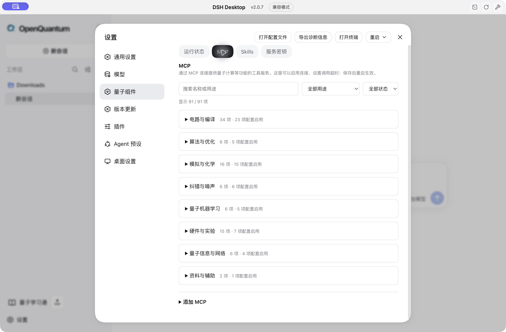
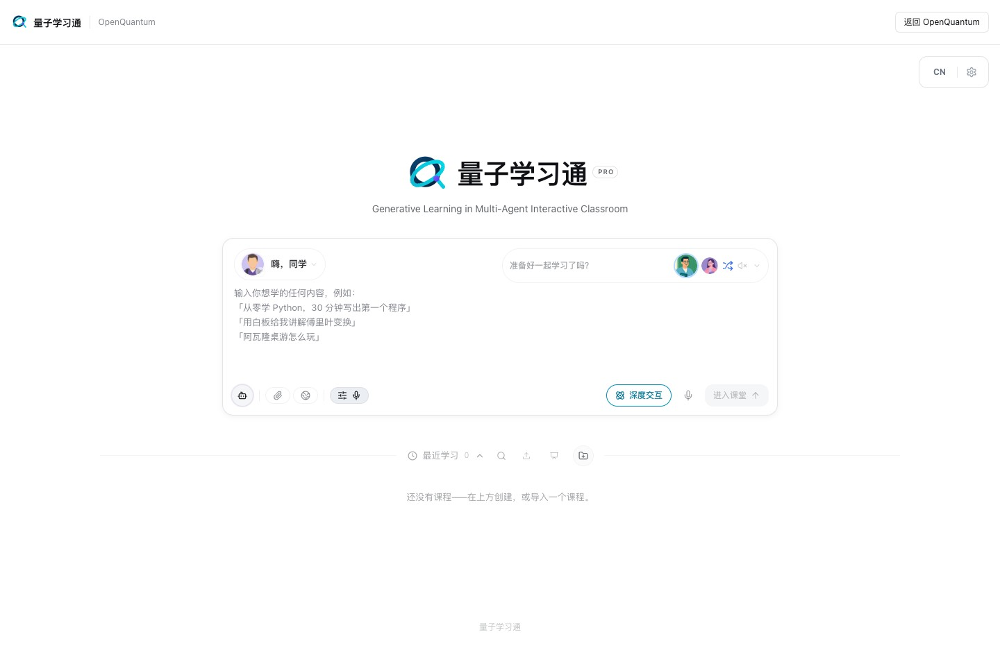
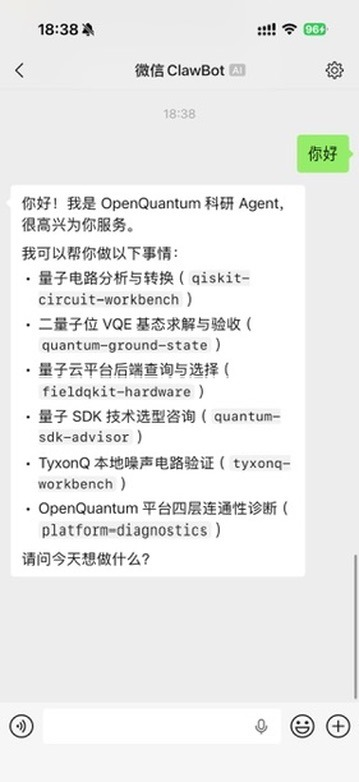
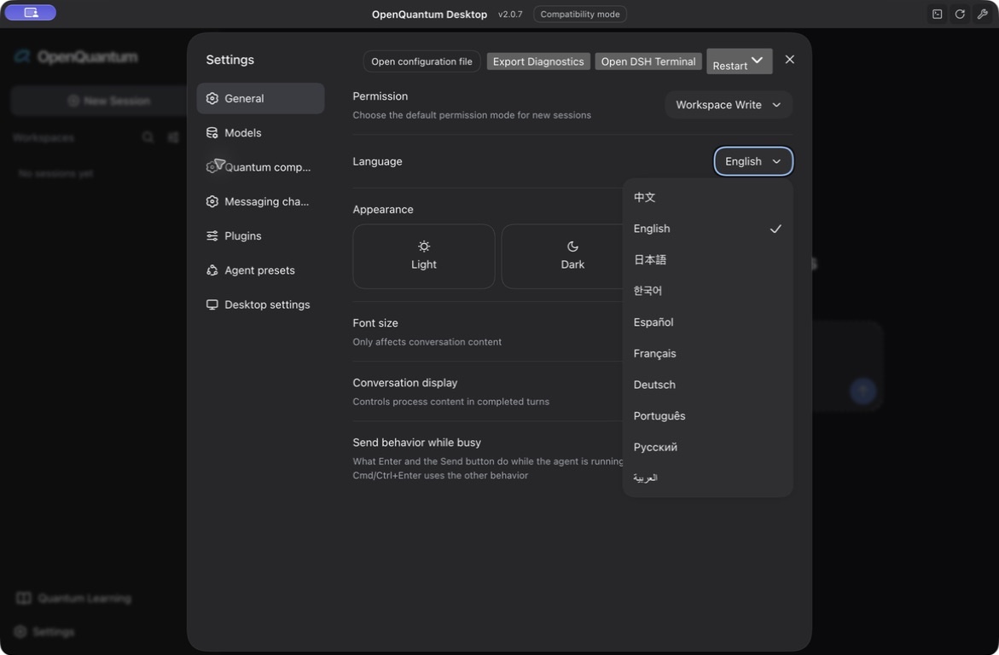
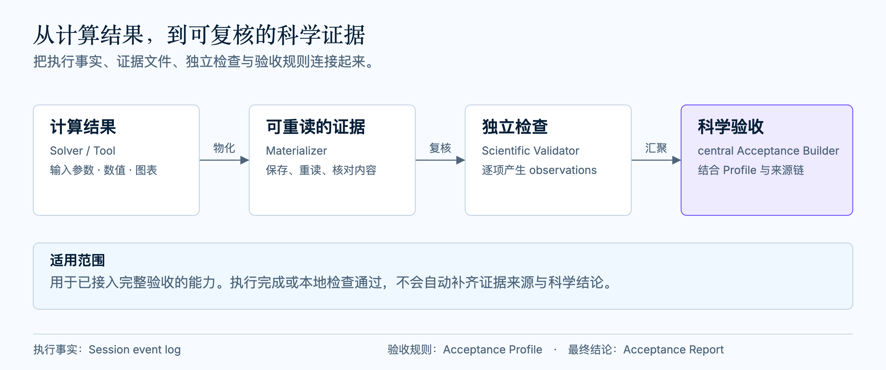
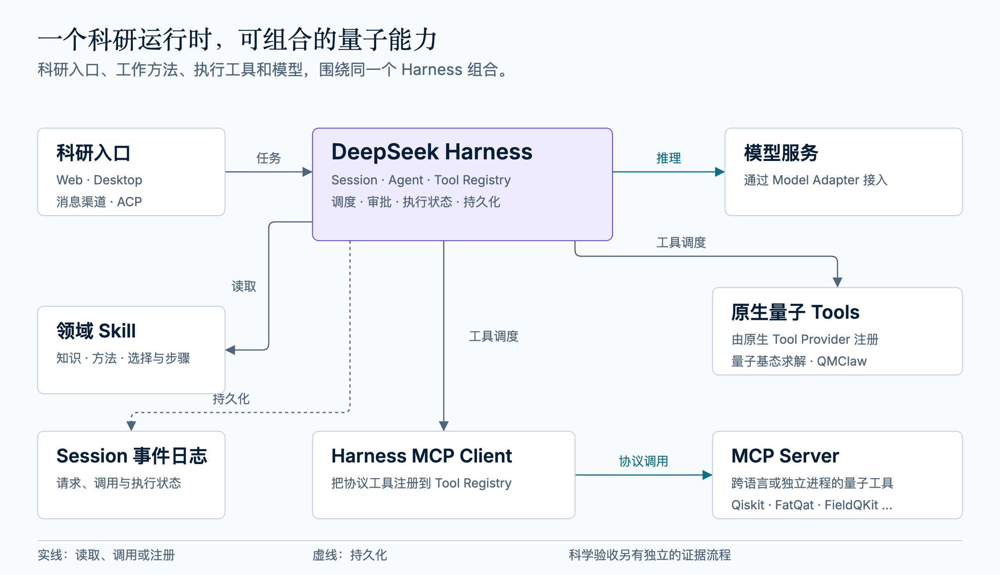

<h1 align="center"></h1>

<p align="center"><a href="../../README.md">简体中文</a> · <a href="./README.en.md">English</a> · <a href="./README.ja.md">日本語</a> · <a href="./README.ko.md">한국어</a> · <a href="./README.es.md">Español</a> · <a href="./README.fr.md">Français</a> · <a href="./README.de.md">Deutsch</a> · <a href="./README.pt.md">Português</a> · <a href="./README.ru.md">Русский</a> · <a href="./README.ar.md">العربية</a></p>

**0.8.5 デスクトップについて：** macOS Apple Silicon 向けの独立した OpenQuantum アプリです。DSH Desktop 2.0.0 / Harness 0.1.0-rc.6 のシンプルな操作感に戻し、画面の言語は当面、中国語と英語に限定します。既存の翻訳と README は保持します。以下の 0.8.4 の説明は旧リリースの記録です。現在のインストール方法と署名の制約は[インストールガイド](../DESKTOP_INSTALLERS.md)をご確認ください。Codex プラグインの公開版は 0.8.4 のままです。

<p align="center">
  <strong>OpenQuantum — 信頼できる量子研究 AI を、ともに育てる。</strong><br />
  <sub>量子研究の専門知を、一つの OpenQuantum に</sub>
</p>

<p align="center">
  <a href="https://github.com/xi-zhao/openQuantum/actions/workflows/ci.yml"></a>
  <a href="../../THIRD_PARTY_NOTICES.md"></a>
  
</p>

OpenQuantum は、オープンソースで共同開発に開かれた量子研究 AI プラットフォームです。オープンソースコミュニティのソフトウェア、アルゴリズム、公開研究成果をつなぎ、AI が研究課題を分析し、手法を選び、計算を実行し、結果を確認できるようにします。共有された専門知を、実際の研究に使える力へと変えます。

研究課題、論文、既存のプログラムを出発点に、AI を研究に参加させましょう。プログラム、パラメーター、確認結果が残るため、一つの研究が次の研究の出発点になります。

用途に合った使い方を選んでください。どちらも同じ専門機能を共有します。**[Codex プラグイン](../integrations/CODEX_PLUGIN.md)** は量子 Skill と科学 Tool を Codex のネイティブな会話に持ち込み、機能の切り替え、MCP 接続、トークンを管理する設定ページを備えます。**Desktop** には研究ワークベンチと独立した Quantum Learning アプリケーションが含まれ、モデルサービスは利用者自身が設定します。

**[Codex プラグインをインストール](#codex)** · [Desktop をインストール](#desktop-installer) · [計算と結果を見る](#use-and-inspect-results) · [Web サイトへ](https://xi-zhao.github.io/OpenQuantum/)

**まずは実測事例から：** [PennyLane の Pauli 交換子](#pennylane-rust-case)は呼び出し全体で **5.09 倍**、[QuTiP の Wigner 関数計算](#qutip-rust-case)は **5.69 倍**高速化しました。いずれも性能比較、結果の確認、再現記録を残しています。

**現行バージョン 0.8.4：**[Desktop のダウンロードとリリースノート](https://github.com/xi-zhao/OpenQuantum/releases/tag/v0.8.4) · [Codex プラグインのダウンロードとリリースノート](https://github.com/xi-zhao/OpenQuantum/releases/tag/codex-v0.8.4)。両者は同じ製品バージョンを使用します。

- **機能を見つけやすく：** Tools・MCP・Skills を用途別の 8 分類に整理し、検索と状態フィルターを追加しました。
- **起動アイコンを一つに：** Mac の `OpenQuantum.app` と Windows の `OpenQuantum.lnk` は OpenQuantum アイコンを使用し、オリジナルの DSH Desktop の UI、Quantum Learning、アップデート機能はそのまま保持します。

<p align="center">
  <a href="#why-openquantum">OpenQuantum を選ぶ理由</a> ·
  <a href="#optimization-cases">実測の最適化事例</a> ·
  <a href="#what-you-can-do">できること</a> ·
  <a href="#codex">Codex プラグイン</a> ·
  <a href="#quick-start">クイックスタート</a> ·
  <a href="#use-and-inspect-results">結果</a> ·
  <a href="#extend-the-platform">拡張</a> ·
  <a href="#roadmap-and-rsi">ロードマップと RSI</a> ·
  <a href="#documentation-and-support">貢献</a> ·
  <a href="#license-and-acknowledgments">オープンソース</a>
</p>

<p align="center">
  <br />
  <sub>使い慣れたオリジナルの Desktop UI。設定で独自のモデルサービスを追加すると、新しいセッションを始められます。</sub>
</p>

<details>
<summary><strong>分類された Tools・MCP・Skills の設定を見る</strong></summary>

必要なグループを展開し、検索や有効状態のフィルターで絞り込みます。Tools は呼び出し可能な操作、MCP はサービス接続の管理、Skills はタスクの手法とガイドの選択を扱います。



このスクリーンショットは 2026-10-13 にオリジナルのクライアントで分類を検証した際に撮影したものです。[画像の説明](../images/README.md)を参照してください。設定が有効でも、サービスがオンラインであることを意味しません。

</details>

<a id="why-openquantum"></a>

## OpenQuantum を選ぶ理由

### 幅広い専門領域が、研究の発想を広げる

量子アルゴリズムや回路シミュレーションから、量子化学、多体系計算、誤り訂正まで、OpenQuantum は専門領域を広げ続け、ツールと手法をつないでいます。研究者はツールの準備にかける時間を減らし、問いの探究に時間を使えます。これらの領域を支える専門知は、Qiskit、PennyLane、QuTiP、PyZX、TeNPy、Stim / PyMatching などのコミュニティプロジェクトがもたらしています。

### 計算が速くなれば、より多くのアイデアを試せる

重要な計算ステップの最適化を続け、待ち時間を短縮して、より多くの比較を行える余地をつくります。対象を絞った最適化事例では、[PennyLane の Pauli 交換子](#pennylane-rust-case)と [QuTiP の Wigner 関数](#qutip-rust-case)の呼び出し全体がそれぞれ **5.09 倍**、**5.69 倍**高速化しました。いずれの結果も元のライブラリと独立した参照計算で確認しています。

### オープンな共同開発が、研究能力を育て続ける

価値あるオープンソースプロジェクトや公開された手法を継続的に取り入れ、適合、最適化、実際の利用を通じて改善します。OpenQuantum はこれらを軸にエージェントのワークフロー、計算インターフェース、検証記録を整備し、新しいツール、手法、経験がプラットフォームを成長させ続けるようにします。コミュニティの専門知を、研究者が使い、確かめ、信頼できる量子研究 AI へと育てる取り組みに、どなたでも[参加](#documentation-and-support)できます。

### 研究の現場から始める

| 取り組む仕事 | 難しいところ | OpenQuantum が加えるもの |
| --- | --- | --- |
| **研究・アルゴリズム開発** | 新しいアイデアを試すたびに、手法の再実装、ベースライン探し、結果の確認を繰り返すことになりがちです。 | アルゴリズム例と専門 SDK から始め、入力を変え、比較を組み立て、対応する独立チェックを使い、再利用できるプログラムと結果を残せます。[結果](#use-and-inspect-results)を参照してください。 |
| **アプリケーション・エージェント開発** | 既存のアプリケーションに量子計算を組み込みたいものの、専門的な手法と使える呼び出し経路が不足しています。 | 既存の Skill、Tool、ネイティブ SDK をつなぎ、アプリケーション独自の UI とワークフローを保ったまま専門ソフトウェアを利用できます。[プラットフォームの拡張](#extend-the-platform)を参照してください。 |
| **産業 R&D・技術評価** | 応用の方向性はあるものの、手法の選択、資源の見積もり、ロードマップの策定に根拠が必要です。 | 対応するタスクで最初の比較を行い、手法の条件、資源の仮定、結果の出典を確認できます。[参考資料と選定](#reference-material-and-selection)を参照してください。 |
| **教育・授業設計** | 教材、実験、スライドが散在していると、抽象的な概念を実践的な授業にするのは困難です。 | オープンな例から実験を設計し、Quantum Learning で教材と授業資料を整理できます。機能と授業の進捗は [Quantum Learning](#quantum-learning) を参照してください。 |
| **手を動かして学ぶ** | 概念は理解していても、アルゴリズムを実行し、入力を変え、結果を解釈する方法はまだ身についていません。 | 例を実行してパラメーターを変え、ガイドと利用可能な参照結果を使って、手法がなぜ適用でき、どこで限界に達するかを確かめられます。[アルゴリズム例](#algorithm-learning-and-method-comparison)を参照してください。 |
| **研究ソフトウェア・エコシステム** | 公開済みの手法、研究コード、SDK があり、他の人が使えるようにワークフロー、インターフェース、例が必要です。 | 手法を Skill として記述し、実行可能な操作を Tool として接続するか、完全なアプリケーションを統合し、出典とクレジットを保持します。[プラットフォームの拡張](#extend-the-platform)を参照してください。 |

### オープンソース：機能を自分の手に

プラットフォームと統合のコードを読み、各手法の出典を確認し、適用されるライセンスの下で独自の組み合わせを改変、デプロイ、保守できます。モデルサービスと計算バックエンドは個別に選択でき、研究データを共有するかどうかは利用者が決めます。作者、ライセンス、貢献のクレジットは見える形で残し、既存の成果がプロジェクトとともに受け継がれるようにします。

### 網羅性：一つの問いに、より多くの手法を

OpenQuantum は、アルゴリズム、コンパイル、シミュレーション、量子情報、化学と多体物理、最適化、誤り訂正、ダイナミクス、制御、ネットワークのソフトウェアと研究手法を集めています。ガイドやオープンな例からネイティブ SDK や計算 Tool まで、タスクに必要なものを選んだり、ツールを組み合わせて新しい比較を行ったりできます。入力、準備、対応範囲は[機能カタログ](#what-you-can-do)に記載しています。

例えば、PyZX で回路を最適化し、QCEC で等価性を確認し、ノイズシミュレーターでノイズ下の振る舞いを調べることで、より簡潔な回路が性能面でも優れるかを問うことができます。ツールを組み合わせる際は、モデル、単位、ビット順序、予算をそろえる必要があります。現在の対応範囲は[計算ガイド](../integrations/SCALABLE_BRIDGES.md)を参照してください。

<a id="give-ai-access-to-specialist-research-capabilities"></a>

### AI に専門的な研究能力を

エージェントは資料を読み、プログラムを書き、ツールを呼び出せます。OpenQuantum をインストールし、対応タスクに必要な依存関係とサービス設定を準備すれば、AI は量子の手法と計算能力を利用できます。Skill は手法と手順を記述し、Tool は具体的な操作を実行します。ネイティブ SDK はホストのコードツールからも利用できます。

プログラム、結果、適用されたチェックが記録されるため、後続の作業に土台が残ります。根拠の確かな否定的結果も残す価値があります。手法がいつ適用でき、いつ別の道を選ぶべきかを示すからです。プログラムの失敗と科学的な結果は別の成果です。記録は[レビューと再利用](#execution-records-and-scientific-acceptance)を支えますが、科学的な判断は利用者に委ねられます。

**オープンソースライブラリと公開された手法を、エージェントが使える機能に変えること。それがこのプラットフォームを支える継続的な取り組みです。** 手法を整理し、ワークフローを書き、ソフトウェアを接続し、出典と利用条件を残します。ご自身の手法、プログラム、完全なアプリケーションを持ち込むこともでき、一つの開発が多くの人の出発点になります。

こうした積み重ねは、長期ロードマップで述べる[次の研究能力の改善](#research-that-improves-how-research-is-done)の土台にもなります。

**[最初のタスクを実行する](#quick-start)** · [手持ちの手法を持ち込む](#extend-the-platform)

<a id="optimization-cases"></a>
<a id="pennylane-rust-case"></a>

## 実測事例：PennyLane の計算を 5.09 倍高速化

**研究タスクを設定し、実行して確かめられる結果を受け取る。** OpenQuantum に次のタスクを与えました。PennyLane の研究計算に対象を絞った最適化を施し、実際の高速化を計測し、結果を検証することです。2026-10-20、OpenQuantum 0.8.4 を導入した Codex でこの実験を完了し、最適化済みプログラム、性能比較、正しさの確認、再現記録を作成しました。

| 計算 | 呼び出し全体 |
| --- | ---: |
| ネイティブ PennyLane | 30.62 ms |
| OpenQuantum による最適化後 | **6.02 ms** |

**呼び出し全体で 5.09 倍の高速化。** 計測対象は、32 量子ビットの局所モデルにおける Pauli 交換子の計算 1 回です。時間は Apple M4、PennyLane 0.45.1 でのウォーム実行 9 ラウンドの中央値です。入出力の変換を含み、環境の準備とコンパイルは含みません。

**結果も確認しています。** 9 件のベンチマーク入力すべてで、出力は PennyLane の参照出力と項ごとに完全に一致しました。行列による独立した網羅的検証で **4,368 組の Pauli 文字列**と 40 個のランダム複素係数演算子和を確認し、行列の最大絶対誤差は **1.42×10⁻¹⁴** でした。計算と計時は独立にレビューされ、**405 件の生の計時サンプル**と完全な入出力をすべて保存しています。

5.09 倍という数値は、この計算で実測した改善です。事例レポートにすべての結果、手法、対応範囲を記載しています。

[事例の全体と再現手順](../../experiments/pennylane-rust-commutator/README.md) · [生の計時データ](../../experiments/pennylane-rust-commutator/results/raw-timings.csv) · [結果の確認](../../experiments/pennylane-rust-commutator/results/validation.json) · [独立レビュー](../../experiments/pennylane-rust-commutator/results/review.md)

<a id="qutip-rust-case"></a>

## 実測事例：QuTiP の計算を 5.69 倍高速化

**専門的な手法を、確かめられるより速い計算に。** OpenQuantum 0.8.4 を導入した Codex で、QuTiP の Wigner 関数計算に対象を絞った最適化を施し、実行可能なプログラム、位相空間の完全な出力、性能比較、独立チェックをまとめました。

| 計算 | 呼び出し全体 |
| --- | ---: |
| QuTiP の既定手法 | 171.77 ms |
| OpenQuantum による最適化後 | **30.18 ms** |

**呼び出し全体で 5.69 倍の高速化。** このタスクは、**64 次元の単一モード Fock 空間、201×201 の位相空間グリッド**上で密度行列の Wigner 関数を計算します。時間は Apple M4、QuTiP 5.3.1、シングルスレッド設定で、交互に実行したウォーム 9 ラウンドの中央値です。入力の読み込み、変換、検証、倍精度の完全な出力を含み、環境の準備、コンパイル、結果の確認は計時範囲外です。

**272 件の結果チェックをすべて通過。** 4 つのサイズにわたり、QuTiP 既定出力との最大絶対差は **6.52×10⁻¹⁶**、独立した Laguerre 多項式の和と解析式との最大絶対差は **6.33×10⁻¹⁵** でした。チェックはランダムな複素密度行列、真空状態と Fock 状態、複素コヒーレンスをもつ重ね合わせ、拒否されるべき入力を対象とします。**144 件の生の計時サンプル**と完全な入出力をすべて保存し、独立にレビューしています。

[事例の全体と再現手順](../../experiments/qutip-rust-wigner/README.md) · [生の計時データ](../../experiments/qutip-rust-wigner/results/raw-timings.csv) · [結果の確認](../../experiments/qutip-rust-wigner/results/validation.json) · [独立レビュー](../../experiments/qutip-rust-wigner/results/review.md)

<a id="what-you-can-do"></a>

## できること

分野を選び、問い、入力、確認したい結果をワークベンチに伝えてください。OpenQuantum のエージェントは関連する Skill の手法に従い、対応する Tool を呼び出して計算します。Quantum Learning は独立した教育用 UI を提供します。

[アルゴリズム](#algorithm-learning-and-method-comparison) · [回路と量子情報](#circuits-and-quantum-information) · [基底状態・化学・最適化](#ground-states-chemistry-and-optimization) · [誤り緩和と誤り訂正](#error-mitigation-and-error-correction) · [Hamiltonian シミュレーションと開放系](#hamiltonian-simulation-and-open-systems) · [実験とハードウェア](#experiment-simulation-and-hardware) · [光子とネットワーク](#photonics-and-quantum-networks) · [参考資料](#reference-material-and-selection) · [Quantum Learning](#quantum-learning)

ローカル計算は量子クラウドのアカウントなしで始められます。実機と有料サービスは必要に応じて設定します。各手法の入力範囲、準備、検証状況は詳細カタログに記載しています。

現在のソースは **114 の SDK・ソース環境**でネイティブ API を完全に利用する経路を提供し、そのうち 26 件は 0.8.4 に含まれる最新の[エコシステム拡張](../integrations/SDK_ECOSYSTEM_2026-10-14.md)によるものです。エージェントは独自のプログラムを書き、公開 API を組み合わせ、完全な結果を保存でき、便宜的な Tool の既定事例にとどまりません。

**数学と物理の形式化：** [Lean 4・mathlib・physlib](../../.agents/skills/lean-physics/SKILL.md) を Lean 4.35.0 に固定したプロジェクトで使い、証明と依存する公理を確認できます。明示的な準備で小さな Pauli の例とその依存モジュールを構築し、他のモジュールは必要に応じて準備します。証明の検査中に依存関係をインストールしません。証明が保証するのは記述した定義と仮定の下での命題であり、物理モデルの妥当性や科学的受理ではありません。

**DEM 診断：** [emlint](../../.agents/skills/emlint-dem-audit/SKILL.md) は、明示的に準備した SDK 環境で Stim の検出器エラーモデルを調べます。反例、スキップした検査、結論不明や空のモデルの状態を保持します。構造検査は符号距離、復号の正しさ、科学的妥当性を証明しません。

各環境はタスクごとに明示的に準備し、プラットフォーム、アカウント、ライセンス、任意バックエンドの制約は引き続き適用されます。ライブラリごとの工程検証は[SDK 完全アクセス記録](../integrations/FULL_SDK_ACCESS.md)にあります。これらの環境は実際の研究タスクで科学的受入れ（実行結果が、独立チェックと出典の記録にもとづいて科学的に妥当と判定されること）を経ておらず、科学的なステータスは `not_evaluated` のままです。

v0.6.0 で統合した企業・研究機関の SDK は、微分可能回路、誤り耐性の資源見積もり、光子計算、パルスコンパイル、量子ネットワークにわたります。3 回の統合は[各社 SDK 17 件](../integrations/VENDOR_SDKS.md)、[企業・研究機関の機能 20 件](../integrations/SDK_EXPANSION.md)、[ネットワーク・制御・クラウドのインターフェース 15 件](../integrations/SDK_GAPS.md)で、これに [QuEra Bloqade Analog](../integrations/BLOQADE_ANALOG.md) が加わります。各アダプターは文書化された操作のみを公開し、アカウント、認証情報、サービス権限、適用ライセンスは利用者が設定します。

<a id="algorithm-learning-and-method-comparison"></a>

### アルゴリズムの学習と手法の比較

実行可能なアルゴリズム例から始め、入力を変えて数値結果を確認し、その手法を自分の問題に応用します。UnitaryLab の **66 件の quantum-skills ガイド**をネイティブ Skill に移植しました。そのうち **49 件が実行可能な例**を備え、元のアルゴリズムライブラリの **39 モジュール**すべてとガイド固有の手法をカバーします。残りはアルゴリズムの分類、バックエンドの選択、移行を支援します。

| 分野 | 実行可能な手法と例 |
| --- | --- |
| 基礎と探索 | QFT、QPE、Hadamard テスト、振幅増幅と振幅推定、Grover、Shor、Simon、離散対数、グラフウォーク |
| 線形方程式と行列手法 | HHL、VQLS、QSVT による線形方程式の求解、断熱的求解、LCU と QSP、古典固有値ソルバーによる参照 |
| Hamiltonian シミュレーション | Trotter–Suzuki、qDrift、QSP、Taylor LCU、置換内容を明示した Cartan の例 |
| 変分計算と機械学習 | VQE、VQD、QAOA、VQC、QCBM、CVQNN、勾配と量子 Fisher 情報 |
| 状態準備と多体系 | Möttönen、MPS、等長写像、変分による状態準備。分子 DMRG、Fermi–Hubbard VQE、Ising 時間発展 |
| 符号構成と微分方程式 | qLDPC 符号の構成とシンドローム。1 次元・2 次元の熱方程式と周期的移流に対する Schrödinger 化の例 |

例では Qiskit、PennyLane、quimb、PySCF、NumPy/SciPy などのオープンなバックエンドを使用します。直接実行することも、既存のコードツールを通じてエージェントに呼び出させることもできます。既定のパラメーターは教育用の事例です。実際の入力、参照誤差、収束はタスクごとに確認してください。

移植では上流の出典とライセンスを保持し、非公開の UnitaryLab ランタイムには依存しません。ワークフローのカバーは、上流の Python API、オプティマイザー、バックエンドとの完全な互換性を意味しません。Cartan、CVQNN、DMRG などの違いは[手法別の対応表](../integrations/UNITARYLAB_OPEN_COVERAGE.md)と[例のガイド](../../examples/quantum-algorithms/README.md)に記載しています。

[アルゴリズム例を実行する](#run-an-algorithm-example-directly) · [類似手法の選び方](../integrations/CAPABILITY_SELECTION.md)

<a id="circuits-and-quantum-information"></a>

### 回路と量子情報

| 分野 | 始められるタスク | 確認できる結果 |
| --- | --- | --- |
| 量子回路 | OpenQASM / QPY 回路の解析・変換、トランスパイルの比較、等価性の確認、回路シミュレーション | 回路構造、トランスパイル後の出力、等価性の判定、状態ベクトルまたはサンプル分布 |
| ローカルでのコンパイルとシミュレーション | TKET、QSteed、MQT QMAP による回路のコンパイル・マッピング。Braket LocalSimulator、QCompute、Qibo などによるローカルシミュレーション | ゲートセットとマッピング、状態ベクトルまたは確率（各 SDK のビット順序の規約に従う） |
| 微分可能プログラムとハイブリッドプログラム | PennyLane、DeepQuantum、TensorCircuit、MindQuantum、VQNet による期待値と勾配。Guppy / Selene による測定、リセット、古典フィードバック | パラメーター勾配、確率、プログラムの結果 |
| 誤り耐性の資源 | Microsoft QDK による物理資源の見積もり、Qualtran による指定 Bloq のゲート資源 | 量子ビット数、実行時間またはゲート数と、ハードウェアおよび分解の仮定 |
| Qiskit / Cirq の相互運用 | qBraid の固定 OpenQASM 2 経路による、対応するユニタリ回路の変換 | 量子ビット番号とアイドル量子ビットを保持した変換後の回路。任意でユニタリ全体の比較 |
| 回路最適化と測定型量子計算 | PyZX による ZX 書き換えと回路抽出。Graphix による MBQC パターンの変換とシミュレーション | 前後の回路とゲート数、資源グラフと測定パターン。任意で独立比較 |
| 回路最適化と回路切断 | Compact によるゲート列の最適化。QCut による回路切断と期待値の再構成 | 前後の回路と独立した等価性チェック。切断のオーバーヘッド、実際のサンプル数、任意で切断なしの参照 |
| Clifford+T のノイズ付きサンプリング | Clifft による T ゲートの干渉とノイズの調査、対応する Stim 形式回路のサンプリング | 最終ビット列のカウントと任意の密度行列参照。回路途中の測定と、生の検出器 / オブザーバブルのパリティ |
| 状態と測定 | 密度行列とエンタングルメント測度の監査。既知の積状態 / GHZ 状態に対する局所ランダム測定のシミュレーション | 独立チェック付きの状態測度。有限サンプル誤差付きの部分系純度の推定値 |

<a id="ground-states-chemistry-and-optimization"></a>

### 基底状態・化学・最適化

| 分野 | 始められるタスク | 確認できる結果 |
| --- | --- | --- |
| 基底状態の求解と検証 | 固定した粒子数セクターで二量子ビットの実 Pauli Hamiltonian に VQE を実行し、厳密な参照と照合 | エネルギー、収束の軌跡、独立チェック。完全なフローでは科学的受入れレポート |
| 量子化学と多体系の基底状態 | SQD による分子と活性空間の調査、TeNPy による XYZ スピン鎖の基底状態 | SQD のエネルギーと軌道占有。DMRG のエネルギー、磁化、エンタングルメントエントロピー、収束。任意で厳密な参照 |
| 変分パラメーターの学習 | Pauli Hamiltonian で Flow-VQE を学習し、低エネルギーの回路パラメーターを得る | 同じ評価予算でのランダム探索と比較した Flow 学習 |
| 励起状態とカーネル分類 | OpenQARP VQD による複数の低エネルギー状態の探索、cqlib の角度カーネルによる QSVM の学習 | エネルギー、残差、直交性、任意で厳密なスペクトル。ホールドアウトでの分類、解析的カーネル、古典ベースライン |
| 対称性と制御代数 | Symmer による指定対称性セクターでの量子ビット削減。PauLie による Pauli 生成子の解析 | 縮約された Hamiltonian、Lie 代数の分類と次元。任意でスペクトル比較または閉包 |
| 組合せ最適化 | QPanda、Ocean、Kaiwu によるローカル最適化問題の構築と求解。Qcover による指定 QAOA パラメーターの評価 | 解、制約チェック、エネルギーと相関（インターフェースが提供する場合は古典比較） |
| 化学演算子と既存データ | OpenFermion / pyChemiQ によるフェルミオン演算子の写像。QCPortal を通じた既存 QCArchive 一点計算記録のオンデマンド照会 | Pauli 項。分子、エネルギー、手法、出典（単位と欠損フィールドを保持） |

<a id="error-mitigation-and-error-correction"></a>

### 誤り緩和と誤り訂正

| 分野 | 始められるタスク | 確認できる結果 |
| --- | --- | --- |
| 誤り緩和 | Mitiq で ZNE、REM、PEC、CDR を実行し、同じサンプリング予算で緩和前後の結果を比較 | 理想的な参照、経験的バイアス、分散、RMSE と、較正・学習・サンプリングのコスト |
| 量子誤り訂正 | Stim / PyMatching による表面符号のメモリー実験、Deltakit による長方形パッチの構築、BP+LSD による復号 | 実際のノイズ付き回路、固定ショット数での論理誤り率と区間。LSD ではシンドロームの整合性チェック |

<a id="hamiltonian-simulation-and-open-systems"></a>

### Hamiltonian シミュレーションと開放系

| 分野 | 始められるタスク | 確認できる結果 |
| --- | --- | --- |
| Hamiltonian シミュレーション | Trotter–Suzuki または qDrift で、実 Pauli Hamiltonian の時間発展回路や終状態を構築 | 回路、資源指標、状態ベクトル、任意で独立した行列参照。ステップ数、次数、時間、seed を設定可能 |
| 開放系のダイナミクス | TJM による開放 Ising 鎖、Dynamiqs による単一量子ビットの駆動掃引と勾配、OQuPy による環境の記憶効果 | オブザーバブルの軌跡、独立した参照、勾配、時間刻み、記憶のカットオフ |

<a id="experiment-simulation-and-hardware"></a>

### 実験シミュレーションとハードウェア

| 分野 | 始められるタスク | 確認できる結果 |
| --- | --- | --- |
| 超伝導・原子系の実験 | 較正ワークフロー、ネイティブゲートの制約、transmon のリークのシミュレーション。Bloqade Analog / Pulser による対応する原子配列とパルスの調査 | 合成データ、ダイナミクスの軌跡、原子ごとの占有率、最終確率 |
| パルスプログラムと制御 | QUA、LabOne Q、Qblox Scheduler、Qililab、OQC QAT によるプログラムのオフライン構築、スケジューリング、コンパイル | プログラム、タイミング、ターゲット命令または波形。これらのアダプターは実験装置を動かしません |
| 量子ハードウェアへのアクセス | バックエンドの探索、トポロジーと認証情報の確認。必要に応じてクラウドジョブの照会、投入、キャンセルを有効化 | デバイス候補と利用条件。有効化したジョブインターフェースからの結果とステータス |
| ローカルデバイスインターフェース | QDMI を通じて設定済みの C ドライバーを照会 | ドライバーが報告するデバイス、量子ビット、ゲート、結合。公式のサンプルドライバーはインターフェースの検証用であり、オンラインの QPU ではありません |

<a id="photonics-and-quantum-networks"></a>

### 光子計算と量子ネットワーク

| 分野 | 始められるタスク | 確認できる結果 |
| --- | --- | --- |
| 光子回路と学習 | Perceval と Lightworks による線形光学の出力計算。MerLin によるバッチ推論と位相シフトの勾配。任意で MrMustard の Gaussian モデル | Fock 確率、勾配または光学モーメント（モード順序とカットオフを明示） |
| ネットワークのモデル化とプログラム | SimQN による単一リンクの損失とデコヒーレンスのシミュレーション。NetQASM による 2 ノードプログラムの生成 | リンク統計とコンパイル済みプログラム。SquidASM のシミュレーションには別途ライセンスが必要な NetSquid 環境が必要です |

<a id="reference-material-and-selection"></a>

### 参考資料と選定

| 分野 | 始められるタスク | 確認できる結果 |
| --- | --- | --- |
| アルゴリズムの参考資料とツール選定 | 66 件の Quantum-Practices アルゴリズムガイドの検索、量子 SDK の比較、研究手順の再利用 | バージョン固定の参考資料、前提条件、選定の助言 |
| 公開デバイスベンチマーク | 410 件の固定された Metriq 履歴記録を、ベンダー、デバイス、ベンチマーク種別で照会 | 元のパラメーター、指標、日付、出典、ライセンス（シミュレーターのラベルを保持） |

### Quantum Learning

教材、授業資料、教室を一か所に。学習者は手を動かして学び、教員は自分の教育内容を整理できます。

| 学習と教育 | 利用できる機能 |
| --- | --- |
| 教材の準備 | ホームページ、コースライブラリ、添付ファイル、コースのインポート、PPTX のインポート |
| コースの構築 | コースのプレビュー、授業資料エディター、Pro ワークベンチ |
| 授業での学習 | スライド、クイズ、対話型 Q&A、プロジェクト型学習 |
| 学習の継続 | ローカルのコース、課題、教材、サーバー側の学習記録。以前の教室からの移行に対応 |

中等教育の基礎から最先端の研究までを、初級・中級・上級のレベルに整理し、レベルをまたいで学べるようにすることを目指しています。公開リソースは整理中で、完全なカリキュラムはまだ制作・公開されていません。アプリケーションの組み込み、起動、ローカルでの永続化は検証済みです。実際のオンライン AI によるコース構築、Q&A、編集は、まだ完全な受入れを待っています。

Pro の教育タスクは上流アプリケーション自身のツールと記録を使用し、ワークベンチの量子ツールにはまだ接続していません。任意のメディア、音声、検索にはそれぞれのサービスが必要です。インストール、バックアップ、移行、検証は [Quantum Learning 統合ガイド](../integrations/OPENMAIC.md)に記載しています。

<p align="center">
  
</p>

[Quantum Learning を準備して教室を開く](#set-up-quantum-learning)。

### Desktop・メッセージング・言語

**Desktop。** OpenQuantum のデスクトップ版は、ネイティブウィンドウ、システムトレイ、ターミナル、通知を備え、ワークベンチのモデル、量子 Skill、計算ツール、実行記録を再利用します。サードパーティ製のオリジナル DSH Desktop と、別途提供する OpenQuantum 機能パッケージを組み合わせて使用し、Mac（Apple Silicon / Intel）、Windows、ソースからの起動に対応します。[Desktop をインストール](#desktop-installer) · [ソースから Desktop をビルド](#desktop-from-source)。

**メッセージング。** CC Connect を通じて、WeChat、Feishu、DingTalk、Slack、Telegram、Discord などのチャネルからタスクを開始でき、ワークベンチの Skill、Tool、実行記録を再利用します。[メッセージングチャネルを設定](#messaging-channels)。

<p align="center">
  <br />
  <sub>WeChat チャネルでのタスクと返信。</sub>
</p>

**UI の言語。** **設定 → 一般 → 言語**で、簡体字中国語、英語、日本語、韓国語、スペイン語、フランス語、ドイツ語、ポルトガル語、ロシア語、アラビア語を選べます。選択は保存され、Quantum Learning にも反映されます。アラビア語は右から左に表示します。



UI の言語を変えても、既存の会話、コース教材、ユーザーの Skill、ツール出力は書き換えません。一部のネイティブシステムダイアログは、中国語と英語以外では英語で表示されます。

<a id="quick-start"></a>

## クイックスタート

利用方法を一つ選んでください。Codex にプラグインをインストールする、機能パッケージ付きの Desktop クライアントを使う、またはソースからワークベンチを起動する、のいずれかです。Desktop とソース版ワークベンチはローカル環境で一人で使う場合を想定しています。開発や `main` にある機能を使う場合はソース版を選んでください。

<a id="codex"></a>

### Codex プラグイン：インストールと利用

OpenQuantum プラグインを一度インストールすると、**Skill、ローカル MCP サービス、科学 Tool、OpenQuantum 設定ページ**がまとめて登録されます。質問、プロジェクト管理、結果の確認は引き続き Codex のネイティブな会話で行い、設定ページで OpenQuantum の機能を構成します。

**Codex にインストールを任せる：** Codex を開き、新しい会話を始めて、次の依頼を貼り付けてください。

```text
Please install the OpenQuantum Codex plugin 0.8.4. First read the installation guide:
https://github.com/xi-zhao/OpenQuantum/blob/codex-v0.8.4/docs/integrations/CODEX_AGENT_INSTALL.md
Download the complete installer and SHA256SUMS from https://github.com/xi-zhao/OpenQuantum/releases/tag/codex-v0.8.4,
verify the checksum, check Codex, Node.js 24+ and npm, and install with the bundled installer.
Keep existing plugins and user settings, and check the Skills, MCP tools and the global "OpenQuantum settings" entry.
Tell me exactly what to do if the app needs reloading. Finally, report what was actually verified and which scientific dependencies still need preparation.
```

Desktop の機能パッケージ、Codex プラグイン、インストーラーはいずれも **OpenQuantum 0.8.4** です。このプラグインには 168 個の Skill と 87 個の科学 Tool が含まれ、26 個のネイティブ SDK Skill を追加し、「ステータス」「MCP」「Skills」「サービスキー」のタブを統一しました。認証情報を必要とする 16 個の新しいサービス Tool は既定で無効です。リリースタグは `codex-v0.8.4` で、添付ファイルと検証範囲は Release の記載どおりです。

**[Codex プラグイン 0.8.4 完全インストールパッケージをダウンロード](https://github.com/xi-zhao/OpenQuantum/releases/download/codex-v0.8.4/openquantum-0.8.4-codex-install.zip)**（[リリースノートと SHA256SUMS](https://github.com/xi-zhao/OpenQuantum/releases/tag/codex-v0.8.4)）。

インストールパッケージにはプラグイン ZIP、インストールスクリプト、依存関係のロックファイルが含まれ、ソースのチェックアウトは不要です。Node.js 24 以降、npm、プラグインとグローバル設定ページに対応した Codex が必要です。エージェントは[インストールガイド](../integrations/CODEX_AGENT_INSTALL.md)に従ってこれらを確認・対処できます。ローカルでのインストールは macOS で検証済みです。他のプラットフォームやホストのバージョンでは互換性を確認してください。

**インストール後：**

1. 案内に従って Codex を再読み込みし、新しい Skill とツールが読み込まれるよう新しい会話を開きます。
2. 会話で直接依頼します。例：「OpenQuantum で量子誤り訂正の手法を探し、最初の実験を提案してください。」
3. **「…」→「OpenQuantum settings」**を開き、**ステータス / MCP / Skills / サービスキー**のタブで機能を管理します。Tool の切り替えは**ステータス → Tools** にあります。組み込みサービスはプラグインとともに設定済みです。独自の MCP サーバーを追加する場合は接続情報を入力し、トークンは専用の認証情報ダイアログで保存してください。

プラグインがインストールするのは機能のコードと設定画面です。一部の計算には、必要に応じて Python、量子 SDK、サードパーティのアカウントの準備が引き続き必要です。[プラグインガイド](../integrations/CODEX_PLUGIN.md)を参照してください。

<details>
<summary><strong>手動インストール（任意）</strong></summary>

完全インストールパッケージをダウンロードして検証・展開し、そのディレクトリで次を実行します（Node.js 24 以降、npm、プラグイン対応の Codex CLI が必要）。

```sh
npm ci --ignore-scripts
npm run plugin:install
```

インストーラーが現在の Codex アプリの CLI を見つけられない場合は、`OPENQUANTUM_CODEX_CLI` にそのパスを設定してください。既存のプラグイン ZIP がある場合は `npm run plugin:install -- /full/path/plugin.zip` を使います。インストール、失敗時の対処、段階的な確認は[エージェント向けインストールガイド](../integrations/CODEX_AGENT_INSTALL.md)に記載しています。

</details>

<a id="desktop-installer"></a>

### Desktop インストーラー

現在のデスクトップリリースは、[オリジナルの DSH Desktop 2.0.7 クライアント](https://github.com/anywhere-labs/dsh-desktop/releases/tag/v2.0.7)と別途提供する OpenQuantum 機能パッケージを組み合わせたものです。オリジナルのクライアントは上流の名前とバージョンを維持します。機能パッケージは Node / uv を同梱し、完全な SDK へのアクセス、量子 Skill、Tool、設定を提供します。インストーラーは OpenQuantum アイコン付きのランチャー（Mac は `OpenQuantum.app`、Windows は `OpenQuantum.lnk`）を作成します。

先にオリジナルの DSH Desktop をインストールし、続いてプラットフォームに合った機能パッケージを選んでください。

| プラットフォーム | OpenQuantum 0.8.4 のダウンロード | 展開後に実行 |
| --- | --- | --- |
| Mac Apple Silicon | [darwin-arm64 パッケージ](https://github.com/xi-zhao/OpenQuantum/releases/download/v0.8.4/OpenQuantum-0.8.4-DSH-darwin-arm64.tar.gz) | `install.command` |
| Mac Intel | [darwin-x64 パッケージ](https://github.com/xi-zhao/OpenQuantum/releases/download/v0.8.4/OpenQuantum-0.8.4-DSH-darwin-x64.tar.gz) | `install.command` |
| Windows x64 | [win32-x64 パッケージ](https://github.com/xi-zhao/OpenQuantum/releases/download/v0.8.4/OpenQuantum-0.8.4-DSH-win32-x64.tar.gz) | `install.cmd` |

展開前に、ダウンロードしたファイルを [Release の SHA256SUMS](https://github.com/xi-zhao/OpenQuantum/releases/tag/v0.8.4) で検証してください。アップグレード時は既存の設定を保持します。[インストールと移行のガイド](../DESKTOP_INSTALLERS.md)を参照してください。機能パッケージと Codex プラグインはいずれも `0.8.4` で、Harness は `0.1.5-rc.1` のままです。計算環境、アカウント、ライセンスは引き続き機能ごとに準備します。

### ソースからのインストール

Git と Node.js 24 を用意してください。Python の量子ツールには [uv / uvx](https://docs.astral.sh/uv/getting-started/installation/) も必要です。その他の依存関係は機能によって異なり、例えば RandomMeas には Julia 1.12.7 が必要です。

```bash
git clone https://github.com/xi-zhao/openQuantum.git
cd openQuantum
npm ci
```

モデルキーがなくても、この時点で[固定のローカル例](#no-model-key-needed-recompute-a-fixed-case)を実行できます。エージェントを通じてタスクを開始するには、ワークベンチの起動方法を選び、モデルを設定してください。

### ワークベンチの起動方法を選ぶ

同じソースのチェックアウトから起動する Web と Desktop は、`.openquantum/dsh` にある同じモデル設定、量子機能、実行記録を共有します。切り替える前に、実行中のワークベンチを終了してください。

**Web ワークベンチ**

```bash
npm run dev
```

ランチャーが表示するログイントークン付きのアドレスを開いてください。認証後、ワークベンチは <http://127.0.0.1:3000> で利用できます。

<a id="desktop"></a>
<a id="desktop-from-source"></a>

<details>
<summary><strong>ソースから Desktop をビルドして起動</strong></summary>

ソースの依存関係をインストールし、Corepack とシステムの C++ ビルドツールを用意した後に実行します。

```bash
npm run desktop:setup
npm run desktop:verify-install
npm run desktop -- --source
```

`desktop:setup` はバージョン固定の上流ソースをビルドし、Electron をダウンロードしてネイティブモジュールをコンパイルします。サードパーティのインターフェースやアセットは変更しません。モデルと量子機能の設定が読み込まれるよう、リポジトリの起動コマンドを使用してください。プラットフォームの要件は[デプロイ](../DEPLOYMENT.md)に記載しています。

</details>

<a id="configure-a-model"></a>

### モデルの設定

Desktop を新規インストールした直後は、モデル一覧が空です。**設定 → モデル**で、OpenAI-compatible Chat Completions エンドポイント、モデル名、API キーを持つプロバイダーを追加し、既定の Agent Preset は OpenQuantum のままにしてください。**量子計算ツールを呼び出すには、モデルが Tool Calling に対応している必要があります。** ここで設定するのはモデルサービスだけです。量子クラウドの認証情報は、それぞれのバックエンドとともに設定します。

<details>
<summary><strong>高度なモデル設定とコマンドラインでの診断</strong></summary>

ソースには任意のデバッグ用例 `openquantum-public` / `openquantum-private` が含まれており、そのアドレスは `.invalid` のプレースホルダーです。新しい Desktop のモデル一覧には事前入力されず、実際のアドレスと認証情報が必要になるのは次の診断を行う場合だけです。

UI で保存したルートの上書き設定は、Git で無視される `$DSH_HOME/settings.yaml` に書き込まれます。キーはローカル環境または Harness の認証情報ストアに留まり、プロジェクトの設定には認証情報への参照だけが記録されます。`.env` を使う場合は、macOS では `cp .env.example .env`、Windows PowerShell では `Copy-Item .env.example .env` を実行し、コメントに従って記入してください。`.env` ではモデル名を上書きしません。その他のモデル名は**設定 → モデル**で設定してください。

次のコマンドは、`.env` または環境変数の公開ルートを、スクリプトに固定された `kimi-k2.7-code` と `glm5.2` のモデル名で確認し、テキスト生成と Tool Calling をテストします。UI で保存したルートの上書き設定は読み込みません。その他のモデルは、後述のワークベンチでのタスクで確認してください。

```bash
npm run models:probe -- --provider openquantum-public
```

</details>

### タスクごとに計算環境を準備する

ローカルの Python 計算ツールは、明示的に準備したバージョン固定の依存関係を使用します。`npm ci` の後、リポジトリのルートで必要な機能の準備コマンドを実行してください。準備時にはダウンロードやビルドが行われることがあり、計算の呼び出し時に依存関係を自動でインストールすることはありません。

| 準備するもの | コマンドまたは操作 |
| --- | --- |
| 最初の Bell 状態の実験 | `node scripts/setup-paper-tools.mjs fatqat-workbench` |
| Rb 原子対の静的相互作用 | `npm run capability:pairinteraction:setup`。[モデルとバージョンの管理](../integrations/PAIRINTERACTION.md) |
| Trotter / qDrift による Hamiltonian シミュレーション | `npm run capability:hamiltonian:setup` |
| Clifft のサンプリングと qBraid による回路変換 | `npm run capability:interop:setup` |
| その他の Python 機能 | `node scripts/setup-paper-tools.mjs <capability-id>`（例：`qec-memory-experiment`）。各 Skill に専用のコマンドが記載されています |
| アルゴリズム例 | [最小環境](#run-an-algorithm-example-directly)から始め、必要に応じて勾配、PennyLane、テンソル、化学のグループを追加 |

環境の準備、接続の有効化、モデルの設定は互いに独立したステップです。既定で有効な接続でも、初回利用前に依存関係の準備が必要です。環境が存在しない、またはロックファイルが変更された場合、Tool は正確な準備コマンドを返します。Julia、QDMI ドライバー、上流の MCP サービスはそれぞれのガイドに従ってください。[ローカル環境](../integrations/LOCAL_ENVIRONMENTS.md)を参照してください。

### 最初のタスクを実行する

<a id="no-model-key-needed-recompute-a-fixed-case"></a>

#### モデルキー不要：固定の事例を再計算する

リポジトリに固定された[二量子ビット Pauli Hamiltonian](../../.agents/skills/quantum-ground-state/evals/fixtures/requests/protocol-fixture.json) を入力とし、ネイティブの `solve_and_validate_ground_state` Tool が指定した粒子数セクターでノイズなしの VQE を実行し、独立した閉形式の計算で結果を確認します。`git clone` と `npm ci` の後、リポジトリで次を実行してください。モデルキーも量子クラウドの認証情報も不要です。

```bash
npm run demo:quantum-ground-state
```

<table>
  <tr>
    <td align="center"><strong>-1.85727503 Ha</strong><br /><sub>VQE エネルギー</sub></td>
    <td align="center"><strong>-1.85727503 Ha</strong><br /><sub>独立した厳密参照</sub></td>
    <td align="center"><strong>4.44 × 10⁻¹⁶ Ha</strong><br /><sub>エネルギー差</sub></td>
    <td align="center"><strong>15 件通過</strong><br /><sub>ローカル計算チェック</sub></td>
  </tr>
</table>

これらの値は **2026-09-12 のローカル再実行**によるものです。[生の出力と実行記録](../examples/quantum-ground-state-local-demo-2026-09-12.json)には、完全な値、チェックの状態、時刻、ソースのコミット、入力のダイジェスト、Node.js のバージョンが含まれます。

<details>
<summary><strong>この実行で確認したこと、まだ足りないこと</strong></summary>

この記録では、15 件のローカル計算チェックが通過し、1 件のセッション来歴チェックは実行されていません。したがって、完全な科学的受入れの結論は存在しません。エネルギー差は、この数値事例で厳密参照と一致することを示します。科学的な範囲は、与えられた Hamiltonian と粒子数セクターに限られます。

完全な科学的受入れには、さらに Harness を通じてタスクを実行し、結果ファイルとセッションの来歴を保存し、再読込可能な受入れレポートを生成する必要があります。モデル設定後の検証の方法は[開発と検証](#development-and-verification)にあります。

</details>

<a id="let-the-agent-run-a-task-prepare-and-sample-a-bell-state"></a>

#### エージェントにタスクを任せる：Bell 状態の準備とサンプリング

モデルを設定し、`node scripts/setup-paper-tools.mjs fatqat-workbench` で FatQat を準備したら、新しいセッションを開始して次のように送信します。

> FatQat を使い、二量子ビットの全ゼロ状態から始めて、q0 に H を適用し、続いて q0 を制御、q1 を標的とする CX を適用してください。ノイズなしの厳密な確率を返し、seed=7 で 1024 回サンプリングした結果と比較してください。

エージェントは FatQat の回路ツールを呼び出せ、ワークベンチはツールの入力と返された結果を保持します。厳密な確率とサンプルのカウントを確認したら、続けて次のように依頼します。

> 回路と seed はそのままで、サンプル数を 8192 に変更し、2 回の実行それぞれの頻度が厳密な確率からどれだけ離れているかを比較してください。

理想的な確率は `00` と `11` がそれぞれ 50% で、有限サンプルの頻度は揺らぎます。2 回の実行を比べるとその揺らぎがわかります。サンプル数を一度増やしただけでは、すべての頻度が理想値に近づくとは限りません。Tool Calling に対応したモデルがなければ、エージェントは計算 Tool を呼び出せません。UI の詳細とローカルでの検証は [FatQat ガイド](../integrations/FATQAT.md)に記載しています。

<a id="run-an-algorithm-example-directly"></a>

#### アルゴリズム例を直接実行する

モデルキーも量子クラウドのアカウントも不要です。NumPy、SciPy、Qiskit から始めます。

```bash
npm run capability:algorithms:setup -- --minimal
```

macOS / Linux では、手法の一覧表示、入力契約の確認、既定の HHL 例の実行を行います。

```bash
examples/quantum-algorithms/.venv/bin/python examples/quantum-algorithms/run.py --list
examples/quantum-algorithms/.venv/bin/python examples/quantum-algorithms/run.py --describe hhl
examples/quantum-algorithms/.venv/bin/python examples/quantum-algorithms/run.py --algorithm hhl
```

Windows PowerShell では次のとおりです。

```powershell
& examples/quantum-algorithms/.venv/Scripts/python.exe examples/quantum-algorithms/run.py --algorithm hhl
```

QSP/QSVT などの手法には `npm run capability:algorithms:setup -- --group pennylane` を実行します。その他のグループは `gradients`、`tensor`、`chemistry` で、グループを追加しても既存のグループは保持されます。引数なしの `npm run capability:algorithms:setup` はすべてを準備します。完全な環境には PySCF が含まれるため、Windows では WSL を推奨します。数値検証は macOS の CPU で行いました。

独自のパラメーターは `--input` で JSON ファイルとして渡し、結果は `--output` で保存できます。モデルを設定した後は、エージェントに `quantum-algorithms` または特定手法の Skill を使わせることもできます。パラメーター、ビット順序、手法間の違い、依存関係のグループは[アルゴリズム例のガイド](../../examples/quantum-algorithms/README.md)に記載しています。

<a id="upgrade-an-existing-source-installation"></a>

### 既存のソースインストールをアップグレードする

[更新ガイド](../UPDATES.md)に従ってソースとプロジェクトの依存関係を更新し、使用する各機能の準備コマンドを一度ずつ再実行してください。Python ブリッジは既存の環境ディレクトリでバージョン固定の依存関係を検証・同期するため、何も削除する必要はありません。アルゴリズム例はグループを追加し続けられます。

ワークベンチを再起動し、新しいセッションを開始してください。既存の Skill と Tool の名前とパラメーターは引き続き有効です。13 個の分類索引は引き続き手動で呼び出せ、自動タスクでは `quantum-algorithms` または特定の手法が選ばれます。任意サービスのツール範囲をすべて元に戻すには、既定の `full` プロファイルを使用してください。[機能の選択と互換性](../integrations/CAPABILITY_SELECTION.md)を参照してください。

### オプションの機能

<a id="set-up-quantum-learning"></a>

<details>
<summary><strong>Quantum Learning を準備する</strong></summary>

ソースの依存関係をインストールした後、同じチェックアウトで次を実行します。

```bash
npm run learning:ui:setup
```

その後 Web または Desktop を起動し、サイドバーから **Quantum Learning** を開きます。初回起動時にはローカルのデータベースとコースサービスが起動し、グローバルな PostgreSQL は不要です。モデルへのリクエストには、OpenQuantum で現在選択されているモデルを使用します。

インストールと起動は macOS で検証済みです。インストーラーは `/bin/sh` に依存しており、通常の Windows にはまだ対応していません。Linux はまだ検証していません。新しい Git worktree では個別のインストールが必要です。バックアップ、移行、プラットフォームの状況は[統合ガイド](../integrations/OPENMAIC.md#使用)に記載しています。

</details>

<a id="messaging-channels"></a>

<details>
<summary><strong>WeChat、Feishu などのメッセージングチャネルを設定する</strong></summary>

```bash
npm run cc-connect:setup
npm run cc-connect:feishu
npm run cc-connect:start
```

最初のプラットフォームは上流の説明に従って設定してください。別のターミナルで `npm run cc-connect:web` を実行すると、他のプラットフォームと認証情報を管理できます。トークンは Git で無視されるローカル設定に保存されます。[メッセージングガイド](../integrations/CC_CONNECT.md)を参照してください。

</details>

デプロイと起動の問題は[デプロイ](../DEPLOYMENT.md)と[トラブルシューティング](../TROUBLESHOOTING.md)で扱っています。

<a id="use-and-inspect-results"></a>

## 結果を使い、確かめる

タスクが実行できたら、別のバックエンドを選び、問題の規模を変え、結果をさらなる研究に持ち込めます。

<a id="choose-the-right-entry-point"></a>

### 適切な使い方を選ぶ

アルゴリズムを学ぶ・変更する場合は[実行可能な例](#algorithm-learning-and-method-comparison)を、入出力の契約が定まった計算が必要な場合は専門ツールを使ってください。Trotter / qDrift、VQD、Qiskit、固有値ソルバーで重複する機能には[共通の選定ガイド](../integrations/CAPABILITY_SELECTION.md)があります。元の名前は維持し、物理的な仮定や数値手法が異なる実装は別々のまま残しています。

Qiskit Gym、Quantum Hardware、FlagQuantum は既定で無効です。必要な場合は、学習、デバイス照会、コンパイル、シミュレーションなどに絞った小さなツールプロファイルを設定してください。選択しない場合は、後方互換の `full` プロファイルが適用されます。セッションで呼び出せる Tool は、有効な接続、実際の登録、選択したプロファイルによって決まります。

<a id="local-computing-and-quantum-clouds"></a>

### ローカル計算と量子クラウド

ローカルの数値計算には量子クラウドのアカウントは不要です。他のツールを使う場合は、**設定 → 量子コンポーネント → MCP Server 接続**で接続を設定し、ワークベンチを再起動して、タスクでバックエンドを指定してください。既定の有効・無効は [MCP サービスカタログ](../CAPABILITIES.md#mcp-服务目录)に記載しています。

実機を使う場合は、対象サービスの認証情報、権限、クォータを用意してください。**デバイスの探索、実ジョブの投入、ローカルシミュレーションは、それぞれ範囲が異なります。** 設定があることはサービスがオンラインであることを意味しません。ジョブが成功したかどうかは実際の実行記録で確認してください。

| バックエンド | 現在の機能 | 認証情報または条件 |
| --- | --- | --- |
| ローカル計算 | 回路とノイズのシミュレーション、基底状態の参照、状態の監査、誤り訂正のサンプリング、最適化、実験シミュレーション（それぞれ固有の入力範囲あり） | クラウドの認証情報は不要。計算前にバージョン固定の依存関係を準備 |
| IBM Quantum | Runtime、AI Transpiler、ハードウェア照会。任意で実ジョブの投入とキャンセル | `QISKIT_IBM_TOKEN`。ジョブ用の MCP Server 接続は既定で無効（必要に応じて有効化） |
| IonQ | ハードウェア照会。任意で実ジョブの投入、キャンセル、コスト見積もり | `IONQ_API_KEY`。ジョブ用の MCP Server 接続は既定で無効（必要に応じて有効化） |
| 本源量子クラウド | 読み取り専用のバックエンド探索（FieldQKit）。QPanda3 Runtime MCP Server を通じた悟空 QPU の照会と、任意のサンプリング、期待値、バッチジョブ | 探索には `ORIGIN_API_TOKEN`、任意のハードウェアジョブには `QPANDA3_API_KEY` |
| Quafu、天衍、国盾、Tencent、LogicalQubit の各クラウド | 認証情報の確認、バックエンドの探索、量子ビットの絞り込み、トポロジーと較正の概要 | 各サービスの API トークン。読み取り専用 |
| FieldQuantum | クラウドシミュレーターのバックエンド探索 | `FIELDQUANTUM_API_TOKEN`。読み取り専用 |

ハードウェアジョブと有料サービスは必要に応じて有効化します。読み取り専用の探索により、実ジョブを実行するかどうかを決める前に、デバイス、トポロジー、較正について知ることができます。「読み取り専用」とは、リモートのクラウドや QPU の状態を変更しないという意味です。SDK のキャッシュや結果ファイルの書き出しがローカルのワークスペースに書き込むことがあるため、ローカルの Python ブリッジは引き続き `workspace-write` の契約を保持します。

### 計算パラメーター

各ツールが対応するモデルと入力の範囲内で、量子ビット数、回路の深さ、Hamiltonian の項、サンプル数、反復予算を選べます。利用できるパラメーターと規模は各ツールのインターフェースに従い、アルゴリズム、バックエンド、計算資源に依存します。範囲を限定した参照事例が、すべてのツールの対応範囲を定めるわけではありません。

主計算と厳密な比較は分かれています。回路の最適化、MBQC パターンの生成、対称性による削減、Lie 代数の解析、テンソルアルゴリズムの実行を直接行い、`referenceMode` で独立参照を自動、強制、省略から選べます。パラメーター、戻り値、資源の設定は[ローカル計算ガイド](../integrations/SCALABLE_BRIDGES.md)に記載しています。ローカル検証の入力、バージョン、結果は、再現のために各統合の記録に残しています。

回路、基底状態、ノイズ、ダイナミクス、ベンチマーク照会のコピーして使えるタスクは、[中国語のリファレンス](../EXAMPLES.md#更多可复制的计算任务)にさらに掲載しています。

<a id="execution-records-and-scientific-acceptance"></a>

### 使い続けられる手法と結果

ワークベンチは各タスクのリクエスト、ツール呼び出し、返された結果を保存するため、過程を振り返り、さらに質問を続けられます。パラメーターを調整したり、接続済みの別のバックエンドを選んだり、よく使う研究手順を Skill にして後のタスクで使ったりできます。

対応する機能では、結果に厳密な参照、独立チェック、統計誤差の情報が付きます。基底状態の求解と量子情報の監査では、入力、結果ファイル、セッションの来歴をレビューのために結びつける完全な科学的受入れのフローも提供します。

<details>
<summary><strong>実行記録と科学的受入れの詳細</strong></summary>

研究ワークベンチは、タスクのリクエスト、Skill の読み込み、ツール呼び出し、権限の状態、返された結果を記録します。設定上の「有効」は設定ポリシーにすぎません。ツールが呼び出し可能か、サービスに到達できるかは、実行の証拠によって示されます。

実行の完了と科学的受入れは別々の状態として表示されます。完全な受入れフローを持つ機能は、入力、結果ファイル、独立チェック、セッション記録を受入れレポートに結びつけ、通過、不合格、未確認の項目を列挙します。その他のツールは、それぞれの範囲内で数値結果とチェックの状態を報告します。



この図は、完全な受入れを備えた機能がどのように証拠を形成するかを示します。[編集可能なソースを見る](../architecture/openquantum-evidence-flow.html)。範囲を限定した基底状態の求解と量子情報の監査は完全なフローを提供します。QUBO、回路の等価性、誤り訂正のメモリー実験は、それぞれのルールの下で結果とチェックを報告します。証拠は[機能宣言](../../.agents/capability-packages.yml)、[アーキテクチャ監査](../architecture/ARCHITECTURE_AUDIT.md)、[固定の量子機能ベンチマーク](../../benchmarks/quantum-capabilities/README.md)にあります。

</details>

### よくある質問

- 量子コンピューターのアカウントやモデルキーは必要ですか？ [ローカル例](#no-model-key-needed-recompute-a-fixed-case)、[モデルの設定](#configure-a-model)、[量子クラウド](#local-computing-and-quantum-clouds)を参照してください。
- [先にすべての SDK を学ぶ必要がありますか？](#give-ai-access-to-specialist-research-capabilities)
- [テキストだけの返信は、計算が実行されたことを意味しますか？](#let-the-agent-run-a-task-prepare-and-sample-a-bell-state)
- [アップグレード後に環境の準備を求められました。どうすればよいですか？](#upgrade-an-existing-source-installation)
- [アルゴリズム例と専門の計算ツール、どちらを使うべきですか？](#choose-the-right-entry-point)
- [Quantum Learning には完全なコースがすでにありますか？](#quantum-learning)

<a id="extend-the-platform"></a>

## プラットフォームを拡張する

**手元の量子ソフトウェアをエージェントが使える機能にし、完全なアプリケーションをオープンなプラットフォームへ。** OpenQuantum でエージェント対応にする拡張経路は次のとおりです。作業の手法を Skill に記述する。計算プログラムをネイティブ Tool として、または MCP Server を通じて接続する。独立した科学的チェックが必要な場合は、Validator とその証拠フローを追加する。完全なアプリケーションは、単一の Tool に分割するのではなく、それ自身の業務とデータの境界に沿って統合します。

OpenQuantum の専門機能は DeepSeek Harness 上で動作し、汎用的なエージェント実行、ツールのスケジューリング、モデル接続、実行記録は Harness が担います。2 つ目のエージェントランタイムは導入しません。利用者が解決すべきタスクから出発し、拡張の形を選んでください。

| 追加するもの | 置き場所 |
| --- | --- |
| 専門知識、手順、ツールの選択、結果の解釈 | Skill。既存の汎用 Tool や量子 Tool を再利用できます |
| 安定した計算、照会、操作 | Tool。ネイティブの Tool Provider または Harness MCP Client が登録します |
| 独自の UI とワークフローを持つ量子アプリケーションや教育製品 | アプリケーションの境界に沿って統合し、その業務、データ、権限、バックエンドの責務を保ちます。Quantum Learning が既存の例です |
| 独立した科学的チェックと受入れ | Validator。最終的な受入れには、Acceptance Profile、証拠の生成と保存、中央の Acceptance Builder を追加します |

既存の Skill、ブリッジ、ネイティブ Tool が参考になります。まず[ドキュメントとアーキテクチャの案内](../README.md)を読み、必要に応じて[貢献ガイド](../../CONTRIBUTING.md)、[拡張モデル](../architecture/EXTENSION_MODEL.md)、[モジュールマップ](../architecture/MODULES.md)を参照してください。

<a id="quantum-applications-for-practical-problems"></a>

### 実際の問題に向けた量子アプリケーション

OpenQuantum が統合するのは、SDK、アルゴリズム、計算サービスだけではありません。明確な利用者と問題を対象とした完全なアプリケーションも統合します。アプリケーションは独自の UI、ワークフロー、データ管理、結果表示を保持でき、協働が有益な場合は明示的な実行インターフェースを通じてエージェントと接続します。

将来のアプリケーションは、スケジューリング最適化や分子・材料計算などを扱い、利用者が単一のアルゴリズムからワークフローを組み立てるのではなく、実際の問題を投入し、入力条件を確認し、適用範囲とともに結果を読めるようにすることが考えられます。これらは方向性であり、提供済みアプリケーションの一覧ではありません。既存の完全なアプリケーション統合は [Quantum Learning](#quantum-learning) です。その他のアプリケーションは、データの権限、バックエンド、コスト、検証範囲を個別に詰める必要があります。アプリケーションが実際の QPU を使うか、古典手法を上回るかは、それぞれの実行記録と比較によって判断されます。

<details>
<summary><strong>アーキテクチャと責務</strong></summary>



この図はワークベンチの中核的な呼び出し関係を示します。[編集可能なソースを見る](../architecture/openquantum-platform-overview.html)。

- **Skill** は知識とワークフローの指示を提供します。コードを実行せず、認証情報も保持しません。
- **Tool Provider** は実行可能なツールを登録します。プロセス内でネイティブに、または MCP Server 向けに Harness MCP Client を通じて登録します。
- **Scientific Validator** は observations を生成します。Acceptance Profile がルールを定義し、observations と来歴から最終的な受入れを導出するのは中央の Acceptance Builder だけです。開発ドキュメントの `L3` は再生可能な完全受入れフローを意味し、すべての呼び出しが受入れ済みであることは意味しません。
- **Agent Preset** は、必要な Skill Provider、Tool Provider、エージェントのポリシーを組み合わせます。

プロセス内・同一言語で隔離の必要がない操作にはネイティブ Tool Provider を優先し、言語をまたぐ場合、別プロセスの場合、リモートデプロイの場合は MCP Server を使用します。Harness は Cordis Plugin を通じて拡張を組み立て、UI、モデル接続、量子計算、科学的判断はそれぞれ別の責務を保ちます。

</details>

Skill、MCP サービス、ネイティブ Tool の完全なカタログは[中国語のリファレンス](../CAPABILITIES.md#接口总览)で管理しています。現在のソースには **186 個の組み込み Skill**（自動選択 173、手動の分類索引 13）、**91 個の MCP サービス接続**（既定で有効 66、既定で無効 25）、**5 個のネイティブ量子 Tool**が含まれます。

<a id="development-and-verification"></a>

### 開発と検証

<details>
<summary><strong>設定チェック、数値回帰、エンドツーエンドテスト</strong></summary>

```bash
# Check the Harness composition
npm run harness:config

# Run the complete offline quality check
npm run check

# macOS/Linux: local numerical regressions and Harness wiring with pinned dependencies
npm run capability:mitiq:live
npm run capability:unitary:live
npm run capability:hamiltonian:live
npm run capability:algorithms:live

# Real agent end-to-end test after configuring a model
npm run e2e:quantum-harness -- --provider openquantum-public
```

変更に関連するチェックを選んでください。完全な一覧は[中国語のリファレンス](../EXAMPLES.md#开发与验证)にあります。テストとローカルの証拠は、公開リリースや科学的受入れとは別物です。リリースの変更点は [v0.8.4 リリースノート](../releases/v0.8.4.md)に記載しています。

</details>

[本源量子公式の `pyqpanda3` Skill](https://github.com/OriginQ/pyqpanda3-skill) は任意の上流 Skill です。186 個の組み込み Skill には数えず、自動ではインストールされません。`npm run skill:qpanda:setup` はレビュー済みのバージョンをインストールしますが、`qpanda_runtime` を有効化したり、クラウドジョブの権限を付与したりはしません。

<a id="roadmap-and-rsi"></a>

## ロードマップと RSI

**既存の機能を使うことから、新しい機能をともに生み出すことへ。** 専門的な手法、計算資源、完全なアプリケーション、実験装置、学習リソースがそれぞれ接続口を持ち、各自の範囲内で連携する、オープンな量子エージェント・アプリケーションプラットフォームを構築し続けます。これらは長期的な方向性であり、提供予定の一覧ではありません。機能は個別の統合と検証を経て加わります。

### プラットフォームの基盤

| 長期的な取り組み | 継続して構築するもの |
| --- | --- |
| **0 · より役に立つ量子エージェント** | タスクの理解、手法の選択、ツールの呼び出し、結果の解釈、失敗からの回復を、依頼から実際の計算まで改善します。進捗は、実際のタスクを完了する品質、時間、コストで測ります。 |
| **1 · エージェント対応の量子ソフトウェアエコシステム** | 専門ソフトウェアの接続を続け、実行インターフェース、専門 Skill、依存関係の準備を改善して、ツールを呼び出せ、手法を再利用できるようにします。適用条件と検証記録は保持します。 |
| **2 · 量子・HPC・AI のワークフロー** | ローカル CPU、リモート GPU、HPC、量子シミュレーター、QPU を接続し、エージェントが組織する量子・古典計算を探ります。規模、精度、時間、予算に応じて資源を選び、バックエンド、オーケストレーション、協調実行を段階的に検証します。 |
| **3 · インテリジェントな実験装置のインターフェース** | 標準化されたデバイスインターフェースを準備し、プログラム可能な装置を段階的に接続して、デバイスの探索、実験制御、測定解析、フィードバックを探り、計算と実際の実験を結びつけます。 |

### アプリケーションと教育

| 長期的な取り組み | 継続して構築するもの |
| --- | --- |
| **4 · より多くの質の高いコース** | 基礎から最先端までの知識マップを構築し、初級・中級・上級のコースを用意して、背景と関心に応じてレベルをまたいで学べるようにし、解説、実践的な実験、評価をつなげます。 |
| **5 · 実際の問題に向けた量子アプリケーション** | 明確な問題を中心に完全なアプリケーションを統合または共同開発し、問題の入力、計算ワークフロー、結果表示を備えて、利用者が下層のツールを組み立てずに済むようにします。各アプリケーションのバックエンド、コスト、範囲、検証結果を文書化します。 |

### パーソナライズと改善

| 長期的な取り組み | 継続して構築するもの |
| --- | --- |
| **6 · 能動的でパーソナライズされた支援** | 学習と研究から各人の背景、関心、目標を理解し、次に何を学ぶか、どの手法を使うかを提案し、不足している前提知識を補って、コースとツールが人に合わせて変わるようにします。どの記録を使うか、どこに保存するか、どう無効にするかは利用者が決めます。 |
| **7 · 改善し続ける研究能力** | タスクの経験から手法とツールの改善へ、さらに研究プロセスそのものの改善へと至る道を探ります。改善は、新しいタスクでの比較、独立チェック、総コスト、ロールバック可能なバージョンで検証します。詳しくは後述の RSI の方向性をご覧ください。 |

実験装置のインターフェースは、Anthropic の [Model Hardware Standard (MHS)](https://www.anthropic.com/news/model-hardware-standard-research-preview) などの探索を参考にし、シミュレートされたデバイスと共同実験から始めます。リアルタイム制御とデバイスの制約は、対応するドライバーと制御システムに委ねます。

<a id="rsi"></a>
<a id="research-that-improves-how-research-is-done"></a>

### 研究のやり方を改善する研究

**現状：プラットフォームには手法、実行、科学的チェック基盤の一部が備わっていますが、RSI のループは実装されていません。** 改善提案、独立評価、バージョンの受入れ、ラウンドをまたぐ効果は、これから構築・検証する必要があります。現在存在するものの根拠は、引き続き[アーキテクチャと証拠の境界](../README.md)です。

**研究が残すべきは答えだけでなく、次の研究をより良くする手法とツールでもあります。** 量子科学における再帰的自己改善（RSI）を探りたいと考えています。システムが自らの限界を見つけ、改善の候補を提案し、検証を経た後のタスクで使う。改善されたシステムが、次のラウンドの改善をより効果的に生み出し、検証する、という姿です。

| レベル | 積み重ねたい変化 |
| --- | --- |
| タスクをまたいで | 承認されたタスクの経験を、単なる会話ログではなく、再利用できる手法、事例、失敗の境界に変える。 |
| 機能の改善 | 手法の選択、ツールの実装、ワークフローへの変更を提案し、新しいタスクで品質、信頼性、コストが改善するかを検証する。 |
| 再帰的自己改善 | 実験計画、候補の探索、独立検証など、改善を生み出す手法そのものを改善し、次のラウンドがより効率的になるかを検証する。 |

構想しているループは、**実際のタスク → 改善の候補 → 独立チェックと新しいタスクでの比較 → 承認されたバージョンの更新 → 次のラウンドの研究**です。

例えば回路のタスクからは、最適化された回路だけでなく、最適化戦略をより良く選ぶ方法も得られるかもしれません。候補の戦略には、独立した等価性チェックと、開発に使っていない回路での旧バージョンとの比較が必要です。そうした戦略を見つける実験そのものを改善することが、再帰の核心に至ります。重要なのは、後のタスクが実際に恩恵を受けるかどうかであり、追加した Skill の数、変更したコードの量、より強力なモデルへの差し替えではありません。

改善は、それを継承していないバージョンと比較し、比較可能な条件の下で、ベースモデル、人間の関与、改善と利用の総コストを報告し、退行がないかを確認しなければなりません。候補のシステムが自らの受入れルールを緩めたり、失敗の証拠を削除したり、自らの権限を拡大したりしてはなりません。独立評価、利用者の承認、データの境界、ロールバックは、変更を受け入れるための条件です。コミュニティの貢献と人間の指導も関わっており、そのすべてを AI の自律的な進歩の功績とすべきではありません。

OpenQuantum が目指すのは、この探索のための量子の作業環境を提供することです。実行可能なツール、再利用できる手法、確認可能な結果、他の研究エージェントに向けたオープンなインターフェースを備えますが、新たな汎用エージェントランタイムの構築や新たな基盤モデルの学習は行いません。CyberEinstein、PRAgent、RunThePaper との連携は将来の可能性であり、プロジェクトをまたぐ既存の自動ループではありません。AI と量子計算が互いを強めるかどうかは、準備、測定、誤り訂正、データ転送のコストを含めて具体的なタスクで検証しなければなりません。量子計算が基盤モデルの学習を加速する、あるいは無制限の自己改善を可能にするとは仮定しません。

**最終的に目指すのは、一つの研究が新しい結果を生み、次の研究の成功を助ける能力を残すことです。**

<a id="documentation-and-support"></a>

## ドキュメントとサポート

**信頼できる量子研究 AI を、ともに育てましょう。** 問題の報告、コードの貢献、ツールの接続、手法や再現事例の共有を通じて、コミュニティの専門知がより多くの研究者に届くよう力を貸してください。再現可能な事例、確認済みの否定的結果、繰り返しの準備をなくす修正、学習者が手を動かせる実験は、どれも次の仕事の出発点になります。

| やりたいこと | ここから |
| --- | --- |
| プラットフォームを使い、機能を理解する | [ドキュメント索引](../README.md)、[デプロイ](../DEPLOYMENT.md)、[トラブルシューティング](../TROUBLESHOOTING.md) |
| Skill、ツール、科学的チェックを貢献する | [プラットフォームを拡張する](#extend-the-platform)、[貢献ガイド](../../CONTRIBUTING.md) |
| アプリケーションを統合し、コースや実験をつくる | [実際の問題に向けたアプリケーション](#quantum-applications-for-practical-problems)、[Quantum Learning](#quantum-learning) |
| 問題を報告する、プロジェクトの背景を知る | [GitHub Issues](https://github.com/xi-zhao/OpenQuantum/issues)、[プロジェクトの紹介（中国語）](../communications/openquantum-wechat-launch.md) |

貢献の際は、出典、作者、ライセンス、条件、検証範囲を明記し、共有が認められた資料のみを共有してください。非公開のセッションや未公開のデータは既定で公開されず、認証情報は決して貢献に含めないでください。セキュリティ上の問題は[セキュリティポリシー](../../SECURITY.md)に従って非公開で報告してください。

詳細な技術ドキュメントは主に中国語で書かれています。英語の詳細版 README も参照できます。この翻訳の修正提案を歓迎します。

**[量子の探究を始める](#quick-start)** · [手法とアプリケーションを持ち込む](#extend-the-platform)

**OpenQuantum · 量子計算を、あなたの手もとに。**

<a id="license-and-acknowledgments"></a>

## ライセンスと謝辞

OpenQuantum の量子機能は、オープンサイエンスとオープンソースソフトウェアの上に成り立っています。私たちは専門 Skill、MCP ブリッジ、ネイティブ Tool、適用される科学的チェックを保守しています。基盤となるアルゴリズムライブラリ、外部サービス、アプリケーションの基盤は、それぞれの作者、プロジェクト名、ライセンスを保持します。

| 利用・改変したプロジェクト | OpenQuantum での役割 |
| --- | --- |
| [DeepSeek Harness](https://github.com/deepseek-ai/deepseek-harness) | 研究ワークベンチのエージェントランタイムとネイティブ Web UI：セッション、モデル呼び出し、ツールのスケジューリング、実行記録 |
| [DSH Desktop](https://github.com/anywhere-labs/dsh-desktop) | デスクトップクライアントの基盤。OpenQuantum はブランドと起動設定を適合させ、ワークベンチを再利用します |
| [CC Connect](../integrations/CC_CONNECT.md) | WeChat、Feishu などのチャネルからの依頼をワークベンチに届けるメッセージングブリッジ |
| [OpenMAIC](https://github.com/THU-MAIC/OpenMAIC) | Quantum Learning の教育基盤。完全な UI、サーバー、教育ワークフローを保持し、OpenQuantum の名称、テーマ、モデル接続を適用します |

各機能を支える計算、デバイス、参照のプロジェクトと、それぞれの適合方法は[中国語のリファレンス](../CAPABILITIES.md#开源生态与致谢)に掲載しています。

OpenQuantum 独自のコードは、個別にライセンスされたディレクトリを除き [MIT License](../../LICENSE) です。[Mitiq 誤り緩和機能のディレクトリ](../../.agents/skills/mitiq-error-mitigation/)は GPL-3.0-only、[Metriq 公開データのスナップショット](../../src/metriq-data/upstream/)は CC-BY-4.0 で、それぞれ独自の LICENSE と NOTICE を持ちます。DeepSeek Harness、DSH Desktop、OpenMAIC、FatQat、Qiskit MCP Servers、FieldQKit、Quantum Hardware MCP などのサードパーティコンポーネントは、それぞれのライセンスを保持します。再配布や任意の統合を有効にする前に [THIRD_PARTY_NOTICES.md](../../THIRD_PARTY_NOTICES.md) を確認してください。スクリーンショットと図のソースは[画像の説明](../images/README.md)にあります。
