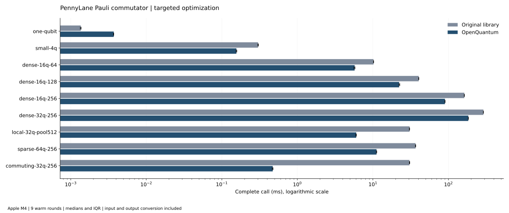
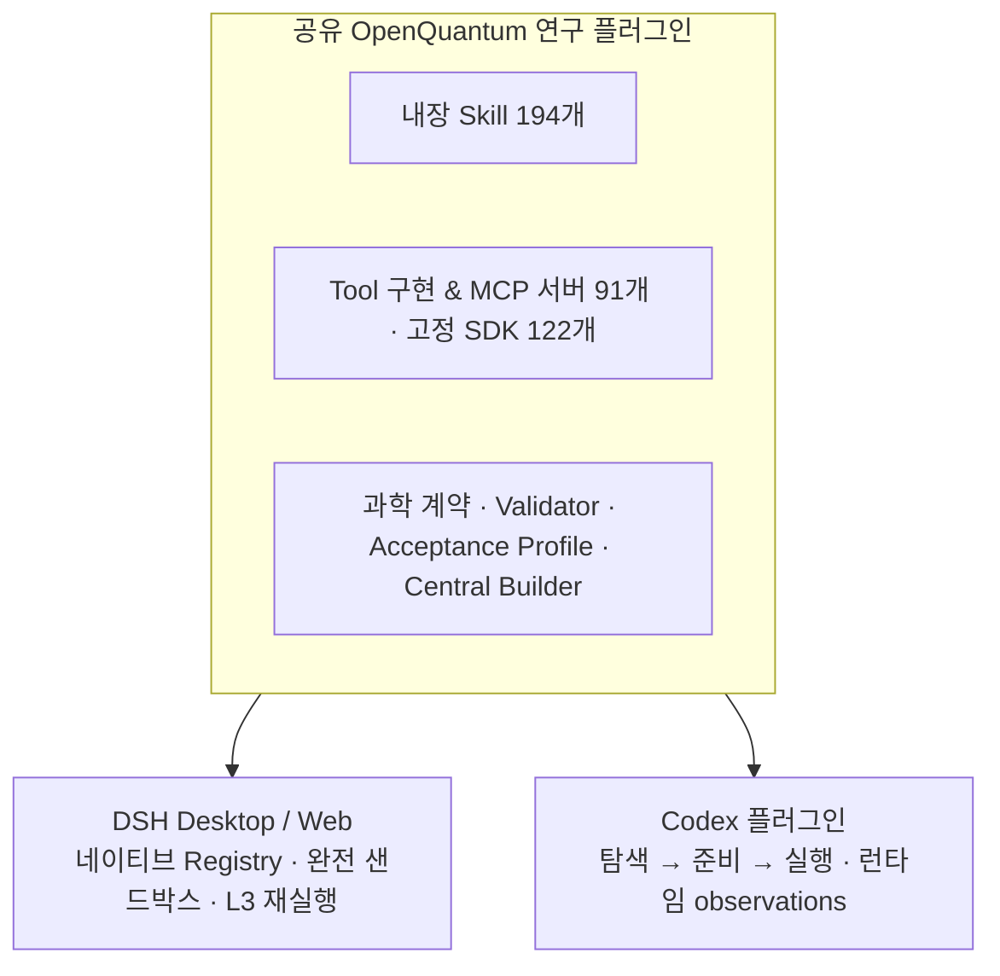

<h1 align="center">
  <picture>
    <source media="(prefers-color-scheme: dark)" srcset="../../packages/openquantum-web-branding/assets/lockup-inverse.svg" />
    
  </picture>
</h1>

<p align="center">
  <strong>OpenQuantum — 함께 만드는 신뢰할 수 있는 양자 연구 AI.</strong><br />
  <sub>양자 연구의 전문 지식을 하나의 OpenQuantum에 · Codex와 Desktop을 지원하는 오픈 소스 양자 연구 플러그인 및 워크벤치</sub>
</p>

<p align="center">
  <a href="https://github.com/xi-zhao/OpenQuantum/stargazers"></a>
  <a href="https://github.com/xi-zhao/OpenQuantum/releases/tag/v0.8.11"></a>
  <a href="https://github.com/xi-zhao/OpenQuantum/actions/workflows/ci.yml"></a>
  <a href="../../THIRD_PARTY_NOTICES.md"></a>
  
  <a href="https://xi-zhao.github.io/OpenQuantum/"></a>
  <a href="../../CONTRIBUTING.md"></a>
</p>

<p align="center">
  <a href="../../README.md">简体中文</a> ·
  <a href="./README.en.md">English</a> ·
  <a href="./README.ja.md">日本語</a> ·
  <a href="./README.ko.md"><strong>한국어</strong></a> ·
  <a href="./README.es.md">Español</a> ·
  <a href="./README.fr.md">Français</a> ·
  <a href="./README.de.md">Deutsch</a> ·
  <a href="./README.pt.md">Português</a> ·
  <a href="./README.ru.md">Русский</a> ·
  <a href="./README.ar.md">العربية</a>
</p>

<p align="center">
  <a href="#why-openquantum">선택 이유</a> ·
  <a href="#what-you-can-do">연구 기능</a> ·
  <a href="#optimization-cases">실측 최적화</a> ·
  <a href="#quick-start"><strong>빠른 시작 ↗</strong></a> ·
  <a href="#use-and-inspect-results">아키텍처와 신뢰성</a> ·
  <a href="#roadmap-and-rsi">로드맵</a> ·
  <a href="#extend-the-platform">참여하기</a>
</p>

<p align="center">
  <a href="https://xi-zhao.github.io/OpenQuantum/">
    <picture>
      <source media="(prefers-color-scheme: dark)" srcset="../images/readme/hero-en-dark.webp" />
      
    </picture>
  </a>
</p>

<p align="center">
  <a href="https://github.com/xi-zhao/OpenQuantum/releases/download/v0.8.11/OpenQuantum-0.8.11-macOS-arm64.dmg">
    <picture>
      <source media="(prefers-color-scheme: dark)" srcset="../images/readme/launch-card-en-dark.webp" />
      
    </picture>
  </a>
</p>

`v0.8.11` 배포 패키지에는 Skill 189개, 환경 117개, DSH에서 재실행할 수 있는 L3 과학 검증 절차 3개가 포함되어 있습니다. 아래 표는 현재 `main` 소스 코드 기준으로 Skill 194개, 환경 122개, L3 검증 절차 11개를 집계한 것입니다.

<table>
  <tr>
    <td align="center" width="25%"><strong>194</strong><br /><sub>내장 Skill (자동 181 / 색인 13)</sub></td>
    <td align="center" width="25%"><strong>91</strong><br /><sub>MCP 연결 (기본 66 / 선택 25)</sub></td>
    <td align="center" width="25%"><strong>122</strong><br /><sub>고정 SDK 및 소스 환경</sub></td>
    <td align="center" width="25%"><strong>11개 L3</strong><br /><sub>재현 가능한 과학적 승인 (DSH)</sub></td>
  </tr>
</table>

---

## 최근 소식

- **2026-11-26** · 재현 가능한 **L3 과학적 승인**을 **11개 기능**(바닥상태 VQE, 양자정보 감사, QCEC 동치성, QEC 메모리, 해밀토니안 시뮬레이션, QPanda QUBO, LDPC 디코딩, PyZX, Symmer, PauLie, Graphix)으로 확장하고, 호스트 측 독립 참조 하위 프로세스를 완전 샌드박스로 격리했습니다.
- **2026-11** · **MWPF**(하이퍼그래프 디코딩), **PPVM**(근-Clifford 손실/누설), **tropidist**(결함 거리 증인), **ST-GRAPE**(강건 펄스 제어) 고정 네이티브 SDK와 **PyZX 0.10.8** 업그레이드를 추가했습니다.
- **2026-11-09** · **[OpenQuantum v0.8.11](../releases/v0.8.11.md)**([Desktop DMG](https://github.com/xi-zhao/OpenQuantum/releases/tag/v0.8.11) & [Codex 플러그인](https://github.com/xi-zhao/OpenQuantum/releases/tag/codex-v0.8.11)) 출시: 양쪽 호스트에서 유계 Tool 실행 백엔드를 공유하고 **SlowQuant**, **TNQS**, **RcmpsCore**를 추가했습니다.
- **2026-10** · 재현 가능한 전체 호출 최적화 벤치마크 2건 공개: **QuTiP Wigner 함수 5.69배**(최대 절대 오차 `6.52 × 10⁻¹⁶`), **PennyLane Pauli 교환자 5.09배**.

<p align="center"><strong>▶ 78초 만에 살펴보는 OpenQuantum</strong></p>

https://github.com/user-attachments/assets/5c00a30d-eef0-493a-975f-3faeb200cc9e

<p align="center"><sub>2026-11-02 데모(중국어 자막, 당시 스냅샷 수량). 최신 기능과 검증 범위는 아래 참고 · <a href="../communications/video/README.md">출처 및 재현 안내</a></sub></p>

---

<a id="why-openquantum"></a>

## 왜 OpenQuantum인가

범용 LLM으로 양자 연구를 수행할 때는 **매번 취약한 코드를 처음부터 다시 작성하는 문제, 100개가 넘는 이기종 양자 SDK 환경, 그리고 독립 검증 없는 그럴듯한 답변**에 막히기 쉽습니다. OpenQuantum은 하나의 **공유 양자 연구 플러그인**으로 오픈 소스 소프트웨어, 논문 방법론, 독립 검증 경로를 연결합니다.

<table>
  <tr>
    <td width="50%" valign="top">
      <strong>폭넓은 생태계 · 122개 고정 환경</strong><br />
      Qiskit, PennyLane, QuTiP, Stim, PyMatching, TeNPy, Mitiq, PyZX, OpenFermion, Lean 4 등 <strong>122개 환경</strong>(Python 110 / Julia 9 / Native 2 / Lean 1)과 <strong>49개 실행 가능 알고리즘 예제</strong>를 제공합니다.
    </td>
    <td width="50%" valign="top">
      <strong>실측 성능 · 핵심 병목 최적화</strong><br />
      고정 입력 기준 전체 호출에서 <strong>QuTiP 5.69배</strong>, <strong>PennyLane 5.09배</strong> 가속을 달성했으며 모든 원시 측정값과 정확도 대조 기록을 공개합니다.
    </td>
  </tr>
  <tr>
    <td width="50%" valign="top">
      <strong>신뢰성 · 실행 완료 ≠ 과학적 승인</strong><br />
      독립 검증과 완전한 출처(provenance)에 근거해 결과의 과학적 신뢰도를 판단하는 <em>과학적 승인</em>을 도구 실행 완료와 엄격히 구분하며, <strong>Lean 4 / mathlib / physlib</strong> 형식 증명 확인을 지원합니다.
    </td>
    <td width="50%" valign="top">
      <strong>개방형 멀티 호스트 · BYOM</strong><br />
      동일한 공유 플러그인으로 <strong>Codex 플러그인</strong>과 <strong>OpenQuantum Desktop / Web</strong>을 모두 지원합니다. Tool Calling 지원 모델을 자유롭게 연결할 수 있으며 자체 코드는 MIT 라이선스입니다.
    </td>
  </tr>
</table>

---

<a id="what-you-can-do"></a>

## 연구 기능 및 생태계

| 양자 알고리즘과 회로 | 양자계와 다체 물리 | 오류 정정과 완화 |
| --- | --- | --- |
| [Qiskit](https://github.com/Qiskit/qiskit) · [PennyLane](https://github.com/PennyLaneAI/pennylane) | [QuTiP](https://github.com/qutip/qutip) · [TeNPy](https://github.com/tenpy/tenpy) | [Stim](https://github.com/quantumlib/Stim) · [PyMatching](https://github.com/oscarhiggott/PyMatching) |
| [PyZX](https://github.com/zxcalc/pyzx) · [Graphix](https://github.com/TeamGraphix/graphix) | [OpenFermion](https://github.com/quantumlib/OpenFermion) · [Dynamiqs](https://github.com/dynamiqs/dynamiqs) | [Mitiq](https://github.com/unitaryfoundation/mitiq) · [MQT QECC](https://github.com/munich-quantum-toolkit/qecc) |
| [pytket](https://github.com/CQCL/tket) · [MQT QCEC](https://github.com/munich-quantum-toolkit/qcec) | [Bloqade](https://github.com/QuEraComputing/bloqade-python) · [Pulser](https://github.com/pasqal-io/Pulser) | [Chromobius](https://github.com/quantumlib/chromobius) · [Deltakit](https://github.com/Deltakit/deltakit) |

| 연구 분야 | 대표 도구 및 SDK | 확인할 경계 |
| --- | --- | --- |
| <a id="algorithm-learning-and-method-comparison"></a>**알고리즘 학습 및 비교** | [49개 실행 가능 오픈 소스 예제](../../examples/quantum-algorithms/README.md): QFT, QPE, HHL, VQE, VQD, QAOA, QSP/QSVT, 상태 준비, qLDPC, 슈뢰딩거화 | 기본 매개변수는 교육용; 실제 오차와 수렴 조건을 작업별로 확인 |
| <a id="circuits-and-quantum-information"></a>**회로 컴파일·시뮬레이션·상호운용** | Qiskit, PennyLane, PyZX, Graphix, MQT QCEC / QMAP / DDSIM, pytket, Compact, QCut, qBraid, Clifft, [PPVM](../../.agents/skills/ppvm-simulation/SKILL.md), 밀도 행렬 감사 | 게이트 집합, 비트 순서, 노이즈 모델, 동치성 범위 |
| <a id="ground-states-chemistry-and-optimization"></a>**바닥상태·양자화학·최적화** | VQE(재현 가능 L3), SQD, TeNPy DMRG, OpenFermion, pyChemiQ, Flow-VQE, OpenQARP, Symmer, PauLie, QPanda / Ocean / Kaiwu | 활성 공간, 입자/대칭 섹터, 수렴 및 독립 참조 |
| **분자 분광·그래프 TN·장론** | [SlowQuant](../../.agents/skills/slowquant-response/SKILL.md), [TNQS](../../.agents/skills/tnqs-dynamics/SKILL.md), [RcmpsCore](../../.agents/skills/rcmps-field-theory/SKILL.md) | 활성 공간·응답 근사, 평면 임베딩 및 절단, 전이 갭과 해밀토니안 갭 구분 |
| <a id="error-mitigation-and-error-correction"></a>**오류 완화 및 양자 오류 정정** | Mitiq, Stim / PyMatching, Deltakit, BP+LSD, Chromobius, [MWPF](../../.agents/skills/mwpf-decoding/SKILL.md), [tropidist](../../.agents/skills/tropidist-distance/SKILL.md), [erasure-recovery](../../.agents/skills/erasure-recovery/SKILL.md), [emlint](../../.agents/skills/emlint-dem-audit/SKILL.md) | 샘플링 예산, 통계 오차, 결함 모델 가정; 정적 DEM 진단이 부호 거리를 증명하지 않음 |
| <a id="hamiltonian-simulation-and-open-systems"></a>**동역학·중성 원자·펄스 제어** | Trotter / qDrift, Dynamiqs, OQuPy, TJM, Bloqade Analog, Pulser, PairInteraction, [ST-GRAPE](../../.agents/skills/stgrape-control/SKILL.md), QUA / LabOne Q / Qblox / Qililab / OQC QAT | 단위, 절단, 고정 시간 격자; 오프라인 펄스 컴파일과 실제 장비 제어 구분 |
| <a id="photonics-and-quantum-networks"></a>**광양자 및 양자 네트워크** | Perceval, Piquasso, Lightworks, MerLin, MrMustard, SimQN, NetQASM / SquidASM | 모드 순서, Fock 절단, 손실 모델 및 별도 라이선스(NetSquid) |
| <a id="experiment-simulation-and-hardware"></a>**하드웨어 탐색 및 클라우드 API** | FieldQKit, IBM Quantum, IonQ, OriginQ, Quafu, Tianyan, Guodun, Tencent, LogicalQubit, QDMI C 드라이버 | 자격 증명·할당량 분리; 기본은 읽기 전용 탐색, 실제 QPU 작업은 명시적 활성화 필요 |
| <a id="reference-material-and-selection"></a>**형식 증명 및 공개 벤치마크** | [Lean 4 / mathlib / physlib](../../.agents/skills/lean-physics/SKILL.md), [Quantum-Practices(66) & Metriq(410)](../CAPABILITIES.md#参考资料与选型) | 형식 증명은 기술된 정의와 공리만 보장; 과거 벤치마크는 현재 장비 성능이 아님 |
| <a id="quantum-learning"></a>**교육 및 인터랙티브 강의실** | [Quantum Learning / OpenMAIC](../integrations/OPENMAIC.md): 강좌 라이브러리, 교재 편집, PPTX 가져오기, 퀴즈 | 전체 커리큘럼 구축 중; 실시간 온라인 AI 수업 전체 승인 대기 |

현재 소스 배포판은 **[내장 Skill 194개](../../.agents/skills/README.md)**, **MCP 서비스 연결 91개**(기본 66 / 선택 25), **네이티브 양자 Tool 5개**와 **[122개 SDK/소스 환경](../integrations/SDK_INVENTORY.md)**(DSH 측 재현 가능 L3 과학적 승인 11개 포함)을 제공합니다.

[전체 카탈로그(중국어)](../CAPABILITIES.md#接口总览) · [SDK API 감사](../integrations/FULL_SDK_ACCESS.md) · [유사 방법 선택 가이드](../integrations/CAPABILITY_SELECTION.md)

---

<a id="optimization-cases"></a>

## 실측 최적화: 더 빠르고 독립 검증 가능

| 벤치마크 작업 | 환경 및 기준 버전 | 기존 라이브러리 | OpenQuantum 최적화 후 | 전체 호출 가속 | 독립 검증 | 재현 자료 |
| --- | --- | ---: | ---: | ---: | --- | --- |
| **QuTiP Wigner 함수** | Apple M4 · QuTiP 5.3.1 (64차원 Fock, 201×201 격자) | 171.77 ms | **30.18 ms** | **5.69배** | 최대 절대차 `6.52 × 10⁻¹⁶`, 272건 독립/해석/거부 검증 통과 | [보고서](../../experiments/qutip-rust-wigner/README.md) · [JSON](../../experiments/qutip-rust-wigner/results/summary.json) |
| **PennyLane Pauli 교환자** | Apple M4 · PennyLane 0.45.1 (32큐비트, 125×512항) | 30.62 ms | **6.02 ms** | **5.09배** | 9개 벤치마크 항별 완전 일치; 4,368쌍 Pauli 문자열 및 40개 무작위 행렬 최대 오차 `1.42 × 10⁻¹⁴` | [보고서](../../experiments/pennylane-rust-commutator/README.md) · [JSON](../../experiments/pennylane-rust-commutator/results/benchmark.json) |

<a id="qutip-rust-case"></a>

<p align="center"></p>

<a id="pennylane-rust-case"></a>

<p align="center"></p>

---

<a id="quick-start"></a>

## 빠른 시작

<a id="codex"></a>

### 방법 1: Codex 플러그인

새 Codex 채팅에서 아래 요청을 붙여 넣으세요:

```text
Please install the OpenQuantum Codex plugin 0.8.11. First read the installation guide:
https://github.com/xi-zhao/OpenQuantum/blob/codex-v0.8.11/docs/integrations/CODEX_AGENT_INSTALL.md
Download the complete installer and SHA256SUMS from https://github.com/xi-zhao/OpenQuantum/releases/tag/codex-v0.8.11,
verify the checksum, check Codex, Node.js 24+ and npm, and install with the bundled installer.
Keep existing plugins and user settings, and check the Skills, MCP tools and the global "OpenQuantum settings" entry.
Tell me exactly what to do if the app needs reloading. Finally, report what was actually verified and which scientific dependencies still need preparation.
```

**[전체 설치 프로그램 ZIP 다운로드](https://github.com/xi-zhao/OpenQuantum/releases/download/codex-v0.8.11/openquantum-0.8.11-codex-install.zip)** · [릴리스 노트 및 SHA256SUMS](https://github.com/xi-zhao/OpenQuantum/releases/tag/codex-v0.8.11) · [수동 설치](../integrations/CODEX_AGENT_INSTALL.md) · [플러그인 경계](../integrations/CODEX_PLUGIN.md)

<a id="desktop-installer"></a>

### 방법 2: Desktop 설치 프로그램

1. **[OpenQuantum 0.8.11 DMG](https://github.com/xi-zhao/OpenQuantum/releases/download/v0.8.11/OpenQuantum-0.8.11-macOS-arm64.dmg)**(macOS Apple Silicon)를 다운로드하고 [SHA256SUMS](https://github.com/xi-zhao/OpenQuantum/releases/tag/v0.8.11)를 확인합니다.
2. `OpenQuantum.app`을 Applications 폴더로 드래그합니다.
3. **Settings → Models**에서 Tool Calling 지원 모델을 추가합니다(ad-hoc 서명 안내: [설치 가이드](../DESKTOP_INSTALLERS.md); Intel Mac / Windows는 [0.8.4 패키지](https://github.com/xi-zhao/OpenQuantum/releases/tag/v0.8.4) 또는 아래 소스 실행 사용).

<a id="install-from-source"></a>

### 방법 3: 소스에서 실행

```bash
git clone https://github.com/xi-zhao/OpenQuantum.git
cd OpenQuantum
npm ci
npm run dev
```

<details>
<summary><strong>추가 실행 방법: 소스 Desktop, Docker(Linux), Quantum Learning, 메신저 연동</strong></summary>

| 실행 방법 | 명령 | 가이드 |
| --- | --- | --- |
| **소스 Desktop** | `npm run desktop:setup` → `npm run desktop:verify-install` → `npm run desktop -- --source` | [배포 가이드](../DEPLOYMENT.md) |
| **Docker Compose(Linux)** | `cp .env.example .env && docker compose up --build` | [배포 가이드](../DEPLOYMENT.md) |
| **Quantum Learning** | `npm run learning:ui:setup` | [OpenMAIC 가이드](../integrations/OPENMAIC.md) |
| **WeChat / Feishu 연동** | `npm run cc-connect:setup` | [메신저 가이드](../integrations/CC_CONNECT.md) |

</details>

### 모델 키 없이 30초 만에 첫 계산 검증하기

```bash
npm run demo:quantum-ground-state
```

<table>
  <tr>
    <td align="center" width="25%"><strong>-1.85727503 Ha</strong><br /><sub>VQE 에너지</sub></td>
    <td align="center" width="25%"><strong>-1.85727503 Ha</strong><br /><sub>독립 정확 참조</sub></td>
    <td align="center" width="25%"><strong>4.44 × 10⁻¹⁶ Ha</strong><br /><sub>절대 오차</sub></td>
    <td align="center" width="25%"><strong>15개 통과</strong><br /><sub>로컬 계산 검증</sub></td>
  </tr>
</table>

---

<a id="use-and-inspect-results"></a>
<a id="execution-records-and-scientific-acceptance"></a>

## 아키텍처 및 신뢰 메커니즘



<table>
  <tr>
    <td width="50%" valign="top"><a href="../images/openquantum-desktop-20261013.jpg"></a><br /><sub>Desktop 워크벤치 (2026-10-13 화면; 0.8.11에서 더 간결해짐)</sub></td>
    <td width="50%" valign="top"><a href="../images/openquantum-settings-categories-20261013.jpg"></a><br /><sub>용도별 기능 설정 및 검색·상태 필터 (2026-10-13)</sub></td>
  </tr>
</table>

---

<a id="roadmap-and-rsi"></a>
<a id="rsi"></a>

## 로드맵 · <a id="extend-the-platform"></a><a id="documentation-and-support"></a>참여 및 인용

- **제공된 기준선**: 내장 Skill 194개, MCP 91개, 고정 SDK 122개, Desktop & Codex `v0.8.11`, DSH 재현 가능 L3 과학적 승인 11개.
- **장기 비전(RSI)**: 독립 검증과 권한 경계에 기반한 재귀적 자기 개선을 탐색 중이며, **전체 RSI 루프는 아직 구현되지 않았습니다**([장기 계획](../roadmap/VISION.md)).
- **기여하기**: [기여 가이드](../../CONTRIBUTING.md) · [Issues](https://github.com/xi-zhao/OpenQuantum/issues) · [행동 강령](../../CODE_OF_CONDUCT.md) · [보안 정책](../../SECURITY.md) (오프라인 전체 점검: `npm run check`).
- **연락처**: [zx4612@mail.ustc.edu.cn](mailto:zx4612@mail.ustc.edu.cn) · WeChat: `sincerely1019`

```bibtex
@software{zhao2026openquantum,
  author  = {Zhao, Xi and {OpenQuantum contributors}},
  title   = {OpenQuantum: Building Trustworthy AI for Quantum Research},
  year    = {2026},
  version = {0.8.11},
  url     = {https://github.com/xi-zhao/OpenQuantum}
}
```

<a id="license-and-acknowledgments"></a>

## 라이선스 및 감사

자체 코드는 별도 표기된 디렉터리를 제외하고 [MIT License](../../LICENSE)(© 2026 Xi Zhao)를 따릅니다. `mitiq-error-mitigation`은 [GPL-3.0-only](../../.agents/skills/mitiq-error-mitigation/LICENSE), Metriq 데이터는 [CC-BY-4.0](../../src/metriq-data/upstream/LICENSE)가 적용됩니다. 자세한 내용은 [`THIRD_PARTY_NOTICES.md`](../../THIRD_PARTY_NOTICES.md)를 참고하세요.

<p align="center">
  <picture>
    <source media="(prefers-color-scheme: dark)" srcset="../../packages/openquantum-web-branding/assets/lockup-inverse.svg" />
    
  </picture><br />
  <sub>OpenQuantum · 손끝에서 시작하는 양자 컴퓨팅.</sub>
</p>
