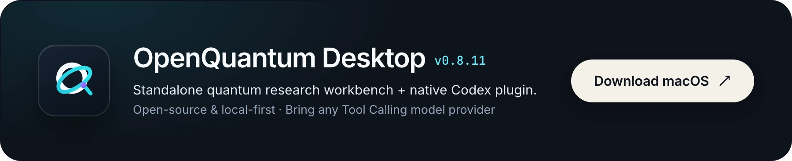
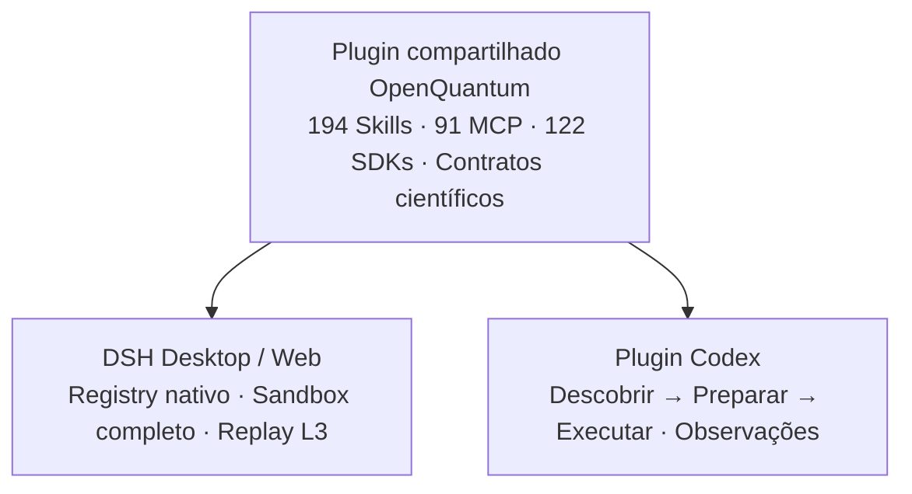
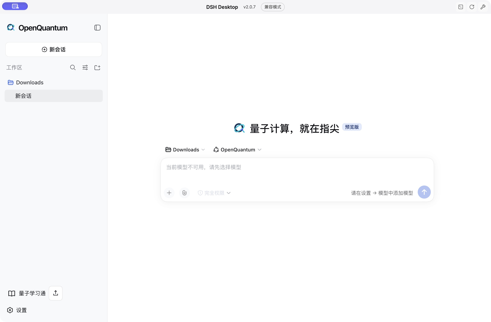

<h1 align="center">
  <picture>
    <source media="(prefers-color-scheme: dark)" srcset="../../packages/openquantum-web-branding/assets/lockup-inverse.svg" />
    
  </picture>
</h1>

<p align="center">
  <strong>OpenQuantum — Construindo juntos uma IA confiável para a pesquisa quântica.</strong><br />
  <sub>A experiência da pesquisa quântica reunida em um único OpenQuantum · Plugin e ambiente de trabalho open source para Codex e Desktop</sub>
</p>

<p align="center">
  <a href="https://github.com/xi-zhao/OpenQuantum/stargazers"></a>
  <a href="https://github.com/xi-zhao/OpenQuantum/releases/tag/v0.8.11"></a>
  <a href="https://github.com/xi-zhao/OpenQuantum/actions/workflows/ci.yml"></a>
  <a href="../../THIRD_PARTY_NOTICES.md"></a>
  
  <a href="https://xi-zhao.github.io/OpenQuantum/"></a>
  <a href="../../CONTRIBUTING.md"></a>
</p>

<p align="center">
  <a href="../../README.md">简体中文</a> ·
  <a href="./README.en.md">English</a> ·
  <a href="./README.ja.md">日本語</a> ·
  <a href="./README.ko.md">한국어</a> ·
  <a href="./README.es.md">Español</a> ·
  <a href="./README.fr.md">Français</a> ·
  <a href="./README.de.md">Deutsch</a> ·
  <a href="./README.pt.md"><strong>Português</strong></a> ·
  <a href="./README.ru.md">Русский</a> ·
  <a href="./README.ar.md">العربية</a>
</p>

<p align="center">
  <a href="#why-openquantum">Por que OpenQuantum</a> ·
  <a href="#what-you-can-do">Recursos</a> ·
  <a href="#optimization-cases">Otimizações</a> ·
  <a href="#quick-start"><strong>Início rápido ↗</strong></a> ·
  <a href="#use-and-inspect-results">Arquitetura</a> ·
  <a href="#roadmap-and-rsi">Roadmap</a> ·
  <a href="#extend-the-platform">Contribuir</a>
</p>

<p align="center">
  <a href="https://xi-zhao.github.io/OpenQuantum/">
    <picture>
      <source media="(prefers-color-scheme: dark)" srcset="../images/readme/hero-en-dark.webp" />
      
    </picture>
  </a>
</p>

<p align="center">
  <a href="https://github.com/xi-zhao/OpenQuantum/releases/download/v0.8.11/OpenQuantum-0.8.11-macOS-arm64.dmg">
    <picture>
      <source media="(prefers-color-scheme: dark)" srcset="../images/readme/launch-card-en-dark.webp" />
      
    </picture>
  </a>
</p>

Os pacotes de instalação da versão `v0.8.11` incluem 189 Skills, 117 ambientes e 3 fluxos de aceitação científica L3 no DSH. A tabela apresenta os números do código-fonte atual de `main`, com 194 Skills, 122 ambientes e 11 fluxos L3.

<table>
  <tr>
    <td align="center" width="25%"><strong>194</strong><br /><sub>Skills integradas (181 auto / 13 índice)</sub></td>
    <td align="center" width="25%"><strong>91</strong><br /><sub>Conexões MCP (66 ativas / 25 opcionais)</sub></td>
    <td align="center" width="25%"><strong>122</strong><br /><sub>Ambientes SDK e fonte fixados</sub></td>
    <td align="center" width="25%"><strong>11 L3</strong><br /><sub>Aceitação científica reproduzível (DSH)</sub></td>
  </tr>
</table>

---

## Novidades

- **2026-11-26** · **Aceitação científica L3** reproduzível expandida para **11 recursos** (VQE de estado fundamental, auditoria de informação quântica, equivalência QCEC, memória QEC, simulação hamiltoniana, QPanda QUBO, decodificação LDPC, PyZX, Symmer, PauLie e Graphix) com isolamento total em sandbox para todos os subprocessos de referência.
- **2026-11** · Novos ambientes SDK nativos fixados para **MWPF**, **PPVM**, **tropidist** e **ST-GRAPE**, além da atualização verificada para **PyZX 0.10.8**.
- **2026-11-09** · Lançamento unificado **[OpenQuantum v0.8.11](../releases/v0.8.11.md)** ([Desktop DMG](https://github.com/xi-zhao/OpenQuantum/releases/tag/v0.8.11) e [plugin Codex](https://github.com/xi-zhao/OpenQuantum/releases/tag/codex-v0.8.11)) com backend compartilhado e suporte a **SlowQuant**, **TNQS** e **RcmpsCore**.
- **2026-10** · Duas otimizações medidas de ponta a ponta: **5,69× na função de Wigner do QuTiP** (diferença máx. `6,52 · 10⁻¹⁶`) e **5,09× em comutadores de Pauli no PennyLane**.

<p align="center"><strong>▶ Conheça o OpenQuantum em 78 segundos</strong></p>

https://github.com/user-attachments/assets/5c00a30d-eef0-493a-975f-3faeb200cc9e

<p align="center"><sub>Demonstração de 2026-11-02 (legendas em chinês e números daquela data). <a href="../communications/video/README.md">Fontes e reprodução</a></sub></p>

---

<a id="why-openquantum"></a>

## Por que escolher o OpenQuantum

Usar um LLM genérico na pesquisa quântica costuma esbarrar em três barreiras: **reescrever código frágil do zero, lidar com mais de cem SDKs fragmentados e receber respostas plausíveis sem verificação independente.** O OpenQuantum conecta software científico aberto, métodos publicados e verificações independentes em um **plugin compartilhado**.

- **Cobertura ampla**: 122 ambientes fixados (110 Python, 9 Julia, 2 nativos, 1 Lean 4) e 49 exemplos executáveis de algoritmos (Qiskit, PennyLane, QuTiP, Stim, PyMatching, TeNPy, Mitiq, PyZX, OpenFermion, Lean 4 e mais).
- **Mais rápido e verificável**: ganhos medidos em chamada completa (**5,69×** no QuTiP, **5,09×** no PennyLane) com verificação ponto a ponto.
- **Ciência verificável**: a *aceitação científica* — concluir que um resultado é cientificamente confiável com base em verificações independentes e procedência completa — permanece separada da conclusão simples de uma ferramenta.
- **Aberto e multi-host**: você usa o mesmo plugin no **plugin Codex** ou no **OpenQuantum Desktop / Web** com seu próprio modelo Tool Calling (BYOM); o código próprio é licença MIT.

---

<a id="what-you-can-do"></a>

## Recursos e ecossistema

| Área de pesquisa | Ferramentas e SDKs em destaque | Limites a verificar |
| --- | --- | --- |
| <a id="algorithm-learning-and-method-comparison"></a>**Algoritmos e comparação** | [49 exemplos executáveis](../../examples/quantum-algorithms/README.md): QFT, QPE, HHL, VQE, VQD, QAOA, QSP/QSVT, preparação de estados, qLDPC e schrödingerização | Parâmetros padrão são didáticos; verifique erro e convergência em cada tarefa |
| <a id="circuits-and-quantum-information"></a>**Circuitos, compilação e interoperabilidade** | Qiskit, PennyLane, PyZX, Graphix, MQT QCEC / QMAP / DDSIM, pytket, Compact, QCut, qBraid, Clifft, [PPVM](../../.agents/skills/ppvm-simulation/SKILL.md), auditoria de matrizes densidade | Conjunto de portas, ordem de bits, modelos de ruído e escopo de equivalência |
| <a id="ground-states-chemistry-and-optimization"></a>**Estados fundamentais, química e otimização** | VQE (L3 reproduzível), SQD, TeNPy DMRG, OpenFermion, pyChemiQ, Flow-VQE, OpenQARP, Symmer, PauLie, QPanda / Ocean / Kaiwu | Espaço ativo, setor de partículas/simetria e referência independente |
| **Espectroscopia, redes tensoriais e teoria de campos** | [SlowQuant](../../.agents/skills/slowquant-response/SKILL.md), [TNQS](../../.agents/skills/tnqs-dynamics/SKILL.md), [RcmpsCore](../../.agents/skills/rcmps-field-theory/SKILL.md) | Aproximações de resposta, incorporação planar e distinção entre gap de transferência e gap hamiltoniano |
| <a id="error-mitigation-and-error-correction"></a>**Mitigação e correção de erros** | Mitiq, Stim / PyMatching, Deltakit, BP+LSD, Chromobius, [MWPF](../../.agents/skills/mwpf-decoding/SKILL.md), [tropidist](../../.agents/skills/tropidist-distance/SKILL.md), [erasure-recovery](../../.agents/skills/erasure-recovery/SKILL.md), [emlint](../../.agents/skills/emlint-dem-audit/SKILL.md) | Orçamento de amostragem e modelo de falhas; diagnóstico DEM estático não prova distância |
| <a id="hamiltonian-simulation-and-open-systems"></a>**Dinâmica, átomos neutros e pulsos** | Trotter / qDrift, Dynamiqs, OQuPy, TJM, Bloqade Analog, Pulser, PairInteraction, [ST-GRAPE](../../.agents/skills/stgrape-control/SKILL.md), QUA / LabOne Q / Qblox / Qililab / OQC QAT | Unidades, cortes e grade temporal fixa; compilação offline não opera hardware de laboratório |
| <a id="photonics-and-quantum-networks"></a>**Fotônica e redes quânticas** | Perceval, Piquasso, Lightworks, MerLin, MrMustard, SimQN, NetQASM / SquidASM | Ordem dos modos, corte de Fock e licença separada do NetSquid |
| <a id="experiment-simulation-and-hardware"></a>**Hardware e nuvens quânticas** | FieldQKit, IBM Quantum, IonQ, OriginQ, Quafu, Tianyan, Guodun, Tencent, LogicalQubit e QDMI | Descoberta somente leitura por padrão; envios reais à QPU apenas sob ativação explícita |
| <a id="reference-material-and-selection"></a>**Provas formais e benchmarks** | [Lean 4 / mathlib / physlib](../../.agents/skills/lean-physics/SKILL.md), [Quantum-Practices (66) e Metriq (410)](../CAPABILITIES.md#参考资料与选型) | Provas cobrem apenas definições e axiomas declarados; registros históricos não certificam hardware atual |
| <a id="quantum-learning"></a>**Ensino e salas interativas** | [Quantum Learning / OpenMAIC](../integrations/OPENMAIC.md) | Currículo completo em construção; fluxos de ensino com IA online aguardam aceitação completa |

A distribuição fonte atual inclui **[194 Skills integradas](../../.agents/skills/README.md)**, **91 conexões de serviços MCP** (66 ativas por padrão, 25 opcionais), **5 Tools quânticas nativas** e **[122 ambientes SDK/fonte](../integrations/SDK_INVENTORY.md)** (com **11 recursos L3** reproduzíveis no DSH). [Catálogo completo (chinês)](../CAPABILITIES.md#接口总览) · [Auditoria SDK](../integrations/FULL_SDK_ACCESS.md)

---

<a id="optimization-cases"></a>

## Otimizações medidas

| Tarefa | Baseline fixado (Apple M4) | Biblioteca original | OpenQuantum | Aceleração | Verificação independente | Reprodução |
| --- | --- | ---: | ---: | ---: | --- | --- |
| **QuTiP Wigner** | QuTiP 5.3.1 (Fock 64, grade 201×201) | 171,77 ms | **30,18 ms** | **5,69×** | Dif. máx. `6,52 · 10⁻¹⁶`; 272 verificações aprovadas | [Relatório](../../experiments/qutip-rust-wigner/README.md) · [JSON](../../experiments/qutip-rust-wigner/results/summary.json) |
| **PennyLane Pauli** | PennyLane 0.45.1 (32 qubits, 125×512 termos) | 30,62 ms | **6,02 ms** | **5,09×** | 9 benchmarks idênticos; 4.368 pares de cadeias de Pauli e 40 matrizes aleatórias (`1,42 · 10⁻¹⁴`) | [Relatório](../../experiments/pennylane-rust-commutator/README.md) · [JSON](../../experiments/pennylane-rust-commutator/results/benchmark.json) |

<a id="qutip-rust-case"></a>

<p align="center"></p>

<a id="pennylane-rust-case"></a>

<p align="center"></p>

---

<a id="quick-start"></a>

## Início rápido

<a id="codex"></a>

### Opção 1: Plugin Codex

Abra um novo chat no Codex e cole a solicitação abaixo:

```text
Please install the OpenQuantum Codex plugin 0.8.11. First read the installation guide:
https://github.com/xi-zhao/OpenQuantum/blob/codex-v0.8.11/docs/integrations/CODEX_AGENT_INSTALL.md
Download the complete installer and SHA256SUMS from https://github.com/xi-zhao/OpenQuantum/releases/tag/codex-v0.8.11,
verify the checksum, check Codex, Node.js 24+ and npm, and install with the bundled installer.
Keep existing plugins and user settings, and check the Skills, MCP tools and the global "OpenQuantum settings" entry.
Tell me exactly what to do if the app needs reloading. Finally, report what was actually verified and which scientific dependencies still need preparation.
```

**[Baixar instalador completo ZIP](https://github.com/xi-zhao/OpenQuantum/releases/download/codex-v0.8.11/openquantum-0.8.11-codex-install.zip)** · [Notas e SHA256SUMS](https://github.com/xi-zhao/OpenQuantum/releases/tag/codex-v0.8.11) · [Instalação manual](../integrations/CODEX_AGENT_INSTALL.md)

<a id="desktop-installer"></a>

### Opção 2: Aplicativo Desktop

Baixe o **[OpenQuantum 0.8.11 DMG](https://github.com/xi-zhao/OpenQuantum/releases/download/v0.8.11/OpenQuantum-0.8.11-macOS-arm64.dmg)** (macOS Apple Silicon), verifique o arquivo [SHA256SUMS](https://github.com/xi-zhao/OpenQuantum/releases/tag/v0.8.11), arraste `OpenQuantum.app` para Aplicativos e configure seu modelo Tool Calling em **Settings → Models** ([guia de instalação](../DESKTOP_INSTALLERS.md); Intel Mac / Windows: [pacotes 0.8.4](https://github.com/xi-zhao/OpenQuantum/releases/tag/v0.8.4)).

<a id="install-from-source"></a>

### Opção 3: Executar a partir do código-fonte

```bash
git clone https://github.com/xi-zhao/OpenQuantum.git
cd OpenQuantum
npm ci
npm run dev
```

<details>
<summary><strong>Outras opções: Desktop via código-fonte, Docker (Linux), Quantum Learning e mensageiros</strong></summary>

- **Desktop via código-fonte**: `npm run desktop:setup`, `npm run desktop:verify-install`, `npm run desktop -- --source` ([implantação](../DEPLOYMENT.md))
- **Docker Compose (Linux)**: `cp .env.example .env && docker compose up --build`
- **Quantum Learning**: `npm run learning:ui:setup` ([OpenMAIC](../integrations/OPENMAIC.md))
- **Mensageiros**: `npm run cc-connect:setup` ([CC Connect](../integrations/CC_CONNECT.md))

</details>

### Primeiro cálculo verificável em 30 segundos (sem chave de modelo)

```bash
npm run demo:quantum-ground-state
```

<table>
  <tr>
    <td align="center" width="25%"><strong>-1,85727503 Ha</strong><br /><sub>Energia VQE</sub></td>
    <td align="center" width="25%"><strong>-1,85727503 Ha</strong><br /><sub>Referência exata</sub></td>
    <td align="center" width="25%"><strong>4,44 · 10⁻¹⁶ Ha</strong><br /><sub>Diferença absoluta</sub></td>
    <td align="center" width="25%"><strong>15 aprovadas</strong><br /><sub>Verificações locais</sub></td>
  </tr>
</table>

---

<a id="use-and-inspect-results"></a>
<a id="execution-records-and-scientific-acceptance"></a>

## Arquitetura e ciência verificável



<table>
  <tr>
    <td width="50%" valign="top"><a href="../images/openquantum-desktop-20261013.jpg"></a><br /><sub>Ambiente de trabalho Desktop (2026-10-13)</sub></td>
    <td width="50%" valign="top"><a href="../images/openquantum-settings-categories-20261013.jpg"></a><br /><sub>Configurações agrupadas por uso com busca e filtros (2026-10-13)</sub></td>
  </tr>
</table>

---

<a id="roadmap-and-rsi"></a>
<a id="rsi"></a>

## Roadmap · <a id="extend-the-platform"></a><a id="documentation-and-support"></a>Contribuir e citar

- **Roadmap**: expandir cobertura L2/L3, orquestração CPU/GPU/HPC/QPU, interfaces de instrumentação e cursos do Quantum Learning. A autoaperfeiçoamento recursivo (RSI) é uma direção de longo prazo; **o ciclo RSI completo não está implementado** ([visão](../roadmap/VISION.md)).
- **Contribuir**: [Guia de contribuição](../../CONTRIBUTING.md) · [Issues](https://github.com/xi-zhao/OpenQuantum/issues) · [Código de conduta](../../CODE_OF_CONDUCT.md) · [Segurança](../../SECURITY.md) (`npm run check`).

```bibtex
@software{zhao2026openquantum,
  author  = {Zhao, Xi and {OpenQuantum contributors}},
  title   = {OpenQuantum: Building Trustworthy AI for Quantum Research},
  year    = {2026},
  version = {0.8.11},
  url     = {https://github.com/xi-zhao/OpenQuantum}
}
```

<a id="license-and-acknowledgments"></a>

## Licença e agradecimentos

O código próprio utiliza a [MIT License](../../LICENSE) (© 2026 Xi Zhao), exceto `mitiq-error-mitigation` ([GPL-3.0-only](../../.agents/skills/mitiq-error-mitigation/LICENSE)) e os dados do Metriq ([CC-BY-4.0](../../src/metriq-data/upstream/LICENSE)). Veja [`THIRD_PARTY_NOTICES.md`](../../THIRD_PARTY_NOTICES.md).

<p align="center">
  <picture>
    <source media="(prefers-color-scheme: dark)" srcset="../../packages/openquantum-web-branding/assets/lockup-inverse.svg" />
    
  </picture><br />
  <sub>OpenQuantum · Computação quântica ao alcance das suas mãos.</sub>
</p>
