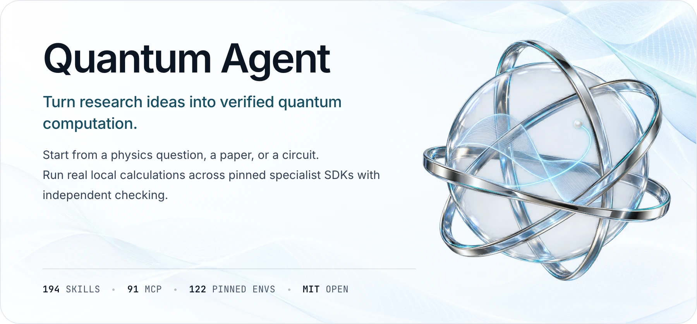
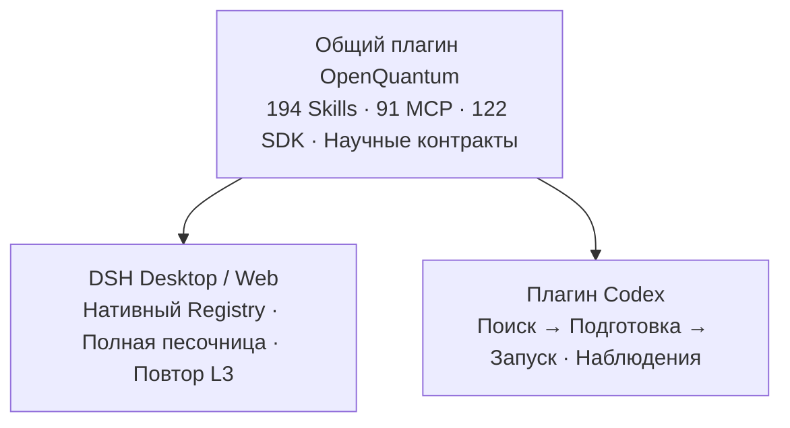

<h1 align="center">
  <picture>
    <source media="(prefers-color-scheme: dark)" srcset="../../packages/openquantum-web-branding/assets/lockup-inverse.svg" />
    
  </picture>
</h1>

<p align="center">
  <strong>OpenQuantum — Вместе создаём надёжный ИИ для квантовых исследований.</strong><br />
  <sub>Профессиональный опыт квантовых исследований — в одном OpenQuantum · Открытый плагин и исследовательская среда для Codex и Desktop</sub>
</p>

<p align="center">
  <a href="https://github.com/xi-zhao/OpenQuantum/stargazers"></a>
  <a href="https://github.com/xi-zhao/OpenQuantum/releases/tag/v0.8.11"></a>
  <a href="https://github.com/xi-zhao/OpenQuantum/actions/workflows/ci.yml"></a>
  <a href="../../THIRD_PARTY_NOTICES.md"></a>
  
  <a href="https://xi-zhao.github.io/OpenQuantum/"></a>
  <a href="../../CONTRIBUTING.md"></a>
</p>

<p align="center">
  <a href="../../README.md">简体中文</a> ·
  <a href="./README.en.md">English</a> ·
  <a href="./README.ja.md">日本語</a> ·
  <a href="./README.ko.md">한국어</a> ·
  <a href="./README.es.md">Español</a> ·
  <a href="./README.fr.md">Français</a> ·
  <a href="./README.de.md">Deutsch</a> ·
  <a href="./README.pt.md">Português</a> ·
  <a href="./README.ru.md"><strong>Русский</strong></a> ·
  <a href="./README.ar.md">العربية</a>
</p>

<p align="center">
  <a href="#why-openquantum">Почему OpenQuantum</a> ·
  <a href="#what-you-can-do">Возможности</a> ·
  <a href="#optimization-cases">Оптимизации</a> ·
  <a href="#quick-start"><strong>Быстрый старт ↗</strong></a> ·
  <a href="#use-and-inspect-results">Архитектура</a> ·
  <a href="#roadmap-and-rsi">Дорожная карта</a> ·
  <a href="#extend-the-platform">Участие</a>
</p>

<p align="center">
  <a href="https://xi-zhao.github.io/OpenQuantum/">
    <picture>
      <source media="(prefers-color-scheme: dark)" srcset="../images/readme/hero-en-dark.webp" />
      
    </picture>
  </a>
</p>

<p align="center">
  <a href="https://github.com/xi-zhao/OpenQuantum/releases/download/v0.8.11/OpenQuantum-0.8.11-macOS-arm64.dmg">
    <picture>
      <source media="(prefers-color-scheme: dark)" srcset="../images/readme/launch-card-en-dark.webp" />
      
    </picture>
  </a>
</p>

В установочные пакеты `v0.8.11` входят 189 навыков (Skills), 117 окружений и 3 процедуры научной приёмки уровня L3 в DSH. В таблице приведены данные для текущего исходного кода ветки `main` — 194 навыка, 122 окружения и 11 процедур уровня L3.

<table>
  <tr>
    <td align="center" width="25%"><strong>194</strong><br /><sub>Встроенных Skill (181 авто / 13 индекс)</sub></td>
    <td align="center" width="25%"><strong>91</strong><br /><sub>Подключение MCP (66 вкл. / 25 опц.)</sub></td>
    <td align="center" width="25%"><strong>122</strong><br /><sub>Зафиксированных SDK-окружений</sub></td>
    <td align="center" width="25%"><strong>11 L3</strong><br /><sub>Воспроизводимая научная приёмка (DSH)</sub></td>
  </tr>
</table>

---

## Что нового

- **2026-11-26** · Воспроизводимая **научная приёмка L3** расширена до **11 возможностей** (VQE основного состояния, аудит квантовой информации, эквивалентность QCEC, память QEC, моделирование гамильтонианов, QPanda QUBO, декодирование LDPC, PyZX, Symmer, PauLie и Graphix) с полной изоляцией эталонных подпроцессов в песочнице.
- **2026-11** · Добавлены зафиксированные нативные SDK-окружения для **MWPF**, **PPVM**, **tropidist** и **ST-GRAPE**, а также проверенное обновление **PyZX 0.10.8**.
- **2026-11-09** · Единый выпуск **[OpenQuantum v0.8.11](../releases/v0.8.11.md)** ([Desktop DMG](https://github.com/xi-zhao/OpenQuantum/releases/tag/v0.8.11) и [плагин Codex](https://github.com/xi-zhao/OpenQuantum/releases/tag/codex-v0.8.11)) с общим ограниченным исполнителем и поддержкой **SlowQuant**, **TNQS** и **RcmpsCore**.
- **2026-10** · Два воспроизводимых ускорения полного вызова: **в 5,69 раза для функции Вигнера QuTiP** (макс. расхождение `6,52 · 10⁻¹⁶`) и **в 5,09 раза для коммутатора Паули PennyLane**.

<p align="center"><strong>▶ OpenQuantum за 78 секунд</strong></p>

https://github.com/user-attachments/assets/5c00a30d-eef0-493a-975f-3faeb200cc9e

<p align="center"><sub>Демонстрация от 2026-11-02 (китайские субтитры и показатели на эту дату). <a href="../communications/video/README.md">Источники и воспроизведение</a></sub></p>

---

<a id="why-openquantum"></a>

## Почему OpenQuantum

При использовании обычных LLM в квантовых исследованиях возникают три проблемы: **постоянное переписывание хрупкого кода с нуля, более сотни разрозненных SDK и правдоподобные ответы без независимой проверки.** OpenQuantum объединяет открытые библиотеки, научные методы и независимые проверки в одном **общем плагине**.

- **Широкий охват**: 122 зафиксированное окружение (110 Python, 9 Julia, 2 нативных, 1 Lean 4) и 49 исполняемых примеров алгоритмов (Qiskit, PennyLane, QuTiP, Stim, PyMatching, TeNPy, Mitiq, PyZX, OpenFermion, Lean 4 и др.).
- **Измеренная скорость**: ускорение полных вызовов (**в 5,69 раза** в QuTiP, **в 5,09 раза** в PennyLane) с поэлементной проверкой точности.
- **Проверяемая наука**: *научная приёмка* — вывод о научной достоверности результата на основе независимых проверок и полной прослеживаемости — строго отделена от факта завершения вызова инструмента.
- **Открытость и мультихост**: единый плагин работает в **плагине Codex** и в **OpenQuantum Desktop / Web** с вашей моделью, поддерживающей Tool Calling (BYOM); собственный код распространяется под лицензией MIT.

---

<a id="what-you-can-do"></a>

## Возможности и экосистема

| Направление | Основные инструменты и SDK | Границы, требующие проверки |
| --- | --- | --- |
| <a id="algorithm-learning-and-method-comparison"></a>**Алгоритмы и сравнение методов** | [49 исполняемых примеров](../../examples/quantum-algorithms/README.md): QFT, QPE, HHL, VQE, VQD, QAOA, QSP/QSVT, подготовка состояний, qLDPC, шрёдингеризация | Параметры по умолчанию учебные; проверяйте точность и сходимость на своей задаче |
| <a id="circuits-and-quantum-information"></a>**Схемы, компиляция и совместимость** | Qiskit, PennyLane, PyZX, Graphix, MQT QCEC / QMAP / DDSIM, pytket, Compact, QCut, qBraid, Clifft, [PPVM](../../.agents/skills/ppvm-simulation/SKILL.md), аудит матриц плотности | Базис вентилей, порядок битов, модели шума и область эквивалентности |
| <a id="ground-states-chemistry-and-optimization"></a>**Основные состояния, химия и оптимизация** | VQE (воспроизводимый L3), SQD, TeNPy DMRG, OpenFermion, pyChemiQ, Flow-VQE, OpenQARP, Symmer, PauLie, QPanda / Ocean / Kaiwu | Активное пространство, сектор частиц/симметрии и независимый эталон |
| **Спектроскопия, графовые TN и теория поля** | [SlowQuant](../../.agents/skills/slowquant-response/SKILL.md), [TNQS](../../.agents/skills/tnqs-dynamics/SKILL.md), [RcmpsCore](../../.agents/skills/rcmps-field-theory/SKILL.md) | Приближения отклика, планарное вложение, отличие трансфер-щели от гамильтоновой щели |
| <a id="error-mitigation-and-error-correction"></a>**Подавление и коррекция ошибок** | Mitiq, Stim / PyMatching, Deltakit, BP+LSD, Chromobius, [MWPF](../../.agents/skills/mwpf-decoding/SKILL.md), [tropidist](../../.agents/skills/tropidist-distance/SKILL.md), [erasure-recovery](../../.agents/skills/erasure-recovery/SKILL.md), [emlint](../../.agents/skills/emlint-dem-audit/SKILL.md) | Бюджет выборок и модель отказов; статическая диагностика DEM не доказывает кодовое расстояние |
| <a id="hamiltonian-simulation-and-open-systems"></a>**Динамика, нейтральные атомы и импульсы** | Trotter / qDrift, Dynamiqs, OQuPy, TJM, Bloqade Analog, Pulser, PairInteraction, [ST-GRAPE](../../.agents/skills/stgrape-control/SKILL.md), QUA / LabOne Q / Qblox / Qililab / OQC QAT | Единицы измерения, отсечения, фиксированная временная сетка; офлайн-компиляция не управляет приборами |
| <a id="photonics-and-quantum-networks"></a>**Фотоника и квантовые сети** | Perceval, Piquasso, Lightworks, MerLin, MrMustard, SimQN, NetQASM / SquidASM | Порядок мод, усечение Фока и отдельная лицензия NetSquid |
| <a id="experiment-simulation-and-hardware"></a>**Оборудование и квантовые облака** | FieldQKit, IBM Quantum, IonQ, OriginQ, Quafu, Tianyan, Guodun, Tencent, LogicalQubit и QDMI | Обнаружение только для чтения по умолчанию; реальные задания на QPU включаются явно |
| <a id="reference-material-and-selection"></a>**Формальные доказательства и бенчмарки** | [Lean 4 / mathlib / physlib](../../.agents/skills/lean-physics/SKILL.md), [Quantum-Practices (66) и Metriq (410)](../CAPABILITIES.md#参考资料与选型) | Доказательства ограничены указанными определениями и аксиомами; архивные бенчмарки не описывают текущие QPU |
| <a id="quantum-learning"></a>**Обучение и интерактивные классы** | [Quantum Learning / OpenMAIC](../integrations/OPENMAIC.md) | Полная учебная программа в разработке; онлайн-сценарии с ИИ ожидают полной приёмки |

Текущий исходный дистрибутив включает **[194 встроенных Skill](../../.agents/skills/README.md)**, **91 подключение сервисов MCP** (66 включены по умолчанию, 25 опциональны), **5 нативных квантовых Tools** и **[122 SDK/исходных окружения](../integrations/SDK_INVENTORY.md)** (включая **11 возможностей L3** в DSH). [Полный каталог (кит.)](../CAPABILITIES.md#接口总览) · [Аудит SDK](../integrations/FULL_SDK_ACCESS.md)

---

<a id="optimization-cases"></a>

## Измеренные оптимизации

| Задача | Зафиксированная база (Apple M4) | Исходная библиотека | OpenQuantum | Ускорение | Независимая проверка | Воспроизведение |
| --- | --- | ---: | ---: | ---: | --- | --- |
| **QuTiP Wigner** | QuTiP 5.3.1 (Фок 64, сетка 201×201) | 171,77 мс | **30,18 мс** | **в 5,69 раза** | Макс. разница `6,52 · 10⁻¹⁶`; пройдено 272 проверки | [Отчёт](../../experiments/qutip-rust-wigner/README.md) · [JSON](../../experiments/qutip-rust-wigner/results/summary.json) |
| **PennyLane Pauli** | PennyLane 0.45.1 (32 кубита, 125×512 термов) | 30,62 мс | **6,02 мс** | **в 5,09 раза** | 9 бенчмарков покомпонентно совпали; 4368 пар строк Паули и 40 случайных матриц (`1,42 · 10⁻¹⁴`) | [Отчёт](../../experiments/pennylane-rust-commutator/README.md) · [JSON](../../experiments/pennylane-rust-commutator/results/benchmark.json) |

<a id="qutip-rust-case"></a>

<p align="center"></p>

<a id="pennylane-rust-case"></a>

<p align="center"></p>

---

<a id="quick-start"></a>

## Быстрый старт

<a id="codex"></a>

### Вариант 1: Плагин Codex

Откройте новый чат в Codex и вставьте запрос:

```text
Please install the OpenQuantum Codex plugin 0.8.11. First read the installation guide:
https://github.com/xi-zhao/OpenQuantum/blob/codex-v0.8.11/docs/integrations/CODEX_AGENT_INSTALL.md
Download the complete installer and SHA256SUMS from https://github.com/xi-zhao/OpenQuantum/releases/tag/codex-v0.8.11,
verify the checksum, check Codex, Node.js 24+ and npm, and install with the bundled installer.
Keep existing plugins and user settings, and check the Skills, MCP tools and the global "OpenQuantum settings" entry.
Tell me exactly what to do if the app needs reloading. Finally, report what was actually verified and which scientific dependencies still need preparation.
```

**[Скачать полный установщик ZIP](https://github.com/xi-zhao/OpenQuantum/releases/download/codex-v0.8.11/openquantum-0.8.11-codex-install.zip)** · [Примечания и SHA256SUMS](https://github.com/xi-zhao/OpenQuantum/releases/tag/codex-v0.8.11) · [Ручная установка](../integrations/CODEX_AGENT_INSTALL.md)

<a id="desktop-installer"></a>

### Вариант 2: Приложение Desktop

Скачайте **[OpenQuantum 0.8.11 DMG](https://github.com/xi-zhao/OpenQuantum/releases/download/v0.8.11/OpenQuantum-0.8.11-macOS-arm64.dmg)** (macOS Apple Silicon), проверьте [SHA256SUMS](https://github.com/xi-zhao/OpenQuantum/releases/tag/v0.8.11), перетащите `OpenQuantum.app` в «Программы» и настройте модель с Tool Calling в **Settings → Models** ([руководство по установке](../DESKTOP_INSTALLERS.md); для Intel Mac / Windows: [пакеты 0.8.4](https://github.com/xi-zhao/OpenQuantum/releases/tag/v0.8.4)).

<a id="install-from-source"></a>

### Вариант 3: Запуск из исходного кода

```bash
git clone https://github.com/xi-zhao/OpenQuantum.git
cd OpenQuantum
npm ci
npm run dev
```

<details>
<summary><strong>Другие режимы: Desktop из исходников, Docker (Linux), Quantum Learning и мессенджеры</strong></summary>

- **Desktop из исходников**: `npm run desktop:setup`, `npm run desktop:verify-install`, `npm run desktop -- --source` ([развёртывание](../DEPLOYMENT.md))
- **Docker Compose (Linux)**: `cp .env.example .env && docker compose up --build`
- **Quantum Learning**: `npm run learning:ui:setup` ([OpenMAIC](../integrations/OPENMAIC.md))
- **Мессенджеры**: `npm run cc-connect:setup` ([CC Connect](../integrations/CC_CONNECT.md))

</details>

### Первый проверяемый расчёт за 30 секунд (без ключа модели)

```bash
npm run demo:quantum-ground-state
```

<table>
  <tr>
    <td align="center" width="25%"><strong>-1,85727503 Ha</strong><br /><sub>Энергия VQE</sub></td>
    <td align="center" width="25%"><strong>-1,85727503 Ha</strong><br /><sub>Точный эталон</sub></td>
    <td align="center" width="25%"><strong>4,44 · 10⁻¹⁶ Ha</strong><br /><sub>Абсолютная разница</sub></td>
    <td align="center" width="25%"><strong>15 пройдено</strong><br /><sub>Локальные проверки</sub></td>
  </tr>
</table>

---

<a id="use-and-inspect-results"></a>
<a id="execution-records-and-scientific-acceptance"></a>

## Архитектура и проверяемая наука



<table>
  <tr>
    <td width="50%" valign="top"><a href="../images/openquantum-desktop-20261013.jpg"></a><br /><sub>Исследовательская среда Desktop (2026-10-13)</sub></td>
    <td width="50%" valign="top"><a href="../images/openquantum-settings-categories-20261013.jpg"></a><br /><sub>Настройки по категориям с поиском и фильтрами (2026-10-13)</sub></td>
  </tr>
</table>

---

<a id="roadmap-and-rsi"></a>
<a id="rsi"></a>

## Дорожная карта · <a id="extend-the-platform"></a><a id="documentation-and-support"></a>Участие и цитирование

- **Дорожная карта**: расширение покрытия L2/L3, совместные рабочие процессы CPU/GPU/HPC/QPU, интерфейсы лабораторных приборов и Quantum Learning. Рекурсивное самоулучшение (RSI) остаётся долгосрочным направлением; **полный цикл RSI ещё не реализован** ([видение](../roadmap/VISION.md)).
- **Участие**: [Руководство по вкладу](../../CONTRIBUTING.md) · [Issues](https://github.com/xi-zhao/OpenQuantum/issues) · [Кодекс поведения](../../CODE_OF_CONDUCT.md) · [Безопасность](../../SECURITY.md) (`npm run check`).
- **Контакты**: [zx4612@mail.ustc.edu.cn](mailto:zx4612@mail.ustc.edu.cn) · WeChat: `sincerely1019`

```bibtex
@software{zhao2026openquantum,
  author  = {Zhao, Xi and {OpenQuantum contributors}},
  title   = {OpenQuantum: Building Trustworthy AI for Quantum Research},
  year    = {2026},
  version = {0.8.11},
  url     = {https://github.com/xi-zhao/OpenQuantum}
}
```

<a id="license-and-acknowledgments"></a>

## Лицензия и благодарности

Собственный код распространяется по [MIT License](../../LICENSE) (© 2026 Xi Zhao), кроме `mitiq-error-mitigation` ([GPL-3.0-only](../../.agents/skills/mitiq-error-mitigation/LICENSE)) и снимка данных Metriq ([CC-BY-4.0](../../src/metriq-data/upstream/LICENSE)). Подробности в [`THIRD_PARTY_NOTICES.md`](../../THIRD_PARTY_NOTICES.md).

<p align="center">
  <picture>
    <source media="(prefers-color-scheme: dark)" srcset="../../packages/openquantum-web-branding/assets/lockup-inverse.svg" />
    
  </picture><br />
  <sub>OpenQuantum · Квантовые вычисления на кончиках пальцев.</sub>
</p>
