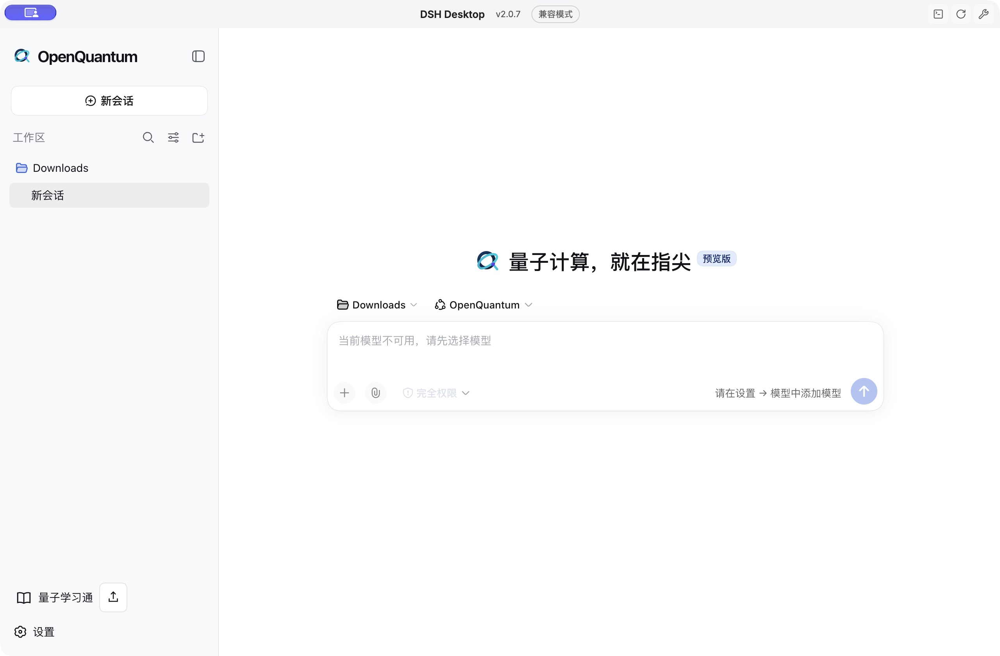

<h1 align="center"></h1>

<p align="center"><strong>Для исследований с ИИ сначала установите OpenQuantum.</strong><br /><sub>Открытая платформа квантовых агентов и приложений</sub></p>

<p align="center"><a href="../../README.md">简体中文</a> · <a href="./README.en.md">English</a> · <a href="./README.ja.md">日本語</a> · <a href="./README.ko.md">한국어</a> · <a href="./README.es.md">Español</a> · <a href="./README.fr.md">Français</a> · <a href="./README.de.md">Deutsch</a> · <a href="./README.pt.md">Português</a> · <a href="./README.ru.md">Русский</a> · <a href="./README.ar.md">العربية</a></p>

OpenQuantum — открытая платформа квантовых агентов и приложений, которая помогает применять ИИ к конкретным исследовательским задачам. Начните с поддерживаемой симуляции схем, расчёта основного состояния или анализа динамики; используйте специализированные инструменты и проверяйте результаты. Можно также работать со встроенными приложениями или добавлять собственные методы. Сервисы моделей и вычислительные ресурсы настраиваются независимо.

**Выполните одну задачу, затем примените метод к своему вопросу.** Запустите пример, измените входные данные и проверьте результаты. Сохраните код, параметры и выходные данные для следующего исследования.

**[Установить плагин Codex](../integrations/CODEX_AGENT_INSTALL.md)** · [Установить Desktop](../DESKTOP_INSTALLERS.md)

**Доступен OpenQuantum 0.8.3:** [Desktop](https://github.com/xi-zhao/OpenQuantum/releases/tag/v0.8.3) · [Плагин Codex](https://github.com/xi-zhao/OpenQuantum/releases/tag/codex-v0.8.3). Оба выпуска используют одну версию продукта. Tools, MCP и Skills распределены по восьми категориям назначения; добавлены поиск и фильтры состояния. Ярлыки Desktop используют значок OpenQuantum.



## Возможности

Qiskit и TyxonQ обеспечивают моделирование схем, PyZX — оптимизацию, Graphix — вычисления на основе измерений, Symmer — сокращение числа кубитов с использованием симметрий, PauLie — анализ алгебр Ли. TeNPy, SQD и Flow-VQE предназначены для основных состояний и химии. Mitiq поддерживает смягчение ошибок; Stim, PyMatching, Deltakit и BP+LSD — их коррекцию. Dynamiqs, OQuPy, TJM и Clifft используются для динамики и шума, FatQat — для экспериментов со сверхпроводящими и атомными системами. Также доступны обнаружение устройств через FieldQKit и учебное приложение Quantum Learning.

В исходный код `main` также входят разрезание схем по вентилям и восстановление средних значений с QCut, оптимизация схем с Compact и расчёт возбуждённых состояний методом VQD с OpenQARP. Эти подключения включены по умолчанию, но требуют подготовки зависимостей. QSVM с угловым ядром cqlib-qml и инструменты схем FlagQuantum по умолчанию выключены и включаются по необходимости. См. [область применения и проверки](../integrations/CANDIDATE_LIBRARIES.md).

Текущий исходный код содержит **157 Skill** (144 доступны для автоматического выбора, 13 — ручные указатели), **91 подключение MCP** и **5 нативных квантовых Tool**. Доступность зависит от включённых подключений и подготовленных сред. См. [руководство по выбору](../integrations/CAPABILITY_SELECTION.md).

v0.8.1 предоставляет доступ к публичным API в **85 средах SDK и исходного кода**. Агент может писать собственные программы, сочетать API и сохранять полные результаты, выходя за рамки готовых примеров Tool. Зависимости нужно явно подготовить для каждой задачи. Ограничения платформ, учётных записей, лицензий и дополнительных бэкендов сохраняются. Объём инженерных проверок указан в [отчёте об интеграции](../integrations/FULL_SDK_ACCESS.md). Приёмка на реальных исследовательских задачах не проводилась; `scientificValidation=not_evaluated`.

v0.6.0 объединяет **52 пакета возможностей SDK** из трёх групп: [17 SDK поставщиков](../integrations/VENDOR_SDKS.md), [20 возможностей компаний и научных организаций](../integrations/SDK_EXPANSION.md) и [15 интерфейсов сетей, управления, оптики и облака](../integrations/SDK_GAPS.md). Они охватывают дифференцируемые схемы, оценку ресурсов, химические операторы, фотонику, компиляцию импульсов и квантовые сети; [Bloqade Analog](../integrations/BLOQADE_ANALOG.md) добавляет локальное моделирование атомных массивов. Каждый адаптер предоставляет документированные операции. Учётные записи, аутентификацию, права и лицензии настраивает пользователь. Локальные проверки не подтверждают реальные облачные подключения, работу QPU или научную приёмку.

Все **66 руководств quantum-skills** UnitaryLab адаптированы в нативные Skills. **49 исполняемых примеров** охватывают **39 исходных модулей алгоритмов** и дополнительные методы из руководств. Используются Qiskit, PennyLane, quimb, PySCF и NumPy/SciPy без закрытой среды исполнения UnitaryLab. Это не означает полной совместимости API; различия указаны в [таблице покрытия](../integrations/UNITARYLAB_OPEN_COVERAGE.md).

Также доступны моделирование гамильтонианов Паули методами Trotter / qDrift, [преобразование Qiskit/Cirq через qBraid, измерения и исходные значения чётности Clifft, а также запросы QDMI к настроенному C-драйверу](../integrations/QUANTUM_INTEROP.md). Данные демонстрационного драйвера QDMI не отражают состояние реального подключённого QPU.

У каждой интеграции свои зависимости и научная область применимости. Успешный локальный расчёт не доказывает производительность реального оборудования. Завершённый вызов инструмента сам по себе не означает прохождение научной проверки.

## Почему OpenQuantum

**От вопроса к расчёту.** Опишите поддерживаемую задачу обычным языком, и агент вызовет специализированные инструменты. Вы задаёте входные данные и физические предположения и оцениваете результаты.

**Каждое исследование — отправная точка для следующего.** Рабочая среда сохраняет входные данные и результаты инструментов, чтобы продолжать работу с другими параметрами. Научная проверка зависит от возможностей конкретного инструмента.

**Ваши методы могут использовать другие.** Можно добавлять Skills, вычислительные инструменты, учебные материалы и приложения. Модели и вычислительные ресурсы настраиваются отдельно; авторство и лицензии исходных проектов сохраняются.

## Быстрый старт

Для локальной работы одного пользователя можно выбрать установщик приложения или запуск из исходного кода.

### Установщик настольного приложения

OpenQuantum 0.8.3 использует оригинальный [anywhere-labs DSH Desktop 2.0.7](https://github.com/anywhere-labs/dsh-desktop/releases/tag/v2.0.7) и отдельный архив возможностей OpenQuantum. Harness остаётся на `0.1.5-rc.1`. В архив входят Node.js и uv; запустите `install.command` на Mac или `install.cmd` на Windows. Бренд, квантовые компоненты, Quantum Learning и обновления сохраняются с минимальными изменениями исходного интерфейса. См. [установку и обновление](../DESKTOP_INSTALLERS.md).

Сначала установите оригинальный DSH Desktop. Скачайте архив для Mac Apple Silicon, Mac Intel или Windows x64 из [Release 0.8.3](https://github.com/xi-zhao/OpenQuantum/releases/tag/v0.8.3) и проверьте его по `SHA256SUMS` перед распаковкой. Установщик создаёт `OpenQuantum.app` на Mac или `OpenQuantum.lnk` на Windows со значком OpenQuantum. Оригинальный клиент сохраняет своё название и версию. Обновления сохраняют существующие Skills, маршруты моделей и настройки MCP. Вычислительные среды и Quantum Learning требуют подготовки по документации.

### Codex

Скачайте [полный установочный пакет 0.8.3](https://github.com/xi-zhao/OpenQuantum/releases/download/codex-v0.8.3/openquantum-0.8.3-codex-install.zip) и следуйте [инструкции](../integrations/CODEX_AGENT_INSTALL.md). Плагин предоставляет 134 Skills и 71 научный Tool в диалогах Codex. Нужны совместимый Codex, Node.js 24 или новее и npm; научные зависимости устанавливаются по мере необходимости.

### Запуск из исходного кода

Для разработки или использования возможностей `main` подготовьте Git, Node.js 24 или новее и uv для инструментов Python, затем выполните следующие шаги.

[uv](https://docs.astral.sh/uv/getting-started/installation/)

```bash
git clone https://github.com/xi-zhao/openQuantum.git
cd openQuantum
npm ci
npm run dev
```

Откройте ссылку для входа из журнала запуска. После аутентификации в браузере появится рабочая область.

### Настройка модели

В разделе Настройки → Модели укажите URL провайдера OpenAI-compatible Chat Completions, название модели и ключ API. Выберите Agent Preset OpenQuantum. Для запуска инструментов модель должна поддерживать Tool Calling. После новой установки Desktop список моделей пуст. Добавьте нужный сервис самостоятельно. Учётные данные модели и квантового облака настраиваются отдельно.

Локальный эталонный пример с фиксированным двухкубитным гамильтонианом работает без ключа модели.

```bash
npm run demo:quantum-ground-state
```

Перед выполнением следующей задачи FatQat из исходного кода явно подготовьте окружение в корне репозитория. На этом этапе возможна загрузка зависимостей; вычислительный вызов не устанавливает их автоматически.

```bash
node scripts/setup-paper-tools.mjs fatqat-workbench
```

Для примеров алгоритмов начните с `npm run capability:algorithms:setup -- --minimal`. При необходимости добавьте `--group gradients`, `--group pennylane`, `--group tensor` или `--group chemistry`; ранее установленные группы сохраняются. Без аргументов по-прежнему готовится полное окружение. Оно включает PySCF, поэтому для Windows рекомендуется WSL; численная проверка выполнена на CPU macOS. См. [инструкции запуска](../../examples/quantum-algorithms/README.md).

После обновления исходного кода повторите подготовку используемых возможностей, перезапустите рабочую среду и откройте новую сессию. Существующие Python-окружения проверяются и синхронизируются на прежнем месте. [Подготовка и обновление окружений](../integrations/LOCAL_ENVIRONMENTS.md).

После настройки модели попробуйте запрос: «С помощью FatQat подготовь состояние Белла из двух кубитов в нулевом состоянии. Примени H к q0, затем CX с управляющим q0 и целевым q1. Сравни точные вероятности с 1024 измерениями при seed=7». Идеальные вероятности 00 и 11 равны 50% каждая. Проверьте фактические входы инструмента и результаты расчёта.

### Настольное приложение

Для сборки Desktop из той же рабочей копии завершите установку из исходников и подготовьте Corepack и системные инструменты сборки C++.

```bash
npm run desktop:setup
npm run desktop:verify-install
npm run desktop -- --source
```

Web и Desktop используют общие данные и настройки Harness при запуске из одной рабочей копии исходного кода. Закройте другой хост перед использованием того же каталога данных.

## Quantum Learning

Подготовьте учебное приложение в той же рабочей копии репозитория, из которой запускаете OpenQuantum.

```bash
npm run learning:ui:setup
```

Откройте Quantum Learning на боковой панели. Для каждого нового Git worktree нужна отдельная установка. При сообщении о неполной установке выполните указанную команду в этом worktree и откройте приложение снова. Интеграция сохраняет материалы, классы и редактор OpenMAIC; доступ к моделям проходит через Harness. Учебные данные хранятся отдельно от журнала сеансов рабочей области.

## Языки

В разделе Настройки → Общие → Язык доступны упрощённый китайский, английский, японский, корейский, испанский, французский, немецкий, португальский, русский и арабский. Выбор сохраняется и синхронизируется с Quantum Learning. Для арабского используется направление справа налево. Существующие разговоры, учебные материалы, пользовательские Skills и результаты инструментов не переводятся. Некоторые системные диалоги используют английский для языков, отличных от китайского и английского.

## Документация и участие

Skills предоставляют знания и процедуры, а Tool Providers регистрируют исполняемые инструменты. Возможности, требующие научной проверки, используют независимый Validator и доказательства для определения приемки. OpenQuantum повторно использует среду выполнения DeepSeek Harness. Подробные инструкции по использованию и расширению доступны в английской и китайской версиях.

[English](./README.en.md) · [中文](../../README.md) · [Documentation](../README.md) · [Contributing](../../CONTRIBUTING.md) · [Issues](https://github.com/xi-zhao/openQuantum/issues)

```bash
npm run harness:config
npm run desktop:check
npm run check
```

## Долгосрочные планы и RSI

Мы исследуем взаимодействие квантовых вычислений, HPC и ИИ, развитие приложений и учебных материалов, а также улучшение методов исследования. Рекурсивное самоулучшение (RSI) остаётся исследовательским замыслом: описанный цикл пока не реализован. Для него необходимы независимые проверки, сравнение на новых задачах, учёт полной стоимости, разрешение пользователя и возможность отката версии.

[Подробная дорожная карта](../../README.md#rsi).

## Лицензия

Собственный код OpenQuantum распространяется по лицензии MIT. DeepSeek Harness, OpenMAIC и проекты квантового ПО сохраняют авторство и свои лицензии. Перед распространением или включением необязательной интеграции ознакомьтесь с Third-party notices.

[MIT](../../LICENSE) · [Third-party notices](../../THIRD_PARTY_NOTICES.md)
