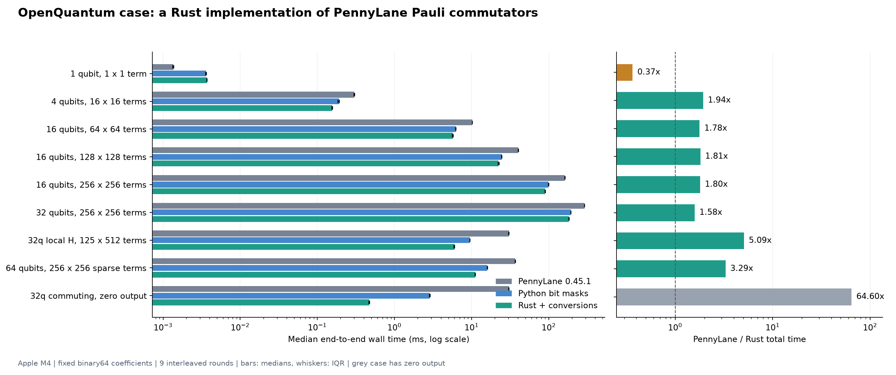

# OpenQuantum × PennyLane：Rust Pauli 对易子案例

实测日期：2026-10-20。工程与数值检查通过，独立审阅通过；central Acceptance Builder 未参与，本案例不宣称生成正式科学 Acceptance Report。

## 实测结论

实测硬件 Apple M4 上，PennyLane 0.45.1 的代表案例为 **30.62 ms → 6.02 ms，5.09×**。该任务计算一个 32 量子位、125 项局域 Hamiltonian 与一个含 512 项的二体算符和的**单个对易子**。时间包含从 PennyLane 对象转入 Rust、计算、返回及重建 PennyLane 对象。

位编码 Python 的完整调用为 9.50 ms，Rust 为 6.02 ms，后一步的收益为 1.58×。同为预编码输入时，Python 内核 4.198 ms，Rust 内核 0.213 ms，约 19.72×。整体加速同时包含数据表示与执行实现的变化，不能全部归因于 Rust 语言。



| 场景 | PennyLane / ms | 位编码 Python / ms | Rust 完整调用 / ms | 完整调用加速 | 非零输出项 |
| --- | ---: | ---: | ---: | ---: | ---: |
| 单比特 X 与 Y | 0.001359 | 0.003619 | 0.003715 | 0.37× | 1 |
| 4 位随机算符和，16 × 16 项 | 0.301991 | 0.192102 | 0.156058 | 1.94× | 110 |
| 16 位稠密随机，64 × 64 项 | 10.191042 | 6.254459 | 5.731542 | 1.78× | 2063 |
| 16 位稠密随机，128 × 128 项 | 40.388833 | 24.679916 | 22.259000 | 1.81× | 8298 |
| 16 位稠密随机，256 × 256 项 | 162.220167 | 99.680375 | 89.940292 | 1.80× | 32687 |
| 32 位稠密随机，256 × 256 项 | 290.283625 | 193.913167 | 183.234500 | 1.58× | 32777 |
| 32 位局域 H 与二体算符和，125 × 512 项 | 30.621250 | 9.502542 | 6.018459 | 5.09× | 4325 |
| 64 位稀疏随机，256 × 256 项 | 36.744500 | 16.011791 | 11.173875 | 3.29× | 5888 |
| 32 位全可交换，输出为零 | 30.489333 | 2.880167 | 0.471958 | 64.60× | 0 |

单比特小任务的完整 Rust 调用更慢；全可交换场景返回零，因而可以很快跳过构造输出。两者均保留在全表中。全可交换场景的大倍数不能概括一般任务。代表案例是对算符和的一次对易子计算，文件 ID 中的 pool512 不表示做了 512 次独立梯度计算。

## 研究问题与范围

计算 [H, A] = HA − AH。代表输入是各向异性 Heisenberg 链加局域 Z 场，以及随机固定实系数的二体可观测量之和。它可用于海森堡方程的算符计算步骤；本次没有积分时间演化或计算完整算法的运行时间。

本原型只处理固定、有限的 binary64 实数/复数系数，最多 64 个可映射 wire，返回 PauliSentence；不做近似截断，只移除精确零项。拒绝自动微分量、广播数组、非有限系数、超出支持精度的系数和结果溢出。它是一个算符代数子任务，不是 PennyLane 整体、完整 VQE/ADAPT 或量子模拟器的性能测试。

## 为什么同时测 Python 位编码

位编码 Python 的完整调用为 9.50 ms，Rust 为 6.02 ms，后一步的收益为 1.58×。同为预编码输入时，Python 内核 4.198 ms，Rust 内核 0.213 ms，约 19.72×。整体加速同时包含数据表示与执行实现的变化，不能全部归因于 Rust 语言。

Pauli word 写成 P(x,z)=i^popcount(x&z) X^x Z^z。对易的项对直接跳过；反对易时使用 [P,Q]=2PQ，保留复相位与系数合并。Python 控制与 Rust 使用同样的位掩码、预计算 Y 计数、相位、筛选和累加顺序。相位指数可为负数，Rust 使用有符号余数规范化。

PennyLane 基线直接调用其优化的 `PauliSentence.commutator()`，不使用更慢的两次乘法作为基线。原型未使用 GPU、并行 Rust 或有损系数截断。输入、双向转换及输出对象构造均计入主要完整调用指标；预编码内核时间仅作分解。

## 核验与测量方法

独立 Kronecker 矩阵穷举覆盖 1–3 位全部 4,368 对 Pauli 单项，结果精确一致。40 组随机复系数算符和同时比较全部 Pauli 系数与独立矩阵，最大矩阵绝对误差 1.42e-14。另外覆盖相消、极小非零系数、混合 wire 标签、实际 64-wire 往返、65-wire 拒绝和非有限结果拒绝；共 96 条验证记录。9 个计时场景中的四种对照实现也逐项核对，全部通过。

固定 plan.json 中的输入类型、规模与 seed；同进程、每方法预热 2 次，9 轮打乱方法次序，报告中位数、四分位区间及全部 405 条原始样本。小任务自动批量重复，最多 16,384 次/样本；较大任务通常每样本 1 次。计时使用 perf_counter_ns，计时期间关闭循环 GC。Rust 单线程，释放 GIL 不启动线程；BLAS/OpenMP 等环境上限设为 1。生成输入、核验、环境安装和编译不计入热运行耗时。未专门测量峰值内存，未做跨机器或跨平台性能验收。

首次本地 release 构建 12.05 s（Rust crates 已缓存），复核后增量构建 1.69 s。它们与 SDK 准备均不包含在热运行时间中。

## OpenQuantum 实际路径与复跑

本案例读取已安装 OpenQuantum 0.8.4 的 `pennylane-differentiable` Skill。已安装 MCP 服务的实际 tools/list 返回发现与准备入口；通过 MCP 协议依次执行 find_openquantum_skills、prepare_openquantum_skill，并查询至 ready。随后由 Skill 的 SDK 定位器返回固定 PennyLane 0.45.1 环境，宿主代码工具执行本目录的 Rust 构建、Python 验证和计时。未修改插件代码、能力开关、共享 SDK 的包版本或模型路由。

本聊天的可见工具清单没有发现/准备入口，因此准备回执来自对同一已安装 MCP 服务的直接协议调用；本次不把它称为原生侧边页点击、原生 Tool 菜单或新用户安装体验验收。该案例展示了完成研究软件实验的一条路径，没有做“有/无 OpenQuantum”的科研生产率对照。

```bash
# 先由 OpenQuantum 为本任务准备 pennylane-differentiable 的原生 SDK。
# LOCATOR 是已安装 Skill 的 scripts/sdk-access.mjs 的绝对路径。
python3 reproduce.py --locator "$LOCATOR" --node "$NODE" --steps build validate benchmark export_outputs
```

`reproduce.py` 每次运行先通过已安装 Skill 的定位器检查权限与 prepared 状态，使用返回的解释器及 environment；它不会安装依赖或更改能力开关。Rust 依赖由 Cargo.lock 固定，build 步骤显式调用 cargo build --release --locked。图表可用已有 Matplotlib 环境运行 `python report.py` 再生成；绘图环境不参与科学计算。

## 文件与证据

- [完整网页报告](results/report.html)、[SVG 图表](results/timings.svg)。
- [逐场景计时及样本](results/benchmark.json)、[全部原始计时](results/raw-timings.csv)。
- [固定输入](results/inputs.json)、[完整参考输出](results/reference-outputs.npz)、[完整 Rust 输出](results/rust-outputs.npz)、[输出重读核验](results/output-replay.json)、[核验记录](results/validation.json)。
- [OpenQuantum 准备回执](results/openquantum-preparation.json)、[SDK 定位结果](results/openquantum-sdk.json)、[源码与扩展摘要](results/provenance.json)。
- [独立审阅记录](results/review.md)、[首轮保留数据及修订原因](results/first-run/NOTE.md)。

原始随机生成器、Rust 与 Python 源码、Cargo.lock、预定义输入计划均在本目录。计时只针对已列出的本机输入，未比较全部第三方高性能 Pauli 库，不宣称最快实现。

## 来源与许可

- [PennyLane PauliSentence](https://docs.pennylane.ai/en/stable/code/api/pennylane.pauli.PauliSentence.html)：接口、基线与算符表示。
- [PennyLane 官方实现](https://docs.pennylane.ai/en/stable/_modules/pennylane/pauli/pauli_arithmetic.html)：优化对易子路径，实际测量使用 OpenQuantum 固定发行版。
- [PyO3 构建文档](https://pyo3.rs/v0.29.0/building-and-distribution.html)：复用 Rust/Python 扩展接口。Cargo.lock 固定 PyO3 0.29.0（MIT/Apache-2.0）。
- 自有案例代码沿用仓库 MIT 许可；PennyLane 沿用其 Apache-2.0 许可。本实验不是 PennyLane 官方项目或官方性能声明。
