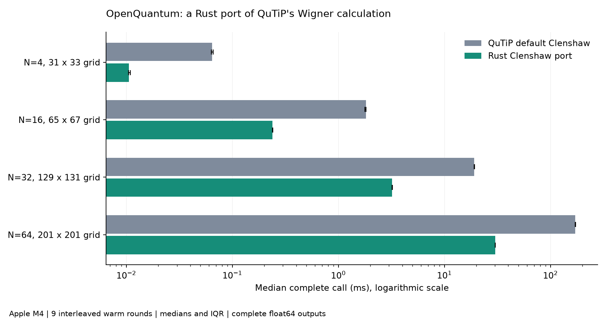
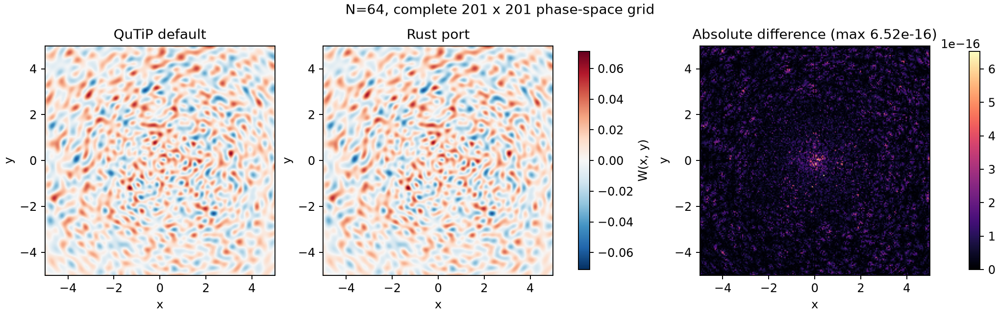

# 用 OpenQuantum 将 QuTiP Wigner 计算移植到 Rust

这次新增了实际的 Rust 计算内核：以 QuTiP 5.3.1 默认 Wigner 算法为对照，保留 Clenshaw 递推、相同输入和完整双精度二维输出，交付可运行代码、实测数据与独立结果核对。

## 代表任务结果

在 Apple M4 上，对 **64 维单模 Fock 空间密度矩阵、201×201 相空间网格**计算完整 Wigner 函数：

| 实现 | 完整调用耗时 |
| --- | ---: |
| QuTiP 默认 Clenshaw | 171.772 ms |
| Rust 移植版 | **30.183 ms** |

**完整调用提速 5.69 倍。** 数据为单线程设定下 2 次预热、9 轮交错执行的中位数。包含 Qobj 输入读取、检查、编码、递推准备、Rust 调用与完整可写 NumPy 输出；环境准备、编译、输入生成和结果核验不计入热运行耗时。没有预先编码输入、预存递推状态、缩小网格、降精度或裁剪负值。



## 全部预定规模

| 输入 | Fock 维数 | 网格 | QuTiP / ms | Rust / ms | 提速 |
| --- | ---: | --- | ---: | ---: | ---: |
| tiny | 4 | 31×33 | 0.0645 | 0.0105 | 6.12× |
| small | 16 | 65×67 | 1.8177 | 0.2396 | 7.59× |
| medium | 32 | 129×131 | 19.1513 | 3.2149 | 5.96× |
| representative | 64 | 201×201 | 171.7721 | 30.1832 | 5.69× |

全部 144 条原始计时、四个规模的完整输入输出和逐轮输出摘要均保留。每轮计时结束后，对该轮返回的完整数组进行核对与哈希；核验在计时区间之外。

## 结果怎样核对

- 主核验共有 **272 项通过**，包括完整网格、Hermitian 矩阵基、30 个随机复密度矩阵、真空、Fock 态与带正负虚相干的解析叠加态。Fock 态最高核对到 40 光子。
- Rust 与四个规模 QuTiP 默认完整输出的最大绝对差为 **6.52e-16**；与独立 Laguerre 多项式求和及解析公式的最大绝对差为 **6.33e-15**。容差固定为 atol=rtol=1e-12。
- 核对非方形网格、不同 g、ket/bra/CSR 输入、可写 float64 输出与负 Wigner 值；明确拒绝不支持的 offset、多模 dims、非 Hermitian、非有限或溢出输入，以及 NumPy 复数缩放参数。
- 三个 Rust 单元测试核对解析态与标量/分块递推。独立审阅直接检查计算源码和保存证据；见[审阅记录](results/review.md)。这不是平台正式科学 Acceptance Report。



## 其他现有方法的对照

同时测量 QuTiP 的 iterative 与 Laguerre 方法，输入和完整输出相同。代表任务：

| 方法 | 中位数 / ms | 对独立公式的最大差 | 满足固定容差 |
| --- | ---: | ---: | --- |
| QuTiP default Clenshaw | 171.772 | 1.45e-15 | 是 |
| QuTiP iterative | 332.419 | 0.0004 | 否 |
| QuTiP Laguerre | 3982.232 | 5.23e-16 | 是 |
| Rust Clenshaw port | 30.183 | 1.47e-15 | 是 |

代表输入中，满足固定容差的最快 QuTiP 对照是 **QuTiP default Clenshaw**，相对它的 Rust 提速为 **5.69×**。iterative 在 medium 与 representative 输入上的数值差异原样保留，不放宽 Rust 容差，也不将其当成同精度的可用对照。FFT 方法返回不同坐标网格，不纳入本次相同网格比较。

## OpenQuantum 如何完成这个案例

1. 在 Codex 中按研究任务选用已安装 OpenQuantum 0.8.4 的 quantum-sdk-workbench Skill，实际调用发现与准备接口，准备 fatqat-workbench 的固定 QuTiP 环境。
2. 使用返回的解释器和环境读取 QuTiP API、编写 Rust 移植与 Python 适配器。在用户工作区用已锁定 PyO3 构建，不修改共享 SDK 或上游 QuTiP。
3. 使用同一个 Qobj 和坐标分别调用原版与 Rust，保存完整计算结果、原始计时、源码摘要与核验记录，安排独立科学审阅。

这条路径使用 Codex 的 AI 编程与代码执行能力，以及 OpenQuantum 的领域 Skill 和固定 SDK；不另配模型 API，不调用云计算或 QPU。

## 复跑

先在 OpenQuantum 中准备 quantum-sdk-workbench 的 fatqat-workbench SDK，再从仓库运行：

```bash
python3 experiments/qutip-rust-wigner/reproduce.py --node "$NODE" --locator "$LOCATOR"
```

LOCATOR 指向已安装 quantum-sdk-workbench/scripts/sdk-access.mjs；NODE 为可用 Node.js。需要本机 Cargo/Rust，构建使用 Cargo.lock 与 release profile。运行器检查准备状态，使用 SDK 返回的解释器与 environment；计算阶段不安装依赖。`--phase validate --output /path/to/checks` 可只做数值核验并写到独立目录；默认 `--phase all` 依次构建、核验、计时并生成报告，更新本案例 results 与 README；`--output /path/to/run` 将构建日志、数值、计时、图表及 README 全部保存到指定目录，不改写已提交的案例证据。`--phase report --output /path/to/run` 可使用同一已准备 SDK 从该目录保存的数据重新生成报告。

## 方法与适用范围

Rust 移植 QuTiP 的 Clenshaw 递推，按短网格块计算并复用每次调用内的递推常数。使用标准 Rust/PyO3、binary64 和系统数学库，没有 fast-math、多线程或 GPU。Python 适配器保留同一单模 Fock 基、g 约定与 W[iy,ix] 坐标顺序；g=√2 对应 hbar=1。

支持 N≥2 的单模 ket/bra 或有限 Hermitian 算符、有限非空实坐标、正有限实 g、offset=0。实际计时使用正规化正半定密度矩阵。接口检查 Hermitian 性，不为任意输入做正半定性和归一化验收。多模 Wigner、非零 Fock offset、FFT、动力学与整个 QuTiP 的 Rust 重写不在本案例范围内。

编译和热运行分别记录；尚未测量冷安装、峰值内存、跨机器表现或完整动力学工作流。初始标量原型的探索数据与失败日志另存，未混入正式中位数。

## 证据与来源

- [源码和证据摘要](results/provenance.json) · [独立审阅](results/review.md) · [原始计时](results/raw-timings.csv) · [数值核验](results/validation.json)。
- [QuTiP Wigner 官方源码](https://qutip.readthedocs.io/en/stable/_modules/qutip/wigner.html) · [PyO3](https://github.com/PyO3/pyo3)。
- Rust 递推移植遵守 QuTiP BSD-3-Clause，完整许可与来源见 [LICENSE.txt](LICENSE.txt)、[NOTICE.md](NOTICE.md)；不是 QuTiP 官方发行或背书。
